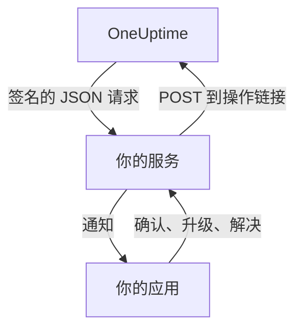

# 自定义通知渠道

自定义渠道会把值班呼叫发送到你自己运行的服务：你公司自己的应用、寻呼系统，或检查离开你网络的内容的网关。你只需为整个服务器添加一次，所有人无需任何设置就能通过它接收呼叫。在 Admin Dashboard 中，它们叫作 **Custom Channels**。

> [!NOTE]
> 自定义渠道属于 [OneUptime Enterprise Edition](/docs/self-hosted/enterprise)，需要包含该功能的 Enterprise 许可证。Community Edition 没有 **Custom Channels** 页面，也不会向任何渠道发送内容。请参阅 [没有许可证时](#没有许可证时)。

:::cards
- [添加渠道](#添加渠道): 一个名称、一个 URL 和一个签名密钥。
- [你的服务会收到什么](#你的服务会收到什么): 每次呼叫为每人发送一个签名的 JSON 请求。
- [处理呼叫](#处理呼叫): 在你自己的应用中确认、升级或解决。
- [投递与重试](#投递与重试): 你的服务宕机时会发生什么。
- [其他通知](#其他通知): 负责人通知、备注和班次，发给想要的人。
- [没有许可证时](#没有许可证时): 哪些会停止，哪些会保留。
:::

## 工作原理



当值班策略呼叫某人，而此人的值班规则使用该渠道时，OneUptime 会向渠道的 URL 发送请求。请求说明这次呼叫是发给谁的（姓名和电子邮件）、与什么有关，并附带链接，供此人在你的应用中确认、升级或解决呼叫时由你的服务调用。

## 添加渠道

1. 在 Admin Dashboard 中，打开 **设置**，然后打开侧边菜单中的 **通知 > Custom Channels**（**通知** 默认折叠），并选择 **Add**。
2. 在 **Channel** 步骤中填写：
   - **名称**：人们在通知方式和值班规则中看到的名称，例如 `CorpoApp`。
   - **Webhook URL**：OneUptime 发送每次呼叫的地址。它可以位于你的私有网络中。
   - **Signing Secret**：OneUptime 会为你生成一个。把它复制到你的服务中，服务用它校验每个请求。编辑渠道时可以再次查看。
3. 在 **Delivery** 步骤中保存，然后选择 **Send test**，向你的服务发送一个 [测试请求](#测试请求)。

在 **Delivery** 步骤中，**Page everyone through this channel** 默认开启。此时 OneUptime 会把该渠道添加到每个项目中所有人的值班规则里，以及之后加入项目的每个人的规则里，并用它联系那些对已触发的事项没有规则的响应人。关闭它，即可让人们自行把渠道添加到自己的规则中。

人们可以在 **用户设置**、**通知方式**、**Custom Channels** 下看到该渠道和一个 **Send test** 按钮，并在值班规则中以 `Custom Channel: CorpoApp` 的形式选择它。他们无需任何设置：每次呼叫是发给谁的，你的服务都会知道。

要在不更改任何人规则的情况下停止发送，请编辑渠道并关闭 **开启**。原本会发往该渠道的呼叫会在值班日志中记录为未发送。删除渠道会删除所有使用它的值班规则。

## 你的服务会收到什么

每次呼叫都是一个带 JSON 请求体的 `POST` 请求：

| 请求头 | 内容 |
| --- | --- |
| `Content-Type` | `application/json` |
| `X-OneUptime-Event` | 事件，例如 `on-call.incident.created` |
| `X-OneUptime-Signature` | `sha256=` 加上原始请求体的十六进制 HMAC-SHA256，用渠道的签名密钥计算 |

```json title="An incident page"
{
  "version": 1,
  "event": "on-call.incident.created",
  "notificationId": "5f2c8a1e-6b1d-4c3a-9e7f-2a4b6c8d0e1f",
  "sentAt": "2026-10-27T03:14:15.000Z",
  "channel": { "id": "0b7e…", "name": "CorpoApp" },
  "title": "New Incident INC-42: API latency high",
  "message": "A new incident has been created: INC-42 (API latency high) in Agency A. Click to view details.",
  "project": { "id": "8d1f…", "name": "Agency A" },
  "team": { "id": "2c9a…", "name": "SRE" },
  "user": { "id": "4e6b…", "name": "Jane Tan", "email": "jane@example.com" },
  "recordType": "incident",
  "record": {
    "id": "9a3c…",
    "number": "INC-42",
    "title": "API latency high",
    "description": "p95 latency above 2 seconds for 5 minutes.",
    "severity": "Critical",
    "state": "Created",
    "url": "https://oneuptime.example.com/dashboard/8d1f…/incidents/9a3c…"
  },
  "onCallPolicy": { "id": "1d4e…", "name": "Primary" },
  "escalationRule": { "id": "7b2f…", "name": "Level 1" },
  "isPageAgain": false,
  "actions": {
    "acknowledge": "https://oneuptime.example.com/api/custom-notification-channel/page/5f2c…/acknowledge?token=…",
    "escalate": "https://oneuptime.example.com/api/custom-notification-channel/page/5f2c…/escalate?token=…",
    "resolve": "https://oneuptime.example.com/api/custom-notification-channel/page/5f2c…/resolve?token=…"
  }
}
```

| 字段 | 含义 |
| --- | --- |
| `version` | `1`。这个版本只会新增字段。 |
| `event` | `on-call.incident.created`、`on-call.alert.created`、`on-call.incidentEpisode.created`、`on-call.alertEpisode.created`，[其他通知](#其他通知) 为 `notification`，或 `test` |
| `notificationId` | 每次呼叫每人一个。用它丢弃你已经处理过的请求。 |
| `title`、`message` | 可直接显示，与推送通知显示的内容相同 |
| `user` | 这次呼叫发给谁。在你的应用中按 `email` 或 `id` 查找其账户。 |
| `team` | 呼叫此人所经由的团队；直接呼叫时为 `null` |
| `recordType`、`record` | 呼叫涉及的对象：`incident`、`alert`、`incidentEpisode` 或 `alertEpisode` |
| `onCallPolicy`、`escalationRule` | 呼叫此人的策略和级别 |
| `isPageAgain` | 当记录在一段时间前已被确认但仍未解决时为 `true` |
| `actions` | 你的服务为 [处理呼叫](#处理呼叫) 而调用的链接 |

发给多人的呼叫会为每人发送一个请求，每个请求都带有该人自己的链接，这样 OneUptime 就知道是谁做出的回应。标题、消息和描述合计不超过 16,384 个字符；更长的描述会被截断，并以“… (truncated — see OneUptime for the full text)”结尾。

### 校验签名

在解析之前，计算原始请求体的 HMAC，并与请求头进行比较：

```javascript title="Node.js"
const crypto = require("crypto");

function isFromOneUptime(rawBody, signatureHeader, secret) {
  const expected =
    "sha256=" + crypto.createHmac("sha256", secret).update(rawBody).digest("hex");
  const received = String(signatureHeader || "");

  return (
    received.length === expected.length &&
    crypto.timingSafeEqual(Buffer.from(received), Buffer.from(expected))
  );
}
```

## 处理呼叫

当此人在你的应用中按下按钮时，你的服务会向 `actions` 中对应的链接发送一个 `POST` 请求。无需 API 密钥：每个链接都带有仅用于这次呼叫的令牌，有效期 7 天，操作会记录为被呼叫的人所做。

| 操作 | 作用 |
| --- | --- |
| `acknowledge` | 确认此人的呼叫，并随之确认事件、告警或片段 |
| `escalate` | 此人无法处理：立即呼叫值班策略的下一级，并停止呼叫此人 |
| `resolve` | 在此人自己的权限允许时，解决事件、告警或片段 |

```bash title="Acknowledge a page"
curl -X POST "https://oneuptime.example.com/api/custom-notification-channel/page/5f2c…/acknowledge?token=…"
```

响应会说明发生了什么，其中的文字可以由你的应用原样显示：

```json title="The answer"
{
  "action": "acknowledge",
  "result": "acknowledged",
  "message": "Acknowledged."
}
```

`result` 是 `acknowledged`、`alreadyAcknowledged`、`escalated`、`notEscalated`、`resolved` 和 `alreadyResolved` 之一。过期或错误的链接会以 4xx 状态和一条消息被拒绝。

## 其他通知

呼叫并不是人们收到的唯一通知：当他们负责的事件状态变化、有人发布备注、他们的值班班次开始等情况下，OneUptime 也会通知他们。每个人在 **用户设置 > 通知设置** 中选择这些通知分别发往哪里；只要有渠道处于开启状态，那里就会有 **Custom Channels** 列。在每个人自己打开之前，该列对所有人都是关闭的。

通知会发往每个已开启的渠道，每个渠道一个请求，`event` 设为 `notification`：

```json title="A notification"
{
  "version": 1,
  "event": "notification",
  "notificationId": null,
  "sentAt": "2026-10-27T03:20:00.000Z",
  "channel": { "id": "0b7e…", "name": "CorpoApp" },
  "title": "Incident INC-42 acknowledged",
  "message": "Incident INC-42 (API latency high) was acknowledged in Agency A.",
  "project": { "id": "8d1f…", "name": "Agency A" },
  "team": null,
  "user": { "id": "4e6b…", "name": "Jane Tan", "email": "jane@example.com" },
  "recordType": null,
  "record": null,
  "onCallPolicy": null,
  "escalationRule": null,
  "isPageAgain": false,
  "actions": null,
  "notificationType": "Send incident state changed notification when I am the owner of the incident",
  "url": "https://oneuptime.example.com/dashboard/8d1f…/incidents/9a3c…"
}
```

`title` 和 `message` 就是此人的推送通知会显示的内容。`notificationType` 是发送这条通知所依据的设置名称，`url` 链接到通知涉及的对象，或为 `null`。没有需要处理的操作，所以 `actions` 为 `null`。

## 投递与重试

当你的服务在 10 秒内以 2xx 状态应答时，请求即视为已投递。没有应答，或以 408、429 或 5xx 状态应答的请求，会在 1 秒后以及再过 4 秒后重新发送：总共三次尝试。其他任何 4xx 状态都不会重新发送。

每次尝试的结果都会记录在此人的值班日志中，包括渠道名称和你的服务应答的状态，但绝不包括 URL。未投递的呼叫不会停止值班策略：如果没有人确认，它会照常升级。如果你的服务是联系人们的唯一途径，请在规则靠后的位置保留一条电子邮件或短信规则。

## 测试请求

Admin Dashboard 页面上或个人通知方式中的 **Send test** 会发送一个请求，其中 `event` 为 `test`，按下按钮的人作为 `user`，`notificationId`、`record` 和 `actions` 为 `null`。可以用它在真正的呼叫到来之前试用你的服务。

## 没有许可证时

自定义渠道在 Enterprise Edition 的 14 天试用期内，以及许可证过期后 30 天的宽限期内都能工作。在此之后，或使用不包含该功能的许可证时：

- **不会向任何自定义渠道发送内容。** 原本会发往渠道的呼叫会在此人的值班日志中记录为未发送，测试也是如此。
- **不再提供渠道。** 渠道会从人们的通知方式、值班规则和通知设置中消失，就绪情况和回退也不再计入它们。
- **页面变为只读。** 你可以查看和删除渠道，但不能添加或更改，任何人也不能让规则或通知设置指向某个渠道。
- **不会删除任何内容。** 渠道以及使用它们的值班规则和设置都会保留。

一旦激活许可证，一切都会立即恢复，无需重启。在自定义渠道停止期间加入项目的人，其规则中不会添加呼叫所有人的渠道：他们可以自行添加。
