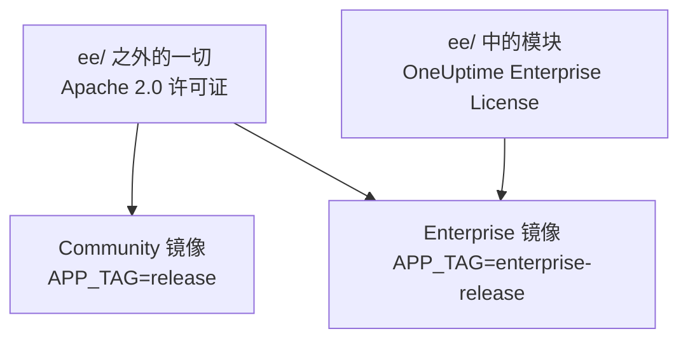
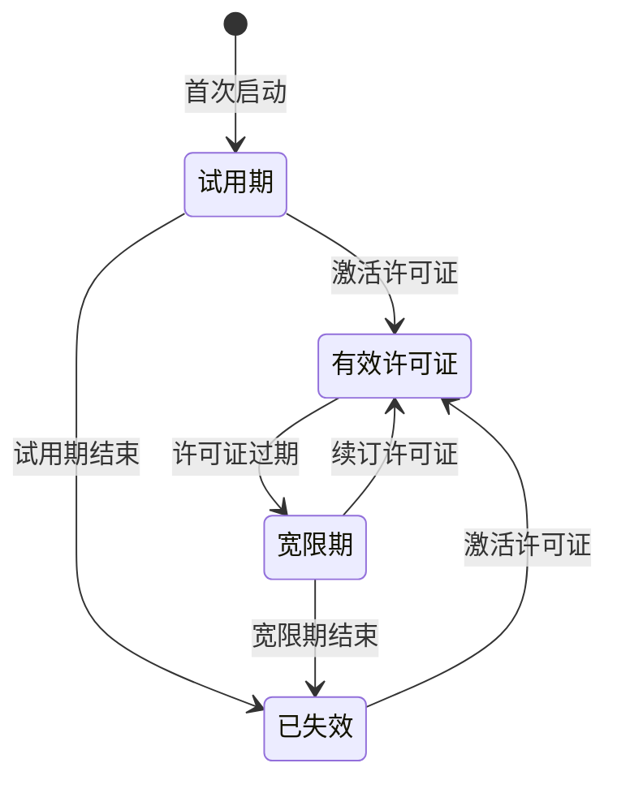

# 企业版

OneUptime 由同一个仓库构建，以两个版本交付：

- **Community Edition**：完整的监控、事件和可观测性平台，包括 SAML 和 OpenID Connect 单点登录，基于 Apache 2.0 许可证开源，可以免费自托管，规模不限。
- **Enterprise Edition**：Community Edition 加上仓库 [`ee/`](https://github.com/OneUptime/oneuptime/tree/master/ee) 目录中的企业模块。这些模块增加了 SCIM 预配，以及治理和实例管理功能。它们依据 [OneUptime Enterprise License](https://github.com/OneUptime/oneuptime/blob/master/ee/LICENSE) 授权，在生产环境中使用需要与你的用户数相符的 Enterprise 许可证。

两个版本是各自独立的容器镜像。Community 镜像不包含来自 `ee/` 的任何代码。OneUptime Cloud 运行的是 Enterprise Edition，在云端由你的套餐决定你能获得其中哪些功能。



> [!NOTE]
> **每个版本都有单点登录。** 项目和状态页的 SAML 与 OIDC 登录、全局 SSO 以及“Require SSO for login”都属于 Community Edition，任何许可证状态都不会将其关闭。

本页介绍每个版本包含的内容、如何运行 Enterprise Edition、许可的工作方式，以及切换版本时会发生什么。

:::cards
- [比较两个版本](#各版本包含的内容): Enterprise Edition 增加了什么。
- [运行 Enterprise 镜像](#运行-enterprise-edition): 只需一项设置，适用于 Kubernetes 或 Docker Compose。
- [激活许可证](#许可): 使用密钥在线激活，或使用签名令牌离线激活。
- [许可证到期时](#许可证过期或缺失时): 哪些会停止，哪些永远不会停止，以及如何恢复。
:::

## 各版本包含的内容

| 功能 | Community | Enterprise | OneUptime Cloud |
| --- | --- | --- | --- |
| 监控、告警、事件、值班、状态页、日志、指标、追踪、异常、仪表板、工作流、AI 功能、API 和 Terraform | 是 | 是 | 所有套餐 |
| 密码登录、双因素认证、团队、角色和 API 密钥 | 是 | 是 | 所有套餐 |
| 用于项目登录的 [SAML SSO 和 OpenID Connect](/docs/identity/sso) | 是 | 是 | Scale 套餐及以上 |
| 用于私有状态页登录的 SAML SSO 和 OpenID Connect | 是 | 是 | Scale 套餐及以上 |
| [全局（整个实例范围的）SSO 和 OIDC](/docs/identity/global-sso) | 是 | 是 | 不适用 |
| 用于项目和状态页的 [SCIM 预配](/docs/identity/scim) | 否 | 是 | Scale 套餐及以上 |
| 团队合规设置 | 否 | 是 | Scale 套餐及以上 |
| 审计日志 | 否 | 是 | Enterprise 套餐 |
| 保留期覆盖：按遥测类型设置保留期（日志、追踪、指标、性能剖析，可按日志严重级别和追踪状态设置规则），以及按服务和按资源设置保留期 | 否 | 是 | Scale 套餐及以上 |
| 管理端的 **Health** 仪表板：实例概览、后台队列、实例日志、PostgreSQL、Valkey、ClickHouse 集群、诊断日志和遥测接收 | 否 | 是 | 不适用 |
| 管理端的 **Query Console** | 否 | 是 | 不可用 |
| PostgreSQL 和 Valkey（Redis）健康告警 | 否 | 是 | 不适用 |
| ClickHouse 容量视图、容量告警和磁盘自动清理 | 是 | 是 | 不适用 |
| 管理员仪表板中的迁移状态、支持包和全局探测器 | 是 | 是 | 不适用 |
| Enterprise 许可证、席位和实例管理 | 否 | 是 | 不适用 |

在两个版本中，单点登录都包括针对项目、私有状态页和整个实例的“Require SSO for login”。

每个版本都有项目的默认遥测保留期，位于 **项目设置 > 遥测与 APM > 数据保留**。保留期覆盖是 Enterprise Edition 在此之上增加的功能。

在 OneUptime Cloud 上，付费功能在任何套餐中都可以随时关闭。试用（或降到更低的套餐）后仍保持设置的保留期覆盖会继续作用于新的遥测数据，因此在低于 Scale 的套餐中，保留期页面会在升级卡片下方显示它，并带有 **移除覆盖** 按钮。在任何套餐中都可以移除；再次设置则需要 Scale 套餐。已经存储的遥测数据保持其存储时的保留期。同样，只要项目仍要求 SSO，**项目设置 > 安全 > SSO** 就会在其升级卡片下方显示 **登录时要求使用 SSO** 开关，以便将其关闭。

“不适用”的行是实例管理功能。在 OneUptime Cloud 上，由 OneUptime 为你运营实例。

## 运行 Enterprise Edition

两个版本使用相同的配置、相同的数据库和相同的数据。切换版本只会改变你运行的镜像，其他一概不变。无论哪个方向都不需要迁移。

:::tabs
@tab Kubernetes
在你的 `values.yaml` 中设置镜像类型：

```yaml title="values.yaml"
image:
  type: enterprise-edition
```

然后照常升级：

```bash
helm upgrade my-oneuptime oneuptime/oneuptime -f values.yaml
```

之后 chart 会拉取每个镜像标签的 `enterprise-` 变体，例如 `oneuptime/app:enterprise-release`，或者在你固定 `image.tag` 时拉取 `enterprise-<version>`。设置 `image.type: community-edition`（默认值）即可运行 Community Edition。
@tab Docker Compose
在你的 `config.env` 中设置 `APP_TAG`：

```bash title="config.env"
APP_TAG=enterprise-release
```

使用 `enterprise-<version>` 固定某个版本。然后拉取镜像并重启：

```bash
npm run update
```

要回到 Community Edition，请设置 `APP_TAG=release` **和** `IS_ENTERPRISE_EDITION=false`。只要设置了 `IS_ENTERPRISE_EDITION=true`，`npm run update` 就会把 `APP_TAG` 改回 `enterprise-release`，而 Community 镜像会拒绝启动。
:::

### `IS_ENTERPRISE_EDITION` 已弃用

决定版本的是你运行的镜像。`IS_ENTERPRISE_EDITION` 不再启用企业功能，并将在未来的版本中移除。你可以不设置它。

在 Community 镜像上设置 `IS_ENTERPRISE_EDITION=true` **不会** 启用企业功能。相反，应用会 **拒绝启动**，这样落到 Community 镜像上的升级就永远不会悄无声息地停止 SCIM 预配（包括取消预配）和审计日志记录。错误信息会告诉你该设置什么：设置 `APP_TAG=enterprise-<version>` 以保留 Enterprise Edition，或设置 `IS_ENTERPRISE_EDITION=false` 以运行 Community Edition。使用 Helm 时不会出现这种情况：chart 会根据 `image.type` 推导出该变量。

`ONEUPTIME_EDITION=community` 会让 Enterprise 镜像以 Community Edition 的方式运行。这便于在真正降级之前先试一试。Enterprise 镜像会自行设置 `ONEUPTIME_EDITION=enterprise`；除了 `community` 之外，不要用其他值覆盖它。

## 许可

仓库根目录中的 [`LICENSE`](https://github.com/OneUptime/oneuptime/blob/master/LICENSE) 文件规定了哪个许可证涵盖哪些内容：`ee/` 目录中的所有内容都适用 [OneUptime Enterprise License](https://github.com/OneUptime/oneuptime/blob/master/ee/LICENSE)，第三方组件保留其所有者提供它们时所用的许可证，其余所有内容都适用 Apache 2.0 许可证。

新的 Enterprise Edition 安装以 **14 天试用期** 运行，从该安装首次启动 Enterprise Edition 时开始计算。试用期用于评估：在生产环境中使用 Enterprise Edition 需要依据 OneUptime Enterprise License 订阅。请在试用期结束前激活许可证：试用期结束后，SCIM、审计日志记录和保留期覆盖都会停止，企业配置会变为只读（参见[许可证过期或缺失时](#许可证过期或缺失时)）。如需许可证，请联系 [sales@oneuptime.com](mailto:sales@oneuptime.com)。

许可证通过 **版本标签** 管理，主管理员可以在管理员仪表板的页眉和 Dashboard 的页脚看到它。它显示许可证状态、席位使用情况，并向主管理员显示实例 ID。

### 在线激活（许可证密钥）

:::steps
1. 以主管理员身份登录并打开版本标签。
2. 输入你的许可证密钥并进行验证。
:::

安装会向 OneUptime 核对密钥，并存储收到的许可证。此后，它通过每日同步让许可证保持最新。要立即获取额外席位或续订之类的变更，请在版本标签上使用 **Refresh license**。

在线激活需要从 OneUptime 服务器到 `https://oneuptime.com` 的出站 HTTPS。如果服务器只能通过中继访问互联网，请将 `ENTERPRISE_LICENSE_SERVER_URL` 设置为中继的 `https://` 地址。中继必须把 `/api/enterprise-license/` 转发到 oneuptime.com。

### 离线激活（与网络隔离的安装）

没有通往互联网的路由的安装可以使用 **签名的许可证令牌** 代替密钥：

:::steps
1. 以主管理员身份登录，打开版本标签并记下 **实例 ID**。
2. 向 OneUptime（[sales@oneuptime.com](mailto:sales@oneuptime.com)）申请该实例 ID 的离线许可证令牌。
3. 将令牌粘贴到版本标签的令牌字段中并激活。
:::

安装会依据内置在你所用版本中的 OneUptime 签名密钥自行验证令牌。它从不联系 OneUptime。为某个实例 ID 签发的令牌会被其他所有安装拒绝，未指定实例 ID 签发的令牌（例如在线激活的安装收到的令牌）也会被拒绝。要续订或增加席位，请在当前令牌过期前激活新令牌。

> [!IMPORTANT]
> **离线激活需要一个信任 OneUptime 许可证签名密钥的版本。** 如果你的版本尚未包含该密钥，激活会失败并提示“this build does not trust the key that signed this token”。这种情况下，请在线激活，或升级到包含该密钥的版本。

### 每日许可证同步发送的内容

在线激活的安装每天向 OneUptime 发送一次报告。报告包含：

- 许可证密钥；
- 实例 ID（由安装生成的随机标识符）以及安装所配置的主机名（`HOST`）；
- 安装运行的 OneUptime 版本；
- 安装中的用户数；
- 每个用户转为小写的电子邮件地址的 **SHA-256 哈希**。OneUptime 用这些哈希把在你多个安装中都有账户的同一个人计为一个席位。普通用户的原始电子邮件地址从不发送；
- 安装的 **主管理员** 的电子邮件地址，以便 OneUptime 就续订和席位上限与你联系。

响应包含 OneUptime 当天所知的许可证信息：公司名称、到期时间、席位上限、你所有安装合计的用户数，以及在该许可证下登记的安装。安装的其他副本会在大约一分钟内获取变更。

当你激活或刷新许可证时，安装只发送许可证密钥、实例 ID、主机名和版本。

除此之外不发送任何内容。监控数据、遥测、日志和配置都不会离开安装。Community Edition 不发送其中任何内容，离线激活的安装也不发送。

### 许可证过期或缺失时

在 14 天试用期内，以及许可证过期后的 30 天内（宽限期），所有企业功能都能正常工作。在其中任何一个结束之前，版本标签都会发出警告。此后，在激活许可证之前，**SCIM、审计日志记录和保留期覆盖都会停止**，与 Community Edition 相同，企业配置也会变为只读。单点登录不是企业功能：SAML 和 OIDC 登录、全局 SSO 以及“Require SSO for login”在任何许可证状态下都一样工作。



| 状态 | 会发生什么 |
| --- | --- |
| **有效许可证** | 所有企业功能都能正常工作。新增用户不能超过许可的席位数。现有用户永远不会被移除。 |
| **试用期或宽限期**（无许可证安装的前 14 天，或许可证过期后的 30 天），或持有从未记录到期时间的许可证的安装 | 所有企业功能都能正常工作，版本标签会显示警告。在过期后的宽限期内，席位上限仍然适用。持有未记录到期时间的许可证的安装，会和无许可证的安装一样经历同样的 14 天试用期，并且不强制执行席位上限，因为它持有的许可证记录本身就不完整。 |
| **试用期或宽限期之后**（许可证已过期、缺失或无效，或许可证不包含该功能） | SCIM 预配、审计日志记录和保留期覆盖 **停止**（见下文）。企业配置变为 **只读**：你可以查看和删除它，但不能创建或更改它。为了让你能够应对事件，有一项更改始终可以进行：替换 SCIM 持有者令牌。在其他一切都只读时，SCIM 设置页面仍提供这项操作：在 SCIM 配置上使用 **重置 Bearer 令牌**，它会显示一次新令牌。通过 API，只发送 `bearerToken`（至少 32 个字符）。审计日志记录无法开启或扩大范围。企业版 Health 仪表板和 Query Console 被锁定。席位上限不再强制执行。 |

许可证失效时会停止的内容：

- **SCIM 预配停止。** 你的身份提供商的 SCIM 请求会被拒绝，包括取消预配，并且 SCIM 团队锁定会被解除，因此由 SCIM 推送组管理的团队可以手动编辑。
- **审计日志记录停止记录。** 此前已记录的审计日志会被保留。
- **保留期覆盖不再生效。** 新的遥测数据按项目的默认保留期保存。已经存储的遥测数据保持其写入时的保留期。你仍然可以通过 API 清除覆盖，但不能设置覆盖。

**不会** 停止的内容：

- **单点登录。** 项目、私有状态页、整个实例（全局 SSO）和移动应用的 SAML 与 OIDC 登录，以及“Require SSO for login”，都属于每个版本。许可证失效不会改变其中任何一项，单点登录配置也仍可编辑。
- **核心监控永远不受影响**：监视器、告警、事件、值班、状态页和遥测都会继续工作。
- **主管理员始终可以用自己的密码登录。**
- **不会删除任何内容。** SCIM 配置、审计日志和保留期覆盖都保持原样。

**一旦激活许可证，一切立即恢复**，无需重启：SCIM 预配、审计日志记录和保留期覆盖会带着你现有的配置回来。只有当 OneUptime 确知许可证已失效时，才会关闭它们。在它无法读取许可证状态时，例如服务器启动的片刻，SCIM、审计日志记录和保留期覆盖保持开启。

> [!WARNING]
> **如果你的身份提供商通过 SCIM 取消预配用户，请在试用期或宽限期结束前激活许可证。** 之后，SCIM 不再为你在身份提供商处移除的人员取消预配：他们的 OneUptime 账户会保留下来，除非“Require SSO for login”适用于他们，否则任何仍能访问此类账户电子邮件收件箱的人都可以设置密码并登录。如果你让许可证失效，请自行在 OneUptime 中移除这些用户。

## 从 Enterprise 切换到 Community

你的配置保留在数据库中。只要安装持有有效许可证，或仍处于试用期或宽限期，切换回 Enterprise 镜像就会把一切恢复原样。单点登录不会改变：SAML 和 OIDC 登录、全局 SSO 以及“Require SSO for login”在两个镜像上的工作方式相同。在 Community 镜像上：

- **SCIM 停止。** 它的预配端点不再存在，因此由 IdP 发起的 SCIM 调用会失败。这包括 SCIM 取消预配。
- **SCIM 团队锁定被解除**，因此曾由 SCIM 推送组管理的团队可以手动编辑。启动时，服务器会记录哪些项目的 SCIM 团队锁定已被解除。
- **审计日志记录停止。** 此前已记录的审计日志会被保留，但审计日志页面会显示升级提示。
- **保留期覆盖不再生效。** 新的遥测数据按项目的默认保留期保存，**项目设置 > 遥测与 APM > 数据保留** 以及每个服务和每个资源设置页面上的保留期卡片都会显示升级提示。覆盖保留在数据库中，切换回来后会再次生效。
- **企业设置页面显示升级提示。** 通过 API，你仍然可以读取和删除企业配置、重置 SCIM 持有者令牌，但不能创建或更改其他任何内容。审计日志记录无法开启。
- **企业版 Health 仪表板、Query Console 以及 PostgreSQL 和 Valkey 健康告警停止。** ClickHouse 容量监控与清理、迁移状态和支持包会继续工作。

> [!CAUTION]
> **在把一个身份提供商通过 SCIM 取消预配用户的安装切换到 Community 镜像之前，请检查谁拥有访问权限。** 没有 SCIM，你在身份提供商处移除的人员会保留他们的 OneUptime 账户，除非“Require SSO for login”适用于他们，否则任何仍能访问此类账户电子邮件收件箱的人都可以设置密码并登录。请先移除这些用户。

## 故障排除

:::details 升级后应用拒绝启动
Community 镜像上设置了 `IS_ENTERPRISE_EDITION=true`。设置 `APP_TAG=enterprise-<version>` 以保留 Enterprise Edition，或设置 `IS_ENTERPRISE_EDITION=false` 以运行 Community Edition，然后再次运行 `npm run update`。
:::

:::details 离线激活失败并提示“this build does not trust the key that signed this token”
你的版本是在信任 OneUptime 许可证签名密钥之前构建的。请在线激活，或升级到包含该密钥的版本。
:::

:::details 你的身份提供商的 SCIM 请求被拒绝
在 Enterprise 镜像上，说明许可证已失效：激活一个许可证，预配就会恢复，无需重启。在 Community 镜像上，SCIM 端点根本不存在。
:::

## 后续步骤

:::cards
- [升级](/docs/installation/upgrading): 迁移到新版本，以及在两个版本的镜像之间切换。
- [SSO](/docs/identity/sso): 单点登录，每个版本都有。
- [全局 SSO](/docs/identity/global-sso): 为整个实例使用一个身份提供商。
- [SCIM](/docs/identity/scim): 从你的身份提供商预配用户和团队。
:::
