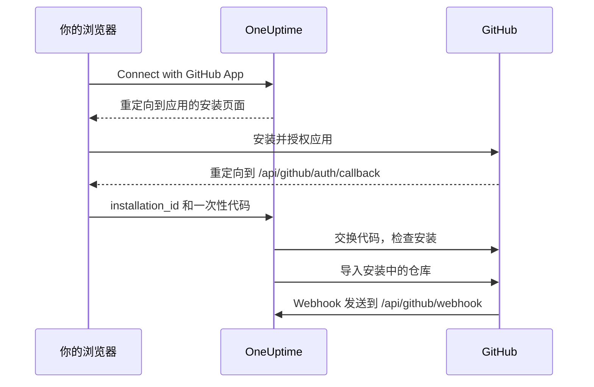

# GitHub 集成

使用你自己拥有的 GitHub App 将自托管的 OneUptime 连接到 GitHub。从 OneUptime 安装应用后，安装中的仓库会导入到你的项目并保持同步，AI 修复任务会创建 pull request，团队还可以在 GitHub 中提及该应用来把工作交给它。

本页面向运行 OneUptime 服务器的人员：你只需创建一次应用，之后每个项目都从 **代码存储库** 连接它。

:::cards
- [创建 GitHub App](#创建-github-app): 使用正确的 URL、权限和事件注册应用。
- [配置 OneUptime](#配置-oneuptime): 把应用的六个值交给服务器。
- [连接仓库](#连接仓库): 从 OneUptime 安装应用。
- [故障排除](#故障排除): 代码存储库中的消息是什么意思。
:::

## 工作原理

安装从 OneUptime 开始，而不是从 GitHub 开始：OneUptime 把你送往 GitHub 时使用的链接，正是把安装与你的项目绑定在一起的东西。



- 浏览器重定向携带安装信息和一次性 OAuth 代码。OneUptime 交换该代码，以确认安装该应用的 GitHub 账号管理着这个安装，然后导入其中的仓库。
- Webhook 保持仓库列表同步，并把工作交给应用：提及、分配、触发标签和评审请求。GitHub 用 webhook secret 为每个 Webhook 签名，无法验证的 Webhook 会被 OneUptime 拒绝。

## 开始之前

- 一个能够为要安装应用的组织或用户创建 GitHub App 的 GitHub 账号。要在组织中安装，你需要是该组织的所有者，或者让所有者批准请求。
- 一个 GitHub 能访问的 OneUptime 公共 HTTPS 主机名，用于接收 Webhook。请参阅 [网络访问](#自托管部署的网络访问)。
- 服务器配置的访问权限：Docker Compose 使用 `config.env`，Kubernetes 使用你的 Helm values。

## 创建 GitHub App

:::steps
### 打开 GitHub App 设置

- **对于组织：** `https://github.com/organizations/YOUR_ORG/settings/apps`
- **对于个人账号：** `https://github.com/settings/apps`

选择 **New GitHub App**。

### 填写注册表单

| 字段 | 值 |
| --- | --- |
| **GitHub App name** | 任意唯一名称，例如 `OneUptime`。请准确记下它：它就是 `GITHUB_APP_NAME`。 |
| **Homepage URL** | `https://your-oneuptime-domain.com` |
| **Callback URL** | `https://your-oneuptime-domain.com/api/github/auth/callback` |
| **Request user authorization (OAuth) during installation** | 开启。**这是必需的**：请参阅下面的说明。 |
| **Setup URL** | 如果 GitHub 允许填写，则为 `https://your-oneuptime-domain.com/api/github/auth/callback`（见下文）。 |
| **Redirect on update** | 可选。有人在 GitHub 上更改安装后，OneUptime 会把他们带到 **代码存储库**。 |
| **Webhook URL** | `https://your-oneuptime-domain.com/api/github/webhook`，并将 Webhook 设为 **Active**。 |
| **Webhook secret** | 一个较长的随机字符串。请记下它：它就是 `GITHUB_APP_WEBHOOK_SECRET`。**必需**：OneUptime 会拒绝未签名的 Webhook，因此不设置 `GITHUB_APP_WEBHOOK_SECRET` 会让仓库同步停止，而不是接受未经验证的负载。 |

根据 GitHub 的文档，开启 **Request user authorization (OAuth) during installation** 后 [无法填写 Setup URL](https://docs.github.com/en/apps/creating-github-apps/registering-a-github-app/about-the-setup-url)：用户安装应用后会改为被送到 Callback URL。两者指向同一个 OneUptime 地址，所以无论哪种方式，重定向都会到达正确的位置。

> [!IMPORTANT]
> **为什么“Request user authorization (OAuth) during installation”是必需的。** 安装后，GitHub 会在 URL 中带上 `installation_id` 进行重定向。仅凭这个数字无法证明安装归谁所有——任何人都可以输入另一个数字。开启此选项后，GitHub 还会返回一个与执行安装的 GitHub 账号绑定的一次性 OAuth `code`，OneUptime 会交换它，以确认该账号确实管理着这个安装，然后才把它连接到你的项目。
>
> 如果不开启，OneUptime 会拒绝连接该安装，仪表板会显示一条错误，要求你开启此设置。这是有意为之：不经验证就接受安装 ID，会让一个 OneUptime 项目占用另一个组织的仓库。

### 设置权限

在 **Permissions & events** 下，设置以下 **Repository permissions**：

| 权限 | 访问 | OneUptime 的用途 |
| --- | --- | --- |
| Contents | Read and write | 读取仓库文件，并推送 AI 修复 pull request 的分支 |
| Pull requests | Read and write | 创建和更新 pull request，并发布评审 |
| Issues | Read and write | 发布应用的评论——**包括在 pull request 上**，GitHub 通过 issues API 处理 pull request 的对话 |
| Checks | Read-only | 可选。读取修复 pull request 的 CI 结果。没有它，这些 pull request 的 CI 状态将保持未验证 |
| Metadata | Read-only | 仓库的基本元数据（GitHub 要求） |

**让应用具备交互能力的是 Issues: Read and write。** 没有它，提及能被接收，但应用尝试回复时会静默失败——GitHub 通过 issues API 提供 pull request 对话中的评论，因此应用写出的每一条回复都取决于这一项权限。请参阅 [在 GitHub 中使用 OneUptime](/docs/ai/github-app)。

OneUptime 不需要组织或账号权限。

### 订阅 Webhook 事件

OneUptime 使用两组事件，它们承担不同的工作。

**仓库同步**：`installation` 和 `installation_repositories`。GitHub App 会自动收到这些事件；它们让已连接的仓库集合与应用的安装范围保持一致。

**交互式应用**：这些事件必须显式订阅，每一个都启用一种把工作交给应用的特定方式：

| 事件 | 启用的功能 |
| --- | --- |
| **Issue comment** | 在 issue **和** pull request 上的 `@mention` 命令 |
| **Issues** | 把 issue 分配给应用，以及仓库的触发标签 |
| **Pull request** | 请求应用进行评审 |
| **Pull request review** | 已提交评审正文中的提及 |
| **Pull request review comment** | diff 中行内评论里的提及 |

如果一个都没有订阅，GitHub App 仍然会连接仓库，也仍然会从 OneUptime 创建修复 pull request——只是对在 GitHub 中写下的任何内容都不会回应。这是“机器人不理我”最常见的原因。命令有哪些、谁可以使用，请参阅 [在 GitHub 中使用 OneUptime](/docs/ai/github-app)。

其他事件（**Push**、**Workflow run**）会被确认后忽略；订阅它们不会启用通知或 CI/CD 自动化。

### 选择应用可以安装的位置

在 **Where can this GitHub App be installed?** 下选择：

- **Only on this account** - 用于私有/内部用途
- **Any account** - 如果你希望其他人也能安装你的应用

### 创建应用并记下其 ID

选择 **Create GitHub App**。GitHub 会打开应用的设置页面。记下页面顶部的 **App ID**，以及 **About** 部分中的 **Client ID**。

### 生成 client secret

在 **Client secrets** 下选择 **Generate a new client secret**。请立即复制：GitHub 只显示一次。

### 生成私钥

在 **Private keys** 下选择 **Generate a private key**。GitHub 会下载一个 `.pem` 文件。请妥善保管：OneUptime 用它以应用身份进行认证。
:::

## 配置 OneUptime

:::tabs
@tab Docker Compose
`config.env` 每行一个值，因此请把私钥用 base64 编码后写在一行中。OneUptime 会对其解码：

```bash
base64 < private-key.pem | tr -d '\n'
```

```bash title="config.env"
GITHUB_APP_ID=YOUR_APP_ID
GITHUB_APP_NAME=YOUR_APP_NAME
GITHUB_APP_CLIENT_ID=YOUR_CLIENT_ID
GITHUB_APP_CLIENT_SECRET=YOUR_CLIENT_SECRET
GITHUB_APP_PRIVATE_KEY=YOUR_BASE64_ENCODED_PRIVATE_KEY
GITHUB_APP_WEBHOOK_SECRET=YOUR_WEBHOOK_SECRET
```

用 `npm run start` 应用更改，它会重新创建容器。`docker compose restart` 不会重新读取 `config.env`。
@tab Kubernetes
```yaml title="values.yaml"
gitHubApp:
  id: "YOUR_APP_ID"
  name: "YOUR_APP_NAME" # The exact name of your GitHub App
  clientId: "YOUR_CLIENT_ID"
  clientSecret: "YOUR_CLIENT_SECRET"
  privateKey: "<BASE64_ENCODED_PRIVATE_KEY_CONTENT>"
  webhookSecret: "YOUR_WEBHOOK_SECRET"
```

`privateKey` 也可以直接使用 PEM 本身，写成多行块（`privateKey: |`）。用 `helm upgrade` 应用更改。
:::

OneUptime 恢复运行后，**代码存储库** 会显示 **Connect with GitHub App**，而不是 **GitHub App is not configured on this server**。

### 环境变量参考

| Docker Compose (`config.env`) | Helm (`values.yaml`) | 值 |
| --- | --- | --- |
| `GITHUB_APP_ID` | `gitHubApp.id` | **App ID**。用于以应用身份认证。 |
| `GITHUB_APP_NAME` | `gitHubApp.name` | 应用的准确名称。安装链接和应用的 `@mention` 句柄（小写，空格替换为连字符）由它生成。没有它，**代码存储库** 无法连接。 |
| `GITHUB_APP_CLIENT_ID` | `gitHubApp.clientId` | **Client ID**。用于验证是谁安装了应用。 |
| `GITHUB_APP_CLIENT_SECRET` | `gitHubApp.clientSecret` | 你生成的 client secret。需要与 client ID 一起使用。 |
| `GITHUB_APP_PRIVATE_KEY` | `gitHubApp.privateKey` | 私钥：PEM，或经过 base64 编码的 PEM。 |
| `GITHUB_APP_WEBHOOK_SECRET` | `gitHubApp.webhookSecret` | webhook secret。每个 Webhook 都用它验证，没有它就不接受任何 Webhook。 |

六个值都是必需的。

## 连接仓库

请从 OneUptime 而不是 GitHub 上的应用页面开始连接：OneUptime 把你送往 GitHub 时使用的链接，正是把安装与你的项目绑定在一起的东西。

:::steps
1. 登录你的 OneUptime 仪表板
2. 前往 **产品** > **任务** > **代码存储库**
3. 点击 **Connect with GitHub App**。OneUptime 会带你前往 GitHub
4. 选择要安装应用的组织或账号，并选择它可以访问哪些仓库：**All repositories**（所有现有和将来的仓库）或 **Only select repositories**
5. 点击 **Install**（如果应用已经安装在那里，则点击 **Save**）
6. GitHub 会把你送回 **代码存储库**，安装中的每个仓库都会被导入。之后添加到安装中或从中移除的仓库会自动保持同步。
:::

**谁可以连接。** 连接会把安装中的仓库导入项目，因此需要添加代码仓库的权限：**Project Owner**、**Project Admin**、**Project Member**、**Settings Admin**、**Settings Member**，或拥有 **Create Code Repository** 的团队。阻止该权限的团队会收回它。在 OneUptime Cloud 上，代码仓库需要 Growth 套餐或更高套餐。对于其他人，卡片会被锁定，并说明需要什么。

**请在 15 分钟内用同一个浏览器完成。** 链接只能在发起它的浏览器中使用一次，有效期 15 分钟。GitHub 把你送回时，OneUptime 会在导入任何内容之前再次检查权限。

## 自托管部署的网络访问

### 流量方向和端点

| 流量 | 所需访问 |
| --- | --- |
| OneUptime 到 GitHub | DNS，以及通过 TCP 443 到 `api.github.com` 的出站 HTTPS（用于 GitHub App 令牌和仓库 API 调用），和到 `github.com` 的出站 HTTPS（用于 OAuth 令牌交换和 HTTPS Git 操作） |
| GitHub 到 OneUptime | 通过 TCP 443 到 `POST /api/github/webhook` 的公共 HTTPS，用于同步安装和仓库访问，以及交互式应用 |
| 用户浏览器到 OneUptime | 仪表板访问，以及用于安装/授权重定向的 `GET /api/github/auth/callback`；这些可以继续只通过用户的 VPN 访问 |

callback 是一次 [浏览器重定向](https://docs.github.com/en/apps/creating-github-apps/registering-a-github-app/about-the-user-authorization-callback-url)，而 Webhook 是来自 GitHub 服务器的请求。用户的 VPN 连接并不能让 GitHub 访问 Webhook。上面的域名涵盖了集成的核心请求；额外的仓库工具、下载、LFS 或软件包可能需要其他目标。这些设置描述的是 GitHub.com；更改防火墙并不会配置对 GitHub Enterprise Server 主机名的支持。

### 私有部署和回调安全

通过一个公共网关暴露 `/api/github/webhook`，该网关应具备公共 DNS、带完整证书链的公共受信任 HTTPS 证书，以及通往 OneUptime ingress 的私有路由。允许到网关的入站 TCP 443，并把公共转发限制在这个 POST 路由上。如果用户通过 VPN 访问仪表板和浏览器 callback，请把它们留在私有 ingress 上；拆分 DNS 可以在内部和外部提供同一个主机名。

在 `config.env` 中设置 `HOST=oneuptime.example.com` 和 `HTTP_PROTOCOL=https`，或在 Helm 中设置 `host: oneuptime.example.com` 和 `httpProtocol: https`。应用配置并等待 OneUptime 重启。这些值只生成 URL；它们不会提供 DNS、TLS 或网络访问。如果主机名发生变化，请更新 GitHub App 的 webhook、callback、setup 和主页 URL。

保留方法、原始路径、查询字符串、请求体、`Content-Type`、`X-Hub-Signature-256`、`X-GitHub-Event` 和 `X-GitHub-Delivery`。通过受信任的代理请求头保留公共主机和 HTTPS 协议。让 Webhook 免于浏览器 SSO、CAPTCHA 和代理登录页面。保持 GitHub 的 SSL 验证开启，并在两个系统中配置相同的 `GITHUB_APP_WEBHOOK_SECRET`：OneUptime 会拒绝未签名的请求，没有这个密钥就无法验证 Webhook。请参阅 GitHub 的 [Webhook 验证指南](https://docs.github.com/en/webhooks/using-webhooks/validating-webhook-deliveries)。

如果你还限制 Webhook 的源 IP，请使用 GitHub Meta API 中当前的 `hooks` 范围并定期刷新；不要用 GitHub Actions 运行器的范围代替，也不要省略签名验证。GitHub 提醒 [其地址会变化，且公布的列表并不完整](https://docs.github.com/en/authentication/keeping-your-account-and-data-secure/about-githubs-ip-addresses)。

### 验证访问并了解限制

:::steps
1. 从 **代码存储库** 连接一个安装。
2. 在 GitHub App 的设置中打开 **Advanced** 并查看 **Recent Deliveries**。重新投递一次，确认网关转发了它并且 OneUptime 接受了它。
3. 向安装中添加或从中移除一个测试仓库，检查 OneUptime 中的仓库列表是否随之变化。
:::

GitHub 文档介绍了 [投递诊断](https://docs.github.com/en/webhooks/testing-and-troubleshooting-webhooks/viewing-webhook-deliveries)，并要求 [在十秒内返回 2xx 确认](https://docs.github.com/en/webhooks/using-webhooks/best-practices-for-using-webhooks)。浏览器对 Webhook 发出的 GET 并不能测试已签名的 POST。

> [!WARNING]
> 没有入站访问时，浏览器授权以及出站 API 和 Git 操作可能可以工作，但 Webhook 无法到达 OneUptime：已删除的安装和仓库访问的变更不会同步，应用也永远不会回应提及、分配或评审请求。

[私有网络访问设置](/docs/self-hosted/private-network-access) 控制发往私有目标的出站请求，并不会让 GitHub 能够访问 Webhook。

## 故障排除

### 连接没有完成

当 GitHub 把你送回而安装没有连接时，**代码存储库** 会显示 **GitHub 未连接**，并用你的语言给出一句原因。页面的其余部分照常加载，所以你可以直接在那里重新连接。页面从不显示 GitHub 自身的回复：它和原因一起记录在 OneUptime 服务器日志中。

| 页面显示 | 怎么做 |
| --- | --- |
| **"此连接链接无效、已过期或已被使用。请重新开始。"** | 链接只能在发起它的浏览器中使用一次，有效期 15 分钟。从 **代码存储库** 重新开始，并在 15 分钟内用同一个浏览器在 GitHub 上完成。从 GitHub 上的应用页面安装应用，并不会把它连接到任何项目。 |
| **"您没有向此项目添加代码仓库的权限。"** | 连接需要添加代码仓库的权限（请参阅 [连接仓库](#连接仓库)）。请项目管理员授予该权限。GitHub 把你送回时会再次检查，因此在此期间被撤销的权限也会在这里终止连接。 |
| **"连接 GitHub 需要 ... 套餐。"** | 在 OneUptime Cloud 上，代码仓库需要这句话中提到的套餐。升级项目的套餐，然后重新连接。 |
| **"GitHub 未确认是谁安装了该应用，因此无法验证此安装。"** | 在 GitHub App 的设置中开启 **Request user authorization (OAuth) during installation**（请参阅 [创建 GitHub App](#创建-github-app)），然后重新连接。 |
| **"OneUptime 无法确认您的 GitHub 账号可以管理此安装。"** | 完成安装的 GitHub 账号并不管理该安装。请使用拥有应用安装所在组织或用户的账号安装应用，或者请所有者来安装。 |
| **"GitHub 没有返回安装信息。"** | 当组织成员请求应用而不是直接安装时，组织的所有者必须先批准请求。批准后再重新连接。 |
| **"此 OneUptime 服务器未设置 GitHub App。"** | 同时设置 `GITHUB_APP_CLIENT_ID` 和 `GITHUB_APP_CLIENT_SECRET`（请参阅 [配置 OneUptime](#配置-oneuptime)），然后重启 OneUptime。 |
| **"OneUptime 无法完成连接。请重试。"** | GitHub 返回了错误，或者在完成过程中某个请求或写入失败了。OneUptime 服务器日志会说明是哪一种。请重试；如果问题持续，请检查日志和 GitHub App 的设置。 |

### 其他问题

:::details 代码存储库显示“GitHub App is not configured on this server”
未设置 `GITHUB_APP_NAME`。将其设为应用的准确名称，并同时设置其他五个值，然后重启 OneUptime。
:::

:::details 安装应用后没有被送回 OneUptime
检查应用的 **Callback URL** 是否为 `https://your-oneuptime-domain.com/api/github/auth/callback`；如果设置了 **Setup URL**，也一并检查。两者都必须指向 `HOST` 中主机名上的同一个 `/api/github/auth/callback` 端点。
:::

:::details GitHub 的 Recent Deliveries 显示 "Invalid webhook signature"
GitHub App 中的 webhook secret 与 `GITHUB_APP_WEBHOOK_SECRET` 不一致、`GITHUB_APP_WEBHOOK_SECRET` 未设置，或者代理修改了请求体。在两边设置相同的密钥，重启 OneUptime，并确保网关原样转发请求体。
:::

:::details 收不到 Webhook 事件
检查 Webhook URL 是否能通过 HTTPS 公开访问，然后在 GitHub App 设置的 **Advanced > Recent Deliveries** 中查看每次尝试及其响应。只要 `GITHUB_APP_WEBHOOK_SECRET` 未设置，Webhook 就会被拒绝。
:::

:::details 仓库或修复任务因认证错误而失败
OneUptime 使用 `GITHUB_APP_ID` 和 `GITHUB_APP_PRIVATE_KEY` 以应用身份认证。检查 App ID 是否正确，以及密钥是否为完整的 PEM（包括 `BEGIN` 和 `END` 行），或经过 base64 编码的该 PEM。如果应用已从 GitHub 卸载，请从 **代码存储库** 重新连接。
:::

:::details 安装后缺少仓库
在 GitHub 上该安装的设置中检查安装可以访问哪些仓库。只要 Webhook 能到达 OneUptime，你在那里添加的仓库都会被自动导入。
:::

:::details 应用忽略 GitHub 中的提及
给应用授予 **Issues: Read and write**，并让它订阅 [订阅 Webhook 事件](#订阅-webhook-事件) 中的交互式事件。此外，提及只匹配由 `GITHUB_APP_NAME` 生成的句柄，因此请把它设为应用的真实名称。
:::

## 安全最佳实践

- **定期轮换密钥。** 定期生成新的 client secret 和私钥。
- **保持 webhook secret 已设置。** OneUptime 会拒绝无法验证的 Webhook。
- **限制仓库访问。** 只把需要连接的仓库授予该安装。
- **关注 Webhook 投递。** 定期检查是否有投递失败或可疑活动。
- **不要把私钥放进版本控制。**

## 后续步骤

:::cards
- [在 GitHub 中使用 OneUptime](/docs/ai/github-app): 可以对应用下达的命令，以及谁可以下达。
- [修复任务](/docs/ai/ai-agent): AI 代理如何创建修复 pull request。
- [私有网络访问](/docs/self-hosted/private-network-access): 让工作流和 Webhook 访问内部工具。
:::
