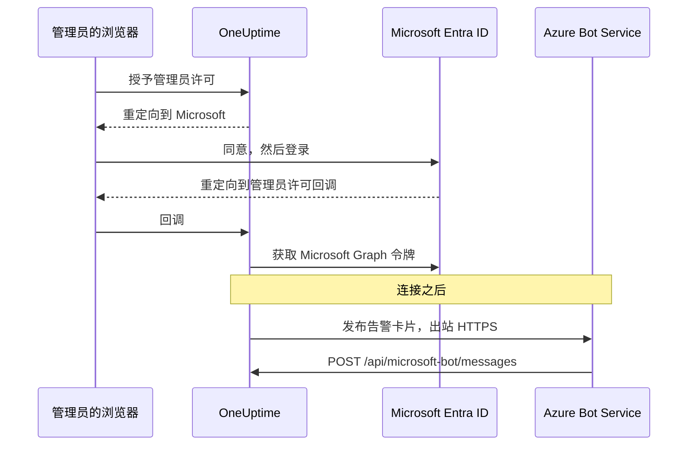
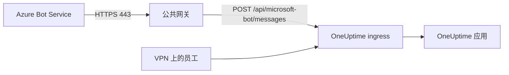

# Microsoft Teams 集成

将你的自托管 OneUptime 连接到 Microsoft Teams。你需要在 Microsoft Entra ID 中注册一个应用，为它创建一个 Azure Bot，把应用的凭据交给 OneUptime，然后安装服务器生成的 Teams 应用包。之后，OneUptime 会把告警和事件发布到你的频道和聊天中，你的团队可以直接在 Teams 里处理。

本页面向运维 OneUptime 服务器的人员。Teams 连接后，通知规则按项目设置：请参阅 [Microsoft Teams](/docs/workspace-connections/microsoft-teams)。

:::cards
- [设置集成](#设置集成): 九个步骤，从 Azure 门户到你的第一个团队。
- [环境变量](#环境变量): OneUptime 需要从应用注册中获取的三个值。
- [网络访问](#网络访问): Microsoft 必须能够访问的机器人端点。
- [故障排除](#故障排除): 无法访问的端点、缺失的安装和失败的连接。
:::

## 工作原理

OneUptime 使用 Azure Bot 实现 Teams 集成。流量是双向的，而且两个方向相互独立：OneUptime 调用 Microsoft 来发布消息；当有人按下按钮、给机器人发消息或把它添加到聊天时，Azure Bot Service 调用你的服务器。



Incoming Webhook 或 Teams 工作流 URL 都不能替代此机器人的消息传递端点。

视频通话（为事件召开的 Teams 会议）不使用此机器人：它需要单独的应用注册，详见 [视频通话](/docs/workspace-connections/video-calls#one-click-connect-on-a-self-hosted-server)。

## 开始之前

- 一个 Azure 订阅，用于 Azure Bot 资源。
- 一个可以在 Microsoft Entra ID 中创建应用注册的账号，以及一位可以授予管理员许可的 Microsoft 365 管理员。
- 一个 Azure Bot Service 能够访问的 OneUptime 公共 HTTPS 主机名。请参阅 [网络访问](#网络访问)。
- 服务器配置的访问权限：Docker Compose 下的 `config.env`，或 Kubernetes 下的 Helm values。
- 要连接项目，需要在该项目中拥有 **Project Owner**、**Project Admin** 或 **Project Member** 角色。

## 设置集成

:::steps
### 第 1 步：创建 Azure 应用注册

在 [Azure 门户](https://portal.azure.com) 中打开 **App registrations**，选择 **New registration**。按如下方式填写表单：

- **Name:** oneuptime
- **Supported account types:** Accounts in this organizational directory only (Single tenant)
- **Redirect URI:** Web - `https://your-oneuptime-domain.com/api/microsoft-teams/auth`

选择 **Register**，然后添加第二个 Web 重定向 URI：`https://your-oneuptime-domain.com/api/microsoft-teams/admin-consent/callback`。记下 **Application (client) ID** 和 **Directory (tenant) ID**：后面两者都会用到。

> [!NOTE]
> **为什么是单租户：** 自托管的 OneUptime 部署服务于一个组织，它的机器人是为你在 `MICROSOFT_TEAMS_APP_TENANT_ID`（第 6 步）中设置的那一个租户注册的。把应用注册为多租户并不会扩大这个范围，反而会引入一种失败情形：主 Microsoft 租户与你不同的来宾 / B2B 用户会带着他们自己的租户 ID 访问机器人，而 OneUptime 无法把它与你的项目对应起来。如果你已经注册了多租户应用，它仍然可以工作；只要确保 `MICROSOFT_TEAMS_APP_TENANT_ID` 是你自己的租户，并且预计来宾账号需要在你的租户中拥有账号才能使用机器人。

### 第 2 步：配置应用权限

在应用注册中打开 **API permissions**，选择 **Add a permission**，然后选择 **Microsoft Graph**。

**添加委托权限**（代表已登录用户执行操作时）：

- **User.Read** - 在 OAuth 流程中获取已通过身份验证的用户的个人资料信息（显示名称、电子邮件）所必需
- **Team.ReadBasic.All** - 用户选择要连接哪个团队时，列出其所属团队所必需
- **Channel.ReadBasic.All** - 读取频道信息并列出团队中的频道以投递通知所必需
- **ChannelMessage.Send** - 向 Teams 频道发送告警和事件通知所必需

**添加应用程序权限**（应用以自身身份执行操作、没有已登录用户时）：

- **Team.ReadBasic.All** - 授予管理员许可后列出组织中所有团队所必需
- **Channel.ReadBasic.All** - 验证频道是否存在并获取其详细信息所必需
- **TeamsAppInstallation.ReadForTeam.All** - 诊断所必需。它让 OneUptime 读取团队中实际安装的是哪个应用包，并与此部署的客户端 ID 进行比较，这样发送失败时就能告诉你是可能原因中的 *哪一个*。没有它，OneUptime 无法区分"未安装"和"已安装，但那是别人的包"，只能转述 Microsoft 的说法，而这正是调试此集成要花几天而不是几分钟的主要原因。请授予它。
- **Chat.ReadBasic.WhereInstalled** - 可选。它让 OneUptime 读取 OneUptime 应用所在的每个聊天的名称。没有它时，每个聊天通过清单中的 **ChatSettings.Read.Chat** 权限（见下文）授予这一能力，而用旧清单添加的聊天只有在其中的应用更新后才具备该权限。

`ChannelMessage.Send` 只有委托权限；[Microsoft Graph 权限参考](https://learn.microsoft.com/en-us/graph/permissions-reference#channelmessagesend) 中没有对应的应用程序权限。请把它保留在上面的委托权限列表中。

然后为你的组织选择 **Grant admin consent**。

机器人本身使用 Teams 应用清单中定义的特定于资源的许可（RSC）权限。这些权限在应用安装到团队或聊天中、或在其中更新时授予，而不是在 Entra ID 中授予：

- **ChannelMessage.Send.Group** - 允许机器人向团队频道发送消息
- **ChannelMessage.Read.Group** - 允许机器人读取频道消息以支持交互式命令
- **Channel.Create.Group** - 允许机器人在需要时创建频道
- **ChatMessage.Read.Chat** - 允许机器人读取它所加入的聊天中的消息（用于交互式命令）
- **ChatMember.Read.Chat** - 允许机器人读取它所加入的聊天的成员（用于在 OneUptime 中为聊天命名）
- **ChatSettings.Read.Chat** - 允许 OneUptime 读取应用所加入的群聊的名称。Teams 不会可靠地把群聊名称发送给机器人，因此没有它时，有名称的群聊会以其成员的名字显示
- **TeamsAppInstallation.Read.Group** - 允许 OneUptime 确认应用已安装在它将要发布消息的团队中

如果你是在这些权限出现之前上传的应用清单，请从 **项目设置 > 工作区 > Microsoft Teams** 重新下载，并作为 OneUptime 应用的更新上传到 Teams。Teams 会在应用安装到某个团队或聊天中、或在其中更新时授予团队和聊天权限，因此请在每个已有该应用的团队和聊天中接受更新。关于聊天，请参阅 [群聊以成员的名字显示](#群聊以成员的名字显示)。

### 第 3 步：创建客户端密码

在应用注册中打开 **Certificates & secrets**，选择 **New client secret**。添加描述，选择有效期（24 个月是合理的选择），然后选择 **Add**。立即复制密码的值：Azure 只显示一次。

> [!IMPORTANT]
> 复制密码的 **Value**，而不是它的 **Secret ID**。值是较长的那个字符串。

### 第 4 步：创建 Bot Service

在 Azure 门户中创建一个 **Azure Bot** 资源：

- **Bot handle:** oneuptime-bot
- **Subscription** 和 **Resource group:** 你自己的
- **Pricing tier:** 测试用 F0 (Free) 即可
- **Type of App:** Single Tenant，使用现有的应用注册：第 1 步中的 **Application (client) ID** 和 **Directory (tenant) ID**

选择 **Review + create**，然后选择 **Create**。机器人部署完成后，打开它的 **Configuration** 页面，将 **Messaging endpoint** 设置为 `https://your-oneuptime-domain.com/api/microsoft-bot/messages` 并保存。

**继续之前先验证端点。** Azure Bot Service 从公共互联网调用此 URL，所以请从你的网络之外的某处进行检查：不要在集群内部检查，也不要通过一个能看到该主机、而 Azure 看不到的 VPN 检查：

```bash
curl -sS -i https://your-oneuptime-domain.com/api/microsoft-bot/messages
```

请使用 `-i`，不要只看状态码：遇到 404 时，**只有响应正文能告诉你它是谁生成的**，而这个区别就是全部诊断。

- **405** 是正确的结果，表示你已完成。该端点只接受 POST，所以 GET 会收到 `405 Method Not Allowed`，并带有 `Allow: POST` 和端点说明。能访问到它，正是这里要测试的内容。
- **正文为 JSON `{"message":"Page not found - /api/microsoft-bot/messages"}` 的 404** 来自 OneUptime，所以请求 *确实* 到达了。要么此部署早于上面的 405 响应（旧版本只为 POST 提供此路由，所以 GET 会落入通用的"not found"处理程序），要么 OneUptime 前面的某个组件改写了路径，在应用看到之前去掉了 `/api` 前缀（常见的罪魁祸首是设置了 `rewrite-target: /` 的 Kubernetes ingress）。
- 来自 nginx、你的 ingress 或负载均衡器的 **带 HTML 错误页面的 404** 意味着相反的情况：请求从未到达 OneUptime，前面的组件没有把 `/api` 路由到应用。
- **TLS 错误、超时或连接被拒绝** 意味着 Azure 也无法访问。请参阅下文的 [消息传递端点故障排除](#卡片按钮显示-unable-to-reach-app聊天始终不出现)。

### 第 5 步：为机器人添加 Microsoft Teams 频道

在 Azure Bot 资源中打开 **Channels**，添加 **Microsoft Teams**。除非有特殊需求，否则保留默认的消息传递选项，然后保存。没有这个频道，机器人永远不会被预配到 Teams 会话中。

### 第 6 步：配置 OneUptime 环境变量

把应用的凭据交给 OneUptime：

:::tabs
@tab Docker Compose
```bash title="config.env"
MICROSOFT_TEAMS_APP_CLIENT_ID=YOUR_TEAMS_APP_CLIENT_ID
MICROSOFT_TEAMS_APP_CLIENT_SECRET=YOUR_TEAMS_APP_CLIENT_SECRET
MICROSOFT_TEAMS_APP_TENANT_ID=YOUR_MICROSOFT_TENANT_ID
```

使用会重新创建容器的 `npm run start` 应用更改。`docker compose restart` 不会重新读取 `config.env`。
@tab Kubernetes
```yaml title="values.yaml"
microsoftTeamsApp:
  clientId: YOUR_TEAMS_APP_CLIENT_ID
  clientSecret: YOUR_TEAMS_APP_CLIENT_SECRET
  tenantId: YOUR_MICROSOFT_TENANT_ID
```

如需把这些值保存在你自己管理的 Kubernetes Secret 中，请改为设置 `microsoftTeamsApp.existingSecret`：它的 `name` 以及键 `clientIdKey`、`clientSecretKey` 和 `tenantIdKey`。使用 `helm upgrade` 应用更改。
:::

OneUptime 重新运行后，**项目设置 > 工作区 > Microsoft Teams** 会显示 **授予管理员许可** 卡片，而不是设置指南。

### 第 7 步：在 OneUptime 中授予管理员许可

打开 **项目设置 > 工作区 > Microsoft Teams**，选择 **授予管理员许可**。以 Microsoft 365 管理员身份登录 Microsoft 并接受权限。Microsoft 会把你送回同一页面，卡片显示 **Admin Consent Completed**：项目现在已连接到你的租户。

然后选择 **Connect my account with Microsoft Teams** 关联你自己的账号。其他项目成员在 **用户设置 > 工作区 > Microsoft Teams** 中执行相同操作。

### 第 8 步：上传 Teams 应用清单

授予管理员许可后，**项目设置 > 工作区 > Microsoft Teams** 会显示 **Action Required: Install This Deployment's App on Microsoft Teams** 卡片。选择 **下载应用清单 Zip**：该包带有此部署的机器人 ID。

在 Microsoft Teams 中打开 **Apps > Manage your apps**，选择 **Upload an app**，然后选择 **Upload a custom app**，并选择你下载的 zip 文件。

> [!WARNING]
> 对于自托管部署，不要从 Microsoft Teams 应用商店安装"OneUptime"。商店中的应用指向 OneUptime Cloud 的机器人，因此 Teams 会接受它，然后拒绝此部署发送的每一条消息。

### 第 9 步：将 OneUptime 添加到每个团队（必需）

上传清单只是为 **你自己** 安装了应用。它 **不会** 让机器人访问任何团队的频道。Microsoft 只接受发往已添加该应用的团队的消息，所以你必须在每个需要通知的团队中执行此操作：

1. 在 Microsoft Teams 中，点击 **团队名称**（不是频道名称）旁边的"..."
2. 选择 **Manage team** > **Apps** > **More apps**
3. 搜索 **OneUptime** 并点击 **Add**

注意：

- 为你自己安装 OneUptime，或将其添加到聊天中，是 **另一种** 安装。两者都不能让它在团队的频道中发布消息。
- **专用频道** 需要在频道本身中安装应用：打开频道 > "..." > **Manage channel** > **Apps** > **Add an app**。团队级别的安装不涵盖专用频道。
- **共享频道** 根本无法接收通知：Microsoft Teams 不支持共享频道中的机器人。OneUptime 会在频道选择器中隐藏它们。
- 如果 **Manage team > Apps > More apps** 为空或显示为灰色，说明你的 Teams 应用设置策略阻止了自定义应用。请在 Teams 管理中心的 **Teams apps > Manage apps** 和 **Setup policies** 中修复。
:::

## 环境变量

| Docker Compose (`config.env`) | Helm (`values.yaml`) | 值 |
| --- | --- | --- |
| `MICROSOFT_TEAMS_APP_CLIENT_ID` | `microsoftTeamsApp.clientId` | **Application (client) ID**。它也是 Teams 应用包中的机器人 ID，因此必须是 GUID。 |
| `MICROSOFT_TEAMS_APP_CLIENT_SECRET` | `microsoftTeamsApp.clientSecret` | 客户端密码的 **Value**，而不是它的 ID。 |
| `MICROSOFT_TEAMS_APP_TENANT_ID` | `microsoftTeamsApp.tenantId` | **Directory (tenant) ID**。机器人在此租户中以单租户应用的身份进行身份验证。 |
| `HOST` | `host` | 你的公共主机名。重定向 URI、消息传递端点和 Teams 应用包都基于它生成。 |
| `HTTP_PROTOCOL` | `httpProtocol` | `https`。Azure Bot Service 只调用 HTTPS 端点。 |

三个 `MICROSOFT_TEAMS_APP_*` 值都是必需的：

- 没有客户端 ID 时，Microsoft Teams 页面显示设置指南，而不是 **授予管理员许可**。
- 没有客户端 ID 或密码时，连接会以 **"此 OneUptime 服务器未设置 Microsoft Teams。"** 结束。
- 没有租户 ID 时，机器人无法进行身份验证，因此发布消息和机器人端点都会失败。

## 网络访问

Microsoft 要求 [自托管机器人提供可公开访问的 HTTPS 端点](https://learn.microsoft.com/en-us/azure/bot-service/bot-service-resources-faq-security?view=azure-bot-service-4.0)。私有 IP 地址、内部 DNS 名称或员工的 VPN 连接都不能让 Azure Bot Service 访问 OneUptime。

| 方向 | 目标 | 用途 |
| --- | --- | --- |
| 从 OneUptime 到 Microsoft | 通过 TCP 443 以 HTTPS 访问 Microsoft Graph、Microsoft 标识和 Bot Framework 服务 | 令牌交换、团队和频道查找以及通知投递 |
| 从 Microsoft 到 OneUptime | `POST /api/microsoft-bot/messages` | 机器人消息、会话安装事件和卡片操作 |
| 从用户的浏览器到 OneUptime | `/api/microsoft-teams/auth` 和 `/api/microsoft-teams/admin-consent/callback` | 登录和管理员许可的重定向 |

应用注册发往 `/api/microsoft-teams/auth` 和 `/api/microsoft-teams/admin-consent/callback` 的重定向会经由用户的浏览器返回。该浏览器必须能访问 OneUptime，例如通过企业网络或 VPN。机器人消息和卡片操作来自 Microsoft 的服务器，需要单独可访问的 ingress。仅有出站告警投递成功，并不能证明入站连通性。

### 从私有部署发布机器人端点



:::steps
1. 将 OneUptime 主机名的公共 DNS 指向面向互联网的反向代理或负载均衡器。允许入站 TCP 443，并提供带完整证书链的公共受信任 TLS 证书。
2. 将网关直接或通过你自己的站点到站点 VPN / 专用链路连接到 OneUptime 的私有 ingress，并允许源站的服务端口。Kubernetes `ClusterIP` 服务需要一个可从网关访问的 ingress 或其他路由。数据库和其他内部服务保持私有。
3. 通过该网关发布 `/api/microsoft-bot/messages`，并将第 4 步中 Azure Bot 的 **Messaging endpoint** 设置为完整的公共 HTTPS URL。保留请求方法、`/api` 前缀、查询字符串、正文和 `Authorization` 标头。保留公共 `Host`，并为公共主机和 HTTPS 协议设置受信任的转发标头。不要在这条路由上添加重定向、浏览器 SSO、CAPTCHA 或代理登录；OneUptime 的 Bot Framework 适配器必须接收并验证该请求。
4. 如有需要，其他路由保持私有。使用拆分 DNS 时，员工可以通过企业网络或 VPN 把同一主机名解析到私有 ingress。该 ingress 也必须使用对该主机名有效的证书提供 HTTPS，并允许上表中的浏览器重定向。将对源站的访问限制为网关和授权的内部客户端。
5. 在 Docker Compose 的 `config.env` 中设置 `HOST=oneuptime.example.com` 和 `HTTP_PROTOCOL=https`，或在 Helm values 中设置 `host: oneuptime.example.com` 和 `httpProtocol: https`。把示例替换为你的域名，应用部署更新，并等待应用重启。这些值只用于生成 URL；它们不会预配 DNS、TLS 或网络访问。如果主机名发生变化，请更新 Azure Bot 端点和应用注册的重定向，并重新下载、重新上传 Teams 清单。
:::

OneUptime 的 [私有网络访问设置](/docs/self-hosted/private-network-access) 管理的是发往内部服务的出站请求。启用 `ALLOW_PRIVATE_NETWORK_WEBHOOKS` 并不会让 Microsoft 访问到机器人端点。

### 出站访问和 IP 限制

允许 OneUptime 应用进行 DNS 解析和出站 HTTPS。使用 `graph.microsoft.com`、`login.microsoftonline.com`、Bot Framework 的身份验证和频道端点，以及为会话提供的连接器服务 URL。商业云的后备连接器是 `https://smba.trafficmanager.net/teams/`；会话的服务 URL 可能不同。请遵循 [Microsoft 的防火墙指南](https://learn.microsoft.com/en-us/azure/bot-service/bot-service-resources-faq-security?view=azure-bot-service-4.0)，并在测试期间检查被阻止的流量；这不是一份完整的主机名列表。

Microsoft 不支持为 Bot Framework 入站流量使用固定的 IP 允许列表，因为其源地址会变化。Teams 客户端的媒体 IP 范围并不描述机器人 Webhook 的来源。请保持 Bot Framework 身份验证处于启用状态，而不是把源 IP 当作身份证明。

### 没有入站访问时的测试和部署

使用第 4 步，从你的网络和 VPN 之外验证公共 DNS、TLS 和路由。然后连接 Teams，发送一条测试通知，给机器人发消息，并按下卡片上的按钮。在 OneUptime 中确认该操作，并将 Microsoft 的投递诊断与网关和应用日志进行对照。仅凭一个可访问的 GET 路由或一条已投递的通知，并不能证明经过身份验证的入站机器人 POST。

用于开发时，[Microsoft 的 Teams 机器人本地测试指南](https://learn.microsoft.com/en-us/microsoftteams/platform/bots/how-to/authentication/add-authentication#testing-the-bot-locally-in-teams) 介绍了如何用隧道暴露本地服务。请转发到允许机器人端点的代理，并使用 `/api/microsoft-bot/messages`，而不是 Microsoft 示例路径 `/api/messages`。每当隧道的公共 URL 变化时，都要更新已配置的主机名和 Azure Bot 端点；测试结束后停止隧道；生产环境中使用稳定的 ingress。隧道同样会打开入站访问。

> [!WARNING]
> 如果策略禁止入站连接，完整的 Teams 机器人集成就无法工作：命令、卡片操作和会话发现都依赖于 Microsoft 能访问 OneUptime。Azure Bot Private Endpoint 并不能解决这一要求。Microsoft 的 [网络隔离说明](https://learn.microsoft.com/en-us/azure/bot-service/dl-network-isolation-how-to?view=azure-bot-service-4.0) 讲的是 Direct Line 隔离，并指出禁用公共网络访问会破坏 Teams 频道的配置。完全断开连接的安装无法使用 Teams。

## 故障排除

先做以下检查：

- 应用注册拥有上述权限，并且已授予管理员许可。
- 重定向 URI 完全匹配（将 `your-oneuptime-domain.com` 替换为你的实际域名）。
- 环境变量已设置，并且设置之后已重启 OneUptime。
- 机器人的消息传递端点可从互联网访问，并且机器人拥有 Microsoft Teams 频道。
- 你上传的 Teams 应用包是从此部署下载的那一个。

### 卡片按钮显示 "Unable to reach app"，聊天始终不出现

这些症状通常意味着 **Azure Bot Service 无法将经过身份验证的活动投递到你的消息传递端点**。请检查路由、机器人身份验证和项目配置。

令人困惑的是，告警卡片仍然能到达 Teams，这让集成看起来几乎是正常的。其实并非如此：两个方向相互独立，只有其中一个在工作：

| 方向 | 传输方式 | Azure 需要访问你吗？ |
| --- | --- | --- |
| OneUptime 在频道中发布告警卡片 | OneUptime 使用你的客户端密码进行身份验证并调用 Microsoft | **否** |
| 你按下该卡片上的按钮 | Azure Bot Service 向 `/api/microsoft-bot/messages` 发送 POST | **是** |
| 你给机器人发送 `help` | Azure Bot Service 向 `/api/microsoft-bot/messages` 发送 POST | **是** |
| 聊天被登记到 **Microsoft Teams Chats** 中 | Azure Bot Service 以 POST 将机器人活动发送到 `/api/microsoft-bot/messages` | **是** |

因此，告警能送达只证明了那次出站发送；它不能证明每一项 Graph 权限或入站机器人端点都没问题。交互功能需要入站机器人活动被成功处理。

OneUptime 根据机器人活动登记聊天，例如应用安装、机器人被添加到会话，或在该聊天中发给机器人的消息。这些活动都经由同一个入站端点到达。如果在添加应用并给它发消息之后，**Microsoft Teams Chats** 列表仍为空，说明该项目没有登记任何聊天；请检查入站请求、身份验证错误以及租户与项目的映射。点击 **Refresh Chats** 会重新读取 OneUptime 已存储的聊天，并从 Microsoft 重新读取每个已存储群聊的名称。

**按以下顺序诊断：**

1. **查找 POST，而不是 404。** 大多数排查都在这里走错方向：

   ```bash
   grep 'POST /api/microsoft-bot/messages' <your access log>
   ```

   如果没有 POST 行，请先确认正确的访问日志正在记录请求，然后检查 Azure 中配置的端点和网络路径。如果有 POST 到达，请检查它们的响应以及 OneUptime 的身份验证或项目映射错误。返回 404 的 `GET` 行是另一项单独的检查；请参阅下面的说明。

2. **从你的网络之外调用端点，** 就像第 4 步那样，使用 `curl -i` 查看正文。`405` 证明该路由处于活动状态，并且可以从你运行命令的地方访问。TLS 错误、超时或连接被拒绝就是你的答案。

3. **检查证书链。** Azure 要求使用公共受信任证书并附带完整证书链的 HTTPS。自签名证书、内部 CA 或缺失的中间证书会让 TLS 握手在 OneUptime 看到请求之前就失败，因此你的访问日志一直是空的，看起来就像 Azure 从未尝试过：

   ```bash
   openssl s_client -connect your-oneuptime-domain.com:443 -servername your-oneuptime-domain.com -verify_return_error </dev/null
   ```

4. **检查主机名能否被公开解析。** 私有 DNS 名称、拆分视图（split-horizon）记录或仅限内部的 ingress 对你和你的 VPN 可达，但对 Azure 仍不可见。请从一个无法访问你的网络的网络上解析它。

5. **确认 Azure Bot 资源中的端点**：它必须与此部署完全一致，包括协议和路径：`https://your-oneuptime-domain.com/api/microsoft-bot/messages`。

**`GET /api/microsoft-bot/messages` 返回 404 并不是故障，也不能证明 Azure 无法访问你。** 该端点一直只接受 POST，所以在此版本之前，来自浏览器的 GET 会落入 OneUptime 通用的"not found"处理程序，返回 `{"message":"Page not found - /api/microsoft-bot/messages"}`。这看起来像是路由缺失，已经让不止一位管理员去寻找一个并不存在的回归；但看看它实际证明了什么：是 OneUptime 生成了这个响应，所以请求已经到达应用。它的大小是 58 字节，因此在访问日志中显示为 `"GET /api/microsoft-bot/messages HTTP/1.1" 404 58`。

此版本会用 `405 Method Not Allowed` 和一段自我说明来响应 GET，所以这个区别不再需要解释。如果你仍在使用旧版本，请根据正文判断 404：OneUptime 的 JSON 表示请求已到达；来自代理的 HTML 错误页面表示请求没有到达。

### 群聊以成员的名字显示

Teams 不会可靠地把群聊名称发送给机器人，所以 OneUptime 从 Microsoft Graph 读取名称。这需要清单中的 **ChatSettings.Read.Chat** 权限，每个聊天会在 OneUptime 应用安装到其中或在其中更新时授予该权限。用旧清单添加了应用的聊天没有该权限，**Refresh Chats** 会标记出这些聊天。用以下两种方式之一修复：

1. 从 **项目设置 > 工作区 > Microsoft Teams** 重新下载清单，作为 OneUptime 应用的更新上传到 Teams，在每个相关聊天中接受更新，然后点击 **Refresh Chats**。
   - 只有当上传的版本高于已安装的版本时，Teams 才会把它当作更新接受。发布镜像根据 `APP_VERSION` 设置版本。没有 `APP_VERSION` 的构建使用一个固定的后备值，只有当 OneUptime 修改清单时才会变化；如果 Teams 提示该包不是更新的版本，请在上传前提高清单中的 `version`。
   - 如果你的租户只允许预先批准的应用使用聊天权限，请先把 **ChatSettings.Read.Chat** 添加到 OneUptime 的预先批准策略中（例如 `Update-MgBetaTeamAppPreapproval -TeamsAppId <app id> -ResourceSpecificApplicationPermissionsAllowedForChats @('ChatMember.Read.Chat','ChatMessage.Read.Chat','ChatSettings.Read.Chat')`），否则更新后的应用无法添加到聊天中。
2. 或者，为应用注册授予应用程序权限 **Chat.ReadBasic.WhereInstalled**（第 2 步）并授予管理员许可，然后点击 **Refresh Chats**。这样无需逐个聊天更新，即可一次覆盖应用所在的每个聊天。OneUptime 会继续使用当前的 Microsoft Graph 令牌直到其过期，因此新授予的权限最多可能需要一小时才会生效。

在 Teams 中没有名称的群聊会以其成员的名字显示，这是设计如此。在 Teams 中重命名的聊天，会在下次有人点击 **Refresh Chats** 时采用新名称。

### 检查此部署的机器人配置

```bash
curl -sS https://your-oneuptime-domain.com/api/microsoft-bot/test | jq
```

它报告 OneUptime 在本地能看到的内容：`MICROSOFT_TEAMS_APP_CLIENT_ID` 和 `MICROSOFT_TEAMS_APP_CLIENT_SECRET` 是否已设置、此部署期望的消息传递端点，以及最有用的一项：你的 Teams 应用包必须带有的 **机器人 ID**。

它只读取环境变量，别无其他。它不会调用 Azure，因此无法告诉你 Azure Bot 资源是否存在、其消息传递端点是否指向这里、Teams 频道是否已启用、密码是否仍然有效，或 Azure 能否访问你。响应本身会说明这一点，列出它检查了什么、没有检查什么，以免被误认为一切正常。

它能做的唯一决定性检查是：将它返回的 `botId` 与 Teams 中已安装的 OneUptime 应用的机器人 ID 进行比较。如果两者不同，该应用包就无法接收来自此部署的消息；请参阅第 8 步。

### "The OneUptime app is not installed in the Microsoft Teams team ..."

OneUptime 已通过 Microsoft Graph 进行检查，该团队中（如果是专用频道，则是该频道中）确实没有这个应用。请完成上面的 **第 9 步**。OneUptime 可以借助 Graph 应用程序权限列出你租户中的每个频道，但只能在应用是其成员的团队中 *发布消息*。

### "Microsoft Teams refused the message ... because the OneUptime bot is not a member of that conversation"

Microsoft 拒绝了这次发布（用它自己的话说是 `BotNotInConversationRoster`），而 OneUptime **无法** 确认应用确实缺失，所以不要做这样的假设。请按下面的顺序排查原因；从 Teams 的角度看，前两种情况与正确的设置完全一样。

1. **团队中的应用是另一个应用包。** 在 **Manage team > Apps** 中看到一个名为"OneUptime"的图标并不够：关键在于该应用包的机器人 ID 是否是 *此* 部署的 `MICROSOFT_TEAMS_APP_CLIENT_ID`。Teams 应用商店中的公开 OneUptime 应用指向 OneUptime Cloud 的机器人，永远不会接受来自你的自托管部署的发布。只有从 **项目设置 > 工作区 > Microsoft Teams**（第 8 步）下载的清单是为你的部署制作的。如有疑问，请从团队中移除该应用，重新上传你自己的清单，然后添加它。
2. **Azure Bot 没有 Microsoft Teams 频道。** 请完成 **第 5 步**。没有它，机器人永远不会被预配到 Teams 会话中，所以即使应用安装顺利、应用列表看起来也正确，机器人也不在任何频道的成员列表中。
3. **应用安装给了你自己或某个聊天，但没有安装到团队中。** 请完成 **第 9 步**。
4. **频道是专用频道。** 团队级别的安装不涵盖专用频道；请参阅第 9 步的注意事项。

授予 **TeamsAppInstallation.ReadForTeam.All**（第 2 步），这样 OneUptime 会告诉你是哪一种情况，而不是把它们全部列出来。

### 通知在一个团队中有效，在另一个团队中无效

安装是按团队进行的。把 OneUptime 添加到一个团队对其他团队没有任何作用，连接集成也一样：连接授予的是整个租户范围的 Graph *读取* 访问权限，这就是为什么频道选择器可能会显示机器人无法发布消息的团队中的频道。请在每个需要通知的团队中完成 **第 9 步**。

### "测试规则" 成功，但真实通知始终没有到达

检查该规则实际启用了哪些目标。规则只会检验它所配置的内容：启用 **Create Microsoft Teams Channel** 时，测试会创建一个频道并在其中发布消息，这只能证明机器人可以 *在创建该频道的团队中* 发布消息，对其他团队则说明不了任何问题。**项目设置 > 通知 > 通知日志** 会记录每一次测试发送，失败时还会包含 Microsoft 返回的原始错误。

### "Sorry, I couldn't find your project configuration"

机器人活动来自的 Microsoft 租户，并不是任何 OneUptime 项目所连接的租户。在服务器日志中检查租户 ID：

```bash
grep "Project auth not found for tenant ID" <your app logs>
```

将它与为该项目存储的租户进行比较：

```sql
SELECT "projectId", "workspaceProjectId"
FROM "WorkspaceProjectAuthToken"
WHERE "workspaceType" = 'MicrosoftTeams';
```

如果两者不一致，说明给机器人发消息的用户登录的是另一个 Microsoft 租户（通常是主租户不是你的租户的来宾 / B2B 账号）。请让该用户使用已连接租户中的账号，或者在已连接团队的频道中 @提及机器人，而不是在 1:1 聊天中。

### "This Microsoft 365 organization is connected to more than one OneUptime project"

两个或更多 OneUptime 项目连接了同一个 Microsoft 租户。机器人消息只携带租户 ID，因此 OneUptime 无法知道你指的是哪个项目，于是选择拒绝而不是猜测。请从除一个项目之外的所有项目中断开 Microsoft Teams。

### "Microsoft Teams App Client ID must be a valid GUID"

当 `MICROSOFT_TEAMS_APP_CLIENT_ID` 不是 GUID 时，**下载应用清单 Zip** 会拒绝生成应用包，因为 Teams 要求应用 ID 和机器人 ID 是 GUID。请从应用注册的概述页面重新复制 **Application (client) ID**，设置它并应用配置。

### 连接未完成

当 Microsoft 把你送回来、但连接没有建立时（授予管理员许可或使用 Microsoft 登录时），你开始操作的那个 Microsoft Teams 页面（**项目设置 > 工作区 > Microsoft Teams**，或者如果你在连接自己的账号，则是你自己的 **用户设置 > 工作区 > Microsoft Teams**）会显示 **Microsoft Teams 未连接**，并附上一句用你的语言说明原因的话。页面的其余部分照常加载，所以你可以就地重试。它从不显示 Microsoft 自己的回复（例如 `AADSTS` 代码）：那些内容连同原因一起记录在 OneUptime 的服务器日志中。

| 页面显示 | 处理方法 |
| --- | --- |
| **"此连接链接无效、已过期或已被使用。请重新开始。"** | 该链接只能在发起它的浏览器中、在 15 分钟内使用一次。请从 Microsoft Teams 页面重新开始，并在同一浏览器中于 15 分钟内完成。 |
| **"您没有将此项目连接到 Microsoft Teams 的权限。"** | 为项目授予管理员许可需要 **Project Owner**、**Project Admin** 或 **Project Member**。Microsoft 把你送回来时会再次检查。 |
| **"您已不再是此项目的成员。"** | 要连接你自己的 Microsoft 账号，在 Microsoft 把你送回来时你必须是该项目的成员。 |
| **"您登录的 Microsoft 365 组织与此连接所针对的组织不同。"** | 请使用授予了管理员许可的 Microsoft 365 组织（或项目所连接的组织）中的账号登录。 |
| **"您的 Microsoft 365 组织还没有团队。"** | 在 Microsoft Teams 中创建一个团队，然后再次授予管理员许可。 |
| **"连接已取消，因此未做任何更改。"** | 未在 Microsoft 中授予许可。请重新开始并接受它。 |
| **"此 OneUptime 服务器未设置 Microsoft Teams。"** | 设置 Microsoft Teams 应用的客户端 ID 和密码（请参阅 [第 6 步](#第-6-步配置-oneuptime-环境变量)），然后重启 OneUptime。 |
| **"OneUptime 无法完成连接。请重试。"** | Microsoft 返回了错误，或者在完成连接时某个请求或写入失败。OneUptime 的服务器日志会说明是哪一种。请重试；如果问题持续出现，请检查日志和应用注册的设置。 |

我们希望改进这一集成，欢迎将你的反馈发送至 [hello@oneuptime.com](mailto:hello@oneuptime.com)。

## 后续步骤

:::cards
- [Microsoft Teams](/docs/workspace-connections/microsoft-teams): 为项目创建通知规则和摘要。
- [Slack 集成](/docs/self-hosted/slack-integration): 也在你的服务器上设置 Slack 应用。
- [私有网络访问](/docs/self-hosted/private-network-access): 让工作流和 Webhook 访问内部工具。
:::
