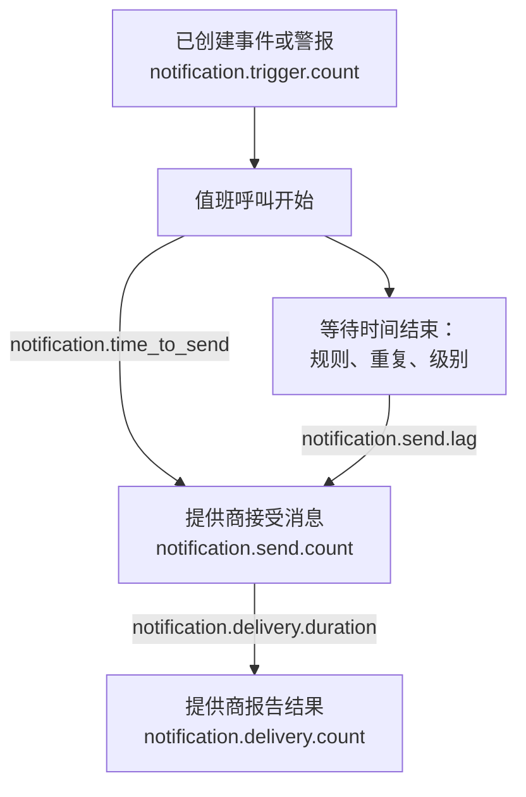

# 通知投递指标

OneUptime 会记录它发送的通知情况如何：有多少事件和警报需要通知，每条消息是否到达了提供商，一次值班呼叫花了多长时间才发出，以及它是否到达了手机。将 OneUptime 自身的遥测数据发送到一个 OneUptime 项目或任意 OpenTelemetry 后端，即可为您的安装所服务的人设定投递目标，并检查您是否达成了这些目标。

:::cards
- [启用它们](#启用它们): 两项设置，没有它们就什么都不会记录。
- [指标](#指标): 七个指标，从触发到手机。
- [呼叫如何计时](#呼叫如何计时): 发送耗时和发送延迟从何时开始计算。
- [起步 SLO](#起步-slo): 四个目标，逐个查询说明。
:::

## 工作原理



每条消息都会计入 `notification.send.count`，涵盖每个渠道，而不仅是值班呼叫。两个时间指标 `notification.time_to_send` 和 `notification.send.lag` 只涵盖值班呼叫。

## 启用它们

在 OneUptime 拥有 OpenTelemetry 导出器之前，什么都不会记录：没有导出器时，这些指标不产生任何开销，也不会保存在任何地方。让它指向一个 OneUptime 项目，并使用该项目的 Server [摄取密钥](/docs/telemetry/ingestion-keys)，或者指向任何通过 HTTP 接收 OTLP 的后端。

:::tabs
@tab Kubernetes
```yaml
openTelemetryExporter:
  endpoint: https://oneuptime.example.com/otlp
  headers: x-oneuptime-token=YOUR_INGESTION_KEY
```
由 `app` 和 `worker` 部署发送它们：请将 `app.disableTelemetryCollection` 和 `worker.disableTelemetryCollection` 保持为默认值 `false`。
@tab Docker Compose
```bash
OPENTELEMETRY_EXPORTER_OTLP_ENDPOINT=https://oneuptime.example.com/otlp
OPENTELEMETRY_EXPORTER_OTLP_HEADERS=x-oneuptime-token=YOUR_INGESTION_KEY
DISABLE_TELEMETRY_FOR_APP=false
```
在 `config.env` 中设置它们，然后运行 `npm start`。`DISABLE_TELEMETRY_FOR_APP` 默认为 `true`，此时不会发送任何内容。
:::

OneUptime 需要同时设置端点和请求头：没有请求头时它什么都不发送。每个请求头写成 `name=value`，多个请求头之间用 `;` 分隔。值中可以包含 `=`。OneUptime 会自行在端点后加上 `/v1/metrics`，同样的设置也会发送它自己的追踪和日志。每个指标在 OneUptime 首次记录它时出现：`notification.send.count` 在发送第一条消息时出现。

### 向 OneUptime 项目发送增量

OneUptime 按 OpenTelemetry 的默认方式发送计数器和直方图：每个数据点保存的是该服务器进程启动以来的累计总数。指标浏览器会把图表每个步长内的数据点相加，因此只有从增量，即保存自上一个数据点以来所发生情况的数据点中，它才能准确读出一个时间范围的计数和百分位数。当指标发往 OneUptime 项目时，请发送增量：

:::tabs
@tab Kubernetes
```yaml
extraEnv:
  - name: OTEL_EXPORTER_OTLP_METRICS_TEMPORALITY_PREFERENCE
    value: delta
```
服务自己的列表会替换整个 Chart 的列表：如果您设置了 `app.extraEnv` 或 `worker.extraEnv`，也要在那里加上它。
@tab Docker Compose
```yaml title="docker-compose.override.yml"
services:
  app:
    environment:
      OTEL_EXPORTER_OTLP_METRICS_TEMPORALITY_PREFERENCE: delta
```
在 `docker-compose.yml` 旁边创建该文件，或将这些内容添加到您已有的文件中，然后运行 `npm start`。
:::

这适用于 OneUptime 发送的关于自身的每个指标。像 Prometheus 这样自行读取累计总数的后端无需任何更改。

## 指标

| 指标 | 类型 | 单位 | 它回答的问题 |
| --- | --- | --- | --- |
| `notification.trigger.count` | 计数器 | `1` | 有多少条记录需要通知 |
| `notification.send.count` | 计数器 | `1` | 交给提供商的每条消息结果如何 |
| `notification.send.duration` | 直方图 | `ms` | 提供商接收它花了多长时间 |
| `notification.time_to_send` | 直方图 | `ms` | 呼叫在触发后多久到达其提供商 |
| `notification.send.lag` | 直方图 | `ms` | 稍后发送的通知在到期后多久到达其提供商 |
| `notification.delivery.count` | 计数器 | `1` | 提供商接受的消息最终结果如何 |
| `notification.delivery.duration` | 直方图 | `ms` | 消息在提供商接受后多久结束 |

每个属性都只取少数几个固定值之一，绝不会是项目、人员、电话号码或记录。唯一的例外是自定义渠道的 ID 和名称：一个安装只有寥寥几个，而把它们区分开正是目的所在。

### 通知人员的记录

`notification.trigger.count` 会在每个事件、警报、事件片段和警报片段创建时对其计数。

| 属性 | 值 |
| --- | --- |
| `notification.trigger.type` | `incident`、`alert`、`incident_episode`、`alert_episode` |
| `notification.trigger.source` | 由 OneUptime 根据监视器或规则创建时为 `automatic`；由人员或 API 创建时为 `manual` |
| `monitor.type` | 创建事件或警报的监视器类型，例如 `Incoming Request`、`Logs` 或 `Metrics`；没有监视器创建时省略 |

### 交给提供商的消息

`notification.send.count` 统计交给提供商的每条消息，`notification.send.duration` 对调用提供商的耗时计时。两者都带有以下属性：

| 属性 | 值 |
| --- | --- |
| `notification.channel` | `email`、`sms`、`call`、`whatsapp`、`telegram`、`push`、`webhook`、`slack`、`microsoft_teams`、`mattermost`、`custom_channel` |
| `notification.provider` | `twilio`、`sms_and_call_gateway`、`smtp`、`sendgrid`、`amazon_ses`、`mailgun`、`postmark`、`resend`、`microsoft_graph`、`expo`、`push_relay`、`web_push`、`meta_whatsapp`、`telegram_bot_api`、`slack`、`microsoft_teams`、`mattermost`、`webhook`、`custom_channel`，或在什么都没有交出时为 `none` |
| `notification.provider.config` | 安装自己的账户和设置为 `global`；项目自己的 Twilio 账户、SMTP 服务器、Webhook 或工作区连接为 `project`，其故障由项目自行修复 |
| `notification.on_call_page` | 值班呼叫的通知为 `true`，否则为 `false` |
| `outcome` | `success`、`failure` 或 `not_sent`，见下文 |
| `notification.destination` | Slack、Microsoft Teams 和 Mattermost：发给某个人的为 `direct_message`，发到频道或 Teams 群聊的为 `channel`，发到传入 Webhook（例如状态页订阅者的）的为 `incoming_webhook`。Webhook：发到状态页订阅者自己的 Webhook 的为 `status_page_subscriber`。个人的 Webhook 和其他所有渠道都不带此属性 |
| `notification.custom_channel.id`、`notification.custom_channel.name` | 仅限自定义渠道：渠道的 ID，以及截断到 100 个字符的名称 |

- `success`：提供商接受了该消息。
- `failure`：提供商拒绝了它或无法访问，或者发送失败。找不到的聊天频道算作没有耗时的失败。
- `not_sent`：有意不发送。项目关闭了该渠道、余额不足或已被封禁，此服务器上关闭了推送，或者自定义渠道已关闭、已删除或不在许可证范围内。成功率不包含这些：它们是设置在起作用，而不是平台出了故障。

发给状态页订阅者自己的 Webhook 的消息只计一次，无论尝试了多少次：端点以 2xx 状态应答时为 `success`；以其他状态应答、无法连接或其地址不被允许时为 `failure`。

### 到达手机的内容

`notification.delivery.count` 按照提供商稍后报告的结果，统计提供商接受的每条消息最终如何结束，每条消息计一次。`notification.delivery.duration` 对提供商接受之后的耗时计时。两者都带有 `notification.channel`、`notification.provider`、`notification.provider.config`、`notification.on_call_page` 和最终状态 `outcome`：

| 渠道 | 提供商 | `outcome` | 耗时 |
| --- | --- | --- | --- |
| `sms` | `twilio` | `delivered`、`undelivered`、`failed` | 直到 Twilio 报告状态 |
| `call` | `twilio` | `answered`、`not_answered`、`failed` | 直到电话被接听，否则直到通话结束 |
| `push` | `expo`、`push_relay` | `delivered`、`undelivered`、`failed` | 不计时：回执只说明 Apple 或 Google 是否接收了推送，不说明何时 |
| `whatsapp` | `meta_whatsapp` | `delivered`、`failed` | 直到 Meta 报告状态 |

响铃无人接、占线或被拒接的电话为 `not_answered`。发给已不存在的应用的推送为 `undelivered`，已读的 WhatsApp 消息算作已投递。只有通过项目自己的 Twilio 账户发送的短信和电话，`notification.provider.config` 才为 `project`。

只有在提供商能够报告的地方才会收到状态：

- 短信和电话：通过 Twilio，前提是 Twilio 能通过 `HOST` 访问您的服务器（参见 [Twilio 集成](/docs/self-hosted/twilio-integration#3-配置网络访问)）。短信和电话网关不报告任何状态。
- WhatsApp：当 Meta 的 Webhook 已为您的安装设置好时。
- 推送：来自 Expo 的回执，OneUptime 会在推送约 15 分钟后读取，经推送中继发送的也一样。由发送该推送的安装对其计数。
- 电子邮件、Telegram、Webhook、聊天和自定义渠道不报告最终状态。

## 呼叫如何计时

### 发送耗时

`notification.time_to_send` 从呼叫的触发开始，到提供商接受通知为止。它只对呼叫开始时就到期的通知计时：第一条升级规则中的人员按其无需等待的值班规则收到的通知，以及呼叫因没有联系到任何人而立即转入的任何级别。值班配置要求的等待不是平台的延迟，因此不计入：它们计入[发送延迟](#发送延迟)。只有提供商接受的通知才会计时；失败会显示在 `notification.send.count` 中。

| 属性 | 值 |
| --- | --- |
| `notification.channel` | 与 `notification.send.count` 相同 |
| `notification.page.start` | 时间从何时开始计算，见下文 |
| `notification.trigger.type` | 呼叫所针对的记录：`incident`、`alert`、`incident_episode`、`alert_episode` |
| `notification.custom_channel.id`、`notification.custom_channel.name` | 仅限自定义渠道 |

| `notification.page.start` | 时间的起点 |
| --- | --- |
| `monitor_data_received` | OneUptime 收到触发监视器的数据之时：一个传入请求、一份服务器代理报告、一封传入邮件、一次探针检查、一个 SNMP Trap 或一次网络设备轮询。其中包括数据在队列中等待评估的时间。 |
| `record_created` | 事件、警报或片段创建之时：由遥测监视器、规则或人员创建，以及针对缺失的检查，例如停止的心跳。 |
| `page_started` | 呼叫稍后开始之时：由人员、工作流或现在匹配的规则启动，或者是直接呼叫。对于被其值班规则或 OneUptime AI 暂缓的呼叫，是暂缓结束之时，如果它更早开始，则是开始之时。对于再次呼叫，是确认后超时到期之时。因此，迟迟才处理其中任何一种的工作进程会体现在这段时间中。 |

对于传入请求，时间从端点收到的最新请求开始计算，因此读数可能略短。

### 发送延迟

`notification.send.lag` 从稍后发送的通知到期的那一刻开始，到提供商接受它为止。由两个工作进程发送这些通知，每个每分钟运行一次，因此准时的工作进程最多显示约一分钟，而落后的工作进程会显示落后了多少。

| `notification.schedule` | 到期时间 |
| --- | --- |
| `rule_wait` | 某人带等待的值班规则，例如“10 分钟后给我打电话”：在此人被呼叫后经过该时长之时。绝不会早于工作进程上次处理其规则之时，因此稍后添加或更改的规则从那时起算。 |
| `repeat` | 在有人确认之前一直重复的推送：每次其间隔用完之时。 |
| `escalation` | 后面的升级级别：前一个级别结束等待之时，或者有人把呼叫转交出去时立即到期。 |
| `policy_repeat` | 策略从第一个级别重新开始：其最后一个级别的等待结束之时。 |

它还带有 `notification.channel`、`notification.trigger.type`，对于自定义渠道还有 `notification.custom_channel.id` 和 `notification.custom_channel.name`。在呼叫开始时就到期的通知绝不会出现在其中，即使工作进程在暂缓之后或作为再次呼叫而迟迟才开始该呼叫也是如此：它在发送耗时中。

### 直方图分桶

每个直方图都有自己的分桶边界，单位为毫秒，设置得让目标可以在边界处读出：

| 直方图 | 分桶边界（毫秒） |
| --- | --- |
| `notification.send.duration` | `5, 10, 25, 50, 100, 250, 500, 1000, 2500, 5000, 10000, 30000, 60000, 120000` |
| `notification.time_to_send` | `250, 500, 1000, 2000, 5000, 10000, 15000, 30000, 60000, 120000, 300000, 600000, 1800000, 3600000` |
| `notification.send.lag` | `1000, 5000, 10000, 15000, 30000, 45000, 60000, 75000, 90000, 120000, 180000, 300000, 600000, 1800000, 3600000` |
| `notification.delivery.duration` | `500, 1000, 2000, 5000, 10000, 15000, 30000, 60000, 120000, 300000, 600000, 1800000, 3600000, 14400000, 86400000` |

百分位数由分桶计算得出，并绘制为它所落入分桶的中点。因此请将它与分桶边界比较：`notification.time_to_send` 的 P95 等于或低于 30000，表示 95% 的呼叫用时 30 秒或更短。

## 起步 SLO

四个大多数安装都能承诺的目标，每个都由接收指标的项目的指标浏览器中的一到两个查询构建。当指标以增量形式到达时，它们能准确读出一个时间范围：参见[向 OneUptime 项目发送增量](#向-oneuptime-项目发送增量)。

### 在指标浏览器中构建目标

:::steps
1. 打开项目的[指标浏览器](/docs/telemetry/metrics-explorer)，点击目标的第一个指标。它的查询是 `a`。
2. 在 **Aggregate by** 下选择其聚合方式。然后打开 **Filters & grouping**，在 **Filter by attributes** 下添加它的每个条件。
3. 对于第二个查询，点击 **添加指标**，并以同样方式设置 `b`。
4. 对于公式，点击 **添加公式**，并在 **公式** 中写入它。
5. 要在目标未达成时收到通知，点击 **操作 → 从此视图创建监视器**，并在值越过目标时发出警报：参见[指标监控](/docs/monitor/metrics-monitor)。
:::

要以错误预算在 30 天内跟踪一个目标，请将该监视器关联到一个 [SLO](/docs/slo/introduction)：它会统计目标未达成的时间。

### 值班短信到达 Twilio

通过安装自己的 Twilio 账户发送的值班短信最多 1% 失败，即 99% 被接受。

| 查询 | 指标 | 聚合 | 条件 |
| --- | --- | --- | --- |
| `a` | `notification.send.count` | **总和** | `notification.channel = sms`、`notification.on_call_page = true`、`notification.provider.config = global`、`outcome != not_sent` |
| `b` | `notification.send.count` | **总和** | 相同条件，再加上 `outcome = failure` |

公式 `$b / $a * 100` 是失败的比例，只要它保持在 1 或以下，目标就算达成。没有失败的步长不会绘制数据点，因为 `b` 没有数据点。`outcome != not_sent` 排除了被项目自身设置拦下的内容，`global` 排除了项目自己的 Twilio 账户。在通过自己的短信和电话网关发送短信的安装中，同样的查询衡量的是该网关。对于其他渠道，把 `sms` 改为 `call`、`push` 或 `email`。

### 呼叫在 30 秒内发出

95% 的值班呼叫在触发后 30 秒内到达其提供商。

| 查询 | 指标 | 聚合 | 条件 |
| --- | --- | --- | --- |
| `a` | `notification.time_to_send` | **P95** | `notification.page.start != page_started` |

只要 `a` 保持在 30000 或以下，目标就算达成。稍后开始的呼叫从开始或到期之时而不是从触发计时，因此不计入。按 `notification.page.start` 分组可以把监视器的队列（`monitor_data_received`）与其余部分分开查看，按 `notification.channel` 分组可以找出较慢的渠道。

### 稍后发送的通知在 90 秒内发出

在等待之后发送的通知中，99% 在到期后 90 秒内到达其提供商。

| 查询 | 指标 | 聚合 | 条件 |
| --- | --- | --- | --- |
| `a` | `notification.send.lag` | **P99** | — |

只要 `a` 保持在 90000 或以下，目标就算达成。按 `notification.schedule` 分组可以看出是哪个工作进程落后了：`rule_wait` 和 `repeat` 属于一个工作进程，`escalation` 和 `policy_repeat` 属于另一个。

### 值班短信到达手机

Twilio 为安装自己的账户接受的值班短信中，最多 5% 未能投递。

| 查询 | 指标 | 聚合 | 条件 |
| --- | --- | --- | --- |
| `a` | `notification.delivery.count` | **总和** | `notification.channel = sms`、`notification.on_call_page = true`、`notification.provider.config = global` |
| `b` | `notification.delivery.count` | **总和** | 相同条件，再加上 `outcome != delivered` |

公式 `$b / $a * 100` 是未投递的比例。其中一部分由运营商和关机的手机决定，因此请根据几周内看到的情况设定目标。对于电话，使用 `call` 和 `outcome != answered`。Twilio 必须能够访问您的服务器：参见[到达手机的内容](#到达手机的内容)。

## 故障排除

:::details 没有收到通知指标
检查 `OPENTELEMETRY_EXPORTER_OTLP_ENDPOINT` 和 `OPENTELEMETRY_EXPORTER_OTLP_HEADERS` 是否都已设置，在 Docker Compose 中还要检查 `DISABLE_TELEMETRY_FOR_APP` 是否为 `false`，然后重启 OneUptime。OneUptime 启动时，如果有无法读取的请求头，或者它什么都不发送，会在日志中记录一条警告。指标只有在记录了内容之后才会出现，因此请先发送一条通知。
:::

:::details 计数只增不减，或百分位数几乎不动
指标以累计总数的形式到达。请发送增量：参见[向 OneUptime 项目发送增量](#向-oneuptime-项目发送增量)。
:::

:::details 没有收到最终状态
最终状态稍后来自提供商，而且只在它们能够报告的地方：参见[到达手机的内容](#到达手机的内容)。在 Twilio 无法访问的安装上，短信和电话会计为已发送，但永远不会计为已投递。
:::

## 后续步骤

:::cards
- [指标浏览器](/docs/telemetry/metrics-explorer): 绘制、组合并比较任意指标。
- [指标监控](/docs/monitor/metrics-monitor): 在目标未达成时发出警报。
- [Twilio 集成](/docs/self-hosted/twilio-integration): 让 Twilio 报告到达手机的内容。
- [升级规则](/docs/on-call/escalation-rules): 发送延迟从中开始计算的等待。
:::
