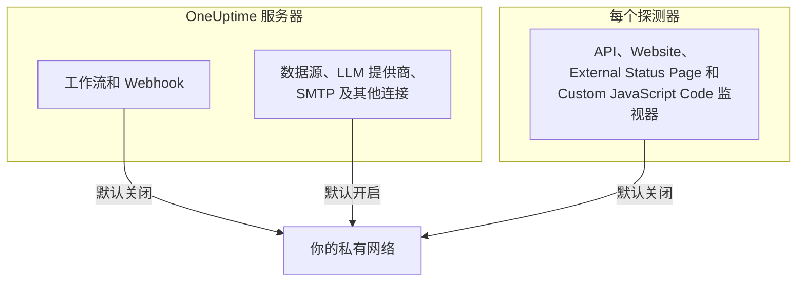

# 私有网络访问

OneUptime 会拒绝向解析到私有、环回或链路本地范围的主机发送某些出站请求。如果你曾尝试让工作流指向内部工具，你应该见过这条消息：

> Webhook URL resolves to a private, loopback, or link-local address and is not allowed

对于托管产品来说，这个默认行为是正确的：任何人都可以注册，Webhook 的目标是不可信的输入。但在自托管实例上，它会妨碍一件很普通的事：把告警发送到只存在于你自己网络中的自托管 Mattermost、Jira 或工单系统。

本页说明如何有意识地、在尽可能小的范围内允许这种访问。由三个开关决定，每个开关负责一类连接，并且分别在不同的机器上配置：

| 你想在内部访问的对象 | 设置所在位置 | 自托管安装的默认值 |
| --- | --- | --- |
| 工作流、项目 Webhook、值班用户 Webhook | **API 服务器**的环境 | 拒绝私有地址 |
| 数据源、LLM 提供商、SMTP 服务器、OIDC 发现及其他连接 | **API 服务器**的环境 | 允许私有地址 |
| API、Website、External Status Page 和 Custom JavaScript Code **监视器** | **探测器**自身的环境 | 拒绝私有地址 |



Ping、Port、SSL 证书、DNS、DNSSEC、SNMP / 网络设备、SQL 查询、数据库健康、Synthetic 和 Network Path 等网络原生监视器类型使用各自的传输方式。本页的设置管理的是会把任意响应内容返回给项目的 HTTP 传输，即 API、Website、External Status Page 和 Custom JavaScript Code 监视器。

:::cards
- [Webhook 和工作流](#webhook-和工作流): 允许 Webhook 向你的网络内发送请求。
- [其他出站连接](#其他出站连接): 数据源、LLM 提供商和邮件服务器。
- [探测器和监视器](#探测器和监视器): 让探测器检查私有站点。
- [验证是否生效](#验证是否生效): 读懂拒绝消息指向的是哪个开关。
:::

## 哪些被阻止，哪些可以解除阻止

被阻止的目标分为两个层级。

| 层级 | 范围 | 能否允许？ |
| --- | --- | --- |
| **私有** | RFC-1918（`10.0.0.0/8`、`172.16.0.0/12`、`192.168.0.0/16`）、CGNAT（`100.64.0.0/10`）、IPv6 唯一本地（`fc00::/7`）和站点本地（`fec0::/10`） | 能 |
| **禁止** | 环回（`127.0.0.0/8`、`::1`）、未指定地址、链路本地（`169.254.0.0/16`、`fe80::/10`）、组播、保留地址、广播，以及名称 `localhost` 和 `metadata.google.internal` | 只能在 Webhook 允许列表中写明确切的主机或 CIDR。监视器永远不能。 |

云元数据端点 `169.254.169.254` 被放在禁止层级是有原因的。在云虚拟机上，它会把实例的 IAM 凭据交给任何能从这台机器发出 HTTP 请求的东西，因此任何笼统的设置都永远不会开放它。

在内部携带 IPv4 目标的 IPv6 写法（IPv4 映射（`::ffff:10.0.0.5`）、NAT64、6to4、Teredo）会按照它们实际到达的 IPv4 地址进行分类，因此无法借助这些写法绕过私有层级的放行，把禁止的地址偷偷带进来。

## Webhook 和工作流

以下目标受到管控，因为目标是项目中经过身份验证的成员所写的 URL：

- 工作流 **API** 组件（GET / POST / PUT / PATCH / DELETE）
- 工作流 **Custom JavaScript** 组件发出的 HTTP 请求
- 项目 Webhook 通知（事件、告警、监视器、值班、计划维护、状态页事件）
- 值班**用户 Webhook**

**不**受此管控、将来也不会受此管控的是 **状态页订阅者 Webhook**。任何访问公开状态页的人都可以注册一个，因此放宽这一目标会让互联网上的任何人都能让你的服务器向你的私有网络发送 POST 请求。这一点不可配置。

不是 Webhook 的出站连接（外部数据源、LLM 提供商、SMTP 服务器（项目的 SMTP 设置和工作流 **Email** 组件）、SMTP OAuth 令牌端点、OIDC 发现和 Runbook HTTP 步骤）由 `DATA_SOURCE_BLOCK_PRIVATE_ADDRESSES` 单独管理，在自托管安装中已经允许私有范围。请参阅[其他出站连接](#其他出站连接)。

### 配置 API 服务器

在 API 服务器上设置以下一项或两项，然后重启。它们默认关闭，因此两项都未设置的实例的行为与以前完全相同。

| 变量 | Helm 值 | 允许的内容 |
| --- | --- | --- |
| `ALLOW_PRIVATE_NETWORK_WEBHOOKS` | `webhooks.allowPrivateNetwork` | 设置为 `true` 时，整个私有层级。 |
| `PRIVATE_NETWORK_WEBHOOK_ALLOWLIST` | `webhooks.privateNetworkAllowlist` | 其中列出的主机和 CIDR，无论属于哪个层级。 |

:::tabs
@tab Docker Compose
```bash title="config.env"
ALLOW_PRIVATE_NETWORK_WEBHOOKS=true
PRIVATE_NETWORK_WEBHOOK_ALLOWLIST=mattermost.internal,*.svc.cluster.local,10.20.0.0/16
```
@tab Kubernetes
```yaml title="values.yaml"
webhooks:
  allowPrivateNetwork: true
  privateNetworkAllowlist: "mattermost.internal,10.20.0.0/16"
```
:::

在 Docker Compose 中，`config.env` 里有一行 `ALLOW_PRIVATE_NETWORK_WEBHOOKS=false`：请修改这一行，而不是再添加一行，然后运行 `npm run start`。在 Kubernetes 中，升级发布版本。

允许列表的条目可以用逗号、空格或换行分隔，每个条目可以是：

- 主机名 — `mattermost.internal`
- 通配符 — `*.svc.cluster.local`（匹配子域名，不匹配后缀本身）
- IPv4 或 IPv6 地址 — `10.20.30.40`、`fd00::1`
- CIDR — `10.20.0.0/16`、`fd12:3456::/32`

条目中的协议、端口、路径或用户信息会被去掉，因此直接粘贴你已有的 Webhook URL 也可以。

允许列表中写明的主机名会被 **不经 DNS 检查** 直接信任，这正是写明它的意义，因为预期它会解析到阻止列表会拒绝的地址。地址条目会与 URL 中的字面值以及 DNS 为其返回的每个地址进行匹配。

> [!CAUTION]
> **切勿将 `169.254.169.254` 或任何包含它的范围放入允许列表。** 在云虚拟机上，这会把你实例的 IAM 凭据交给每一位项目成员。

## 其他出站连接

第二道防护覆盖的是由项目成员选择目标、但不是 Webhook 的出站连接：

- 外部数据源（PostgreSQL、MySQL、SQL Server、ClickHouse、Elasticsearch 和 REST API 连接）、Splunk 等安全事件连接，以及威胁情报源
- LLM 提供商，包括自托管的 Ollama 或 vLLM
- SMTP 服务器（项目的 SMTP 设置和工作流 **Email** 组件），以及 SMTP 和工作流的 OAuth 令牌 URL
- 用于单点登录的 OIDC 发现
- 状态页和仪表板的自定义域名验证
- Runbook HTTP 步骤
- 导入时读取的 Grafana OnCall API URL（**项目设置** > **基础** > **从其他工具导入**）

这道防护的方向与 Webhook 设置相反。在自托管安装中，它默认**允许**私有层级，因为这些连接所连接的数据库、邮件服务器或模型服务器通常就在你自己的网络中。禁止层级（环回、链路本地和云元数据端点）无论如何都会被拒绝，而且没有针对它的允许列表。

`DATA_SOURCE_BLOCK_PRIVATE_ADDRESSES` 会收紧这道防护。将它设置为 `true`，这些连接也会拒绝私有层级，例如当你实例上的项目属于不应访问你内部网络的人时：

:::tabs
@tab Docker Compose
```bash title="config.env"
DATA_SOURCE_BLOCK_PRIVATE_ADDRESSES=true
```
@tab Kubernetes
```yaml title="values.yaml"
outboundConnections:
  blockPrivateNetwork: true
```
:::

此设置不适用于全局 LLM 提供商，它由管理员而不是项目配置（通过 `GLOBAL_LLM_PROVIDER_*` 变量、Helm chart 的 `vllm.globalProvider`，或在管理员仪表板的 **设置** > **全局 LLM 提供商** 中配置）：这样的提供商仍然可以访问私有地址，不过环回和链路本地对它同样保持拒绝。

只有确切的值 `true` 才会开启它。在 `BILLING_ENABLED=true` 的实例上，无论你如何设置，它始终开启。它不会改变上面的 Webhook 设置或下面的探测器设置允许哪些目标；每道关卡都单独配置。但它会改变拒绝消息的措辞，Webhook 和工作流请求也一样：开启后，被拒绝的主机名在报告时不会说明它解析到了什么（参见[验证是否生效](#验证是否生效)）。

在 Docker Compose 中，`config.env` 里有一行 `DATA_SOURCE_BLOCK_PRIVATE_ADDRESSES=false`（如果你的 `config.env` 早于它，请添加这一行）。把这一行改为 `true`，而不是再添加一行，然后运行 `npm run start`，用新值重新创建容器；`docker compose restart` 不会重新读取 `config.env`。在 Kubernetes 中，在 values 文件中设置它并升级发布版本；chart 会把它传给 app 和 worker 的 Pod。

开启后，被拒绝的主机名在报告时不会说明它解析到了什么，例如 _"LLM provider host ollama.internal could not be reached."_ 这样的消息。完全无法解析的名称也会得到同样的消息，因此项目成员无法利用这些字段查出存在哪些内部名称。以 IP 形式输入的地址仍会连同原因一起给出，例如 _"LLM provider host 10.0.4.12 is not allowed: private network address."_ 这样的消息。设置 `LOG_LEVEL=DEBUG` 后，应用会记录每个被拒绝的名称所解析到的地址。

## 探测器和监视器

受影响的监视器类型有四种：**API**、**网站**、**External Status Page** 和 **Custom JavaScript Code**。在默认探测器上，它们可以访问公共的 HTTP(S) 目标，但会拒绝私有地址空间。API、Website 和 External Status Page 监视器会为每个连接验证并固定 DNS 结果，并重新验证每一次重定向；Custom JavaScript Code 在其沙箱桥接中应用同样的地址策略。

这个开关由 **探测器进程从它自己的环境中** 读取，而不是从 API 服务器的环境中读取，并且每个探测器都会读取它：Docker Compose 自带的探测器、Helm chart 部署的探测器，以及你自己运行的任何[自定义探测器](/docs/probe/custom-probe)。谁部署探测器，谁就控制它的环境，也是知道该探测器能看到哪个网络的一方：自定义探测器通常是另一台机器，往往由另一个人运行，而且它从不读取 API 服务器的配置。

:::tabs
@tab Docker Compose
`config.env` 中已经有一行 `PROBE_ALLOW_PRIVATE_NETWORK_MONITORS=false`：请把这一行改为 `true`，而不是再添加一行，因为同一个变量出现两次时，后面的那一行生效。然后运行 `npm run start`，它会用新值重新创建容器；`docker compose restart` 不会重新读取 `config.env`。每个自带探测器都读取这一行，因此它适用于 `probe-1`，如果你的部署还运行第二个探测器，也适用于 `probe-2`。

```bash title="config.env"
PROBE_ALLOW_PRIVATE_NETWORK_MONITORS=true
```
@tab Kubernetes
在 values 文件中按探测器分别设置，然后升级发布版本。`probes:` 下的每个条目都是一个单独的探测器，因此请在每个需要访问私有地址的探测器上设置：

```yaml title="values.yaml"
probes:
  one:
    allowPrivateNetworkMonitors: true
```
:::

在自定义探测器上，在该探测器自己的环境中设置 `PROBE_ALLOW_PRIVATE_NETWORK_MONITORS=true` 并重启它。值必须恰好是 `true`；其他任何值，例如 `TRUE` 或 `1`，都会让开关保持关闭，无论 `LOG_LEVEL` 设置为什么，探测器都会在启动警告中说明这一点。

自带的探测器是**全局探测器**：它们使用实例的 `REGISTER_PROBE_KEY` 自行注册，实例上的每个项目都可以选择它们。因此，为自带探测器打开开关，会让**实例上的每个项目**的监视器都能通过它访问私有地址。单团队安装通常正需要这样。如果项目之间不应共享这种访问范围（例如不同的团队，或你托管的客户），请在自带探测器上保持关闭，改为在每个网络内部署一个私有（自定义）探测器，只在那里打开。

有一个例外。使用 `REGISTER_PROBE_KEY` 自行注册、且自身环境中有 `BILLING_ENABLED=true` 的探测器（即开放注册的托管产品中的全局探测器，任何人都可以注册，所有项目共享全局探测器）即使打开了开关也只访问公网，并会在启动时记录一条警告，说明它忽略了该开关。Docker Compose 和 Helm chart 自带的探测器会自动获得实例的 `BILLING_ENABLED`；请把它也提供给你为这类实例运行的其他任何 `REGISTER_PROBE_KEY` 探测器。探测器没有其他办法知道自己是全局探测器，因此在管理员仪表板中创建、并以 `PROBE_ID` 和 `PROBE_KEY` 运行的全局探测器，会像私有探测器一样遵循开关：如果项目之间不应共享该探测器的网络，就不要在那里打开它。私有探测器在任何实例上都遵循开关。

每个探测器在启动时都会记录其生效的私有网络策略：私有网络监控是开启还是关闭，以及原因。被忽略的值，以及开关向所有项目开放的全局探测器，会在任何 `LOG_LEVEL` 下以警告形式记录。常规的开启或关闭日志行，以及在 `privateNetworkMonitors` 下记录同一决定的 "Probe environment" JSON，会在 `LOG_LEVEL=INFO`（Helm chart 的默认值）下记录；Docker Compose 默认使用 `LOG_LEVEL=ERROR`，因此要在那里看到它们，请设置 `LOG_LEVEL=INFO`。如果你刚修改过的探测器上的监视器仍被拒绝，请先查看这份日志。

打开开关**不会**开放环回、链路本地或云元数据端点。它们在每个探测器上都保持拒绝，这对运行在不属于监视器作者的网络中的探测器最为重要。

> [!WARNING]
> 对于你代表其他人运营的探测器，请保持关闭。

## 验证是否生效

再次运行工作流或监视器。如果仍被拒绝，错误消息会指出是哪道关卡关闭了：

- _"...points to a private network address and is not allowed. Self-hosted instances can allow this by setting `ALLOW_PRIVATE_NETWORK_WEBHOOKS`..."_ — 缺少 API 服务器设置。
- _"...private network address... Set PROBE_ALLOW_PRIVATE_NETWORK_MONITORS=true on the probe running this monitor to allow it."_ — 运行该监视器的是私有（自定义）探测器，且它的开关是关闭的。注意，这一设置是在探测器上，而不是在 API 服务器上。
- _"...private network address... Set PROBE_ALLOW_PRIVATE_NETWORK_MONITORS=true on the probe running this monitor to allow it (probes.<name>.allowPrivateNetworkMonitors in the Helm chart). This is a global probe, so that allows it for every project on this instance; otherwise, select a private probe deployed on that network."_ — 运行该监视器的是自带（全局）探测器，且它的开关是关闭的。如果实例上的每个项目都可以访问那个网络，请按上文所述为该探测器打开开关；否则，请在监视器上选择一个私有探测器。
- _"...Global probes cannot monitor private network addresses. Deploy and select a private probe for this target."_ — 运行该监视器的是环境中有 `BILLING_ENABLED=true` 的全局探测器。在那里，自动注册的全局探测器无论开关如何设置都只访问公网；请在目标网络内部署一个私有探测器，并在监视器上选择它。
- _"Monitor target host ... could not be reached."_ — 目标为**主机名**的 API、Website 或 External Status Page 监视器，在名称解析到被拒绝的地址时和 DNS 失败时都会报告这条消息，这样监视器就无法被用来探查存在哪些内部名称。随之显示的错误详情在两种情况下都会提到 `PROBE_ALLOW_PRIVATE_NETWORK_MONITORS`，但不会说明属于哪种情况。如果该名称指向私有地址，请在探测器的启动日志中查看其私有网络策略；如果它是关闭的，解决办法与上面的消息相同。设置 `LOG_LEVEL=DEBUG` 后，探测器还会记录每个被拒绝名称的确切原因。
- _"Request URL could not be reached."_ — **Custom JavaScript Code** 监视器也遵循同样的规则：请求**主机名**的脚本，在名称解析到被拒绝的地址时和 DNS 失败时都会收到这条消息。设置 `LOG_LEVEL=DEBUG` 后，探测器会记录确切原因。
- _"Webhook URL could not be reached."_ 或者，来自工作流的 _"Request URL could not be reached."_ — 实例以 `DATA_SOURCE_BLOCK_PRIVATE_ADDRESSES=true`（或 `BILLING_ENABLED=true`）运行，因此被拒绝的**主机名**不会得到解释：它要么解析到了被拒绝的地址，要么根本没有解析成功。设置 `LOG_LEVEL=DEBUG` 后，app 或 worker 会记录是哪一种情况以及地址。
- _"...points to a private, loopback, or link-local address and is not allowed."_ — 目标位于禁止层级。对于 Webhook，如果确实需要，请在 `PRIVATE_NETWORK_WEBHOOK_ALLOWLIST` 中写明确切的主机或 CIDR。对于监视器，没有任何例外。
- _"...hostname could not be resolved via DNS."_ — 容器无法解析该名称。请检查它是否与目标共享网络。

## 安全注意事项

开放这项访问会实实在在地改变你的 OneUptime 实例能被用来访问的范围，因此值得慎重对待：

- **优先使用允许列表，而不是笼统的布尔开关。** 写明 `mattermost.internal` 的授权范围，远小于开放所有 RFC-1918 地址。
- **任何能创建工作流，或创建 API、Website、External Status Page、Custom JavaScript Code 监视器的人，都能访问你允许的一切。** 请相应地对待这些项目的成员资格。
- **响应正文会被返回。** 工作流 API 组件会把状态、标头和正文返回到工作流日志中，因此被允许的主机不仅可写，也可读。
- **Webhook 请求从不跟随重定向。** 因此被允许的公共主机无法在第二跳把服务器转向内部主机。
- **尽可能按探测器划定范围，而不是整个实例。** 部署在单个网络内的探测器，比开放 API 服务器的出站流量授权范围更窄。

## 后续步骤

:::cards
- [自定义探测器](/docs/probe/custom-probe): 在需要检查的网络内运行探测器。
- [工作流配置](/docs/workflows/configuration): 工作流步骤能访问什么、能做什么。
- [LLM 提供商](/docs/ai/llm-provider): 将 OneUptime AI 连接到你网络中的模型。
- [架构](/docs/self-hosted/architecture): 自托管安装的哪个部分建立了哪种连接。
:::
