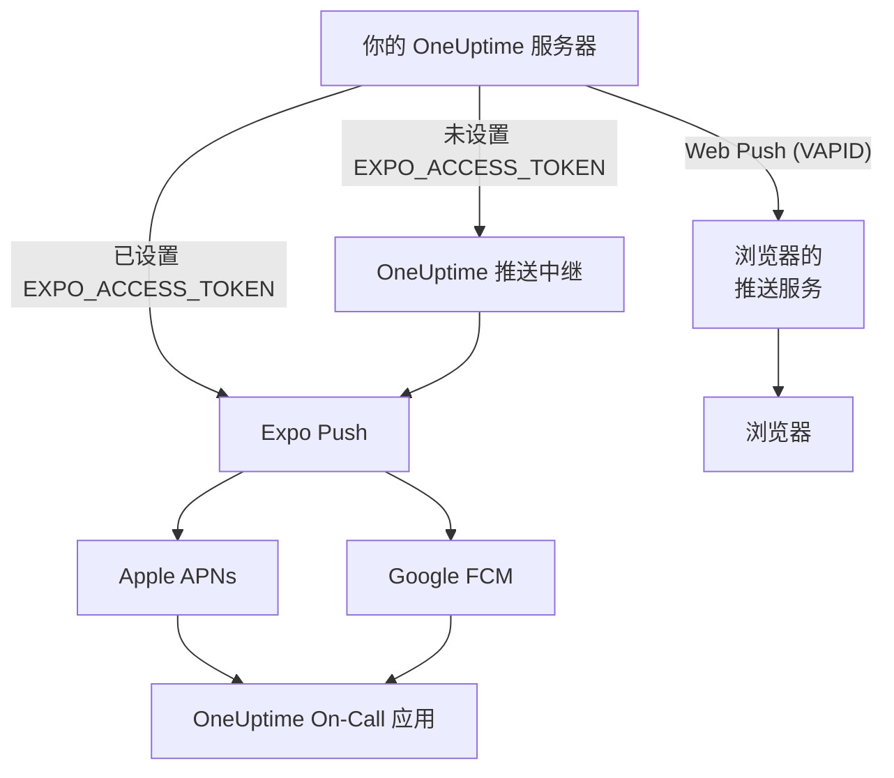
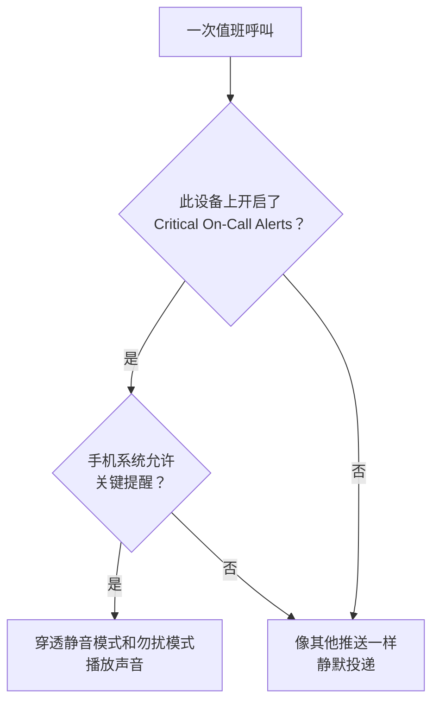

# 推送通知

OneUptime 通过 **OneUptime On-Call** 移动应用在手机上呼叫人员，并通过 Web Push 在浏览器中呼叫。移动推送由 **Expo Push** 提供：自托管实例默认通过 OneUptime 的推送中继发送，因此它只需要能出站访问中继，不需要自己的 Expo、Apple 或 Google 凭据。

:::cards
- [选择推送的发送方式](#自托管设置): 推送中继，或你自己的 Expo 访问令牌。
- [打开防火墙](#网络访问): 你的服务器和团队成员的设备会访问的地址。
- [穿透静音模式](#关键值班告警穿透静音模式): 让值班呼叫在静音的手机上也能响起。
- [修复始终收不到的推送](#故障排除): Expo 的每个错误代表什么。
:::

## 工作原理



OneUptime 移动应用会向后端注册一个 Expo Push 令牌。后端通过 OneUptime 的推送中继发送通知，配置了 `EXPO_ACCESS_TOKEN` 时则直接发送给 Expo。Expo 再把消息转发给 Apple APNs 或 Google FCM，投递到设备上。

Web 推送通知仍然使用 VAPID 密钥和 Web Push 协议。

## 自托管设置

使用官方移动应用和默认中继时，服务器不需要 Expo 凭据。若要通过 Expo 直接投递，请用适合你应用的 Expo 项目的凭据配置 `EXPO_ACCESS_TOKEN`。Web Push 需要 `VAPID_PUBLIC_KEY`、`VAPID_PRIVATE_KEY` 和 `VAPID_SUBJECT`。

| 变量 | Helm 值 | 默认值 | 作用 |
| --- | --- | --- | --- |
| `PUSH_NOTIFICATION_RELAY_URL` | `pushNotification.relayUrl` | `https://oneuptime.com/api/notification/push-relay/send` | 在未设置 `EXPO_ACCESS_TOKEN` 时，移动推送发往的地址。 |
| `EXPO_ACCESS_TOKEN` | `expo.accessToken` | 空 | 使用你的 Expo 项目令牌，把移动推送直接发送给 Expo。 |
| `VAPID_PUBLIC_KEY` | `vapid.publicKey` | 空 | 浏览器订阅时使用的密钥对的公钥部分。 |
| `VAPID_PRIVATE_KEY` | `vapid.privateKey` | 空 | 私钥部分，用于为每条 Web 推送签名。 |
| `VAPID_SUBJECT` | `vapid.subject` | `mailto:support@oneuptime.com` | 浏览器推送服务可以联系到你的联系地址。 |

用 `npx web-push generate-vapid-keys` 生成一次 VAPID 密钥对并妥善保存：用某个密钥对订阅的浏览器，会在密钥对更改后收不到推送。

:::tabs
@tab Docker Compose
```bash title="config.env"
VAPID_PUBLIC_KEY=your-public-key
VAPID_PRIVATE_KEY=your-private-key
VAPID_SUBJECT=mailto:oncall@example.com
# Leave unset to send mobile pushes through the push relay.
EXPO_ACCESS_TOKEN=
```
@tab Kubernetes
```yaml title="values.yaml"
vapid:
  publicKey: your-public-key
  privateKey: your-private-key
  subject: mailto:oncall@example.com
# Leave empty to send mobile pushes through the push relay.
expo:
  accessToken:
```
:::

## 网络访问

| 方向 | 目标 | 协议 / 端口 | 何时需要 |
| --- | --- | --- | --- |
| OneUptime → 默认推送中继 | `https://oneuptime.com/api/notification/push-relay/send`, `https://oneuptime.com/api/notification/push-relay/receipts` | HTTPS / TCP 443 | 未设置 `EXPO_ACCESS_TOKEN` 时的移动推送。 |
| OneUptime → Expo | `https://exp.host/--/api/v2/push/send`, `https://exp.host/--/api/v2/push/getReceipts` | HTTPS / TCP 443 | 设置了 `EXPO_ACCESS_TOKEN` 时的直接移动推送。 |
| OneUptime → 浏览器推送服务 | 浏览器推送订阅中保存的 HTTPS 端点 | HTTPS / 通常为 TCP 443 | Web Push。 |
| 移动应用或浏览器 → OneUptime | 你的 OneUptime 主机名 | HTTPS / TCP 443 | 登录、注册设备并打开通知链接。 |

如果你更改了 `PUSH_NOTIFICATION_RELAY_URL`，请允许其目标主机名和配置的端口。自定义中继必须实现 OneUptime 的中继 API。这些默认值以及中继与直接投递之间的切换，定义在 [OneUptime 的配置](https://github.com/OneUptime/oneuptime/blob/master/config.example.env) 和 [推送服务](https://github.com/OneUptime/oneuptime/blob/master/packages/Common/Server/Services/PushNotificationService.ts) 中。直接发给 Expo 的请求使用 [Expo 发送指南](https://docs.expo.dev/push-notifications/sending-notifications/) 中记录的端点。OneUptime 在同一地址把 `/send` 换成 `/receipts`，从中继读取投递回执。没有该路由的中继仍会投递推送；但这时，应用已被删除的设备只有在之后发往它的推送被拒绝时才会被发现。

对于 Web Push，请允许你的团队所用浏览器的实际订阅端点主机。OneUptime 接受 `fcm.googleapis.com`、`android.googleapis.com`、`push.services.mozilla.com`、`notify.windows.com` 和 `push.apple.com`，包括它们的子域名。典型的例子有 `updates.push.services.mozilla.com` 和 `web.push.apple.com`。目标由 [浏览器的推送订阅](https://developer.mozilla.org/en-US/docs/Web/API/PushSubscription) 提供；只允许 Expo 或 OneUptime 的中继并不能启用 Web Push。

请允许发送通知的 OneUptime 进程进行 DNS 解析和出站 TLS。它的信任库必须能验证目标的证书，代理必须在无需交互式身份验证的情况下放行 API 请求。推送提供商不会调用你的 OneUptime 服务器上的 Webhook，因此只要用户设备能通过 VPN 或其他私有连接访问服务器，服务器就可以保持私有。无法访问其中继或外部推送服务的服务器无法投递这些通知。

设备的连通性是另一项要求。iOS 设备需要访问 APNs，通常是 TCP 5223，并以 TCP 443 作为后备；目标地址范围请参阅 [Apple 当前的网络要求](https://support.apple.com/en-us/102266)。Android 设备需要通过 TCP 5228–5230 和 443 访问 FCM；请参考 [Google 当前的主机和防火墙指引](https://firebase.google.com/docs/cloud-messaging/network-configuration)。这些设备端口不需要在 OneUptime 上开放入站，服务器端的移动推送流程使用中继或 Expo，而不是直接连接 APNs/FCM。

:::steps
1. 从发送通知的容器或 Pod 检查到你的投递方式目标（中继、Expo 或某个浏览器的推送服务）的 DNS 和 HTTPS。
2. 在 **用户设置 > 通知方式 > Push Notifications** 中用 **测试通知** 发送一次测试，并确认它到达已注册的设备。对于 Web Push，请分别测试每个浏览器。
3. 在 OneUptime 日志中检查中继、Expo 或 Web 推送的错误；仅仅成功提交到 API，并不能确认已投递到设备。
:::

对于移动推送，OneUptime 还会在每次推送约 15 分钟后读取 Expo 的投递回执：从未到达设备的推送随后会在推送日志中显示为未投递；如果是值班呼叫，还会显示在值班时间线上。

## 关键值班告警（穿透静音模式）

默认情况下，推送通知服从手机的设置：静音的手机保持安静，勿扰模式会拦下通知。对值班人员来说，凌晨 3 点这样的默认行为是错误的，因此移动应用提供了按设备设置的 **Settings > Notifications > Critical On-Call Alerts**，让*仅值班呼叫*能够穿透这两者发出声音。

范围是刻意收窄的。只有值班通知规则产生的呼叫才符合条件。所有者订阅、发布备注的提醒、状态变更更新和监视器通知，无论这项设置如何，都不会被升级。



呼叫要穿透静音模式，必须同时满足三个条件。只要缺少任何一个，呼叫仍会投递——只是静默投递。

1. **值班人员在该设备上开启了它。** 按设备存储在 `UserPush.isCriticalAlertEnabled` 中，默认关闭。同一个人的手机和平板是分别决定的。
2. **服务器把呼叫标记为关键。** 它为 iOS 发送 APNs 的关键声音负载以及 `interruptionLevel: critical`，并为 Android 指定 `oncall_critical` 通知渠道。
3. **操作系统允许它**，这正是两个平台的不同之处。

:::tabs
@tab iOS
iOS 上的关键提醒需要 `com.apple.developer.usernotifications.critical-alerts` 权限（entitlement），Apple 会应申请按开发者账号授予那些就紧急事件通知用户的应用。请通过 [Apple 的 Critical Alerts 申请表](https://developer.apple.com/contact/request/notifications-critical-alerts-entitlement/) 申请。

App Store 上的官方 **OneUptime On-Call** 应用从 **1.5.0 版本** 起带有该权限。更早的版本没有，iOS 也从不为它们提供关键提醒，所以在开启这项设置之前，请先更新应用。

如果你自己构建应用，该权限是可选的。描述文件无法携带未授予该团队的权限，而声明了无法携带的权限的构建会**签名失败**。只有 `packages/MobileApp/eas.json` 中的 `production` 配置开启了它，因为 Apple 已将其授予发布官方应用的团队。使用自己的 Apple 团队签名的分支，必须删除该 `env` 条目，直到 Apple 也向该团队授予此权限。获得授予后，在构建时开启它：

```bash
EXPO_IOS_CRITICAL_ALERTS_ENTITLEMENT=true npx expo prebuild
```

或者在 `packages/MobileApp/eas.json` 中构建配置的 `env` 块里添加 `EXPO_IOS_CRITICAL_ALERTS_ENTITLEMENT: "true"`。

在设备上，于应用中开启 **Settings > Notifications > Critical On-Call Alerts**，并在 iOS 询问时允许关键提醒。只有在应用请求了权限之后，iOS 才会在 iOS 设置的 **Settings > Notifications > OneUptime On-Call** 下为应用添加 **Critical Alerts** 开关，因此在你于应用中开启这项设置之前，那个开关并不存在。如果你拒绝了请求，之后仍可以在 iOS 设置中用那个开关允许关键提醒。

在没有该权限的构建上，iOS 既不显示请求也不显示开关，应用的设置页面会说明此版本的应用无法接收关键提醒。它不会让值班人员去找一个 iOS 根本没有显示的开关。
@tab Android
Android 没有厂商审批步骤，但绕过勿扰模式要由用户在系统界面中授予，而不是通过应用内的请求。值班人员开启这项设置时，应用会为其打开 **Settings > Notifications > Do Not Disturb access**，并在其返回时再次检查。

这里有两种机制在起作用，它们覆盖不同的情况：

- `oncall_critical` 通知渠道请求 `bypassDnd`，它覆盖勿扰模式，并需要上述访问权限。
- 同一渠道使用**闹钟**音频流，在仅仅把铃声静音的手机上也能听到。这一半完全不需要任何权限。

Android 会在渠道首次创建时冻结其设置，因此无法通过应用更新来更改——只能发布一个新的渠道 id。
:::

要检查它是否生效，请从 **用户设置 > 通知方式 > Push Notifications** 向设备发送一条测试通知。当设备开启了关键提醒时，测试也会作为关键提醒发送——所以先把手机静音，你就能听出真正的呼叫是否能到达你。

## 故障排除

### 推送通知没有到达

- 确保移动应用是用 EAS Build 构建的（Expo Go 不支持推送通知）
- 检查设备是否已注册在数据库的 `UserPush` 表中
- 在 OneUptime 服务器日志中检查 Expo Push API 错误
- 确认设备有可用的互联网连接，并已启用通知权限
- 检查 **用户设置 > 通知方式 > Push Notifications**：标记为 **未收到通知** 的设备已停止接收通知，需要重新注册（见下文）

### iOS 设置中没有 Critical Alerts 开关

- 从 App Store 更新 OneUptime On-Call。1.5.0 之前的版本在构建时没有 Apple 的关键提醒权限，iOS 完全不会为它们显示 Critical Alerts 开关
- 在应用中开启 **Settings > Notifications > Critical On-Call Alerts**。只有在应用请求权限之后，iOS 才会把这个开关添加到它自己的设置中，而应用会在这项设置开启时请求权限
- 删除再重新添加值班通知规则或推送设备，并不会改变这一点。这项设置属于设备上的应用，而不是某条规则

### 关键提醒没有穿透静音模式

- 检查**那台**设备上的开关是否已开启——这项设置按设备区分，重新安装或从零设置的新手机会创建新的设备注册（从旧手机备份恢复的手机，会在旧手机不再接收通知时接管旧手机的注册，并保留应用原有的设置）
- **iOS**：确认构建带有 Apple 的关键提醒权限（见上文），并且已在 iOS Settings > Notifications > OneUptime On-Call 下允许 Critical Alerts
- **Android**：确认应用在 Settings > Notifications > Do Not Disturb access 下拥有勿扰访问权限
- 设置页面会说明缺少的是哪一项；它会从操作系统读回当前状态，而不是相信应用上一次请求的内容

### 标记为"未投递"的推送

Expo 接受了推送，并不意味着推送已到达设备：Apple 或 Google 仍可能拒绝它。OneUptime 会在发送每条移动推送约 15 分钟后读取其投递回执；未设置 `EXPO_ACCESS_TOKEN` 时，通过推送中继读取。当回执报告错误时，推送日志和该呼叫的值班时间线会从已发送变为 **Push notification not delivered**，并附上 Expo 的错误代码：

- `DeviceNotRegistered`：移动应用已从设备上删除，或其推送令牌已失效。请参阅下一节。
- `MessageRateExceeded`：短时间内向设备发送了太多通知。之后发往它的推送会照常发送。
- `MessageTooBig`：通知超出了推送服务接受的大小。OneUptime 会缩短通知以适应大小，所以这种情况不应发生；如果发生了，请告诉我们。
- `InvalidCredentials` 或 `MismatchSenderId`：发送该推送的 Expo 项目的推送凭据无效。使用 `EXPO_ACCESS_TOKEN` 时，请检查你的 Expo 项目的推送凭据；使用默认中继时，请联系 OneUptime 支持。

当 Expo 当场拒绝推送时，推送日志会立即给出原因。通过推送中继也一样：中继会传回 Expo 的错误代码，而不是以服务器错误作答。

### 日志中的"DeviceNotRegistered"错误

当移动应用已从设备上删除，或设备的推送令牌已失效时，Expo 会报告 `DeviceNotRegistered`。它通常在推送的投递回执中说明这一点，OneUptime 会在推送约 15 分钟后读取该回执；有时 Expo 也会当场拒绝推送。无论哪种情况，OneUptime 都会停止向该设备发送。该设备会被标记为不再接收通知，而不是被删除，因此它的通知规则会保留，而未到达的那次呼叫的推送日志和值班时间线会说明原因。**用户设置 > 通知方式 > Push Notifications** 会将其显示为 **未收到通知**。其所有者的其他设备和通知方式仍会收到呼叫。

要恢复该设备，请在登录状态下在其上打开移动应用。应用会重新注册，从而在 Expo 处更新其推送令牌，设备会按照其规则重新接收通知。如果应用已被删除，请重新安装并登录。应用重新注册之前所发推送的回执不会标记该设备。当最新的移动应用从旧手机的备份恢复到新手机上时，它会把之前的推送令牌告诉 OneUptime；如果旧手机的设备不再接收通知，新手机就会连同其规则一起接管它。

通过推送中继（未设置 `EXPO_ACCESS_TOKEN`）时也是如此：中继在发送推送时报告 `DeviceNotRegistered`，并读取你的实例向它查询的投递回执。

如果以上都没有帮助，请带上 OneUptime 日志中的错误，通过 [hello@oneuptime.com](mailto:hello@oneuptime.com) 联系我们。

## 后续步骤

:::cards
- [移动应用](/docs/mobile-desktop-apps/index): 安装 OneUptime On-Call 应用并登录。
- [移动应用故障排除](/docs/mobile-desktop-apps/faq-troubleshooting): 解决手机上的登录和通知问题。
- [升级规则](/docs/on-call/escalation-rules): 决定呼叫谁，以及何时呼叫。
- [私有网络访问](/docs/self-hosted/private-network-access): 你的服务器在你自己的网络中可以访问什么。
:::
