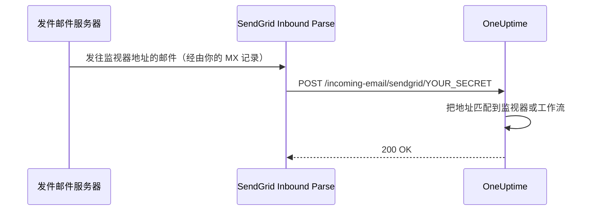

# SendGrid 入站邮件

OneUptime 的 **Incoming Email Monitor** 让你可以根据发送到唯一、按监视器区分的电子邮件地址的邮件来创建和解决告警。这对于集成旧系统、告警工具或任何能够发送邮件的服务都很有用。

同样的设置也让工作流可以接收邮件：带有 **Incoming Email** 触发器的工作流会在同一个域名上获得自己的地址，发往该地址的每封邮件都会启动该工作流。参见[触发器](/docs/workflows/triggers#incoming-email)。

本指南说明如何设置 SendGrid Inbound Parse，把入站邮件转发到你的自托管 OneUptime 实例。OneUptime Cloud 不需要这些设置：它的地址开箱即用。

:::cards
- [开始之前](#先决条件): 一个 SendGrid 账号、一个域名和一个公开的 HTTPS 地址。
- [进行设置](#设置说明): 从 MX 记录到测试邮件的七个步骤。
- [环境变量](#环境变量参考): 三项设置及其默认值。
- [故障排除](#故障排除): 始终收不到的邮件和失败的 Webhook。
:::

## 工作原理



1. 你在 OneUptime 中创建一个 **Incoming Email Monitor**
2. OneUptime 为该监视器生成一个唯一的电子邮件地址（例如 `monitor-abc123@inbound.yourdomain.com`）
3. 当有邮件发往该地址时，SendGrid 接收它并通过 Webhook 转发给 OneUptime
4. OneUptime 根据你配置的条件评估该邮件，以创建或解决告警

## 先决条件

- 一个可以使用 Inbound Parse 的 SendGrid 账号
- 一个由你控制、可以修改 DNS 设置的域名
- 一个把 SendGrid Webhook 转发到你的 OneUptime 实例的公开 HTTPS 端点

## 网络访问

使用 Inbound Parse 时，是 SendGrid 主动连接 OneUptime。只允许 OneUptime 出站访问互联网是不够的。

| 方向 | 目标 | 协议 / 端口 | 用途 |
| --- | --- | --- | --- |
| SendGrid → OneUptime | `https://your-oneuptime-domain.com/incoming-email/sendgrid/YOUR_SECRET` | HTTPS / TCP 443 | 以 multipart POST 投递解析后的邮件。 |
| 发件邮件服务器 → SendGrid | `mx.sendgrid.net`，由你的入站域名的公开 MX 记录选定 | SMTP / TCP 25 | 在 SendGrid 接收邮件；此连接不会到达你的 OneUptime 服务器。 |
| OneUptime → SendGrid，仅当单独配置了通过 SendGrid 提供商发送邮件时 | `api.sendgrid.com` | HTTPS / TCP 443 | 通过 Mail Send API 发送通知邮件。 |

为 Webhook 主机名发布 DNS，并提供公共客户端信任的证书。私有部署的 OneUptime 可以只通过一个能从内部访问 OneUptime 的公共反向代理或网关暴露 Webhook 路径。保留路径、密钥、内容类型和 multipart 请求体，并让 POST 无需交互式登录或浏览器质询即可通过。OneUptime 服务器不需要入站 SMTP 监听器。参见 [SendGrid 的 Inbound Parse 设置](https://www.twilio.com/docs/sendgrid/for-developers/parsing-email/setting-up-the-inbound-parse-webhook)。

把 `INBOUND_EMAIL_WEBHOOK_SECRET` 设为一个强随机值，并用该值替换 URL 中的 `YOUR_SECRET`。该路由要求包含最后一个路径段。配置了密钥时，OneUptime 会检查它的值；把变量留空则会关闭这项检查。请对完整 URL 和监视器的电子邮件地址保密，包括在代理日志中。OneUptime 目前不验证 SendGrid 签名的 Inbound Parse 头或 OAuth 令牌。如果你需要这些机制，请按照 [SendGrid 的 Webhook 安全文档](https://www.twilio.com/docs/sendgrid/for-developers/parsing-email/securing-your-parse-webhooks) 配置一个网关，在转发给 OneUptime 之前先验证它们。

SendGrid 没有为 Inbound Parse 提供可靠的静态源 IP 列表。它发送邮件所用的 IP，以及 `mx.sendgrid.net` 解析出的地址，都不能作为 Webhook 的允许列表。请遵循 [SendGrid 的防火墙指引](https://support.sendgrid.com/hc/en-us/articles/44375457225371-How-to-Configure-Firewall-Settings-for-SendGrid-Webhook-and-Inbound-Parse-IPs)，而不是固定一个当前的 DNS 结果。

Inbound Parse 与出站邮件发送是分开的。接收监视器邮件不需要 OneUptime 调用 SendGrid API。如果你也选择 SendGrid 发送通知，请允许 DNS 解析以及到 `api.sendgrid.com` 的出站 HTTPS；[Mail Send](https://www.twilio.com/docs/sendgrid/api-reference/mail-send/mail-send) 提交时不需要任何入站回调。如果改用 SMTP，请允许在 OneUptime 中配置的 SMTP 服务器和端口。

## 设置说明

:::steps
### 选择你的入站邮件域名

选择一个专门用于为 OneUptime 接收邮件的子域名，例如 `inbound.yourdomain.com`、`email.yourdomain.com` 或 `monitor.yourdomain.com`。它只用于发往 OneUptime 监视器和工作流的邮件，因此你的任何邮箱都不在它上面。

### 把它的 MX 记录指向 SendGrid

添加一条 MX 记录，把该子域名的邮件路由到 SendGrid：

| 类型 | 主机/名称 | 优先级 | 值 |
| --- | --- | --- | --- |
| MX | inbound | 10 | mx.sendgrid.net |

如果你的域名是 `example.com`，而你使用 `inbound.example.com`，记录如下：

```text
inbound.example.com.  IN  MX  10  mx.sendgrid.net.
```

DNS 更改最多可能需要 48 小时才能传播，但通常在几小时内完成。

### 在 SendGrid 中验证域名

接收域名必须属于你在 [SendGrid 中已验证的域名](https://www.twilio.com/docs/sendgrid/ui/account-and-settings/inbound-parse)之一。在 [SendGrid 控制台](https://app.sendgrid.com)中，进入 **Settings** > **Sender Authentication**，点击 **Authenticate Your Domain**，并添加它要求的 DNS 记录（用于 DKIM 的 CNAME 记录）。

### 添加 Inbound Parse Webhook

在 SendGrid 控制台中，进入 **Settings** > **Inbound Parse** 并点击 **Add Host & URL**。按下表填写，然后点击 **Add**：

| 字段 | 值 |
| --- | --- |
| **Receiving Domain** | 你的入站子域名（例如 `inbound.yourdomain.com`） |
| **Destination URL** | `https://your-oneuptime-domain.com/incoming-email/sendgrid/YOUR_SECRET` |
| **Check incoming emails for spam** | 可选——按需启用 |
| **Send raw, full MIME message** | 保持不勾选（不需要） |
| **POST the raw, full MIME message** | 保持不勾选（不需要） |

### 配置 OneUptime

设置入站邮件变量，密钥与 Destination URL 中的相同：

:::tabs
@tab Docker Compose
```bash title="config.env"
INBOUND_EMAIL_PROVIDER=SendGrid
INBOUND_EMAIL_DOMAIN=inbound.yourdomain.com
INBOUND_EMAIL_WEBHOOK_SECRET=replace-with-a-strong-random-secret
```
@tab Kubernetes
```yaml title="values.yaml"
inboundEmail:
  provider: "SendGrid"
  domain: "inbound.yourdomain.com"
  webhookSecret: "replace-with-a-strong-random-secret"
```
:::

然后应用它们：在 Docker Compose 上运行 `npm run start`，它会用新值重新创建容器；在 Kubernetes 上则升级 Helm 发布。

### 创建 Incoming Email 监视器

[创建 Incoming Email 监视器](/docs/monitor/incoming-email-monitor#创建入站邮件监视器)。它的 **概览** 页面会显示它的地址，例如 `monitor-abc123def456@inbound.yourdomain.com`，它的条件决定哪些邮件创建告警、哪些邮件解决告警。

工作流使用同一个域名。把 **Incoming Email** 触发器添加到工作流并点击它：它的地址（`workflow-…@inbound.yourdomain.com`）显示在其设置的顶部。在设置上面的入站邮件变量之前，触发器会提示服务器尚未设置为接收邮件。

### 发送测试邮件

向监视器的地址发送一封主题符合其条件的邮件。监视器的摘要会显示这封邮件，条件匹配时会创建告警。
:::

## 环境变量参考

| 变量 | Helm 值 | 说明 | 必需 | 默认值 |
| --- | --- | --- | --- | --- |
| `INBOUND_EMAIL_PROVIDER` | `inboundEmail.provider` | 入站邮件提供商。只有 SendGrid 一种。 | 否 | `SendGrid` |
| `INBOUND_EMAIL_DOMAIN` | `inboundEmail.domain` | 为入站邮件配置的子域名。设置之前，入站邮件处于关闭状态。 | 是 | 空 |
| `INBOUND_EMAIL_WEBHOOK_SECRET` | `inboundEmail.webhookSecret` | 与 Webhook URL 最后一段 `/incoming-email/sendgrid/YOUR_SECRET` 比较的密钥。为公开端点配置它；空值会关闭验证。 | 建议 | 空 |

Incoming Email 监视器可以依据哪些内容进行匹配——主题、发件人、正文、收件人，以及邮件是否按时到达——请参阅[可用的过滤器类型](/docs/monitor/incoming-email-monitor#可用的过滤器类型)。

## 故障排除

:::details 收不到邮件
1. **检查 DNS 传播：** `dig MX inbound.yourdomain.com` 应返回 `mx.sendgrid.net`。
2. **核对 SendGrid Inbound Parse 设置：** 在 SendGrid 控制台的 **Settings** > **Inbound Parse** 下，检查你的域名和 Webhook URL。
3. **检查 OneUptime 日志：** 在 OneUptime `app` 服务的日志中查找入站邮件 Webhook 请求及任何错误。SendGrid 不为 Inbound Parse 保留详细日志，因此这些日志就是到达内容的记录。
:::

:::details Webhook 失败
1. **检查公开的 Webhook 路由：** 包含密钥的完整 URL 必须能从互联网到达 OneUptime。缺少最后一个密钥段的 URL 不匹配该路由。
2. **检查防火墙规则：** 允许发往 Webhook 路径的 HTTPS POST 请求，不要有登录重定向或浏览器质询，也不要把 SendGrid 的邮件发送 IP 用作 Webhook 来源允许列表。
3. **核对 SSL 证书：** 为 Webhook 主机名使用有效且受公众信任的证书，并包含其证书链。
:::

:::details 监视器不创建告警
1. **核对条件：** 检查你的告警创建条件是否与邮件内容匹配，在使用模式匹配之前先用精确字符串测试。
2. **检查监视器：** 确认它没有被禁用，并且类型是 Incoming Email。
3. **查看监视器的摘要：** 检查邮件是否已接收并处理，并阅读评估日志，了解条件是如何匹配的。
:::

:::details 触发器提示服务器尚未设置为接收邮件
服务器上的 `INBOUND_EMAIL_DOMAIN` 为空。设置它，应用更改，然后重新打开工作流的触发器。
:::

## 安全最佳实践

1. **使用 HTTPS：** Webhook 端点始终使用 HTTPS
2. **Webhook 密钥：** 配置 `INBOUND_EMAIL_WEBHOOK_SECRET`，并把它包含在 Webhook URL 中（例如 `/incoming-email/sendgrid/your-secret`）作为额外验证
3. **域名验证：** 在 SendGrid 中验证你的域名，以提高邮件安全性
4. **限制访问：** 只为可信的邮件来源创建监视器
5. **监控日志：** 定期检查入站邮件日志，留意可疑活动

## 后续步骤

:::cards
- [Incoming Email Monitor](/docs/monitor/incoming-email-monitor): 条件、地址格式和示例。
- [工作流触发器](/docs/workflows/triggers): 通过邮件启动工作流。
- [私有网络访问](/docs/self-hosted/private-network-access): 你的服务器在你自己的网络中可以访问什么。
- [架构](/docs/self-hosted/architecture): 在自托管安装中 Webhook 到达哪里。
:::
