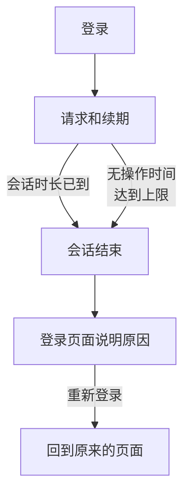

# 会话时长

选择用户在需要重新登录之前保持登录 OneUptime 的时长：登录后的固定时间、未使用的时间，或两者都设。它适用于每一次登录仪表板、Admin Dashboard 和移动应用，无论使用密码、通行密钥、Google 登录、Microsoft 登录还是单点登录。SSO 登录可以有自己的时长。

> [!NOTE]
> 会话时长是 [OneUptime Enterprise Edition](/docs/self-hosted/enterprise) 的一部分。Community Edition 没有 **会话时长** 页面，每次登录的时长如 [无限制](#无限制) 所述。

:::cards
- [设置会话时长](#设置会话时长)：Admin Dashboard 中的两项设置。
- [会话如何结束](#会话如何结束)：服务器统计什么，以及何时统计。
- [SSO 登录](#sso-登录)：单点登录自己的时长。
- [哪些不算登录](#哪些不算登录)：API 密钥、MCP 连接和状态页的读者。
:::

## 无限制

在你设置时长之前，登录没有时长限制。它的访问令牌有效 15 分钟，并在后台用刷新令牌续期；刷新令牌有效 30 天，每次使用都会重新计时。至少每 30 天打开一次 OneUptime 的人会保持登录，没有打开的人需要重新登录。

## 设置会话时长

:::steps
### 打开会话时长
在 Admin Dashboard 中打开 **设置**，然后在侧边菜单中打开 **会话时长**。

### 选择时长
- **自动退出登录时间**：从登录那一刻起，无论用户多么活跃，登录能持续多久。
- **无操作自动退出登录时间**：用户在 OneUptime 中不点击、不输入、不滚动可以持续多久。

每次选择都会立即保存。

### 确认哪些人会退出登录
更短的时长会应用于当前所有已登录的人。如果它会让一些人立即退出登录，OneUptime 会先告诉你人数，以及你是否在其中。选择 **保存并让他们退出登录** 即可继续。
:::

| 设置 | 可选范围 | 默认值 |
| --- | --- | --- |
| **自动退出登录时间** | 1 小时到 90 天 | **无限制** |
| **无操作自动退出登录时间** | 15 分钟到 14 天 | 30 天，也是最长时长 |

通过 API，在服务器的全局配置中，`sessionLengthInMinutes` 接受 15 到 525600（一年）之间的任意整数分钟，`sessionIdleTimeoutInMinutes` 接受 15 到 43200（30 天）。留空即为默认值。

## 会话如何结束

- 服务器根据会话本身统计这两个时长：它何时登录，以及它的用户最后一次活跃是什么时候。服务器会在每次请求、每次续期和每次实时更新时检查它们，从不把退出登录交给浏览器。
- 无操作时间从仪表板或 Admin Dashboard 任意标签页中最后一次点击、按键或滚动开始计算。只是开着的标签页不会让会话保持有效。
- 移动应用每次被使用时都算作活跃。
- 会话结束时，浏览器会转到登录页面，并说明原因。重新登录后，用户会回到原来所在的页面。

| 更改 | 当前已登录的人会怎样 |
| --- | --- |
| 更短的会话时长或无操作时间 | 已经超过的人会立即退出登录，其他人在达到时退出登录 |
| 更长的时长，或不限制 | 没有人会退出登录，会话从下一次续期起持续更久 |

## SSO 登录

通过单点登录的登录也遵循同样的两项设置。要为它们单独设置时长，请在 **会话时长** 页面上打开 **更多设置**，然后开启 **为 SSO 登录单独设置时长**。之后，它下方的两项设置会应用于通过项目的 SAML 或 OpenID Connect 提供商，或通过服务器自身的 [全局 SSO](/docs/identity/global-sso) 的登录，而页面顶部的两项设置应用于其他所有登录。它们一开始与其他所有登录的时长相同，因此在您选择其他时长之前，开启它不会带来任何变化。

此外，要求 SSO 的项目只在会话的 SSO 登录仍然有效时才允许其进入，而这一时间不会超过 SSO 登录所遵循的时长。

通过 API，该开关是 `useSeparateSsoSessionLengths`，SSO 登录的时长是 `ssoSessionLengthInMinutes` 和 `ssoSessionIdleTimeoutInMinutes`，范围相同。

## 哪些不算登录

- **API 密钥** 保留你为其设置的有效期。
- **MCP 连接**，即通过 OAuth 连接的 AI 助手，保留它们自己的有效期。在要求 SSO 的项目中，连接的有效时间不会超过批准它时所用的 SSO 登录。
- **私有状态页** 为其读者设有自己的时长：参见 [私有用户](/docs/status-pages/index#私人用户)。

## 没有许可证时

试用期或宽限期结束后，如果没有有效的许可证，或许可证不包含会话时长，就无法设置或更改时长。已设置的时长仍会让用户退出登录，你仍可以将其移除。使用 Community Edition 镜像时不应用任何时长：这些值保留在数据库中，切换回来后会再次生效。

## 后续步骤

:::cards
- [SSO](/docs/identity/sso)：让用户通过你的身份提供商登录。
- [全局 SSO](/docs/identity/global-sso)：整个服务器使用一个身份提供商。
- [Enterprise Edition](/docs/self-hosted/enterprise)：Enterprise Edition 增加了什么，以及它的许可证。
:::
