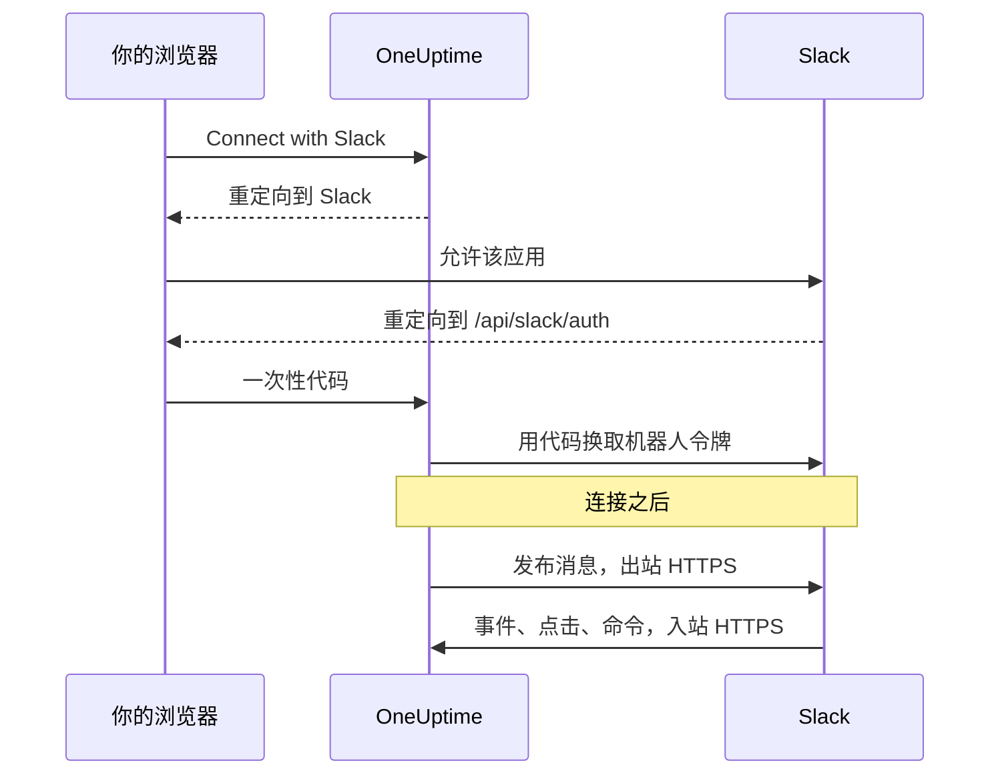
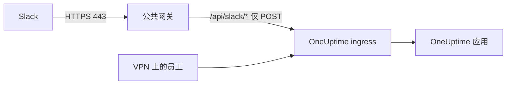

# Slack 集成

将你自托管的 OneUptime 连接到 Slack。你用服务器生成的清单创建一个 Slack 应用，把应用的凭据交给 OneUptime，再把每个项目连接到一个工作区。之后，OneUptime 会把事件、告警和计划维护发布到你的频道，团队可以直接在 Slack 中处理它们。

本页面向运行 OneUptime 服务器的人员。Slack 连接后，通知规则按项目设置：请参阅 [Slack](/docs/workspace-connections/slack)。

:::cards
- [设置 Slack 应用](#设置-slack-应用): 用你的清单创建应用，并连接一个项目。
- [环境变量](#环境变量): OneUptime 需要从应用获取的三个值。
- [网络访问](#自托管部署的网络访问): Slack 必须能够访问的回调。
- [故障排除](#故障排除): Slack 页面上的消息是什么意思，以及该怎么做。
:::

## 工作原理

Slack 应用归你所有：它安装在你的工作区中，只与你的服务器通信。流量是双向的，每个方向都需要各自的网络访问。



- **出站**：OneUptime 调用 Slack 的 Web API 来发布消息、创建频道和上传图片。
- **入站**：Slack 调用你服务器上的四个路由，用于事件、按钮点击、菜单和斜杠命令。每个请求都用应用的 signing secret 签名。签名不匹配或时间戳超过五分钟的请求会被 OneUptime 拒绝。

## 开始之前

- 一个你可以在其中创建和安装应用的 Slack 工作区。
- 一个 Slack 能访问的 OneUptime 公共 HTTPS 主机名。请参阅 [网络访问](#自托管部署的网络访问)。
- 服务器配置的访问权限：Docker Compose 使用 `config.env`，Kubernetes 使用你的 Helm values。
- 要连接项目，需要在该项目中拥有 **Project Owner**、**Project Admin** 或 **Project Member** 角色。

## 设置 Slack 应用

:::steps
### 设置公共 URL

OneUptime 根据 `HOST` 和 `HTTP_PROTOCOL` 生成应用清单和每个回调 URL。将它们设置为 Slack 将通过 HTTPS 调用的主机名：

:::tabs
@tab Docker Compose
```bash title="config.env"
HOST=oneuptime.example.com
HTTP_PROTOCOL=https
```
@tab Kubernetes
```yaml title="values.yaml"
host: oneuptime.example.com
httpProtocol: https
```
:::

这些值只用于生成 URL，不会创建 DNS 记录、证书或防火墙规则。

### 复制应用清单

打开 **项目设置 > 工作区 > Slack**。在服务器上设置好 Slack 之前，该页面显示 **Integrating Slack with your OneUptime Project**，以及为你的主机名生成的清单。清单也可以在 `https://oneuptime.example.com/api/slack/app-manifest` 获取。

检查清单中的每个 URL 是否都以你的公共主机名开头。如果不是，请先修正 `HOST` 和 `HTTP_PROTOCOL` 并应用更改。

### 创建 Slack 应用

在 [api.slack.com/apps](https://api.slack.com/apps) 上从清单创建一个新应用，选择你的工作区并粘贴清单。请始终使用你自己的服务器生成的清单，这样其中的 URL 才与你的主机名一致。

### 复制应用的凭据

在应用的 **Basic Information** 页面中，在 **App Credentials** 下复制 **Client ID**、**Client Secret** 和 **Signing Secret**。

### 将凭据添加到 OneUptime

:::tabs
@tab Docker Compose
```bash title="config.env"
SLACK_APP_CLIENT_ID=YOUR_SLACK_APP_CLIENT_ID
SLACK_APP_CLIENT_SECRET=YOUR_SLACK_APP_CLIENT_SECRET
SLACK_APP_SIGNING_SECRET=YOUR_SLACK_APP_SIGNING_SECRET
```
@tab Kubernetes
```yaml title="values.yaml"
slackApp:
  clientId: "YOUR_SLACK_APP_CLIENT_ID"
  clientSecret: "YOUR_SLACK_APP_CLIENT_SECRET"
  signingSecret: "YOUR_SLACK_APP_SIGNING_SECRET"
```

如果要把这些值保存在你自己管理的 Kubernetes Secret 中，请改为设置 `slackApp.existingSecret`：它的 `name`，以及键 `clientIdKey`、`clientSecretKey` 和 `signingSecretKey`。
:::

### 应用配置

:::tabs
@tab Docker Compose
```bash
npm run start
```

这会用新的 `config.env` 重新创建容器。`docker compose restart` 不会重新读取它。
@tab Kubernetes
```bash
helm upgrade my-oneuptime oneuptime/oneuptime -f values.yaml
```
:::

OneUptime 恢复运行后，**项目设置 > 工作区 > Slack** 会显示 **Connect with Slack** 按钮，而不是清单。

### 验证事件请求 URL

在 Slack 应用的 **Event Subscriptions** 中验证请求 URL。只有设置了 signing secret 之后，OneUptime 才会响应 Slack 的 challenge，所以如果在创建应用时验证失败了，请重试。

### 连接项目

在 **项目设置 > 工作区 > Slack** 中选择 **Connect with Slack**，并在 Slack 中允许该应用。Slack 会把你送回同一页面，页面上现在会显示你的工作区。

### 连接你自己的 Slack 账号

按钮、表单和命令会以与使用它们的 Slack 账号关联的 OneUptime 用户身份执行。每个人打开 **用户设置 > 工作区 > Slack** 并选择 **Connect my account with Slack**。尚未连接账号的人会收到应用发来的私信，请他们完成连接。
:::

## 环境变量

| Docker Compose (`config.env`) | Helm (`values.yaml`) | 必需 | 值 |
| --- | --- | --- | --- |
| `SLACK_APP_CLIENT_ID` | `slackApp.clientId` | 是 | 应用的 **Client ID**。没有它时，Slack 页面会显示设置指南，而不是 **Connect with Slack**。 |
| `SLACK_APP_CLIENT_SECRET` | `slackApp.clientSecret` | 是 | 应用的 **Client Secret**，用于把 Slack 返回的代码换成令牌。 |
| `SLACK_APP_SIGNING_SECRET` | `slackApp.signingSecret` | 是 | 应用的 **Signing Secret**。来自 Slack 的每个请求都用它校验。 |
| `HOST` | `host` | 是 | 你的公共主机名，不含协议。 |
| `HTTP_PROTOCOL` | `httpProtocol` | 是 | `https`。Slack 只调用 HTTPS URL。 |

## 应用能做什么

清单会设置以下功能。每项功能都通过所示的路由访问你的服务器，因此只有当 Slack 能访问该路由时才能使用。

| 功能 | 作用 | 路由 |
| --- | --- | --- |
| `/incident` 和 **Create New Incident** 快捷方式 | 在 Slack 中声明事件 | `POST /api/slack/interactive` |
| `/maintenance` 和 **Create Scheduled Event** 快捷方式 | 在 Slack 中安排维护 | `POST /api/slack/interactive` |
| `/oneuptime` | 向 OneUptime AI 询问你的日志、追踪、指标、事件和监控器 | `POST /api/slack/command` |
| OneUptime 消息中的按钮和表单 | 确认、解决、添加备注、更改状态、运行值班策略 | `POST /api/slack/interactive` 和 `POST /api/slack/options-load` |
| 事件 | 提及、消息、表情回应和置顶，例如把一条消息保存为备注 | `POST /api/slack/events` |

### 消息中的图片

事件和告警的描述可以包含截图，例如合成监控器的截图（请参阅 [合成监控器](/docs/monitor/incident-alert-templating#合成监控器)）。OneUptime 会把每张截图作为私有文件上传到你的工作区，从而在 Slack 消息中显示它们，这需要机器人权限范围 `files:write`。生成的清单包含它。

如果你的 Slack 应用是用较旧的清单创建的，请在 **OAuth & Permissions > Bot Token Scopes** 下添加 `files:write`（或用当前清单更新应用）。然后在 **项目设置 > 工作区 > Slack** 中再次选择 **Connect with Slack**，以授予新的权限范围。在此之前，每张截图都会显示为其替代文本。

## 自托管部署的网络访问

### 流量方向和端点

| 流量 | 所需访问 |
| --- | --- |
| OneUptime 到 Slack | DNS，以及通过 TCP 443 到 `slack.com` 的出站 HTTPS，用于 Web API 调用和 OAuth 令牌交换；使用时，还需要到 `hooks.slack.com` 的访问，用于命令的响应 URL 和传入 Webhook 通知 |
| Slack 到 OneUptime | 通过 TCP 443 到下面四个 POST 路由的公共 HTTPS，用于完整的集成 |
| 用户浏览器到 OneUptime | 仪表板访问，以及到 `/api/slack/auth/:projectId/:userId` 和 `/api/slack/auth/:projectId/:userId/user` 的 OAuth 重定向；这些可以继续只通过用户的 VPN 访问 |

出站域名描述的是 OneUptime 的 Slack 集成，而不是 Slack 客户端或每项 Slack 功能的完整允许列表。Slack 的*传入 Webhook* 由 Slack 托管：OneUptime 向它发送消息，所以它不是你服务器上的入站端点。请参阅 Slack 的 [传入 Webhook 指南](https://docs.slack.dev/messaging/sending-messages-using-incoming-webhooks/)。

通过 ingress 将以下回调转发到 OneUptime：

| 方法和路径 | 用途 |
| --- | --- |
| `POST /api/slack/events` | Events API 验证、表情回应、置顶、提及和消息 |
| `POST /api/slack/interactive` | 按钮、快捷方式、模态框提交、`/incident` 和 `/maintenance` |
| `POST /api/slack/options-load` | 交互式菜单的选项请求 |
| `POST /api/slack/command` | `/oneuptime` 命令 |

OAuth 是 [浏览器重定向，随后在服务器端交换令牌](https://docs.slack.dev/authentication/installing-with-oauth/)。清单将 `/api/slack/auth` 注册为重定向 URL 前缀，OneUptime 在开始授权时会加上项目和用户路径。仅有浏览器访问并不能让 Slack 投递事件或按钮点击。

### 私有部署和回调安全



使用公共 DNS，以及一个具有公共受信任 HTTPS 证书、完整证书链和通往 OneUptime ingress 私有路由的网关。允许到网关的入站 TCP 443，并且只转发上面的四个回调路由。私有的 `ClusterIP`、内部 DNS 名称或员工的 VPN 连接，Slack 都无法访问。使用拆分 DNS，可以在同一主机名下让仪表板和 OAuth 路由保持私有。

更改主机名后，请重新生成清单并更新 Slack 应用。

经过网关时，请保留：

- 方法、路径、查询字符串和原始请求体；
- `Content-Type`、`X-Slack-Signature` 和 `X-Slack-Request-Timestamp`；
- 公共主机和 HTTPS 协议，通过受信任的代理请求头传递。

让回调路由免于浏览器 SSO、CAPTCHA 和代理登录页面，并保留 OneUptime 的 signing secret 和时间戳检查。保持服务器时钟同步：偏差超过五分钟的请求会被拒绝。Slack 文档介绍了 [请求签名验证](https://docs.slack.dev/authentication/verifying-requests-from-slack/)；检查源 IP 不能替代它。

### 验证访问并了解限制

:::steps
1. 在 Slack 应用的 **Event Subscriptions** 中验证请求 URL。Slack 会发送 [POST challenge 并检查 TLS](https://docs.slack.dev/apis/events-api/using-http-request-urls/)。
2. 发送一条测试通知，运行一个斜杠命令，点击事件消息上的按钮，并触发一个已订阅的事件。
3. 检查网关和 OneUptime 的日志中是否有投递失败，但不要记录密钥。
:::

Slack 期望快速确认，包括 [对交互在三秒内作出响应](https://docs.slack.dev/interactivity/handling-user-interaction/)。浏览器 GET 或成功发出的出站消息并不能验证这些 POST 回调。

> [!WARNING]
> 如果禁止所有入站连接，已授权的应用仍然可以通过出站 HTTPS 发送消息，但事件、按钮、快捷方式和命令都无法工作。OneUptime 的清单使用 HTTP 回调并禁用 Socket Mode；开启 Slack 的 Socket Mode 不是这些路由受支持的替代方案。

[私有网络访问设置](/docs/self-hosted/private-network-access) 控制发往私有目标的出站请求，并不会把回调暴露给 Slack。

## 故障排除

### 连接没有完成

当 Slack 把你送回而连接没有建立时，你开始操作的 Slack 页面（**项目设置 > 工作区 > Slack**，或者在连接自己的账号时，你自己的 **用户设置 > 工作区 > Slack**）会显示 **Slack 未连接**，并用你的语言给出一句原因。页面的其余部分照常加载，所以你可以直接在那里重新连接。页面从不显示 Slack 自身的回复：它和原因一起记录在 OneUptime 服务器日志中。

| 页面显示 | 怎么做 |
| --- | --- |
| **"此连接链接无效、已过期或已被使用。请重新开始。"** | 链接只能在发起它的浏览器中使用一次，有效期 15 分钟。从 Slack 页面重新开始，并在 15 分钟内用同一个浏览器在 Slack 中完成。 |
| **"您没有将此项目连接到 Slack 的权限。"** | 在 Slack 中安装 OneUptime 需要 **Project Owner**、**Project Admin** 或 **Project Member**。Slack 把你送回时会再次检查，因此在此期间被撤销的角色也会在这里终止连接。 |
| **"您已不再是此项目的成员。"** | 要连接你自己的 Slack 账号，在 Slack 把你送回时你必须是项目成员。 |
| **"此项目尚未连接到 Slack 工作区。"** | 先在 **项目设置 > 工作区 > Slack** 中把 OneUptime 安装到 Slack，然后再连接你自己的账号。 |
| **"您登录的 Slack 工作区与此项目所连接的工作区不同。"** | 在登录到安装了该项目的 Slack 工作区的状态下连接你的账号。 |
| **"连接已取消，因此未做任何更改。"** | 请求没有在 Slack 中获得允许。重新开始并允许它。 |
| **"此 OneUptime 服务器未设置 Slack。"** | 设置 `SLACK_APP_CLIENT_ID` 和 `SLACK_APP_CLIENT_SECRET`（请参阅 [环境变量](#环境变量)），然后重启 OneUptime。 |
| **"OneUptime 无法完成连接。请重试。"** | Slack 返回了错误，或者在完成过程中某个请求或写入失败了。OneUptime 服务器日志会说明是哪一种。请重试；如果问题持续，请检查日志和 Slack 应用的设置。 |

### 其他问题

:::details Slack 无法验证事件请求 URL
只有在设置了 `SLACK_APP_SIGNING_SECRET` 并且请求能到达时，OneUptime 才会响应 Slack 的 challenge。设置 signing secret，应用配置，然后重试验证。如果仍然失败，请检查 `POST /api/slack/events` 是否能从互联网通过公共受信任的证书访问。
:::

:::details 按钮和斜杠命令没有反应，但通知能收到
通知是出站的，所以无需入站访问也能工作。按钮、快捷方式和命令是入站的：请检查 Slack 能否访问 `POST /api/slack/interactive` 和 `POST /api/slack/command`，以及网关是否保留了请求体和 `X-Slack-Signature`、`X-Slack-Request-Timestamp` 请求头。
:::

:::details 应用说我的 Slack 账号没有连接到 OneUptime
按钮、表单和命令需要你的 Slack 账号与你的 OneUptime 用户关联。打开 **用户设置 > 工作区 > Slack** 并选择 **Connect my account with Slack**。如果你已被移出项目，应用会改为告诉你这一点，并拒绝来自 Slack 的操作。
:::

:::details 截图显示为文字
Slack 应用缺少 `files:write` 权限范围。请参阅 [消息中的图片](#消息中的图片)。
:::

## 后续步骤

:::cards
- [Slack](/docs/workspace-connections/slack): 为项目创建通知规则和摘要。
- [Microsoft Teams 集成](/docs/self-hosted/microsoft-teams-integration): 也在你的服务器上设置 Teams 机器人。
- [私有网络访问](/docs/self-hosted/private-network-access): 让工作流和 Webhook 访问内部工具。
:::
