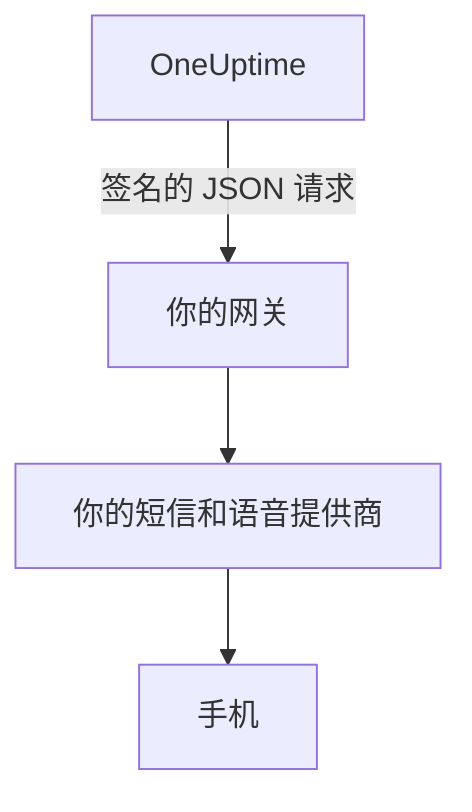

# 短信和电话网关

OneUptime 可以通过你自己运行的网关发送短信和拨打电话，而不是通过 Twilio。当你的规定要求每条消息都必须经过你自己的短信和语音提供商，或者经过一个在消息离开你的网络之前对其进行检查的系统时，就可以使用它。OneUptime 会把每条短信和每通电话作为一个签名的 JSON 请求发送到你的网关，再由你的网关投递出去。

:::cards
- [设置网关](#设置网关): 一个 URL，以及为你生成的签名密钥。
- [你的网关会收到什么](#你的网关会收到什么): 每条短信或每通电话对应一个签名的 JSON 请求。
- [其他语言的电话](#其他语言的电话): 用对方使用 OneUptime 的语言说出每通电话。
- [处理呼叫](#处理呼叫): 通过电话或回复来确认、升级或解决。
- [投递与重试](#投递与重试): 你的网关宕机时会发生什么。
:::

## 工作原理



对于原本会通过服务器自己的 Twilio 账户发送的所有内容，网关都会取而代之：值班呼叫、通知、验证码和状态页订阅者短信。在 **项目设置 > 通知 > 通知渠道** 中的 **Twilio 配置** 卡片上添加了自己的 Twilio 配置的项目，仍然通过该配置发送。每个项目的短信和电话开关，以及启用计费时的余额，都会像使用 Twilio 时一样进行检查。

## 设置网关

:::steps
1. 在 Admin Dashboard 中，前往 **设置 > 通话和短信**，然后在 **SMS and Call Provider** 卡片上点击 **Edit Provider**。
2. 选择 **Your own gateway**，并输入 **Gateway URL**。网关可以位于你的私有网络中。
3. 保存。OneUptime 会为你生成一个签名密钥。从卡片上复制它，并配置到你的网关中。
4. 点击 **检查网关**。你的网关应以 2xx 状态响应，并且不发送任何内容。
:::

要更换密钥，请在 **更多字段** 下清空 **签名密钥** 并保存：OneUptime 会生成一个新的密钥。要改回 Twilio，请选择 **Twilio** 并保存。

## 你的网关会收到什么

每条短信和每通电话都是一个带有 JSON 请求体和以下标头的 `POST` 请求：

| 标头 | 值 |
| --- | --- |
| `Content-Type` | `application/json` |
| `X-OneUptime-Event` | `sms`、`call` 或 `test` |
| `X-OneUptime-Signature` | `sha256=` 后跟用签名密钥计算出的请求体 HMAC-SHA256 十六进制值 |
| `User-Agent` | `OneUptime-CallAndSmsGateway/1.0` |

```json title="An on-call page by SMS"
{
  "version": 1,
  "event": "sms",
  "id": "7c5b0d0e-3e5f-4d1a-9a4f-2b8e6c1d9f00",
  "sentAt": "2026-10-27T09:30:00.000Z",
  "to": "+15551234567",
  "message": "OneUptime: A new alert has been created. Alert #42: Database is down…",
  "isSensitive": false,
  "project": {
    "id": "0f6b8c3a-1d2e-4f5a-8b9c-0d1e2f3a4b5c",
    "name": "Production"
  },
  "actions": {
    "acknowledge": "https://oneuptime.example.com/api/custom-notification-channel/page/5f2c…/acknowledge?token=…",
    "escalate": "https://oneuptime.example.com/api/custom-notification-channel/page/5f2c…/escalate?token=…",
    "resolve": "https://oneuptime.example.com/api/custom-notification-channel/page/5f2c…/resolve?token=…"
  },
  "inLanguage": null
}
```

| 字段 | 含义 |
| --- | --- |
| `version` | 此格式始终为 `1`。只会向其中添加字段。 |
| `event` | `sms`、`call` 或 `test`，与 `X-OneUptime-Event` 相同。 |
| `id` | 此消息唯一，且在每次投递尝试中都相同：用它来忽略你已经发送过的消息。 |
| `sentAt` | OneUptime 发送它的时间，采用 ISO 8601 格式。 |
| `to` | 电话号码，采用 E.164 格式。测试中为 `null`。 |
| `message` | 短信内容，或电话中要说的内容。一条短信最多 1,600 个字符，电话的文本最多 16,384 个字符。更长的文本会被截断，并以一条说明其余内容在 OneUptime 中的注释结尾。 |
| `isSensitive` | 验证码为 `true`。不要把该消息以及 `inLanguage` 中的消息写入你自己的日志。 |
| `project` | 项目的 `id` 和 `name`，如果不是由项目发送的则为 `null`。 |
| `actions` | 对于值班呼叫，是用于处理该呼叫的链接。其他情况下为 `null`。 |
| `inLanguage` | 对于打给以英语以外的语言使用 OneUptime 的人的电话，为 `language`（该语言的代码）和 `message`（电话用该语言要说的内容）。其他情况下为 `null`，所有短信也是如此，因为短信本来就是用对方的语言写的。请参阅 [其他语言的电话](#其他语言的电话)。 |

电话以描述而非脚本的形式发送：`message` 是电话中要说的内容，不包含 Twilio 的“按 1 确认”。请用你自己的方式提供这些操作，例如按键，并调用对应的链接。

### 其他语言的电话

打给以其他语言使用 OneUptime 的人的电话会带有两份内容：一份是英语，在 `message` 中，每通电话都有；另一份是对方的语言，在 `inLanguage` 中。语音由你的网关选择，因此 OneUptime 无法知道它会说哪些语言。如果你的网关有 `inLanguage.language` 这种语言的语音，就用该语音说出 `inLanguage.message`。如果没有，就改为用英语说出 `message`。绝不要把一种语言的内容交给另一种语言的语音：那样没人能听懂。只读取 `message` 的网关会像以前一样继续工作，并说英语。

```json title="A call to someone who reads German"
{
  "event": "call",
  "message": "This is a call from OneUptime. Your verification code is 4  8  2  9  1  3. …",
  "isSensitive": true,
  "inLanguage": {
    "language": "de",
    "message": "Dies ist ein Anruf von OneUptime. Ihr Bestätigungscode lautet 4  8  2  9  1  3. …"
  }
}
```

语言代码是一个 BCP 47 标签，是 OneUptime 所用的语言之一：`de`、`fr`、`es`、`it`、`pt`、`nl`、`da`、`no`、`sv`、`ru`、`ja`、`ko`、`zh-CN`、`zh-TW`、`hi`、`fa` 和 `ar`。`es` 是西班牙的西班牙语，`pt` 是巴西的葡萄牙语，`no` 是挪威语书面语（Bokmål），`ar` 是现代标准阿拉伯语，两个中文代码都是普通话，分别使用简体字和繁体字。其中也包括波斯语：Twilio 没有波斯语语音，因此通过 Twilio 打给以波斯语使用 OneUptime 的人的电话使用英语，但你的网关可能有这种语音。验证码按位书写，数字之间有两个空格：请让你的语音逐个、缓慢地读出这些数字，而不是当作一个数来读。

### 校验签名

在解析请求之前，先计算原始请求体的 HMAC，并与标头进行比较。这项校验与 [自定义渠道](/docs/self-hosted/custom-notification-channels#校验签名) 相同，因此一个校验函数就能同时用于两者：

```javascript title="Node.js"
const crypto = require("crypto");

function isFromOneUptime(rawBody, signatureHeader, secret) {
  const expected =
    "sha256=" + crypto.createHmac("sha256", secret).update(rawBody).digest("hex");
  const received = String(signatureHeader || "");

  return (
    received.length === expected.length &&
    crypto.timingSafeEqual(Buffer.from(received), Buffer.from(expected))
  );
}
```

## 处理呼叫

当对方在通话中或通过回复做出回应时，你的网关会向 `actions` 中对应的链接发送 `POST` 请求。这些链接的工作方式与自定义渠道的链接相同：不需要 API 密钥，每个链接都带有仅适用于该次呼叫、有效期 7 天的令牌，并且操作会记录为由被呼叫的人执行。每个操作及其响应请参阅 [处理呼叫](/docs/self-hosted/custom-notification-channels#处理呼叫)。

```bash title="Acknowledge a page"
curl -X POST "https://oneuptime.example.com/api/custom-notification-channel/page/5f2c…/acknowledge?token=…"
```

## 投递与重试

当你的网关在 10 秒内以 2xx 状态响应时，请求即视为已投递。网关没有响应，或以 408、429 或 5xx 状态响应的请求，会在 1 秒后以及再过 4 秒后重新发送：总共尝试三次。其他任何 4xx 状态都不会重新发送。

短信或通话日志，以及值班呼叫中此人的值班日志，会显示 `Sent to the SMS and call gateway (HTTP 200).` 或未投递的原因，但绝不会显示 URL。OneUptime 无法得知消息是否已到达手机，因此只要你的网关接受了短信，该短信就会显示为已发送，而发出该短信的号码会留空。

## 测试请求

**检查网关** 会发送一个 `event` 设为 `test`，且 `to`、`project`、`actions` 和 `inLanguage` 设为 `null` 的请求。请以 2xx 状态响应，并且不要发送任何内容。

## 后续步骤

:::cards
- [自定义通知渠道](/docs/self-hosted/custom-notification-channels): 通过你自己的应用呼叫人员。
- [推送通知](/docs/self-hosted/push-notifications): 为整个服务器关闭推送。
- [Twilio 集成](/docs/self-hosted/twilio-integration): 改为通过 Twilio 发送。
- [私有网络访问](/docs/self-hosted/private-network-access): 你的服务器可以在你自己的网络中访问哪些内容。
- [通知投递指标](/docs/self-hosted/notification-delivery-metrics): 统计你的网关接受和拒绝的消息。
:::
