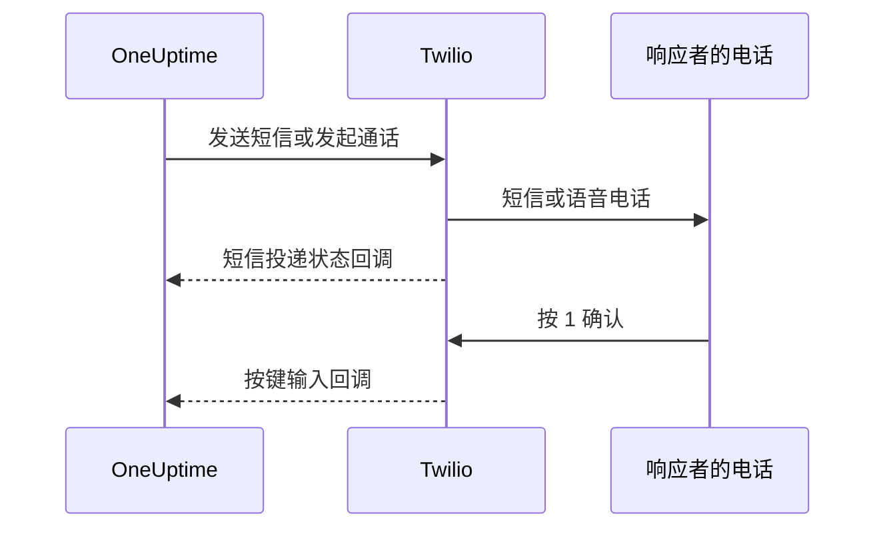

# Twilio 集成

自托管的 OneUptime 通过您自己的 Twilio 账户发送短信和语音告警，费用由您直接支付给 Twilio。Twilio 凭据保存在 OneUptime 的仪表板中，而不是环境变量中：通知投递读取已保存的配置，Helm Chart 中也没有 Twilio 凭据的值。

> [!NOTE]
> 一次旧的迁移导入了 `TWILIO_ACCOUNT_SID`、`TWILIO_AUTH_TOKEN` 和 `TWILIO_PHONE_NUMBER`；修改这些变量并不能更新现有安装的凭据。

:::cards
- [准备 Twilio 账户](#1-准备-twilio-账户): 凭据、电话号码和账户的限制。
- [保存凭据](#2-在-oneuptime-中保存凭据): 为一个项目保存，或为整个安装保存。
- [配置网络访问](#3-配置网络访问): Twilio 需要在何时访问您服务器上的哪些路径。
- [验证电话号码](#5-验证团队成员的电话号码): 团队成员的号码如何验证。
:::

## 1. 准备 Twilio 账户

:::steps
### 复制凭据

打开 [Twilio Console](https://console.twilio.com/)，复制您的 **Account SID** 和 **Auth Token**。

### 获取电话号码

获取一个具备所需短信和/或语音能力的 Twilio 电话号码。发送方和接收方号码都使用包含国家代码的 E.164 格式。

### 检查账户限制

检查账户余额、目的地国家权限以及适用的发送方注册要求。试用账户在接收方、地区等方面有限制，可能导致 OneUptime 的真实告警无法送达；测试前请阅读 [Twilio 关于账户和试用的文档](https://www.twilio.com/docs/usage/tutorials/how-to-use-your-free-trial-account)。生产环境请使用已升级的账户。
:::

## 2. 在 OneUptime 中保存凭据

为一个项目保存凭据，或为整个安装保存一次：

| | 项目配置 | 整个安装的配置 |
| --- | --- | --- |
| 位置 | **项目设置 > 通知 > 通知设置** 中的 **Twilio 配置** 卡片 | **Admin Dashboard > 设置 > 通话和短信** |
| 谁可以设置 | **Project Owner**、**Project Admin**，或自定义角色中的 **Create Call and SMS** | 主管理员 |
| 用于 | 作为项目默认配置期间发给项目成员的短信和电话、分配给它的状态页面，以及使用它的来电策略 | 发给任何没有默认配置的项目成员的短信和电话 |

添加项目配置：

:::steps
1. 前往 **项目设置 > 通知 > 通知设置**。
2. 在 **Twilio 配置** 中选择 **创建Twilio 配置**。
3. 输入名称、**Twilio 账户 SID**、**Twilio 身份验证令牌** 和 **Twilio 主电话号码**。如有需要，再为其他国家输入以逗号分隔的 **Twilio 备用电话号码**。
4. 项目的第一个配置会默认打开 **设为项目默认**，因此发给项目成员的短信和电话（包括值班通知）在保存后立即通过它发送。如果这个账户只用于状态页面或来电，请关闭它。之后添加的配置开关默认关闭：打开开关，或在该配置行的菜单中选择 **设为项目默认**，即可把这些消息转到它上面。省略 `isProjectDefault` 的 API 请求也按同样方式处理。
5. 保存。每个项目只能有一个默认配置。状态页面使用明确分配给各个状态页面的配置。

> [!IMPORTANT]
> **SMS** 和 **语音电话** 在每个项目中默认关闭，打开之前，项目中的任何人都无法为它们添加电话号码。项目所有者、**Billing Admin** 或拥有 **Manage Billing** 权限的人可以在同一页面的 **通知渠道** 卡片中打开它们。
:::

如果要设置整个安装的默认配置，管理员可以改为打开 **Admin Dashboard > 设置 > 通话和短信**，编辑 Twilio 凭据和电话号码并保存。当成员所在的项目没有默认配置时，发给他们的通知会使用这个全局配置。请对 Auth Token 保密。

## 3. 配置网络访问

仅有出站访问即可发送。投递状态更新、按键确认和来电则需要 Twilio 能访问您的服务器。

私有部署需要 DNS 解析，以及通过 TCP 443 访问 Twilio 的出站 HTTPS，才能提交短信和电话。由于 Twilio 的 API 地址是动态的，Twilio 建议允许到 `*.twilio.com` 的出站 HTTPS；请参阅 [Twilio IP 地址](https://help.twilio.com/articles/115015934048-All-About-Twilio-IP-Addresses)。请将其应用到 OneUptime 应用工作负载的出站流量上，包括 Kubernetes NetworkPolicy 和外部防火墙。

是否需要入站访问取决于功能：

| 功能 | Twilio 是否需要访问 OneUptime？ |
| --- | --- |
| 提交短信 | 否。不过投递状态更新需要回调。 |
| 简单的测试语音电话 | 否。OneUptime 在出站 API 请求中附带语音指令。 |
| 按 1 确认值班告警 | 是。Twilio 把按键输入提交给 OneUptime。 |
| 来电策略 | 是。Twilio 请求通话指令并报告拨号结果。 |

以下是经过 OneUptime Nginx 网关的外部路径。占位符因通知而异：

| 方法 | 路径 | 用途 |
| --- | --- | --- |
| POST | `/notification/sms/status-callback/:smsLogId/:token` | 短信投递状态 |
| POST | `/api/user-notification-log-timeline/call/gather-input/:itemId?token=...` | 按键确认 |
| POST | `/notification/incoming-call/voice` | 可选：来电指令 |
| POST | `/notification/incoming-call/dial-status/:callLogId/:callLogItemId` | 可选：来电路由结果 |

OneUptime 会自动生成短信和确认的 URL。不要用固定的 webhook URL 替换其中的令牌。来电请按照[来电策略](/docs/on-call/incoming-call-policy)操作，关联号码时会为该号码配置 webhook。

Twilio 要求 [webhook URL 可被公开访问](https://www.twilio.com/docs/usage/webhooks/webhooks-overview)。请使用公开受信任的 TLS 证书，并在经过代理时保留原始的主机、协议、路径、查询参数、请求体和 `X-Twilio-Signature` 请求头。来电处理程序会验证 Twilio 签名；短信投递使用每条消息独有的 URL 令牌，按键确认使用签名的查询令牌。不要在共享日志或截图中暴露令牌。请参阅 [Twilio webhook 安全](https://www.twilio.com/docs/usage/webhooks/webhooks-security)。

### 从私有部署发布回调

:::steps
1. 为您的 OneUptime 主机名（例如 `oneuptime.example.com`）发布 DNS，指向面向互联网的反向代理或负载均衡器。允许入站 TCP 443，并配置带完整证书链的公开受信任证书。私有 IP、仅内部可用的 DNS 或管理员的 VPN 连接都无法让 Twilio 连通。
2. 为该网关提供一条通往 OneUptime 私有 ingress 的网络路由，可以直连，也可以经过您自己的站点到站点 VPN 或专用链路。放行上游服务端口。Kubernetes `ClusterIP` 服务需要一个可访问的 ingress，或从网关出发的其他路由。数据库和其他内部服务保持私有。
3. 只发布上表中您用到的回调路径。通过 OneUptime 的 Nginx 网关转发它们，该网关把外部的 `/notification` 前缀映射到应用。按键确认的路由保留 `/api`。保留 HTTP 方法和请求数据；不要重定向到其他 URL。保留公开的 `Host`，并在代理上为公开主机和 HTTPS 协议设置受信任的转发请求头。
4. 让这些路由免于浏览器 SSO、CAPTCHA 和代理登录页面。保持 OneUptime 的回调认证开启。只允许网关和经授权的内部客户端访问私有源站。
5. 在 Docker Compose 的 `config.env` 中设置 `HOST=oneuptime.example.com` 和 `HTTP_PROTOCOL=https`，或在 Helm values 中设置 `host: oneuptime.example.com` 和 `httpProtocol: https`。应用部署变更并等待应用重启。这些设置只生成 URL，不会创建 DNS、证书或防火墙规则。OneUptime 没有单独的 Twilio 回调主机名设置。如果主机名发生变化，也要更新现有 Twilio 电话号码的 webhook。
:::

仪表板可以继续留在私有 ingress 上：使用拆分 DNS 时，员工通过公司网络或 VPN 把同一主机名解析到该 ingress，而 Twilio 将其解析到网关。两条路径上都要提供对该主机名有效的证书。OneUptime 的[私有网络访问设置](/docs/self-hosted/private-network-access)管理发往内部服务的出站请求；`ALLOW_PRIVATE_NETWORK_WEBHOOKS` 不会发布入站端点。

### IP 限制与没有入站访问的部署

Twilio 普通 webhook 的来源地址会变化，因此不要把 SIP 或媒体 IP 范围用作回调的允许列表。符合条件的 Twilio 版本提供 [Static Proxy for Webhooks](https://www.twilio.com/docs/iam/twilio-editions/twilio-static-proxy)。请确认您的版本是否符合条件以及支持哪些产品，并用 Twilio 当前公布的地址范围配置防火墙；即使使用它，也要继续验证回调。

> [!WARNING]
> 如果策略禁止入站连接，提交短信和简单的内联语音播放可以通过出站 HTTPS 工作。短信投递更新、按键确认和来电路由在回调不可访问时无法工作。完全断网的安装无法使用 Twilio。

开发时，Twilio 的 [webhook 测试指南](https://www.twilio.com/docs/usage/webhooks/webhook-testing)介绍了如何使用公共隧道：把它转发到只允许所需路由的代理，按上述方式配置得到的主机名，测试后停止隧道。隧道同样会开放入站访问。

## 4. 分别测试发送和回调

:::steps
1. 在公司网络和 VPN 之外，确认回调主机名解析到公共网关并提供有效的 TLS 证书。浏览器发起的 GET 无法测试这些 POST 回调。
2. 在项目的 Twilio 配置上使用 **发送测试短信** 和 **发送测试呼叫**，并在目标电话上确认收到。两者都需要添加 Twilio 配置的权限：**Project Owner**、**Project Admin**，或自定义角色中的 **Create Call and SMS** 和 **Read Call and SMS**。
3. 为用户配置已验证的短信或电话联系方式和通知规则，然后触发一次受控的值班告警。按 1，并在 OneUptime 中确认已被确认。如果您使用来电策略，请拨打配置的号码，并检查其路由和通话日志。
4. 在 OneUptime 和 Twilio 的消息日志中确认短信的投递状态。发送被接受并不代表已送达；[Twilio 会通过回调报告之后的状态变化](https://www.twilio.com/docs/messaging/guides/track-outbound-message-status)。
:::

| 症状 | 排查位置 |
| --- | --- |
| 什么都没有发出 | 凭据、号码的能力、账户限制和出站连接。 |
| 短信或电话已送达，但状态或确认没有更新 | 回调 URL 和公共 ingress 的日志。Twilio 的 [HTTP 获取失败指南](https://www.twilio.com/docs/api/errors/11200)可以帮助诊断无法访问的回调、TLS 问题和 HTTP 错误。 |

仅凭测试电话成功，并不能证明回调可以访问。

## 5. 验证团队成员的电话号码

为短信或电话添加电话号码时，系统会立即发送验证码，并打开验证对话框。对话框显示验证码的发送时间和有效期，并会按请求发送新的验证码，但每分钟最多一次。验证之前不需要重新发送任何内容。

无法发送验证码时，对话框会说明原因，而不是声称已经发送：例如，在项目默认配置或上述整个安装的配置存在之前，会提示没有设置 Twilio 账户。第一个验证码无法发送的号码不会被添加，表单会显示原因，例如 Twilio 拒绝了某个目的地国家。

为短信验证过的号码同时也为电话验证，无需第二个验证码。通过电话验证不会验证短信，因为能接听电话的号码（例如固定电话）不一定能接收短信。如果 Twilio 接受了一个始终没有送达的验证码，项目的短信日志会显示它的投递状态。

## 后续步骤

:::cards
- [来电策略](/docs/on-call/incoming-call-policy): 让来电者通过 Twilio 号码联系到您的值班工程师。
- [升级规则](/docs/on-call/escalation-rules): 决定每一级通过短信、电话或其他方式通知谁。
- [SMTP](/docs/emails/smtp): 也通过您自己的邮件服务器发送电子邮件。
- [私有网络访问](/docs/self-hosted/private-network-access): 让工作流和 webhook 能访问内部工具。
:::
