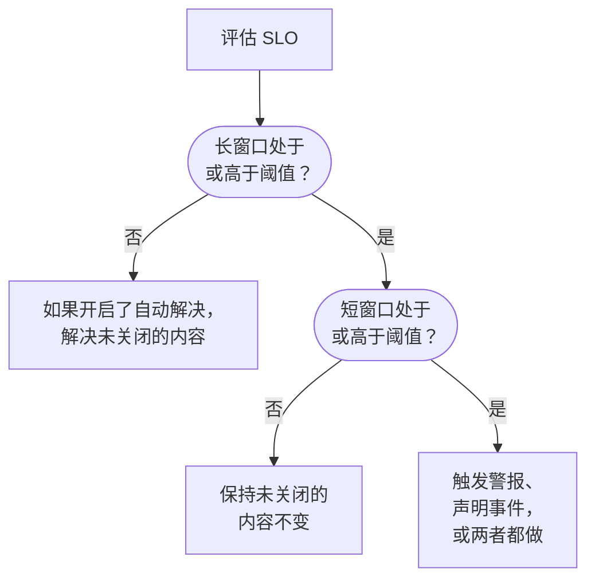

# 消耗率警报与事件

错误预算告诉您现在的位置；消耗率规则告诉您什么时候该起床。当 SLO 花错误预算的速度快到值得关注时，消耗率规则会触发警报、声明事件或两者都做，并带有您自己的标题和描述、严重性、所有者、标签、值班升级和工作区通知。

:::cards
- [规则如何决定触发](#规则如何决定触发): 两个窗口，都高于阈值。
- [默认规则](#默认规则): Fast burn 和 Slow burn，按 SLO 的窗口调整。
- [创建规则](#创建或编辑规则): 在 SLO 的 Burn Rate Rules 页面上的五个步骤。
- [模板变量](#每个警报和事件的内容): 编写您自己的标题和描述。
:::

## 消耗率的含义

消耗率是与匀速相比，您花错误预算的速度：

```text
burn rate = (share of time that was bad) ÷ (share of time the target allows to be bad)
```

消耗率为 1 时，您恰好在整个窗口内花完预算，达到目标且一点不剩。数值越高，预算用完得越早。对于 30 天内 99.9% 的 SLO：

| 消耗率（如果持续） | 预算用完需要 |
| --- | --- |
| 1 | 30 天 |
| 2 | 15 天 |
| 6 | 5 天 |
| 14.4 | 约 2 天（50 小时） |

消耗率与剩余多少预算无关。它回答的是“现在有多糟？”，而这正是决定是否呼叫某人所需要知道的。

## 规则如何决定触发

OneUptime 在每次评估 SLO 时（每 5 分钟）检查每条已启用的消耗率规则。每条规则在两个窗口上测量消耗率，只有两者都处于或高于其阈值时才会触发：

- **长窗口**（例如 1 小时）表明消耗是持续且显著的，而不是一次检查失败。
- **短窗口**（例如 5 分钟）表明它仍在发生。没有它，一小时前的峰值会在恢复后很长时间内仍持续告警。

这是 Google SRE Workbook 中的多窗口、多消耗率模式，OneUptime 会为您设置好。



在 SLO 拥有完整一个长窗口的监控历史之前，规则无法触发：否则监视器的第一次检查失败除以几分钟的历史，会得到一个巨大的消耗率。因此新 SLO 在第一个小时内无法触发 **Fast burn** 规则，在前六个小时内无法触发 **Slow burn** 规则。如果之后 SLO 不再有那么多历史，例如其监视器被换成新的之后，规则会解决它打开的内容，而不是让其悬而未决。当 SLO 的任一监视器处于计划维护中时，规则也不会触发：请参阅[计划维护](#计划维护)。

## 默认规则

每个新 SLO 都会获得两条消耗率规则。对于 30 天窗口：

| 规则 | 阈值 | 长窗口 | 短窗口 | 触发条件 |
| --- | --- | --- | --- | --- |
| **Fast burn** | 14.4× | 1 小时 | 5 分钟 | 约 2% 的预算在一小时内消耗：大约 2 天就会用完。 |
| **Slow burn** | 6× | 6 小时 | 30 分钟 | 约 5% 的预算在六小时内消耗：大约 5 天就会用完。 |

14.4× 和 6× 的阈值是按 30 天的预算计算的，因此 OneUptime 会按您的 SLO 窗口进行调整。每条规则始终表示“1 小时内消耗 2% 的预算”或“6 小时内消耗 5% 的预算”：

| SLO 的窗口 | Fast burn 阈值 | Slow burn 阈值 |
| --- | --- | --- |
| 7 天 | 3.36× | 1.4× |
| 28 天 | 13.44× | 5.6× |
| 30 天 | 14.4× | 6× |
| 90 天 | 43.2× | 18× |

日历月 SLO 使用 30 天的值。两条规则都会以项目中最高的警报严重性、使用默认标题和描述触发警报，自动解决它，并且不添加所有者或标签。它们不会声明事件，因此升级 OneUptime 永远不会开始替您声明事件。您可以编辑、删除它们，或添加自己的规则。

## 创建或编辑规则

您需要创建 SLO 消耗率规则的权限。

:::steps
### 打开 Burn Rate Rules

打开 SLO，进入 **Burn Rate Rules**，点击 **创建SLO Burn Rate Rule**，或编辑一条默认规则。

### 为规则命名

在 **Rule** 中输入 **名称**，例如“Fast burn”。**已启用** 处于打开状态。

### 设置消耗窗口

在 **Burn Window** 中设置 **Burn Rate Threshold**（例如 `14.4`）、**Long Window (Minutes)** 和 **Short Window (Minutes)**，还可以设置 **Re-fire Suppression (Minutes)**。

### 选择它声明什么

在 **What It Declares** 中打开 **创建警报**、**声明事件** 或两者。**Add SLO Owners as Owners** 还会让 SLO 的所有者成为规则所创建一切内容的所有者。

### 描述警报和事件

**警报** 和 **事件** 步骤只针对规则会声明的内容出现。每个步骤都有标题和严重性，以及折叠的部分：**描述**、**所有权和标签**、**值班** 和 **更多字段**，后者包含自动解决、隐私和修复说明。新规则从默认标题和描述开始，可直接编辑。在最后一步点击 **创建SLO Burn Rate Rule**。
:::

OneUptime 在保存规则时检查其数值：

| 设置 | 必须 |
| --- | --- |
| **Burn Rate Threshold** | 大于 0。 |
| **Short Window (Minutes)** | 大于 0。 |
| **Long Window (Minutes)** | 比短窗口长。 |
| **Re-fire Suppression (Minutes)** | 0 或更大。留空表示长窗口的时长。 |

规则必须创建警报、声明事件或两者都做：两者都关闭的规则会被拒绝，因为它会在每次评估时被检查却从不声明任何内容。

规则表格显示每条规则的阈值、窗口和抑制、它声明的内容（以及警报或事件是否只能手动解决或是否为私有）、严重性、值班策略、所有者和标签。

> [!TIP]
> 一个好的起点：保留两条默认规则，把快速消耗规则以高严重性发送到会呼叫人的值班策略，让慢速消耗规则为工作时间触发严重性较低的警报。如果您的团队以事件方式运作，请在快速消耗规则上打开 **声明事件**，如果不想两者都收到，就在那里关闭 **创建警报**。

## 规则声明什么

|  | **创建警报** | **声明事件** |
| --- | --- | --- |
| 初始状态 | 开启 | 关闭 |
| 性质 | 轻量信号：进入警报列表。 | 重量信号：获得事件编号并启动整个响应流程。 |
| 标题和描述 | 自定义，或默认文本 | 自定义，或默认文本 |
| 严重性 | **警报严重性**：留空时为项目中最高的 | **事件严重性**：留空时为项目中最高的 |
| 升级 | **Alert On-Call Duty Policies** | **Incident On-Call Duty Policies** |
| 所有者和标签 | **警报所有者** 和 **警报标签** | **事件所有者** 和 **事件标签** |
| 私有 | 关闭 | 关闭 |
| 自动解决 | 开启 | 开启 |
| 状态页 | 从不发布 | 从不发布 |

由于两者分别配置，您可以把简短的警报发给负责团队的轮值，把详细的事件发给重大事件的轮值。它们也各自独立：每个都单独去重、解决和抑制，因此解决事件不会重置警报的抑制，反之亦然。

### SLO 是受影响的资源

消耗率规则创建的每个警报和事件都会在 **受影响的资源** 下列出其 SLO 并链接到它。警报和事件列表的 **受影响的资源** 筛选器可将其限定为某个 SLO，SLO 的 **警报** 和 **事件** 页面会列出它们，侧边菜单中的徽章统计未关闭的数量。这个关联由 OneUptime 自行建立，编辑警报或事件永远不会移除它。

### 消耗率事件保持内部

快速消耗的错误预算是给工程团队的信号，而不是已声明的中断。消耗率事件从不显示在状态页上，也从不通知状态页订阅者。它也不会关联任何监视器，否则解决它会改写 SLO 赖以测量的那份监视器状态历史。

如果您手动解决这样的事件，在消耗恢复且规则真正再次触发之前，什么都不会再次声明它，因此您在处理事件时永远不必和规则较劲。

## 每个警报和事件的内容

新规则的警报和事件都从默认标题和描述开始。清空标题或描述即可恢复默认文本。默认标题为：

```text
SLO burn rate: {{sloName}} — {{ruleName}}
```

默认描述会写出规则名称、两个窗口的消耗率与阈值的对比，以及剩余的错误预算。

要自己编写，请在标题、描述和修复说明中使用模板变量。每个字段都会在 **模板变量** 下列出这些变量：点击一个即可插入到光标处，也可以在字段中输入 `{{` 再选择。描述和修复说明的工具栏中还有 **插入变量**。变量在规则触发时填入：

| 变量 | 包含内容 | 示例 |
| --- | --- | --- |
| `{{sloName}}` | SLO 的名称。 | `Checkout availability` |
| `{{sloId}}` | SLO 的 ID。 | `b7f4c2d8-1f3e-4a5b-9c6d-7e8f9a0b1c2d` |
| `{{sloLink}}` | OneUptime 仪表板中该 SLO 的链接。 | `https://oneuptime.com/dashboard/project-id/slos/slo-id` |
| `{{sloStatus}}` | 本次评估后 SLO 的状态。 | `At Risk` |
| `{{ruleName}}` | 触发的消耗率规则的名称。 | `Fast burn` |
| `{{burnRateThreshold}}` | 规则的消耗率阈值（可持续速度的倍数）。 | `14.4` |
| `{{longWindowBurnRate}}` | 在规则的长窗口上测得的消耗率。 | `21.5` |
| `{{shortWindowBurnRate}}` | 在规则的短窗口上测得的消耗率。 | `36` |
| `{{longWindowInMinutes}}` | 规则长窗口的时长，以分钟计。 | `60` |
| `{{shortWindowInMinutes}}` | 规则短窗口的时长，以分钟计。 | `5` |
| `{{targetPercentage}}` | SLO 的目标，以百分比表示。 | `99.9` |
| `{{currentSliPercentage}}` | 在 SLO 合规窗口上测得的 SLI，以百分比表示。 | `99.87` |
| `{{errorBudgetRemainingPercentage}}` | 仍可用的错误预算所占比例，以百分比表示。预算超支时为负数。 | `42.5` |
| `{{errorBudgetRemaining}}` | 仍可用的错误预算，以时长表示。预算超支时以负号开头。 | `18m 22s` |
| `{{errorBudgetRemainingMinutes}}` | 仍可用的错误预算，以分钟计。 | `18.37` |
| `{{windowDescription}}` | 用文字描述的 SLO 合规窗口。 | `rolling 30-day window` |

例如，标题 `{{ruleName}}: {{sloName}} is burning {{longWindowBurnRate}}x` 会变成 `Fast burn: Checkout availability is burning 21.5x`。

:::details 变量如何填入
- 数字四舍五入到两位小数。
- 花括号内的空格没有影响：`{{ sloName }}` 也能用。
- 拼错的变量会原样保留，这样拼写错误会出现在警报中，而不是悄无声息地消失。
- 标题最多 500 个字符，描述和修复说明最多 50,000 个字符。填入变量后超过 500 个字符的标题会合并为一行并以省略号截短，因此警报或事件仍会被创建。
- 如果规则触发时无法生成 SLO 的链接，`{{sloLink}}` 会保持为空，警报或事件仍会被创建。
:::

## 所有者、标签和隐私

- **警报所有者** 和 **事件所有者** 是通过 **添加所有者** 从同一个列表中选择的人员和团队。它们在警报或事件创建后立即被添加，并收到通知。人员必须是项目成员。
- **Add SLO Owners as Owners** 还会把 SLO 的所有者（其所有者用户和所有者团队的成员）添加到规则创建的一切内容中。SLO 的所有者本来就会收到 SLO 自身状态变化的通知，因此这可能会让他们收到两次通知。默认关闭。
- 每位所有者只添加一次：已经是警报或事件所有者的用户（例如通过项目的所有者规则），或属于某个已添加所有者团队的用户，不会被重复添加。
- **警报标签** 和 **事件标签** 会添加到警报或事件上，以便筛选器、所有者规则和工作区通知规则可以匹配它们。
- 私有警报或事件只对其所有者、项目管理员和项目所有者可见。

标签、所有者团队和值班策略必须属于 SLO 所在的项目。

## 解决与重复触发抑制

- **解决跟随长窗口。** 开启自动解决时（默认），一旦长窗口的消耗率降到阈值以下，OneUptime 就会解决规则的警报和事件。按短窗口解决会导致来回抖动：时断时续的中断会在安静五分钟后被解决，然后整夜反复呼叫人。
- **关闭自动解决。** 关闭 **自动解决警报** 或 **自动解决事件** 后，该记录会一直保持未关闭，直到有人解决它，即使消耗已经恢复。规则不会在其上再打开一个，一旦被手动解决且长窗口低于阈值，规则在抑制期过后可以再次触发。
- **重复触发抑制。** 记录解决后，规则在抑制期内（默认为长窗口的时长）不会再次声明同类记录。这样正在恢复的系统就有时间恢复，而不会因残留的噪音呼叫任何人。

有些更改总会解决规则打开的内容，无论其自动解决设置如何，以免因一条已无法自圆其说的规则而持续升级：

- 关闭 **创建警报** 或 **声明事件** 会关闭该输出打开的内容；
- 关闭或删除规则；
- 关闭 SLO 的评估、归档 SLO 或删除它；
- SLO 变为 **已暂停** 或 **Misconfigured**，因为此时它不测量任何内容；
- 规则失去其阈值或窗口，或 SLO 不再拥有完整一个长窗口的历史。

## 计划维护

当 SLO 的某个监视器处于进行中的计划维护事件时，其消耗率规则不会触发警报，也不会声明事件：计划内的工作不应呼叫任何人。规则已经打开的内容仍会照常解决。这段时间仍会按 SLO 的停机状态计入错误预算。

## SLO 的动态

SLO 的 **Feed** 会发布规则触发的每个警报和声明的每个事件，附带链接和解释它的消耗率，并在每个被自动或手动解决时发布。因为仍未关闭而被规则重新接手的记录不会发布两次。创建、编辑和删除规则也会被发布，并记录在 SLO 的 **审计日志** 中。请参阅 [SLO 动态与审计日志](/docs/slo/feed-and-audit-logs)。

## 故障排除

:::details 创建 SLO 后规则没有立即触发
只有当 SLO 拥有完整一个长窗口的监控历史时，规则才会触发：默认快速消耗规则为一小时，慢速消耗规则为六小时。
:::

:::details 中断仍在持续时警报被解决了
自动解决跟随长窗口：一旦长窗口的消耗率降到阈值以下，警报就会被解决。给规则设置更长的长窗口，或关闭 **自动解决警报** 并手动解决警报。
:::

:::details 计划维护期间什么都没有触发
当 SLO 的任一监视器处于进行中的计划维护事件时，消耗率规则保持静默。停机时间仍会计入预算。
:::

:::details 有最小样本数吗？
对于按监视器可用性测量的 SLO 没有。可用性以秒为单位测量，因此窗口中的每一秒都是一个样本，不存在需要防范的低流量情况。最小样本数只对基于事件的 SLI 有意义，而这类 SLI 目前尚未提供。
:::

## 后续步骤

:::cards
- [错误预算](/docs/slo/error-budget): 预算是什么以及能撑多久。
- [升级规则](/docs/on-call/escalation-rules): 呼叫谁，以及按什么顺序。
- [SLO 动态与审计日志](/docs/slo/feed-and-audit-logs): 规则触发的每个警报和事件。
:::
