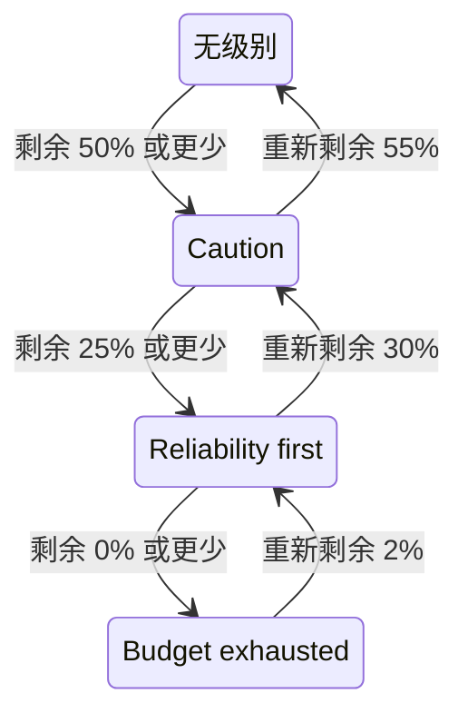

# 错误预算策略

错误预算策略写下团队约定在 SLO 的错误预算减少时要做的事，例如在用掉一半时审查有风险的更改，或在全部用完时冻结发布。OneUptime 会把 SLO 放到其预算已到达的策略级别，在 SLO 的页面上显示团队对该级别的约定，可以在 SLO 进入某个级别时触发警报或声明事件，把每次级别变化发布到你选择的 Slack、Microsoft Teams 或 Mattermost 频道，并告诉你的 CI/CD 流水线是否要暂缓发布。这是 [Google SRE Workbook](https://sre.google/workbook/error-budget-policy/) 中的错误预算策略实践。

:::cards
- [级别如何运作](#级别如何运作): 哪个级别生效，以及 SLO 何时离开它。
- [设置策略](#设置策略): 从推荐策略开始，或编写自己的级别。
- [警报和事件](#警报和事件): 在 SLO 进入某个级别时通知团队。
- [发布到 Slack、Microsoft Teams 和 Mattermost](#发布到-slackmicrosoft-teams-和-mattermost): 在 SLO 进入某个级别时告知频道，不呼叫任何人。
- [部署闸门](#部署闸门): 在某个级别冻结部署期间，让 CI/CD 暂缓发布。
- [通过 API 读取级别](#通过-api-读取级别): 从 CI 和脚本中检查级别。
:::

## 级别如何运作

策略是一组级别。每个级别有三个字段：

| 字段 | 内容 |
| --- | --- |
| **名称** | 团队给级别起的名字，例如“Reliability first”。 |
| **剩余预算阈值 (%)** | 剩余错误预算的比例等于或低于此值时，该级别生效。范围为 0 到 100，可以有小数。SLO 的每个级别都有自己的阈值。 |
| **我们的做法** | SLO 处于该级别期间团队约定要做的事，使用 Markdown。必填，最多 10,000 个字符。 |

只要剩余预算等于或低于某个级别的阈值，该级别就生效，因此 0% 的级别就是预算耗尽时的级别。多个级别同时生效时，SLO 处于阈值最低的那个级别，也就是最严重的级别。没有级别生效时，SLO 不在任何级别。如果有 50%、25% 和 0% 三个级别，剩余 30% 预算的 SLO 处于 50% 的级别，剩余 10% 的 SLO 处于 25% 的级别。

级别还可以在 SLO 处于其中期间冻结部署：参见 [部署闸门](#部署闸门)。

### 进入和离开级别

级别跟随剩余预算的方式与 SLO 的状态相同：

- 进入级别是立即的：发现预算等于或低于某个级别阈值的那次评估会把 SLO 放进该级别。一次跌破多个阈值的预算会直接进入最严重的级别。
- 离开某个级别、进入较轻的级别，要等到预算明显恢复。0% 的级别在预算重新剩余 2% 时离开。其他级别在预算比其阈值高出 5 个百分点时离开。

因此，0% 的级别与 **预算已耗尽** 状态同步变化，位于 SLO 风险阈值的级别与 **有风险** 同步变化：参见 [状态变化与风险阈值](/docs/slo/error-budget#状态变化与风险阈值)。在阈值附近来回波动的滚动窗口不会让级别来回切换。



## 设置策略

你需要创建 SLO 错误预算策略级别的权限。

:::steps
### 打开 错误预算策略

打开 SLO，在其侧边菜单的 **规则** 部分中转到 **错误预算策略**。该页面列出 SLO 的级别，每个级别都显示名称、生效时的剩余预算以及团队要做的事。

### 从推荐策略开始

只要 SLO 还没有级别，页面就会提供 **使用推荐的策略**。点击它，检查它列出的三个级别，然后确认。之后把每个级别的文字改成团队自己的约定。

### 或者自己添加级别

点击 **创建SLO 错误预算策略级别**。输入 **名称** 和 **剩余预算阈值 (%)**，并在 **我们的做法** 中写下团队的约定。如果流水线应在 SLO 处于该级别期间暂缓发布，请开启 **冻结部署**。

### 选择级别要触发什么

级别会记录并显示约定。若还要在 SLO 进入该级别时通知某人，请打开折叠的警报和事件设置，开启警报、事件或两者。两者默认都是关闭的。参见 [警报和事件](#警报和事件)。
:::

添加、编辑或删除级别会立即生效：OneUptime 会在大约一分钟内重新评估 SLO。如果预算已经等于或低于某个级别的阈值，SLO 随即进入该级别，该级别会触发它被设置为触发的内容。关闭或删除某个级别会解决它触发的内容，SLO 会转到其预算所在的级别。关闭某个级别的警报或事件会解决该警报或事件。

### 推荐策略

**使用推荐的策略** 会在预算的一半、四分之一和零处添加三个级别，使用以下英文文字：

| 级别 | 生效条件 | 团队要做的事 | 部署 |
| --- | --- | --- | --- |
| **Caution** | 剩余 50% 或更少 | Half of the error budget is spent. Review risky changes before they ship, and find out what has been spending the budget. | 允许 |
| **Reliability first** | 剩余 25% 或更少 | Reliability comes first. Only reliability improvements and critical fixes ship until the budget recovers. | 允许 |
| **Budget exhausted** | 剩余 0% 或更少 | The error budget is spent. Freeze non-critical releases: only fixes for this SLO's reliability and security fixes ship until the budget is back. | 已冻结 |

在你开启之前，它们都不会触发警报或声明事件。**Budget exhausted** 会冻结部署，正如它的约定所说，确认窗口中也会这样标注它：参见 [部署闸门](#部署闸门)。在部署闸门推出之前添加的级别不会冻结任何部署，除非你为它们开启该开关。只会添加 SLO 还没有的级别：名称相同或阈值相同的级别，无论开启与否，都算已存在。因此，从第二个标签页或通过 API 请求两次，也不会重复添加任何内容。如果其中某个级别无法添加，就一个也不会添加：SLO 保持原样，你可以再试一次。以这种方式添加的每个级别都会在 SLO 的审计日志中记录为由你添加。

## 级别显示在哪里

- SLO 的 **概览** 显示它所处的级别以及团队在那里约定要做的事，让每个打开 SLO 的人都能看到当前有效的约定。当该级别冻结部署时，其名称下方的红色徽章会显示从何时开始冻结。
- **错误预算燃尽** 图表在每个级别的阈值处画一条带标签的线，与风险阈值的线并列。
- SLO 的 **动态** 会发布每次级别变化：SLO 离开的级别和进入的级别、剩余预算、团队约定在新级别要做的事，以及这次变化是冻结了部署还是重新允许了部署。
- 你的规则指定的 Slack、Microsoft Teams 和 Mattermost 频道会收到同样的消息：参见 [发布到 Slack、Microsoft Teams 和 Mattermost](#发布到-slackmicrosoft-teams-和-mattermost)。
- SLO 的 **审计日志** 会把每次级别变化，以及每次部署被冻结或重新被允许，记录为 OneUptime 自身做出的更改，因此只有在开启 **存储系统事件** 时才会显示：参见 [开启审计日志](/docs/slo/feed-and-audit-logs#开启审计日志)。添加、编辑和移除级别会以操作者本人的名义记录。
- SLO 的读取 API 会返回级别，以及是否允许部署：参见 [通过 API 读取级别](#通过-api-读取级别) 和 [部署闸门](#部署闸门)。

## 警报和事件

每个级别都可以在 SLO 进入它时触发警报、声明事件或两者都做。它们的选项与消耗率规则的警报和事件相同：严重性、值班策略、标题、描述和修复说明的模板、私密、自动解决、标签、所有者团队和所有者用户，以及把 SLO 的所有者添加为所有者。参见 [规则声明什么](/docs/slo/burn-rate-alerts#规则声明什么)。两者默认都是关闭的，因此在你开启其中一个之前，级别不会通知任何人。

- 进入更严重的级别会解决上一个级别触发的内容，无论其自动解决设置如何，因为新级别取代了它。因此，同一时间最多只有一个级别的警报和事件处于打开状态，而且它们属于 SLO 所处的级别。
- 恢复到较轻的级别或离开所有级别时，如果该级别的自动解决已开启（默认开启），它们会被解决。自动解决关闭时，它们会一直保持打开，直到有人解决。
- 没有重复触发抑制。级别只有在 SLO 明显离开它、然后再次进入之后才会再次触发，因此不会反复抖动。如果在 SLO 仍处于该级别时有人手动解决了它触发的内容，该内容会保持已解决。
- 只要 SLO 的任何监视器处于计划维护中，级别就不会触发任何内容。级别本身仍会变化，已打开的内容也仍会被解决。如果维护结束时 SLO 仍处于该级别，级别会在那时触发它被设置为触发的内容。

与消耗率规则一样，级别触发的警报或事件会在 **受影响的资源** 下列出 SLO，并且事件永远不会显示在状态页上。SLO 的动态会发布每一个警报和事件，以及它们何时被解决。

### 它们的内容

级别的标题、描述和修复说明可以使用模板变量，与规则相同：参见 [每个警报和事件的内容](/docs/slo/burn-rate-alerts#每个警报和事件的内容)。级别的字段提供 SLO 及其预算的变量，以及级别自己的三个变量：`{{sloName}}`、`{{sloId}}`、`{{sloLink}}`、`{{sloStatus}}`、`{{policyTier}}`、`{{policyTierThresholdPercentage}}`、`{{policyTierWhatWeDo}}`、`{{targetPercentage}}`、`{{currentSliPercentage}}`、`{{errorBudgetRemainingPercentage}}`、`{{errorBudgetRemaining}}`、`{{errorBudgetRemainingMinutes}}` 和 `{{windowDescription}}`。规则自己的变量，例如 `{{ruleName}}` 和消耗率，不会提供，在级别的模板中为空。

这三个级别变量在消耗率规则的模板中同样可用：

| 变量 | 内容 |
| --- | --- |
| `{{policyTier}}` | 评估后 SLO 所处级别的名称，不在任何级别时为 `None`。 |
| `{{policyTierThresholdPercentage}}` | 该级别的阈值，例如 `25`。SLO 不在任何级别时为空。 |
| `{{policyTierWhatWeDo}}` | 团队约定在该级别要做的事。SLO 不在任何级别时为空。 |

标题留空的级别使用内置标题：

```text
SLO error budget policy: {{sloName}} — {{policyTier}}
```

内置描述会说明级别，把剩余预算与级别的阈值进行比较，并说明团队约定在该级别要做的事。

## 发布到 Slack、Microsoft Teams 和 Mattermost

规则可以把 SLO 错误预算策略的每次变化发布到团队关注的 Slack、Microsoft Teams 或 Mattermost 频道，而不呼叫任何人：在 SLO 进入某个级别、恢复到较轻的级别或离开所有级别时，以及在其部署被冻结或重新被允许时。每条规则自行选择针对哪些 SLO、发布哪些变化。请先把工作区连接到项目：参见 [Slack](/docs/workspace-connections/slack)、[Microsoft Teams](/docs/workspace-connections/microsoft-teams) 或 [Mattermost](/docs/workspace-connections/mattermost)。

:::steps
### 打开 SLOs 菜单的工作区部分

前往 **SLOs** → **工作区** → **Slack**、**Microsoft Teams** 或 **Mattermost**。 **工作区** 部分只列出你的项目已连接的聊天工作区。

### 创建规则

点击 **创建SLO 通知规则**，并为它填写 **规则名称**。在 **哪些 SLO** 下，保留 **所有 SLO**，或选择 **仅符合条件的 SLO** 并添加条件：参见 [规则匹配什么](#规则匹配什么)。

### 选择发布位置

在 **然后，在 Slack 中** 下，填写规则要发布到的频道名称。在 Microsoft Teams 中，选择一个团队及其频道，或已添加 OneUptime 应用的聊天。SLO 不会拥有专属频道，因此规则只会发布到你已有的频道和聊天。
:::

消息会用 SLO 的 **动态** 中的措辞说明这次变化：SLO 离开的级别和进入的级别、部署如何变化、剩余错误预算、新级别的阈值，以及团队约定在该级别要做的事，与团队所写的原文一致。该约定中的提及（例如 `<!channel>`）会作为文本发布，不会通知任何人。

- 每次变化只发布一次，在产生它的那次评估保存之后发布。未保存的评估不会发布任何内容，下一次评估会发布这次变化。
- 只要 SLO 停留在其级别中，无论预算在阈值附近徘徊多久，都不会发布任何内容：参见 [进入和离开级别](#进入和离开级别)。
- 为 SLO 所处的级别开启或关闭 **冻结部署**，会单独发布一条消息。
- 已暂停、配置错误、已禁用或已归档的 SLO 会保留其级别，不会发布任何内容。
- 无法发送的消息会被记录到日志中，评估、SLO 的动态以及级别触发的内容都会照常进行，不受影响。

### 规则匹配什么

| 条件 | 匹配内容 |
| --- | --- |
| **SLOs** | 你选择的 SLO，或除它们之外的所有 SLO。 |
| **SLO 标签** | SLO 的标签：包含你选择的标签中的任意一个、全部，或都不包含。 |
| **SLO 名称** | SLO 的名称：等于或不等于你的文本、包含或不包含它、以它开头或结尾。 |
| **错误预算策略变更** | 发生了什么变化：**进入更严重的级别**、**恢复到较轻的级别**、**离开所有级别**、**部署已冻结** 或 **部署已重新允许**。 |

冻结了部署或重新允许了部署的级别变化只发一条消息，它同时算作这两种变化。因此，针对 **部署已冻结** 的规则也会发布进入冻结部署级别的那次变化：负责版本发布的频道会得知每一次冻结。

## 预算未被测量时

- **已暂停** 或 **配置错误** 的 SLO 不测量预算，因此它的级别保持不变，级别触发的内容也会保持打开，直到恢复测量。消耗率规则则相反，此时会解决它们已打开的内容。
- 关闭 SLO 的评估或归档 SLO，会解决其级别触发的内容。SLO 所处的级别保持不变。
- 删除 SLO 会删除其级别，并解决它们触发的内容。
- 在以上每种情况下，SLO 都会保留它对部署给出的答复，因为它保留了自己的级别：参见 [部署闸门](#部署闸门)。

## 部署闸门

级别可以冻结部署。当 SLO 处于开启了 **冻结部署** 的级别时，SLO 的 `deploymentsAllowed` 字段为 `false`，因此在发布前检查它的 CI/CD 流水线会暂缓这次发布。其他情况下它为 `true`：SLO 没有策略时、其预算高于所有级别时，以及处于不冻结部署的级别时。推荐策略中的 **Budget exhausted** 级别会冻结部署。

:::steps
### 开启 冻结部署

打开 SLO 的 **错误预算策略**，编辑该级别，开启 **冻结部署** 并保存。表格中该级别的 **部署** 列会显示 **已冻结**。

### 给流水线一个密钥

创建一个能读取该 SLO 的项目 [API 密钥](/docs/api-reference/api-reference)，并把它存为流水线中名为 `ONEUPTIME_API_KEY` 的机密。

### 在发布前检查 SLO

把下面的检查添加为部署步骤之前的一个步骤，并用 SLO 的 ID 替换 `<slo-id>`。
:::

:::tabs
@tab Shell
```bash
ALLOWED=$(curl -sS -X POST 'https://oneuptime.com/api/service-level-objective/<slo-id>/get-item' \
  -H "ApiKey: $ONEUPTIME_API_KEY" \
  -H 'Content-Type: application/json' \
  -d '{ "select": { "deploymentsAllowed": true } }' | jq -r '.deploymentsAllowed')
[ "$ALLOWED" = "true" ]
```
@tab GitHub Actions
```yaml title=".github/workflows/deploy.yml"
name: Deploy
on:
  push:
    branches: [main]

jobs:
  deploy:
    runs-on: ubuntu-latest
    steps:
      - uses: actions/checkout@v4
      - name: Stop while the error budget policy freezes deployments
        env:
          ONEUPTIME_API_KEY: ${{ secrets.ONEUPTIME_API_KEY }}
          SLO_ID: <slo-id>
        run: |
          SLO=$(curl -sS -X POST "https://oneuptime.com/api/service-level-objective/$SLO_ID/get-item" \
            -H "ApiKey: $ONEUPTIME_API_KEY" \
            -H 'Content-Type: application/json' \
            -d '{ "select": { "deploymentsAllowed": true, "currentErrorBudgetPolicyTierName": true } }')
          if [ "$(echo "$SLO" | jq -r '.deploymentsAllowed')" != "true" ]; then
            echo "Not deploying: $SLO"
            exit 1
          fi
      - name: Deploy
        run: ./deploy.sh
```
@tab GitLab CI
```yaml title=".gitlab-ci.yml"
error-budget-gate:
  stage: test
  image: alpine:3.20
  variables:
    SLO_ID: <slo-id>
  before_script:
    - apk add --no-cache curl jq
  script:
    - >
      SLO=$(curl -sS -X POST "https://oneuptime.com/api/service-level-objective/$SLO_ID/get-item"
      -H "ApiKey: $ONEUPTIME_API_KEY"
      -H 'Content-Type: application/json'
      -d '{ "select": { "deploymentsAllowed": true, "currentErrorBudgetPolicyTierName": true } }')
    - echo "$SLO"
    - test "$(echo "$SLO" | jq -r '.deploymentsAllowed')" = "true"
```
:::

只有当答复为 `true` 时，检查才会通过。被冻结的 SLO、不含该字段的答复（密钥无法读取该 SLO，或 ID 错误）以及完全没有答复，都会让该步骤停止，因此流水线绝不会依据它没有得到的答复进行发布。在 GitLab CI 中，该作业在 test 阶段运行，因此被冻结的 SLO 会让其后的 deploy 阶段停止；请把 `ONEUPTIME_API_KEY` 添加为掩码 CI/CD 变量。在自托管安装上，请改用它自己的地址，而不是 oneuptime.com。

SLO 用两个字段作答，使用 SLO 自身的读取权限读取：

| 字段 | 内容 |
| --- | --- |
| `deploymentsAllowed` | SLO 处于冻结部署的级别时为 `false`，否则为 `true`。 |
| `deploymentsFrozenAt` | 部署被冻结的时间。允许部署期间为空。 |

答复如何变化：

- 把 SLO 放进冻结部署的级别的那次评估会冻结部署，把它带出该级别的那次评估会重新允许部署，并沿用该级别自己的恢复余量：参见 [进入和离开级别](#进入和离开级别)。从一个冻结部署的级别转到另一个冻结部署的级别时，部署保持冻结，`deploymentsFrozenAt` 也保留原来的时间。
- 为 SLO 所处的级别开启或关闭 **冻结部署**，会在大约一分钟内生效。若要在预算恢复之前发布，请关闭它：这次更改会以你的名义记录在 SLO 的审计日志中。
- **已暂停** 或 **配置错误** 的 SLO 会保留原有的答复，就像它保留自己的级别一样：让所有监视器都暂停的维护窗口既不会解除冻结，也不会开始冻结。已禁用或已归档的 SLO 根本不会被评估，因此也会保留它的答复。
- 部署被冻结期间，SLO 的 **概览** 会显示从何时开始冻结，其 **动态** 会说明部署何时被冻结、何时重新被允许。

## 通过 API 读取级别

SLO 自身的读取 API 会返回它所处的级别，这样 CI 作业或脚本可以在行动之前检查它，例如在发布之前。只要 SLO 不在任何级别，这三个字段都为空：

| 字段 | 内容 |
| --- | --- |
| `currentErrorBudgetPolicyTierId` | 级别的 ID。 |
| `currentErrorBudgetPolicyTierName` | 级别的名称。 |
| `currentErrorBudgetPolicyTierEnteredAt` | SLO 进入该级别的时间。 |

这些字段使用 SLO 自身的读取权限读取，与读取其预算所需的权限相同。例如，使用项目的 [API 密钥](/docs/api-reference/api-reference)：

```bash
curl -X POST 'https://oneuptime.com/api/service-level-objective/<slo-id>/get-item' \
  -H "ApiKey: $ONEUPTIME_API_KEY" \
  -H 'Content-Type: application/json' \
  -d '{ "select": { "name": true, "errorBudgetRemainingPercentage": true, "currentErrorBudgetPolicyTierName": true, "currentErrorBudgetPolicyTierEnteredAt": true } }'
```

级别本身是一个独立的资源 `/api/service-level-objective-error-budget-policy-tier`，具有每个资源都有的列出、读取、创建、更改和删除请求。另有两个请求用于推荐策略。两者都接收 `{ "serviceLevelObjectiveId": "..." }`，并在 `tiers` 中返回级别：

| 请求 | 作用 |
| --- | --- |
| `POST /api/service-level-objective-error-budget-policy-tier/recommended-policy` | 列出 SLO 缺少的推荐级别。不写入任何内容。 |
| `POST /api/service-level-objective-error-budget-policy-tier/recommended-policy/add` | 添加这些级别，并列出添加的内容。再次请求不会添加任何内容。 |

## 权限

| 权限 | 允许角色 |
| --- | --- |
| **Read SLO Error Budget Policy Tier** | 查看 SLO 的级别。 |
| **Create SLO Error Budget Policy Tier** | 手动或通过 **使用推荐的策略** 添加级别。 |
| **Edit SLO Error Budget Policy Tier** | 更改级别，并开启或关闭它们。 |
| **Delete SLO Error Budget Policy Tier** | 移除级别。 |

这些权限位于角色的 SLO 组中。Project Owner 和 Project Admin 角色拥有全部权限，Project Member 和 Viewer 角色可以读取级别。

## 尚未提供

错误预算策略的部分功能尚未提供：每个级别专属的工作流触发器、由多个 SLO 共用的策略、确认某个级别或为其设置例外，以及基于预算剩余时间而不是剩余预算的级别。OneUptime 不会自行阻止发布：阻止发布的是检查 `deploymentsAllowed` 的流水线，正如 [部署闸门](#部署闸门) 所示。

## 后续步骤

:::cards
- [错误预算](/docs/slo/error-budget): 预算是什么，以及状态如何跟随预算。
- [消耗率警报与事件](/docs/slo/burn-rate-alerts): 在预算消耗过快时通知团队。
- [SLO 动态与审计日志](/docs/slo/feed-and-audit-logs): 每次级别变化，以及级别触发的内容。
:::
