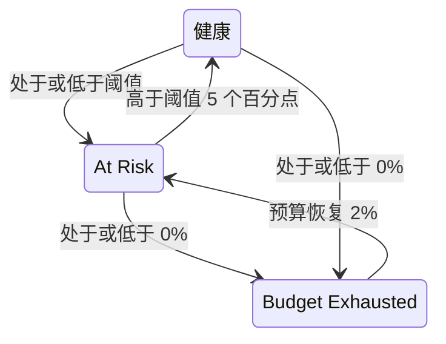

# 错误预算

错误预算是 SLO 目标所允许的停机时间。99.9% 的目标并不意味着“永不宕机”，而是意味着“30 天内最多可以停机 43 分钟，所以要花得明智”。本页说明 OneUptime 如何计算预算、预算能撑多久、如何恢复，以及谁会收到通知。

:::cards
- [预算如何计算](#预算如何计算): 计算公式以及常见目标的预算。
- [预算剩余时间](#预算剩余时间): 按当前速度预算还能撑多久。
- [预算如何恢复](#预算如何恢复): 滚动窗口和日历月。
- [所有者通知](#所有者通知): 预算不足时谁会收到通知。
:::

## 预算如何计算

总预算是窗口中您的目标没有承诺的那部分：

```text
total budget = (100% − target) × window length
```

| 目标 | 7 天窗口 | 28 天窗口 | 30 天窗口 | 90 天窗口 |
| --- | --- | --- | --- | --- |
| 99% | 1h 40m 48s | 6h 43m 12s | 7h 12m | 21h 36m |
| 99.5% | 50m 24s | 3h 21m 36s | 3h 36m | 10h 48m |
| 99.9% | 10m 5s | 40m 19s | 43m 12s | 2h 9m 36s |
| 99.95% | 5m 2s | 20m 10s | 21m 36s | 1h 4m 48s |
| 99.99% | 1m 0s | 4m 2s | 4m 19s | 12m 58s |

SLO 的 **设置** 页面会在目标旁显示它允许的预算，例如“每个 30 天窗口 43m 12s 停机时间”。

### 多监视器 SLO 的预算

在 **Any Monitor Down** 模式下，无论 SLO 测量多少个监视器，预算都是 `(100% − target) × window`：窗口是一条时间线。

在 **Monitor Seconds Average** 模式下，预算按所有监视器合计的监视器秒计算，因此会随监视器数量增加：一个包含三个监视器、30 天内 99.9% 的 SLO，预算约为 129 分钟，而不是 43 分钟。百分比（SLI、剩余预算、消耗率）的含义不变，只有时长会变。

### 日历月的预算

日历月 SLO 从第一天起就拥有整个月的预算：在 31 天的月份里，99.9% 的 SLO 在 1 日就拥有全部 44m 38s。预算不会按当月已过去的部分折算，因此 1 日早上一分钟的中断就会花掉当月预算中的一分钟。

## 剩余预算

随着停机时间累积，**概览** 会在 **Error budget left** 磁贴中显示剩余预算：

- 以占总预算的百分比显示，这也决定了 SLO 的状态并填充进度条。进度条在 SLO 的风险阈值处有一个标记；
- 以时长显示，例如 "31m 4s left of 43m 12s"。

预算用完时，磁贴显示 **No budget left**。停机时间超出预算时，磁贴显示 **Budget exceeded** 以及以时间表示的超支量，例如 "4d 23m over budget · 5m 47s allowed"：SLO 用完了全部 5 分 47 秒的预算，还多用了 4 天 23 分钟。进度条保持为空并显示为红色。

剩余预算以带符号的数字存储，用于计算和历史图表，因此在那里超支的预算显示为负百分比。很大的负百分比表示超支量相对于预算很大；它并不是服务宕机时间所占的比例。

哪些秒计为停机，取决于 SLO 的停机状态，对于多监视器 SLO 还取决于其多监视器模式，两者都在 **设置** → **Downtime Calculation** 中。请参阅 [SLO 概览](/docs/slo/introduction)。

## 预算剩余时间

**概览** 上的 **Budget runway** 磁贴回答“照这样下去，预算什么时候用完？”。它用剩余预算除以过去 60 分钟的消耗率：

```text
runway = budget left ÷ (burn rate × (100% − target))
```

| 磁贴显示 | 含义 |
| --- | --- |
| 一个时长，例如 **~2d 5h** | 按当前速度，预算大约在这么长时间后用完。显示为琥珀色，剩一天或更少时为红色。**Under 1m** 表示不到一分钟。 |
| **Not burning** | 过去 60 分钟没有花掉任何预算。 |
| **Sustainable** | 仅限滚动窗口：剩余时间至少有一个完整窗口，因此预算的花费速度不快于旧停机时间移出窗口的速度。按这个速度它不会用完。 |
| **Lasts until reset** | 仅限日历月：预算会在用完之前于下个月初重置。 |
| **Overspent** | 预算已经花完。磁贴会显示超支了多少。 |

对于日历月 SLO，磁贴还会显示预算何时重置。

剩余时间是一个直线预测。在滚动窗口中，移出窗口的旧停机时间会把预算还回来，而预测忽略了这一点：请把它理解为您至少还有的时间。它在第一次评估之前不显示，对于预算按监视器秒而不是实际时间计算的 **Monitor Seconds Average** 模式 SLO 也不显示。

## 错误预算燃尽

**概览** 上的 **Error budget burn-down** 图表以百分比绘制当前合规窗口中的剩余预算：

- 0% 处的一条线标出预算用完的位置，一条虚线标出 SLO 的风险阈值。
- 对于日历月 SLO，一条浅色线从月初的满预算匀速下降到重置时的零预算。低于这条线，说明本月花预算的速度太快。
- 每次评估（每 5 分钟）记录一个点，因此新 SLO 的图表在第一次评估之前是空的。
- 在图表上拖动可以放大窗口的一部分。双击或点击 **Reset zoom** 可回到整个窗口。

**Open metrics** 会打开 SLO 的 **指标** 页面，其 **Error Budget History** 选项卡最多可回溯 400 天。请参阅 [SLO 指标与仪表板](/docs/slo/metrics)。

## 预算如何恢复

预算如何回来取决于 SLO 的窗口类型：

:::tabs
@tab Rolling
滚动窗口总是从现在起回看同样长的时间，因此停机时间终会移出窗口：一次中断在发生后恰好一个窗口长度时就不再计入。6 月 1 日的 30 分钟中断会在 7 月 1 日移出 30 天 SLO 的计算，预算会随着每一秒停机时间离开窗口而逐渐回来，而不是一次性全部回来。

所以恢复是靠积累得来的，无法预约。如果小的中断不断发生，旧的停机时间移出的同时新的又进来，预算就会停滞不前而不是恢复。
@tab Calendar Month
日历月 SLO 在其时区的每月 1 日午夜重置。全部预算一次性回来，上个月结束。任何方向上都不会跨月结转：糟糕的月份不会影响下个月，表现很好的月份也不会给下个月留出余量。
:::

### 新 SLO

比自身窗口还新的滚动窗口 SLO 会基于目前已有的数据测量，总预算也随之增长：一周前创建的 30 天 SLO 目前只有 7 天的预算。在窗口填满之前，**概览** 会用 **Window 23% full** 指示器以及 **Error budget left** 磁贴中的相同说明显示窗口的填充程度。随着窗口填满，数字会逐渐稳定下来。

## 状态变化与风险阈值

剩余预算决定 SLO 的状态：

| 状态 | 条件 |
| --- | --- |
| **健康** | 剩余预算多于风险阈值。 |
| **At Risk** | 剩余预算处于或低于风险阈值：默认为 20%。 |
| **Budget Exhausted** | 剩余预算为零或更低。 |

在 **设置** → **Objective** 中设置风险阈值。

滚动窗口每次恢复一秒，因此接近边界的 SLO 可能会在两个状态之间来回跳动。为了让每次状态变化都有意义，SLO 只有在明显越过边界时才会离开当前状态：



在默认 20% 的阈值下，处于风险的 SLO 在剩余预算达到 25% 时恢复健康，预算耗尽的 SLO 在 2% 时回到风险状态。每次状态变化都会出现在 SLO 的 **Feed** 中，并附有解释它的 SLI、预算和消耗率。

## 所有者通知

当 SLO 变为 **At Risk** 或 **Budget Exhausted** 时，OneUptime 会通知其所有者：

- 所有者是 SLO **所有者** 页面上仍是项目成员的用户和团队成员。没有所有者的 SLO 会改为通知项目所有者。
- 每位所有者默认会收到电子邮件，并在 **用户设置** → **通知设置** → **监控** 中为 **SLO status changed** 打开的其他渠道上收到通知。
- 邮件主题包含状态和 SLO，例如 `[SLO At Risk] API Availability`。

为了不让接近边界的 SLO 反复发送通知，其所有者每小时最多收到一次通知。变为 **Budget Exhausted** 的通知总会发送，即使在这一小时之内。

> [!TIP]
> 所有者通知让 SLO 的负责人知道其预算出了问题。要通过升级策略呼叫您的值班团队，请使用[消耗率警报与事件](/docs/slo/burn-rate-alerts)。消耗率规则还可以把 SLO 的所有者添加到它创建的每个警报和事件中。

## 后续步骤

:::cards
- [消耗率警报与事件](/docs/slo/burn-rate-alerts): 当预算消耗过快时提醒您的团队。
- [SLO 指标与仪表板](/docs/slo/metrics): 绘制预算随时间变化的图表。
- [SLO 概览](/docs/slo/introduction): 目标、窗口和停机状态。
:::
