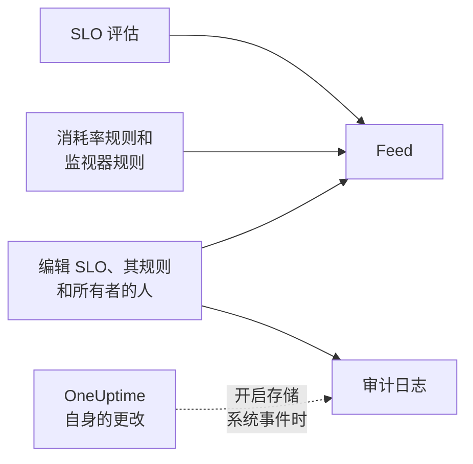

# SLO 动态与审计日志

SLO 保留两份历史记录，它们回答不同的问题。**Feed** 回答“这个 SLO 发生了什么？”，是写给照看它的人看的。**审计日志** 逐个字段地回答“到底是谁改了什么？”，用于审查和合规。

## 动态还是审计日志？

| | **Feed** | **审计日志** |
| --- | --- | --- |
| 回答的问题 | SLO 发生了什么 | 谁在何时改了什么 |
| 记录内容 | 状态变化、消耗率警报和事件，以及对 SLO、其规则、监视器和所有者的更改 | 人员对 SLO、其消耗率规则、监视器规则和所有者所做的每项更改，包括旧值和新值 |
| 是否包含 OneUptime 自身的操作 | 是：评估以及关联监视器的监视器规则 | 仅在 **存储系统事件** 开启时 |
| 套餐 | 所有套餐 | OneUptime Cloud 上的 Enterprise 套餐，或自托管安装上的 Enterprise Edition |
| 保留时间 | OneUptime Cloud 上三年 | 默认 7 天，最多 180 天 |

## SLO 的动态

动态位于 SLO 的 **Feed** 页面，最新条目显示在 SLO **概览** 的 **Recent activity** 中。条目链接到其中提到的 SLO、监视器、警报和事件，大多数条目都有一个 **More Information** 部分，显示相关数字或旧值和新值。

| 事件 | 发布时机 |
| --- | --- |
| SLO 已创建 | 创建 SLO 时。列出其目标、合规窗口、SLI、风险阈值、描述以及创建时带有的默认消耗率规则。 |
| SLO 已更新 | 名称、描述、标签、目标、合规窗口、时区、风险阈值、多监视器模式或停机状态发生变化时。显示每个旧值和新值。 |
| SLO 已启用或已禁用 | 评估被打开或关闭时。 |
| SLO 已归档或已恢复 | SLO 被归档或取消归档时。 |
| 状态已更改 | 某次评估使 SLO 进入新状态时。显示解释它的 SLI、错误预算、消耗率和风险阈值，以及 **已暂停** 或 **Misconfigured** 的原因。 |
| 已触发消耗率警报 | 消耗率规则创建警报时。链接到该警报并显示触发它的消耗率。 |
| 已声明消耗率事件 | 消耗率规则声明事件时。链接到该事件并显示触发它的消耗率。 |
| 消耗率警报或事件已解决 | 规则的警报或事件被关闭时：自动解决，或在自动解决关闭期间手动解决。 |
| 消耗率规则已添加、更改或移除 | 有人创建、编辑或删除消耗率规则时。新 SLO 的默认规则改为出现在其“SLO 已创建”条目中。 |
| 监视器规则已添加、更改或移除 | 有人创建、编辑或删除监视器规则时。没有任何实质更改的保存不会发布。 |
| 监视器已关联或已取消关联 | 监视器被手动或由监视器规则添加到 SLO 或从 SLO 中移除时。较长的列表会列出前几个监视器并注明“及其他 N 个”。 |
| 所有者已添加或已移除 | 用户或团队被添加到 SLO 的所有者中或从中移除时。 |
| 已应用标签规则 | 标签规则在 SLO 创建时或有人运行该规则时为 SLO 添加了标签。列出匹配的规则。请参阅[标签与所有者规则](/docs/slo/label-and-owner-rules)。 |
| 已应用所有者规则 | 所有者规则为 SLO 添加了所有者。列出匹配的规则；它添加的每位所有者还会各自获得一条“所有者已添加”条目。 |

一些细节：

- 由人做出的更改，条目会注明是谁。OneUptime 自身做出的更改（例如评估，或监视器规则关联监视器），以及通过 API 或自动化做出的更改，不带用户。
- 规则因仍未关闭而重新接手的警报或事件不会发布两次。
- 对于私有警报或事件，条目会省略其标题、编号和链接，因为任何能读取 SLO 的人都能读取其动态。但它仍会说明创建了一条私有记录，并显示触发它的消耗率。
- 任何人都不能编辑或删除动态条目。在 OneUptime Cloud 上，超过三年的条目会被移除。

## 审计日志

SLO 的 **审计日志** 页面列出对以下内容所做的更改：

- SLO 本身：其详细信息、设置、标签、监视器和归档；
- 其消耗率规则；
- 其监视器规则；
- 其所有者用户和所有者团队。

对规则和所有者的更改记录在规则或所有者上，并汇总到 SLO，因此 SLO 的页面能在一个地方显示其完整历史，每个条目都链接到它所属的页面。标签和监视器等相关项会连同名称一起记录，而不只是 ID。

有两类内容不在其中：

- **评估结果。** SLI、错误预算、消耗率、状态和评估时间每隔几分钟就会变化。它们的历史在 **概览**、**指标** 页面和 **Feed** 中。
- **OneUptime 自身做出的更改**，例如监视器规则关联或取消关联监视器，除非项目开启了 **存储系统事件**。无论如何，**Feed** 都会记录监视器的关联和取消关联。

### 开启审计日志

审计日志是 Enterprise 功能：需要 OneUptime Cloud 上的 **Enterprise** 套餐，或自托管安装上的 Enterprise Edition。在其他套餐上，SLO 的 **审计日志** 页面会说明如何获得。在自托管安装上，没有有效许可证时审计日志会停止记录（14 天试用期结束后，或许可证过期 30 天后），一旦激活许可证就会恢复（请参阅 [When a license expires or is missing](/docs/self-hosted/enterprise#when-a-license-expires-or-is-missing)）。**审计日志** 页面会在未记录时予以提示。

审计日志在每个项目中默认也是关闭的。要开启它们：

:::steps
### 打开审计日志设置

进入 **项目设置**，在侧边菜单中打开 **审计日志**，然后点击 **设置**。

### 编辑设置

点击 **Edit Audit Log Settings**，打开 **启用审计日志**。

### 选择保留内容

将 **保留时长（天）** 设置为 7（默认值）到 180 之间，并打开 **存储系统事件** 以同时记录 OneUptime 自身做出的更改。保存。更改约在一分钟内生效。
:::

审计日志关闭期间，SLO 的 **审计日志** 页面会显示 **Audit logging is off** 以及开启它的链接。关闭之前记录的条目仍然可见。项目完整的审计日志（涵盖所有资源）位于 **项目设置** → **审计日志** → **审计日志**。

## 后续步骤

:::cards
- [SLO 概览](/docs/slo/introduction): SLO 拥有的每个页面。
- [监视器与监视器规则](/docs/slo/monitor-rules): 是什么关联和取消关联监视器。
- [消耗率警报与事件](/docs/slo/burn-rate-alerts): 是什么触发和解决动态中的警报和事件。
- [标签与所有者规则](/docs/slo/label-and-owner-rules): 是什么自动添加标签和所有者。
:::
