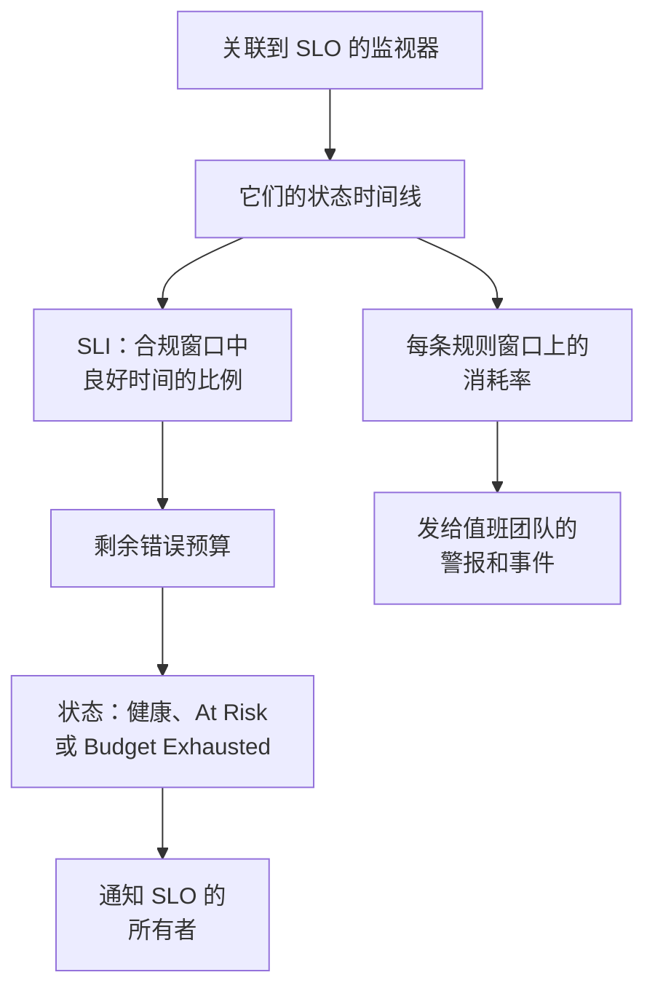

# SLO 概览

服务等级目标（SLO）是您为所监控对象设定的可靠性目标，例如“在滚动的 30 天内 99.9% 的时间可用”。OneUptime 每 5 分钟将每个 SLO 与其目标对比测量一次，因此您回答的不再是“它现在能用吗？”，而是“在对用户重要的时间段内，我们是否足够可靠，还剩多少出错的余地？”。

:::cards
- [创建 SLO](#创建-slo): 一个名称和一个目标，其余一切都从默认值开始。
- [监视器与监视器规则](/docs/slo/monitor-rules): 选择 SLO 要测量的监视器。
- [错误预算](/docs/slo/error-budget): 目标允许多少停机时间，以及预算如何恢复。
- [消耗率警报与事件](/docs/slo/burn-rate-alerts): 当预算消耗过快时提醒您的团队。
:::

## 工作原理

SLO 读取关联到它的监视器的状态时间线，也就是您的状态页所显示的同一份数据。OneUptime 据此计算合规窗口中良好时间所占的比例、错误预算还剩多少，以及预算消耗的速度。

## 关键概念

| 术语 | 含义 |
| --- | --- |
| **SLI**（服务等级指标） | 测量值：SLO 的监视器在合规窗口中处于可用状态的时间百分比。 |
| **SLO**（服务等级目标） | SLI 的目标，例如“过去 30 天至少 99.9%”。 |
| **错误预算** | 目标允许的停机时间：`(100% − target) × window`。30 天内 99.9% 即 43 分 12 秒。 |
| **消耗率** | 与匀速相比，预算被花掉的速度。消耗率为 1 时，预算恰好在窗口结束时用完。 |

错误预算把可靠性变成了可以花的东西。剩得多，就加快发布、敢于冒险；剩得少，就放慢脚步、投入稳定性。SLO 为这场讨论提供一个所有人都能看到的数字。

## 创建 SLO

您需要一个可以创建 SLO 的角色：Project Owner、Project Admin，或具有 Create Service Level Objective 权限的自定义角色。

:::steps
### 打开 SLO

从顶部栏的 **产品** 菜单打开 **SLOs**。它位于第一组，与监视器和事件在一起。点击 **创建Service Level Objective**。

### 命名并设定目标

输入 **名称**（例如“API Availability”）和 **Target (%)**：监视器必须保持可用的时间比例。目标初始值为 `99.9`。它必须大于 0 且不超过 99.999，因为 100% 的目标不会留下任何可跟踪的错误预算。

### 在更多字段中检查默认值

**更多字段** 默认折叠，并有一行说明其默认值的作用：SLO 按 30 天的滚动窗口测量，当剩余错误预算低于 20% 时进入风险状态。展开它即可修改下表中的任一字段。

### 保存 SLO

点击 **创建Service Level Objective**。OneUptime 会打开新的 SLO。由于新 SLO 还没有监视器，它的 **概览** 会显示 **Choose what this SLO measures**。

### 关联监视器

点击 **Create a monitor rule** 可关联所有匹配的监视器（现在和将来的都包括在内），或点击 **Add monitors** 手动选择。请参阅[监视器与监视器规则](/docs/slo/monitor-rules)。

### 等待第一批数字

OneUptime 每 5 分钟评估一次已启用的 SLO。SLI、错误预算和燃尽图会在第一次有监视器可测的评估之后出现。
:::

**更多字段** 中的字段：

| 字段 | 设置内容 | 默认值 |
| --- | --- | --- |
| **描述** | SLO 的用途。 | 空 |
| **风险阈值 (%)** | 剩余错误预算降到多少比例时 SLO 变为 **At Risk**。0 到 100 之间的整数。 | 20 |
| **Window Type** | **Rolling**：最近 N 天，随着旧的停机时间移出窗口而恢复。**Calendar Month**：每个月独立计算，在 1 日重置。 | **Rolling** |
| **Window (Days)** | 仅限滚动窗口：回看多少天，1 到 366。通常为 28 或 30。 | 30 |
| **时区** | 仅限日历月：每个月开始和结束所用的时区。 | UTC |
| **标签** | 用于组织和筛选 SLO 的标签。 | 无 |

决定 SLO 如何测量的一切都从默认值开始，之后可以修改：

| 设置 | 新 SLO 的初始值 | 修改位置 |
| --- | --- | --- |
| 监视器 | 无 | **监视器** 或 **Monitor Rules** |
| 停机状态 | 项目中所有非运行状态 | **设置** → **Downtime Calculation** |
| 多监视器模式 | **Any Monitor Down** | **设置** → **Downtime Calculation** |
| 评估 | 开启 | **设置** → **评估** |
| 消耗率规则 | 一条 **Fast burn** 规则和一条 **Slow burn** 规则，按窗口调整 | **Burn Rate Rules** |

## SLO 的组成

| 组成部分 | 决定什么 |
| --- | --- |
| 监视器 | SLI 的来源。可手动关联，也可用监视器规则关联：请参阅[监视器与监视器规则](/docs/slo/monitor-rules)。 |
| 目标 | SLO 承诺的良好时间比例，大于 0 且不超过 99.999。 |
| 合规窗口 | 测量 SLI 和预算的时间段：1 到 366 天的滚动窗口，或日历月。 |
| 风险阈值 | 剩余预算降到多少比例时 SLO 变为 **At Risk**。 |
| 停机状态 | 哪些监视器状态计为停机。 |
| 多监视器模式 | 如何合并多个监视器的停机时间。 |

### 哪些状态计为停机

每个 SLO 都有自己的一份计为停机的监视器状态列表。新 SLO 从项目中所有未标记为运行中的状态开始（例如 Degraded 和 Offline），与状态页的做法相同。在 **设置** → **Downtime Calculation** 中修改该列表。留空则计入所有非运行状态，包括之后添加到项目中的状态。

> [!TIP]
> 用两个 SLO 以两种方式测量同一组监视器：一个严格的可用性 SLO，Degraded 和 Offline 都计入；一个较宽松的完全中断 SLO，只计入 Offline。

### 合规窗口

| 窗口类型 | 行为 |
| --- | --- |
| **Rolling** | 从现在起回看固定的天数。旧的停机时间会移出窗口，因此预算会逐渐回来。 |
| **Calendar Month** | 从当月 1 日开始测量，使用 SLO 的时区（默认为 UTC）。每月月初全部预算都会回来。 |

### 一个 SLO 包含多个监视器

当 SLO 测量多个监视器时，它的 **Multi Monitor Mode** 决定如何合并这些监视器的停机时间。新 SLO 使用 **Any Monitor Down**。

| 模式 | 停机时间的计算方式 | 适用场景 |
| --- | --- | --- |
| **Any Monitor Down** | 只要至少有一个监视器停机，该时刻就计为整个 SLO 的停机时间。重叠的中断只计一次。 | 这些监视器共同组成一个服务：任何一个停机，用户都会察觉。 |
| **Monitor Seconds Average** | 每个监视器的停机时间分别计算，并在全部监控时间上取平均：SLI = 1 − (所有监视器的停机秒数 ÷ 所有监视器的监控秒数)。 | 这些监视器是一组相似的资源，部分影响应按部分计入。 |

例如，监视器 A 在 10:00 到 11:00 停机，而监视器 B 一直可用。**Any Monitor Down** 记录 60 分钟停机；**Monitor Seconds Average** 记录相当于 30 分钟的停机，因为两个监视器中有一个停机了一小时。在该模式下，预算也按监视器秒计算：请参阅[错误预算](/docs/slo/error-budget)。

## SLO 状态

OneUptime 为每个已评估的 SLO 分配一个状态：

| 状态 | 含义 |
| --- | --- |
| **健康** | 剩余预算多于风险阈值。 |
| **At Risk** | 剩余预算已降至风险阈值或以下：默认为 20%。 |
| **Budget Exhausted** | 预算已全部用完或已超支。 |
| **Misconfigured** | 无法测量该 SLO：它没有监视器，或其监视器已不存在、尚未在窗口内记录任何状态，或其目标超出范围。 |
| **已暂停** | 它测量的每个监视器都已归档，或因手动操作、手动事件或计划维护而关闭了主动监控。只要其中任一监视器恢复监控，它就会自动恢复。 |

已关闭或已归档的 SLO 不会被评估，因此其状态保持不变；SLO 列表会改为显示 **已禁用** 或 **已归档** 徽章。当状态变为 **At Risk** 或 **Budget Exhausted** 时，会通知 SLO 的所有者：请参阅[错误预算](/docs/slo/error-budget)。

## SLO 列表

**SLOs** 页面列出所有未归档的 SLO，以及它们的状态、SLI、剩余预算、消耗率、目标、窗口、监视器、标签和所有者。

- 列表上方的磁贴按状态统计 SLO：**健康**、**At Risk**、**Budget Exhausted**、**Misconfigured**、**已暂停** 和 **已禁用**。点击磁贴只显示这些 SLO，再次点击则显示全部。
- 选择多个 SLO，可以一次性添加或移除标签和所有者、归档或删除它们。
- 侧边菜单的 **设置** 部分包含 **标签规则** 和 **所有者规则**，用于为新 SLO 添加标签和所有者：请参阅[标签与所有者规则](/docs/slo/label-and-owner-rules)。
- 侧边菜单的 **高级** 部分包含 **已归档**，即已归档 SLO 的列表。

## SLO 的页面

打开一个 SLO，即可在侧边菜单中看到它的页面：

| 页面 | 显示内容 |
| --- | --- |
| **概览** | 状态、主要数字、错误预算燃尽、近期活动、未关闭的警报和事件，以及消耗率规则。 |
| **指标** | SLO 的 `oneuptime.slo.*` 指标、它的长期错误预算历史，以及影响它的事件和警报的指标。请参阅 [SLO 指标与仪表板](/docs/slo/metrics)。 |
| **事件** | 其消耗率规则声明的事件。徽章统计未关闭的数量。 |
| **警报** | 其消耗率规则触发的警报。徽章统计未关闭的数量。 |
| **Feed** | SLO 发生过的事情，以时间线呈现。请参阅 [SLO 动态与审计日志](/docs/slo/feed-and-audit-logs)。 |
| **监视器** | 它测量的监视器，以及每个监视器是由人还是由规则关联的。 |
| **Monitor Rules** | 关联匹配监视器的规则。 |
| **Burn Rate Rules** | 在预算消耗过快时触发警报、声明事件的规则。 |
| **所有者** | 会收到其状态变化通知的用户和团队。 |
| **设置** | 目标、合规周期、停机计算、评估开关和归档卡片。 |
| **审计日志** | 谁在何时更改了 SLO、其规则和其所有者。 |
| **Delete SLO** | 永久删除 SLO，并解决它未关闭的消耗率警报和事件。 |

**监视器**、**Monitor Rules** 和 **Burn Rate Rules** 位于 **配置** 部分，**所有者**、**设置**、**审计日志** 和 **Delete SLO** 位于 **Management** 部分。这两个部分默认都是折叠的，用于从代码管理 SLO 的 **开发者** 部分也是如此：点击部分标题即可展开。

当有问题阻止 SLO 测量时，它每个页面顶部的横幅会说明问题所在，并链接到可以修复它的页面：请参阅[故障排除](#故障排除)。

### 概览页

**概览** 从上到下回答“我们是否在预算之内？”：

- **摘要**：状态、一句说明其含义的话以及描述。旁边是 **刷新** 和 SLO 上次评估的时间。下面是目标、**Compliance window**（新的滚动窗口填满之前会带有填充指示器：请参阅[新 SLO 与窗口填充指示器](#新-slo-与窗口填充指示器)）、监视器数量和所有者。
- **主要数字**：
  - **SLI**：窗口中良好时间的比例，以及它高于或低于目标多少。
  - **Error budget left**：一个百分比、类似 "12m 30s left of 43m 12s" 的时长，以及一条在风险阈值处带标记的进度条。预算超支时显示 **Budget exceeded** 及超出多少。
  - **Burn rate**：过去 60 分钟内预算被花掉的速度，也就是默认快速消耗规则使用的时间段。超过 1× 时变为琥珀色；达到 SLO 已启用的消耗率规则中最低的阈值时变为红色，并显示 **Rule threshold reached**。
  - **Budget runway**：按这个速度预算还能撑多久。请参阅[错误预算](/docs/slo/error-budget#预算剩余时间)。
- **Error budget burn-down**：当前窗口内的剩余预算。请参阅[错误预算](/docs/slo/error-budget#错误预算燃尽)。
- **Recent activity**：SLO 动态中的最新条目。
- **SLO Details**：名称、描述和标签，这是概览页上唯一可编辑的设置。
- **Open alerts & incidents**：消耗率规则当前未关闭的内容。
- **Burn rate rules**：每条已启用规则的阈值与当前消耗率对比，以及规则会声明什么。

### 设置

**设置** 页面汇集了 SLO 的测量方式，每项一张卡片：

| 卡片 | 修改内容 | 须知 |
| --- | --- | --- |
| **Objective** | **Target (%)** 和 **风险阈值 (%)**，通过 **Edit Objective** 修改。 | 显示目标允许的停机时间，例如“每个 30 天窗口 43m 12s 停机时间”。 |
| **Compliance Period** | **Window Type**、**Window (Days)** 和 **时区**，通过 **Edit Period** 修改。 | 窗口改变时消耗率规则保留原有阈值，因此之后请检查它们。 |
| **Downtime Calculation** | **Multi Monitor Mode** 和 **停机监视器状态**，通过 **Edit Downtime Calculation** 修改。 | 不选任何状态时会计入所有非运行状态，包括之后添加的状态。 |
| **评估** | **评估此 SLO** 开关，一切换就会保存。 | 关闭时会要求确认，因为这也会解决 SLO 未关闭的消耗率警报和事件。 |
| **Archive SLO** | **归档** 或 **取消归档**。 | 请参阅[归档 SLO](#归档-slo)。 |

更改目标、周期或停机计算后，OneUptime 会在下一次运行时重新评估 SLO。

## 归档 SLO

不再测量但想保留的 SLO（例如已下线的服务或去年的目标）可以归档。在 **设置** → **Archive SLO** 中归档，或在列表中选择 SLO 后选择 **归档**。

已归档的 SLO：

- 会从 SLO 列表、其状态磁贴以及仪表板的 SLO 选择器和列表中隐藏；
- 不会被评估：数字停留在上次评估时，消耗率规则不会触发，也不发送指标；
- 其未关闭的消耗率警报和事件会被解决；
- 保留其设置、历史、规则和所有者。其监视器规则会让监视器列表保持最新，因此恢复时会使用正确的监视器。

已归档的 SLO 列在 SLO 列表侧边菜单 **高级** 下的 **已归档** 页面中。在那里选择它们并选择 **取消归档** 即可恢复：它们会在下一次运行时重新评估，SLI 和预算会根据其监视器的历史重新计算。

归档和关闭评估是两个独立的开关。归档前已关闭的 SLO 在取消归档后仍是关闭的：用其横幅中的 **打开评估**，或 **设置** → **评估** 中的 **评估此 SLO** 重新打开。

| 您想要 | 这样做 |
| --- | --- |
| 暂时停止测量，但保留在列表中 | 关闭评估 |
| 让它退役，但保留历史和设置 | 归档 |
| 永久移除 | 删除 |

## 警报、事件和监视器上的 SLO

消耗率规则创建的每个警报和事件都会关联到它的 SLO：

- 警报或事件的页面会在 **受影响的资源** 下列出该 SLO，并附有指向它的链接。
- 警报和事件列表会在受影响的资源中显示该 SLO，**受影响的资源** 筛选器可将列表限定为某个 SLO。
- SLO 的 **警报** 和 **事件** 页面会列出它们，侧边菜单中的徽章统计未关闭的数量。

这个关联由 OneUptime 在规则创建警报或事件时建立；您不能手动添加，编辑警报或事件也不会移除它。

监视器的侧边菜单也有一个 **SLOs** 页面：列出测量该监视器的 SLO，这样在暂停或更改监视器之前，您就知道哪些目标依赖它。

## 新 SLO 与窗口填充指示器

比自身窗口还新的滚动窗口 SLO 会基于目前已有的数据测量：昨天创建的 30 天 SLO 只有一天的数据。它的错误预算一开始很小，随着窗口填满而增长，因此最初的数字波动会比之后更大。

在此期间，**概览** 会提示这一点：摘要中显示 **Window 23% full** 指示器（第一天显示 **Window under 1% full**），**Error budget left** 磁贴也会在数字下方重复说明。窗口填满后两者都会消失。日历月 SLO 从不显示它们，因为它们的预算从第一天起就覆盖整个月；**Monitor Seconds Average** 模式的 SLO 也不显示，因为其预算按所有监视器合计。

## 故障排除

SLO 页面顶部的横幅会说明是什么阻止了它测量：

| 横幅 | 含义 | 处理方法 |
| --- | --- | --- |
| **No monitors attached** | SLO 没有监视器，因此没有可测量的对象。 | 关联监视器，或创建监视器规则。 |
| **Waiting for SLO evaluation** | 已关联监视器，但上一次评估没有它们的状态数据。 | 检查监视器是否正在被检查。下一次有数据的评估之后就会出现数字。 |
| **Measurement is paused** | 它测量的每个监视器都已归档或关闭了主动监控。 | 至少为一个监视器重新打开监控，或等待维护结束。 |
| **The target is out of range** | 目标不在大于 0 且小于 100 的范围内。 | 在 **设置** → **Objective** 中设置一个目标，例如 99.9。 |
| **This SLO is disabled** | 评估已关闭。 | 点击 **打开评估**。 |
| **This SLO is archived** | SLO 已归档。 | 在 **设置** 中取消归档。 |
| **Not evaluated yet** | SLO 刚刚创建。 | 等待第一次评估，最多几分钟。 |

## 后续步骤

:::cards
- [监视器与监视器规则](/docs/slo/monitor-rules): 手动或通过规则关联监视器。
- [错误预算](/docs/slo/error-budget): 预算的计算、剩余时间以及预算如何回来。
- [消耗率警报与事件](/docs/slo/burn-rate-alerts): 当预算消耗过快时提醒值班团队。
- [SLO 指标与仪表板](/docs/slo/metrics): 为 SLO 绘制图表并构建 SLO 仪表板。
:::
