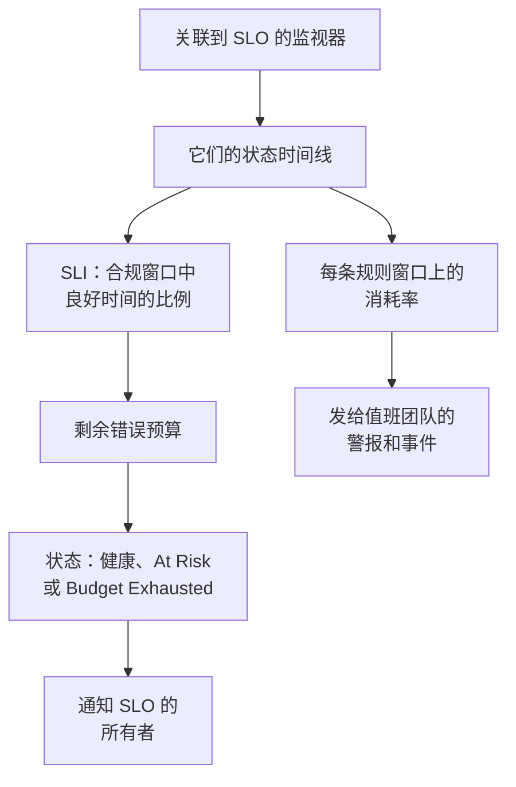

# SLO 概览

服务等级目标（SLO）是您为自己运行的服务设定的可靠性目标，例如“在滚动的 30 天内 99.9% 的时间可用”或“99.9% 的结账请求成功”。OneUptime 每 5 分钟将每个 SLO 与其目标对比测量一次，因此您回答的不再是“它现在能用吗？”，而是“在对用户重要的时间段内，我们是否足够可靠，还剩多少出错的余地？”。[术语表](/docs/introduction/glossary#slo) 把 SLO 与 OneUptime 使用的其他词放在一起介绍。

:::cards
- [创建 SLO](#创建-slo): 衡量对象、名称和目标，其余一切都从默认值开始。
- [监视器与监视器规则](/docs/slo/monitor-rules): 选择 SLO 要测量的监视器。
- [请求与延迟 SLO](/docs/slo/request-slos): 根据服务的追踪衡量其请求。
- [错误预算](/docs/slo/error-budget): 目标允许多少停机时间，以及预算如何恢复。
- [消耗率警报与事件](/docs/slo/burn-rate-alerts): 当预算消耗过快时提醒您的团队。
:::

## 工作原理

SLO 衡量的是两种对象之一。监视器可用率 SLO 读取关联到它的监视器的状态时间线，也就是您的状态页所显示的同一份数据。请求 SLO 根据服务的追踪，统计这些服务处理的请求：请参阅[请求与延迟 SLO](/docs/slo/request-slos)。本页其余部分介绍监视器可用率 SLO，除非另有说明，请求 SLO 的工作方式与之相同。OneUptime 据此计算合规窗口中良好时间所占的比例、错误预算还剩多少，以及预算消耗的速度。监视器的监控关闭期间的时间会被排除：那段时间没有任何东西检查该监视器，因此这段时间既不消耗错误预算，也不算作良好时间。监视器第一次检查之前的时间同样会被排除：在有东西检查监视器之前，它的状态只是每个监视器创建时都具有的正常运行状态，因此 SLO 从其监视器的第一次检查开始测量；监视器尚未被任何东西检查过的 SLO，在它们被检查之前没有任何可测量的内容。



## 关键概念

OneUptime 各处使用的词都收录在 [术语表](/docs/introduction/glossary) 中。

| 术语 | 含义 |
| --- | --- |
| **SLI**（服务等级指标） | 测量值：SLO 的监视器在合规窗口中处于可用状态的时间百分比，或其服务的请求中良好请求所占的百分比。 |
| **SLO**（服务等级目标） | SLI 的目标，例如“过去 30 天至少 99.9%”。 |
| **错误预算** | 目标允许的停机时间：`(100% − target) × window`。30 天内 99.9% 即 43 分 12 秒。对于请求 SLO，它是目标允许的不良请求：在 99.9% 时，每 1,000 个请求中允许 1 个。 |
| **消耗率** | 与匀速相比，预算被花掉的速度。消耗率为 1 时，预算恰好在窗口结束时用完。 |

错误预算把可靠性变成了可以花的东西。剩得多，就加快发布、敢于冒险；剩得少，就放慢脚步、投入稳定性。SLO 为这场讨论提供一个所有人都能看到的数字。

## 创建 SLO

您需要一个可以创建 SLO 的角色：项目所有者、项目管理员，或具有 Create Service Level Objective 权限的自定义角色。

:::steps
### 打开 SLO

从顶部栏的 **产品** 菜单打开 **SLOs**。它位于第一组，与监视器和事件在一起。点击 **创建服务级别目标**。

### 选择衡量对象

在 **衡量对象** 下，保留 **监视器可用率** 即可衡量监视器处于可用状态的时间比例。若要改为衡量服务的请求，请选择 **请求成功率** 或 **请求延迟**，并选择相应的 **服务**：请参阅[请求与延迟 SLO](/docs/slo/request-slos)。若要统计您的服务发送的计数器或直方图中的良好事件，请选择 **指标**：请参阅[基于指标的 SLO](/docs/slo/request-slos#基于指标的-slo)。点击 **下一步**。

### 命名并设定目标

输入 **名称**（例如“API Availability”）和 **目标（%）**：必须为良好的时间或请求所占的比例。目标初始值为 `99.9`。它必须大于 0 且不超过 99.999，因为 100% 的目标不会留下任何可跟踪的错误预算。

### 在更多字段中检查默认值

**更多字段** 默认折叠，并有一行说明其默认值的作用：SLO 按 30 天的滚动窗口测量，当剩余错误预算低于 20% 时进入风险状态。展开它即可修改下表中的任一字段。

### 保存 SLO

点击 **创建服务级别目标**。OneUptime 会打开新的 SLO。监视器可用率 SLO 还没有监视器，因此它的 **概览** 会显示 **Choose what this SLO measures**。

### 关联监视器

对于监视器可用率 SLO，点击 **创建监视器规则** 可关联所有匹配的监视器（现在和将来的都包括在内），或点击 **添加监视器** 手动选择。请参阅[监视器与监视器规则](/docs/slo/monitor-rules)。

### 等待第一批数字

OneUptime 每 5 分钟评估一次已启用的 SLO。SLI、错误预算和燃尽图会在第一次有监视器可测或有请求可统计的评估之后出现。
:::

**更多字段** 中的字段：

| 字段 | 设置内容 | 默认值 |
| --- | --- | --- |
| **描述** | SLO 的用途。 | 空 |
| **风险阈值 (%)** | 剩余错误预算降到多少比例时 SLO 变为 **有风险**。0 到 100 之间的整数。 | 20 |
| **窗口类型** | **滚动**：最近 N 天，随着旧的停机时间移出窗口而恢复。**自然月**：每个月独立计算，在 1 日重置。 | **滚动** |
| **窗口（天）** | 仅限滚动窗口：回看多少天，1 到 366。通常为 28 或 30。 | 30 |
| **时区** | 仅限日历月：每个月开始和结束所用的时区。 | UTC |
| **标签** | 用于组织和筛选 SLO 的标签。 | 无 |

决定 SLO 如何测量的一切都从默认值开始，之后可以修改：

| 设置 | 新 SLO 的初始值 | 修改位置 |
| --- | --- | --- |
| 监视器 | 无 | **监视器** 或 **监视器规则** |
| 停机状态 | 项目中所有非运行状态 | **设置** → **停机时间计算方式** |
| 多监视器模式 | **任一监视器宕机** | **设置** → **停机时间计算方式** |
| 评估 | 开启 | **设置** → **评估** |
| 消耗率规则 | 一条 **Fast burn** 规则、一条 **Slow burn** 规则和一条 **Slow leak** 规则，按窗口调整 | **消耗速率规则** |

## SLO 的组成

| 组成部分 | 决定什么 |
| --- | --- |
| 衡量对象 | **监视器可用率**、**请求成功率** 或 **请求延迟**。 |
| 监视器或服务 | SLI 的来源：监视器（可手动关联，也可用监视器规则关联，请参阅[监视器与监视器规则](/docs/slo/monitor-rules)），或请求 SLO 统计其请求的服务。 |
| 目标 | SLO 承诺的良好时间比例，大于 0 且不超过 99.999。 |
| 合规窗口 | 测量 SLI 和预算的时间段：1 到 366 天的滚动窗口，或日历月。 |
| 风险阈值 | 剩余预算降到多少比例时 SLO 变为 **有风险**。 |
| 停机状态 | 哪些监视器状态计为停机。 |
| 多监视器模式 | 如何合并多个监视器的停机时间。 |

### 哪些状态计为停机

每个 SLO 都有自己的一份计为停机的监视器状态列表。新 SLO 从项目中所有未标记为运行中的状态开始（例如 Degraded 和 Offline），与状态页的做法相同。在 **设置** → **停机时间计算方式** 中修改该列表。留空则计入所有非运行状态，包括之后添加到项目中的状态。

> [!TIP]
> 用两个 SLO 以两种方式测量同一组监视器：一个严格的可用性 SLO，Degraded 和 Offline 都计入；一个较宽松的完全中断 SLO，只计入 Offline。

### 合规窗口

| 窗口类型 | 行为 |
| --- | --- |
| **滚动** | 从现在起回看固定的天数。旧的停机时间会移出窗口，因此预算会逐渐回来。 |
| **自然月** | 从当月 1 日开始测量，使用 SLO 的时区（默认为 UTC）。每月月初全部预算都会回来。 |

### 一个 SLO 包含多个监视器

当 SLO 测量多个监视器时，它的 **多监视器模式** 决定如何合并这些监视器的停机时间。新 SLO 使用 **任一监视器宕机**。

| 模式 | 停机时间的计算方式 | 适用场景 |
| --- | --- | --- |
| **任一监视器宕机** | 只要至少有一个监视器停机，该时刻就计为整个 SLO 的停机时间。重叠的中断只计一次。 | 这些监视器共同组成一个服务：任何一个停机，用户都会察觉。 |
| **监视器秒数平均** | 每个监视器的停机时间分别计算，并在全部监控时间上取平均：SLI = 1 − (所有监视器的停机秒数 ÷ 所有监视器的监控秒数)。 | 这些监视器是一组相似的资源，部分影响应按部分计入。 |

例如，监视器 A 在 10:00 到 11:00 停机，而监视器 B 一直可用。**任一监视器宕机** 记录 60 分钟停机；**监视器秒数平均** 记录相当于 30 分钟的停机，因为两个监视器中有一个停机了一小时。在该模式下，预算也按监视器秒计算：请参阅[错误预算](/docs/slo/error-budget)。

## SLO 状态

OneUptime 为每个已评估的 SLO 分配一个状态：

| 状态 | 含义 |
| --- | --- |
| **健康** | 剩余预算多于风险阈值。 |
| **有风险** | 剩余预算已降至风险阈值或以下：默认为 20%。 |
| **预算已耗尽** | 预算已全部用完或已超支。 |
| **正在等待** | 它的监视器还没有被任何东西检查过：例如一分钟前刚创建的监视器，或尚未连接的自托管探测器。它从这些监视器的首次检查开始计量。 |
| **配置错误** | 无法测量该 SLO：它没有监视器，或其监视器已不存在、尚未在窗口内记录任何状态，或其目标超出范围。请求 SLO 在没有服务、没有延迟阈值，或其服务尚未在窗口内处理过任何请求时，也会处于配置错误状态。 |
| **已暂停** | 它测量的每个监视器都已归档，或因手动操作、手动事件或计划维护而关闭了主动监控。只要其中任一监视器恢复监控，它就会自动恢复。 |

已关闭或已归档的 SLO 不会被评估，因此其状态保持不变；SLO 列表会改为显示 **已禁用** 或 **已归档** 徽章。当状态变为 **有风险** 或 **预算已耗尽** 时，会通知 SLO 的所有者：请参阅[错误预算](/docs/slo/error-budget)。规则也可以把状态变化发布到 Slack、Microsoft Teams 或 Mattermost：请参阅[状态变更](/docs/slo/error-budget-policy#状态变更)。

## SLO 列表

**SLOs** 页面列出所有未归档的 SLO，以及它们的状态、SLI、剩余预算、消耗率、目标、窗口、监视器、标签和所有者。其 **衡量对象** 列对请求 SLO 显示其服务，对监视器正常运行时间 SLO 显示其监视器；**服务** 筛选器可找出衡量某个服务的 SLO。

- 列表上方的磁贴按状态统计 SLO：**健康**、**有风险**、**预算已耗尽**、**正在等待**、**配置错误**、**已暂停** 和 **已禁用**。只要有未归档的 SLO，磁贴就会显示。点击磁贴只显示这些 SLO，再次点击则显示全部。
- 选择多个 SLO，可以一次性添加或移除标签和所有者、启用或禁用、为它们添加缺少的[推荐消耗率规则](/docs/slo/burn-rate-alerts#一次为多个-slo-添加推荐规则)或[推荐的错误预算策略](/docs/slo/error-budget-policy#推荐策略)、归档或删除它们。
- **部署** 筛选器显示错误预算策略此刻正在冻结部署的 SLO，或允许部署的 SLO。从列表的列选择器中显示 **部署** 列，即可看到每个 SLO 从何时起被冻结：请参阅[部署闸门](/docs/slo/error-budget-policy#部署闸门)。
- 侧边菜单的 **设置** 部分包含 **标签规则** 和 **所有者规则**，用于为新 SLO 添加标签和所有者：请参阅[标签与所有者规则](/docs/slo/label-and-owner-rules)。
- 侧边菜单的 **高级** 部分包含 **已归档**，即已归档 SLO 的列表。

## SLO 的页面

打开一个 SLO，即可在侧边菜单中看到它的页面：

| 页面 | 显示内容 |
| --- | --- |
| **概览** | 状态、主要数字、错误预算燃尽、近期活动、未关闭的警报和事件，以及消耗率规则。 |
| **指标** | SLO 的 `oneuptime.slo.*` 指标、它的长期错误预算历史，以及影响它的事件和警报的指标。请参阅 [SLO 指标与仪表板](/docs/slo/metrics)。 |
| **月度报告** | SLO 在每个自然月以及整个期间的表现。请参阅[月度报告](#月度报告)。 |
| **事件** | 其消耗率规则和错误预算策略声明的事件。徽章统计未关闭的数量。 |
| **警报** | 其消耗率规则和错误预算策略触发的警报。徽章统计未关闭的数量。 |
| **动态** | SLO 发生过的事情，以时间线呈现。请参阅 [SLO 动态与审计日志](/docs/slo/feed-and-audit-logs)。 |
| **监视器** | 它测量的监视器，以及每个监视器是由人还是由规则关联的。仅限监视器可用率 SLO。 |
| **监视器规则** | 关联匹配监视器的规则。仅限监视器可用率 SLO。 |
| **消耗速率规则** | 在预算消耗过快时触发警报、声明事件的规则。 |
| **错误预算策略** | 错误预算减少时团队约定要做的事，以及策略的每个级别触发的警报和事件。参见 [错误预算策略](/docs/slo/error-budget-policy)。 |
| **所有者** | 会收到其状态变化通知的用户和团队。 |
| **设置** | 衡量对象、目标、合规周期、停机计算、评估开关和归档卡片。 |
| **审计日志** | 谁在何时更改了 SLO、其规则和其所有者。 |
| **删除 SLO** | 永久删除 SLO，并解决它未关闭的消耗率警报和事件。 |

**监视器** 位于 **概览** 部分的 **概览** 之下；**监视器规则**、**消耗速率规则** 和 **错误预算策略** 位于 **规则** 部分；**所有者**、**设置**、**审计日志** 和 **删除 SLO** 位于 **管理** 部分。**规则** 和 **管理** 部分默认是折叠的，用于从代码管理 SLO 的 **开发者** 部分也是如此：点击部分标题即可展开。

当有问题阻止 SLO 测量时，它每个页面顶部的横幅会说明问题所在，并链接到可以修复它的页面：请参阅[故障排除](#故障排除)。

### 概览页

**概览** 从上到下回答“我们是否在预算之内？”：

- **摘要**：状态、一句说明其含义的话以及描述。旁边是 **刷新** 和 SLO 上次评估的时间。下面是目标、**合规窗口**（新的滚动窗口填满之前会带有填充指示器：请参阅[新 SLO 与窗口填充指示器](#新-slo-与窗口填充指示器)）、监视器数量（或请求 SLO 的服务数量）和所有者，可通过 **添加所有者** 就地添加所有者。
- **主要数字**：
  - **SLI**：窗口中良好时间的比例，以及它高于或低于目标多少。
  - **剩余错误预算**：一个百分比、类似 "43分钟12秒 中剩余 12分钟30秒" 的时长（对于请求 SLO，则是不良请求的数量），以及一条在风险阈值处带标记的进度条。预算超支时显示 **已超出预算** 及超出多少。
  - **消耗速率**：过去 60 分钟内预算被花掉的速度，也就是默认快速消耗规则使用的时间段。超过 1× 时变为琥珀色；达到 SLO 已启用、且回看 6 小时或更短时间的消耗率规则中最低的阈值时变为红色，并显示 **已达到规则阈值**。一小时的数据对于回看数天的规则（例如 **Slow leak**）说明不了什么，因此不会与这类规则比较。
  - **预算可撑时长**：按这个速度预算还能撑多久。请参阅[错误预算](/docs/slo/error-budget#预算剩余时间)。
- **错误预算燃尽**：当前窗口内的剩余预算。请参阅[错误预算](/docs/slo/error-budget#错误预算燃尽)。
- **最近活动**：SLO 动态中的最新条目。
- **SLO 详情**：名称、描述和标签，这是概览页上唯一可编辑的设置。
- **未解决的警报和事件**：消耗率规则当前未关闭的内容。
- **Burn rate rules**：每条已启用规则的阈值与当前消耗率对比（仅限回看 6 小时或更短时间的规则），以及规则会声明什么。

当 SLO 处于其错误预算策略的某个级别时，**概览** 还会显示该级别以及团队约定在该级别要做的事：参见 [错误预算策略](/docs/slo/error-budget-policy)。

**被使用于**卡片会列出作用于此 SLO 的消耗速率规则和错误预算策略层级，以及显示它的仪表板。归档或删除此 SLO 时，会先说明这些内容：它的规则和层级会随之删除。

### 设置

**设置** 页面汇集了 SLO 的测量方式，每项一张卡片：

| 卡片 | 修改内容 | 须知 |
| --- | --- | --- |
| **衡量对象** | **衡量对象**、**服务**、**延迟阈值（ms）**、**请求过滤器** 和 **指标**，通过 **编辑衡量对象** 修改。 | 更改后，请求 SLO 会从头重新统计其请求。 |
| **目标** | **目标（%）** 和 **风险阈值 (%)**，通过 **编辑目标** 修改。 | 显示目标允许的停机时间，例如“每个 30 天窗口 43分钟12秒 停机时间”。 |
| **合规周期** | **窗口类型**、**窗口（天）** 和 **时区**，通过 **编辑周期** 修改。 | 窗口改变时消耗率规则保留原有阈值，因此之后请检查它们。 |
| **停机时间计算方式** | **多监视器模式** 和 **停机监视器状态**，通过 **编辑停机时间计算方式** 修改。 | 仅限监视器可用率 SLO。不选任何状态时会计入所有非运行状态，包括之后添加的状态。 |
| **评估** | **评估此 SLO** 开关，一切换就会保存。 | 关闭时会要求确认，因为这也会解决 SLO 未关闭的消耗率警报和事件。 |
| **归档SLO** | **归档** 或 **取消归档**。 | 请参阅[归档 SLO](#归档-slo)。 |

更改衡量对象、目标、周期或停机计算后，OneUptime 会在下一次运行时重新评估 SLO。

### 月度报告

**月度报告** 显示 SLO 在最近 **3 个月**、**6 个月**、**9 个月** 或 **12 个月**，或某个日历年中每个自然月的表现。每个月显示其 SLI、停机时间（请求 SLO 显示失败或慢的请求，基于指标的 SLO 显示不良事件）、已用错误预算的比例以及结果：

| 结果 | 含义 |
| --- | --- |
| 满足 | 该月已结束，其 SLI 达到了目标。 |
| 未达成 | 该月已结束且未达到目标，或该月仍在进行中，但停机时间已经超过整个月允许的停机时间。 |
| 进展正常 | 该月仍在进行中，截至目前的 SLI 达到目标。 |
| 低于目标 | 该月仍在进行中，截至目前的 SLI 低于目标。 |
| 无数据 | 该月没有任何测量。 |

**总计** 行把整个期间作为一个整体来衡量。有多个监视器的 SLO 还有一个 **按监视器** 表格：每个监视器各自在每个月的 SLI，对 SLO 影响最大的监视器排在最前。**下载 CSV** 会把报告保存为可在电子表格中使用的文件。

报告不会额外保存任何数据。每个月在你打开报告时根据监视器的状态历史计算，使用 SLO 当前的监视器、停机状态和目标，因此可以追溯到创建 SLO 之前。请求 SLO 的各个月份来自 OneUptime 为它统计并保留 400 天的请求，基于指标的 SLO 则来自同样保留的指标事件。月份按 SLO 的时区划分，没有设置时区时按 UTC。

API 返回同样的报告：

```bash
curl -sS "https://oneuptime.com/api/service-level-objective/<slo-id>/monthly-report?months=12" \
  -H "ApiKey: $ONEUPTIME_API_KEY"
```

用 `months` 请求截至当前月份的 1 到 24 个月，或用 `year` 请求某个日历年，例如 `year=2025`。

## 归档 SLO

不再测量但想保留的 SLO（例如已下线的服务或去年的目标）可以归档。在 **设置** → **归档SLO** 中归档，或在列表中选择 SLO 后选择 **归档**。

已归档的 SLO：

- 会从 SLO 列表、其状态磁贴以及仪表板的 SLO 选择器和列表中隐藏；
- 不会被评估：数字停留在上次评估时，消耗率规则不会触发，也不发送指标；
- 其未关闭的消耗率警报和事件会被解决；
- 保留其设置、历史、规则和所有者。其监视器规则会让监视器列表保持最新，因此恢复时会使用正确的监视器。

已归档的 SLO 列在 SLO 列表侧边菜单 **高级** 下的 **已归档** 页面中。在那里选择它们并选择 **取消归档** 即可恢复：它们会在下一次运行时重新评估，SLI 和预算会根据其监视器的历史重新计算。

归档和关闭评估是两个独立的开关。归档前已关闭的 SLO 在取消归档后仍是关闭的：用其横幅中的 **打开评估**，或 **设置** → **评估** 中的 **评估此 SLO** 重新打开。

| 您想要 | 这样做 |
| --- | --- |
| 暂时停止测量，但保留在列表中 | 关闭评估 |
| 让它退役，但保留历史和设置 | 归档 |
| 永久移除 | 删除 |

## 警报、事件和监视器上的 SLO

消耗率规则创建的每个警报和事件都会关联到它的 SLO：

- 警报或事件的页面会在 **受影响的资源** 下列出该 SLO，并附有指向它的链接。
- 警报和事件列表会在受影响的资源中显示该 SLO，**受影响的资源** 筛选器可将列表限定为某个 SLO。
- SLO 的 **警报** 和 **事件** 页面会列出它们，侧边菜单中的徽章统计未关闭的数量。

这个关联由 OneUptime 在规则创建警报或事件时建立；您不能手动添加，编辑警报或事件也不会移除它。

监视器的侧边菜单也有一个 **SLOs** 页面：列出测量该监视器的 SLO，这样在暂停或更改监视器之前，您就知道哪些目标依赖它。

## 新 SLO 与窗口填充指示器

比自身窗口还新的滚动窗口 SLO 会基于目前已有的数据测量：昨天创建的 30 天 SLO 只有一天的数据。它的错误预算一开始很小，随着窗口填满而增长，因此最初的数字波动会比之后更大。

在此期间，**概览** 会提示这一点：摘要中显示 **窗口已填充 23%** 指示器（第一天显示 **窗口填充不到 1%**），**剩余错误预算** 磁贴也会在数字下方重复说明。窗口填满后两者都会消失。日历月 SLO 从不显示它们，因为它们的预算从第一天起就覆盖整个月；**监视器秒数平均** 模式的 SLO 也不显示，因为其预算按所有监视器合计。在 OneUptime 仍在统计其服务较早的请求期间，请求 SLO 也会显示它们：请参阅[请求与延迟 SLO](/docs/slo/request-slos#请求如何计数)。

## 故障排除

SLO 页面顶部的横幅会说明是什么阻止了它测量：

| 横幅 | 含义 | 处理方法 |
| --- | --- | --- |
| **未关联任何监视器** | SLO 没有监视器，因此没有可测量的对象。 | 关联监视器，或创建监视器规则。 |
| **正在等待 SLO 评估** | 已关联监视器，但上一次评估没有它们的状态数据。 | 检查监视器是否正在被检查。下一次有数据的评估之后就会出现数字。 |
| **正在等待首次检查** | 已关联监视器，但还没有任何检查：例如一分钟前刚创建的监视器，或尚未连接的自托管探测器。 | 无需处理：SLO 从它们的首次检查开始计量。如果首次检查迟迟不来，请打开监视器查看原因。 |
| **测量已暂停** | 它测量的每个监视器都已归档或关闭了主动监控。 | 至少为一个监视器重新打开监控，或等待维护结束。 |
| **目标超出范围** | 目标不在大于 0 且小于 100 的范围内。 | 在 **设置** → **目标** 中设置一个目标，例如 99.9。 |
| **此 SLO 已禁用** | 评估已关闭。 | 点击 **打开评估**。 |
| **此 SLO 已归档** | SLO 已归档。 | 在 **设置** 中取消归档。 |
| **尚未评估** | SLO 刚刚创建。 | 等待第一次评估，最多几分钟。 |
| **未选择服务** | 请求 SLO 没有服务，因此没有可统计的请求。 | 在 **设置** → **衡量对象** 中选择它的服务。 |
| **未设置延迟阈值** | 请求延迟 SLO 没有阈值，因此没有请求能算作足够快。 | 在 **设置** → **衡量对象** 中设置 **延迟阈值（ms）**。 |
| **正在等待请求** | 请求 SLO 的服务都还没有在其窗口内处理过任何请求。 | 检查这些服务是否向 OneUptime 发送追踪。下一次统计到请求的评估之后就会出现数字。 |
| **没有可统计的指标** | 基于指标的 SLO 没有可统计的指标：未选择指标，或缺少区分良好事件的方式。 | 在 **设置** → **衡量对象** 中选择指标，以及它的良好条件或值。 |
| **正在等待其指标** | 基于指标的 SLO 的服务都还没有在其窗口内发送过该指标的任何事件。 | 检查这些服务是否以 SLO 统计的名称向 OneUptime 发送该指标。下一次统计到事件的评估之后就会出现数字。 |

## 后续步骤

:::cards
- [监视器与监视器规则](/docs/slo/monitor-rules): 手动或通过规则关联监视器。
- [请求与延迟 SLO](/docs/slo/request-slos): 根据服务的追踪衡量其请求。
- [错误预算](/docs/slo/error-budget): 预算的计算、剩余时间以及预算如何回来。
- [发布检查](/docs/slo/release-checks): 回滚消耗错误预算的发布。
:::
