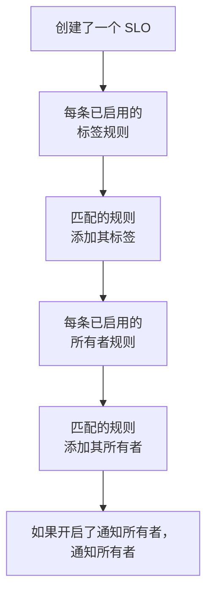

# 标签与所有者规则

标签规则和所有者规则会替您整理 SLO。**标签规则** 会给每个与之匹配的新 SLO 添加标签，**所有者规则** 会为它添加所有者用户和团队。这样，一个新的 checkout SLO 就会被打上 _Checkout_ 标签并归 checkout 团队所有，而无需任何人记着去做。两者的工作方式与其他所有产品的标签和所有者规则相同：它们的共同点请参阅[标签与所有者规则](/docs/configuration/label-and-owner-rules)。

## 工作原理

规则在通过仪表板或 API 创建 SLO 时运行。标签规则先运行，因此所有者规则可以匹配标签规则刚刚添加的标签。

两类规则都作用于整个项目。您可以在 SLO 列表的侧边菜单中 **设置** 下找到它们：**标签规则** 和 **所有者规则**。**设置** 部分默认折叠；点击其标题即可展开。

## 创建规则

:::steps
### 打开规则列表

打开 **SLOs**，然后在侧边菜单中打开 **设置** → **标签规则** 或 **设置** → **所有者规则**，点击 **创建SLO Label Rule** 或 **创建SLO Owner Rule**。

### 选择规则匹配什么

在 **匹配** 步骤中，为 SLO 必须满足的每个条件点击 **添加条件**（请参阅[匹配条件](#匹配条件)）。有两个或更多条件时，选择 **匹配全部** 或 **匹配任一**。没有条件的规则会匹配每个新 SLO。

### 选择规则添加什么

标签规则的第二步是 **标签**，在这里选择 **要添加的标签**。所有者规则的第二步是 **所有者**，在这里选择要添加的 **所有者**——人员和团队，通过 **添加所有者** 从同一个列表中选择。规则必须至少添加一个标签或所有者。

### 检查名称和折叠的字段

**名称** 会根据您的选择自动填写，例如 *添加 Checkout, Production* 或 *将 Checkout team 添加为所有者*，并随您的选择变化，直到您自己输入名称为止。**更多字段** 中包含可选的 **描述**，对于所有者规则还有 **通知所有者**。

### 保存规则

在最后一步再次点击 **创建SLO Label Rule** 或 **创建SLO Owner Rule**。规则创建后即处于启用状态。
:::

**通知所有者**（位于 **更多字段** 中）默认开启：所有者规则添加的所有者会收到与手动添加的所有者相同的“您已被添加为所有者”通知。关闭它即可静默添加所有者。

要暂停规则而不删除它，请在其编辑表单中关闭 **已启用**。编辑表单从不强制要求标签或所有者：不添加任何内容的旧规则仍可以重命名、关闭或删除，列表会将其标记为 **不添加任何内容**。

当规则匹配某个 SLO 时：

- 标签规则会添加 **要添加的标签** 中的每个标签。SLO 已有的标签不会重复添加；多条规则匹配时，SLO 会获得它们的全部标签。
- 所有者规则会把规则中的每个用户和团队添加为所有者。SLO 已有的所有者会被跳过；多条规则匹配时，SLO 会获得它们的全部所有者。已不再是项目成员的用户或来自其他项目的团队永远不会被添加；规则中的其他所有者仍会被添加。

SLO 的所有者是会收到其状态变化通知的人：请参阅[错误预算](/docs/slo/error-budget)。

## 匹配条件

每个条件比较 SLO 的一个字段：

| 字段 | 比较对象 | 运算符 |
| --- | --- | --- |
| **SLO 标签** | SLO 的标签。 | **包含任一**、**包含全部**、**不包含任何** |
| **SLO 名称** | SLO 的名称。 | **包含**、**不包含**、**等于**、**不等于**、**开头为**、**结尾为**、**匹配模式**、**不匹配模式** |
| **SLO 描述** | SLO 的描述。 | 与 **SLO 名称** 相同 |

名称或描述上的新条件默认为 **包含**。模式可以是正则表达式（例如 `^checkout-.*`），也可以是 `*` 通配符（例如 `*checkout*`），不区分大小写。两者都不是的模式（例如 `checkout-(01`）会在保存时被拒绝，而不是悄无声息地什么都匹配不到。

| 您想要 | 条件 |
| --- | --- |
| checkout 服务的所有 SLO | **SLO 名称** 包含 `checkout` |
| 所有生产环境 SLO | **SLO 标签** 包含任一 _Production_ |
| checkout 的 SLO，但不包括 staging 的 | **匹配全部**：**SLO 名称** 包含 `checkout`，且 **SLO 标签** 不包含任何 _Staging_ |

## 规则何时运行

- **创建 SLO 时**，无论通过仪表板还是 API：先运行每条已启用的标签规则，再运行每条已启用的所有者规则。
- **运行规则时**，使用 **Run Now**：见下文。

编辑 SLO 不会再次应用规则，规则也从不移除任何内容：既不移除有人手动添加的标签或所有者，也不移除它自己添加的。已关闭的规则不做任何事。

## 在现有 SLO 上运行规则

您今天编写的规则适用于之后创建的 SLO。要把它应用到已有的 SLO，请点击规则所在行的 **Run Now**，或点击 **查看**，再在规则自己的页面上点击 **Run Now**。您也可以选择多条规则，通过表格的批量操作运行它们。

一次运行会检查项目中的每个 SLO（包括已归档的），并报告匹配了多少个、更改了多少个。只有当您在运行对话框中选择通知、且规则开启了 **通知所有者** 时，运行所添加的所有者才会收到通知。请参阅[对现有资源运行规则](/docs/configuration/run-rules-now)。

标签规则还可以在项目之间复制：请参阅[导入和导出标签规则](/docs/configuration/label-rule-import-export)。

## 历史记录

每当规则更改 SLO，SLO 的 **Feed** 都会记录是哪些规则做的。规则添加的每位所有者还会各自获得一条“已添加为所有者”的动态条目，因此动态会说明添加了谁以及原因。请参阅 [SLO 动态与审计日志](/docs/slo/feed-and-audit-logs)。

## 权限

| 要做的事 | 需要的权限 |
| --- | --- |
| 使用标签规则 | **Create SLO Label Rule**、**Edit SLO Label Rule**、**Delete SLO Label Rule** 或 **Read SLO Label Rule** |
| 使用所有者规则 | **Create SLO Owner Rule**、**Edit SLO Owner Rule**、**Delete SLO Owner Rule** 或 **Read SLO Owner Rule** |
| 运行标签规则 | **Edit SLO Label Rule** 和 **Edit Service Level Objective** |
| 运行所有者规则 | **Edit SLO Owner Rule**、**Edit Service Level Objective**、**Create SLO User Owner** 和 **Create SLO Team Owner** |

这些权限位于角色的 SLO 组中，Project Owner 和 Project Admin 角色拥有全部权限。一次运行会更改项目中的每个 SLO，因此仅限于部分标签或您拥有的 SLO 的权限不足以运行规则。

## 后续步骤

:::cards
- [标签与所有者规则](/docs/configuration/label-and-owner-rules): 各产品的标签和所有者规则如何工作。
- [对现有资源运行规则](/docs/configuration/run-rules-now): Run Now 对每种规则的作用方式。
- [SLO 概览](/docs/slo/introduction): SLO 拥有的每个页面，以及 SLO 列表。
:::
