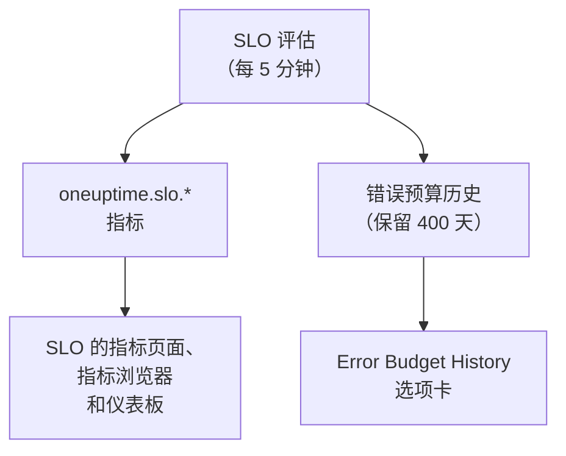

# SLO 指标与仪表板

OneUptime 每次评估 SLO（每 5 分钟一次）时，都会把结果写成名为 `oneuptime.slo.*` 的指标。它们与您的监视器指标位于同一个指标存储中，因此您可以在 SLO 的 **指标** 页面上为它绘制图表，在指标浏览器中打开它，并像其他任何时间序列一样筛选和分组后放到任何仪表板上。

:::cards
- [指标](#指标): 六个时间序列、它们的单位以及如何聚合。
- [指标页面](#指标页面): SLO 的图表、历史以及事件和警报指标。
- [仪表板上的 SLO](#仪表板上的-slo): SLO 小部件和 SLO Dashboard 模板。
:::

## 工作原理

## 指标

| 指标 | 单位 | 聚合 | 包含内容 |
| --- | --- | --- | --- |
| `oneuptime.slo.sli.percent` | `%` | Avg | SLO 合规窗口上的 SLI：测量时间中良好时间所占的比例。 |
| `oneuptime.slo.target.percent` | `%` | Avg | SLO 的目标，每次评估都会写入，以便图表把它画在 SLI 上方。 |
| `oneuptime.slo.error.budget.remaining.percent` | `%` | Avg | 窗口中尚未花掉的错误预算比例。预算超支后为负数。 |
| `oneuptime.slo.error.budget.remaining.seconds` | `seconds` | Avg | SLO 在被违反之前还能承受的停机时间。预算超支后为负数。 |
| `oneuptime.slo.burn.rate` | `x` | Max | 过去 60 分钟内预算被花掉的速度。1x 表示恰好在整个窗口内花完预算。 |
| `oneuptime.slo.status` | — | Max | 每次评估时 SLO 的状态：`0` 为健康，`1` 为 At Risk，`2` 为 Budget Exhausted。 |

聚合是指 SLO 自身的图表和 SLO Dashboard 模板如何合并落入同一图表区间的点。百分比和时长取平均值。消耗率和状态取最大值，这样短暂的消耗峰值或短暂进入 Budget Exhausted 不会被平均掉。

对于 **Monitor Seconds Average** 模式的 SLO，`oneuptime.slo.error.budget.remaining.seconds` 计算的是其所有监视器合计的监视器秒，与其错误预算相同：请参阅[错误预算](/docs/slo/error-budget)。

### 不写入数据点的情况

- 已关闭或已归档的 SLO 不会被评估，因此不写入任何内容。
- **已暂停** 或 **Misconfigured** 的 SLO 不测量任何内容，因此只写入 `oneuptime.slo.target.percent`，它是配置而不是测量值。其 SLI、预算、消耗率和状态图表会出现空缺。
- 不是实数的值，例如没有数据的窗口上的消耗率，会被跳过，绝不会写为 0。

### 属性

每个数据点都带有这些属性：

| 属性 | 值 |
| --- | --- |
| `sloId` | SLO 的 ID。SLO 自己的页面按它筛选，因此重命名 SLO 永远不会拆分其图表。 |
| `sloName` | 写入数据点时 SLO 的名称。 |
| `projectId` | 项目的 ID。 |
| `oneuptime.label.<key>` | 每个 SLO 标签对应一个属性。名为 `Tier 1` 的标签会变成 `oneuptime.label.tier_1` = `true`，名为 `product:checkout` 的标签会变成 `oneuptime.label.product` = `checkout`。键会转为小写，空格和标点会变成 `_`。 |

这些时间序列属于 SLO，而不属于它的任何监视器，也不计入遥测用量。

事件和警报指标带有两个对应的属性 `serviceLevelObjectiveIds` 和 `serviceLevelObjectiveNames`：以逗号分隔的、该事件或警报所影响的 SLO 列表。

### 保留时间

`oneuptime.slo.*` 指标的保留时间与监视器指标相同：默认 **30 天**。在自托管安装中，主管理员可以在 Admin Dashboard 的 **数据保留** 设置中通过 **Monitor Metric Retention (Days)** 修改它。

这不会限制 SLO **指标** 页面的 **Error Budget History** 选项卡。该历史单独存储，保留 400 天。

## 指标页面

SLO 的 **指标** 页面有四个选项卡：

| 选项卡 | 显示内容 |
| --- | --- |
| **SLO Metrics** | `oneuptime.slo.*` 时间序列，显示在共享同一时间范围（默认为过去一天）的三张卡片中：**Objective**（叠加了目标的 SLI，以及剩余预算）、**Burn**（消耗率和剩余预算时间）和 **状态**。 |
| **Error Budget History** | 长期历史中的 SLI、剩余预算和消耗率，并在目标、风险和耗尽边界以及每条已启用消耗率规则的阈值处画线。 |
| **事件指标** | 影响此 SLO 的事件的数量、确认时间、解决时间和持续时间，默认为过去一周。包括其消耗率规则声明的事件。 |
| **警报指标** | 警报的相同内容。包括其消耗率规则触发的警报。 |

**SLO Metrics**、**事件指标** 和 **警报指标** 选项卡读取指标存储，这需要读取遥测数据的权限。能读取 SLO 但不能读取遥测数据的自定义角色会看到这些选项卡为空，而 **Error Budget History** 仍然可用。

## 仪表板上的 SLO

### 为任意 SLO 指标绘制图表

:::steps
#### 添加图表

在仪表板的编辑模式下，添加一个图表或数值小部件，并选择一个 `oneuptime.slo.*` 指标。

#### 分组或筛选

按 `sloName` 和 `sloId` 分组，每个 SLO 一条线；`sloId` 可以区分同名的两个 SLO。也可以按 `sloName` 或某个 `oneuptime.label.*` 属性筛选。

#### 选择聚合方式

使用上表中的聚合方式：百分比和时长用 Avg，消耗率和状态用 Max。
:::

### SLO 小部件

[SLO 小部件](/docs/dashboards/widgets#slo)以磁贴或图表的形式显示某个 SLO 的 SLI、剩余预算或消耗率。它通过以下两种方式之一确定 SLO：

| 设置 | 行为 |
| --- | --- |
| **Service Level Objective** | 把小部件固定到一个 SLO。选择器列出未归档的 SLO。 |
| **Follow SLO Variable** | 显示在仪表板变量中选中的 SLO：一个基于 `sloName` 键的 **Telemetry Attribute** 变量。固定了 SLO 时会被忽略。 |

在[公共仪表板](/docs/dashboards/sharing)上，跟随变量的小部件允许查看者按名称选择项目中任何未归档的 SLO。固定的小部件只显示自己的 SLO，并会继续显示之后被归档的 SLO 的最后数字。

### SLO Dashboard 模板

创建仪表板时选择 **SLO Dashboard** 模板，即可得到一个现成的看板，分三个区块展示项目中的所有 SLO：

1. **Service Level Objectives**：所有未归档 SLO 的列表，包括状态、SLI 与目标的对比、预算条和消耗率，以及按状态统计的 SLO 数量。已启用的 SLO 排在前面，预算最少的最靠前；已关闭的 SLO 以 **已禁用** 排在最后，其最后的数字显示为灰色。
2. **Error Budget & Burn Rate**：**Lowest Error Budget Remaining**、**Least Error Budget Time Left** 和 **Peak Burn Rate** 磁贴，以及按 `sloName` 和 `sloId` 分组、每个 SLO 一条线的 **Error Budget Remaining by SLO** 和 **Burn Rate by SLO** 图表。
3. **Selected SLO**：一个 SLO 的 **SLI**、**Error Budget Remaining** 和 **Burn Rate** 磁贴，以及 **SLI History**、**Error Budget History** 和 **Burn Rate History** 图表。

工具栏中的一个 SLO 变量决定整个看板的范围。它是基于 `sloName` 的 Telemetry Attribute 变量，因此其选项是指标中出现的 SLO 名称。选择一个 SLO 会把列表缩小到该 SLO，限定该区块的图表和磁贴，并填充跟随该变量的 **Selected SLO** 小部件。在您选择之前，它们会提示您在工具栏中选择一个 SLO。

## 故障排除

:::details 工具栏的 SLO 选择器中缺少某个 SLO
选择器列出过去一天内写入过的 SLO 名称。新 SLO 在第一次评估后出现；**已暂停** 或 **Misconfigured** 的 SLO 仍可选择，因为它仍在写入目标；已关闭或已归档的 SLO 会在其最后一个数据点之后大约一天消失。
:::

:::details 选择一个名称时显示了两个 SLO
两个 SLO 同名。列表和图表会同时显示两者，**Selected SLO** 小部件会提示名称不明确。请为 SLO 取不同的名称。
:::

:::details SLO Metrics 选项卡为空
您的角色无法读取遥测数据，或者 SLO 尚未被评估。**Error Budget History** 读取的是 SLO 本身，仍然可用。
:::

## 后续步骤

:::cards
- [仪表板小部件](/docs/dashboards/widgets): 所有小部件，包括 SLO 小部件。
- [仪表板变量](/docs/dashboards/variables): 用一个选择器决定整个看板的范围。
- [错误预算](/docs/slo/error-budget): 预算数字的含义。
:::
