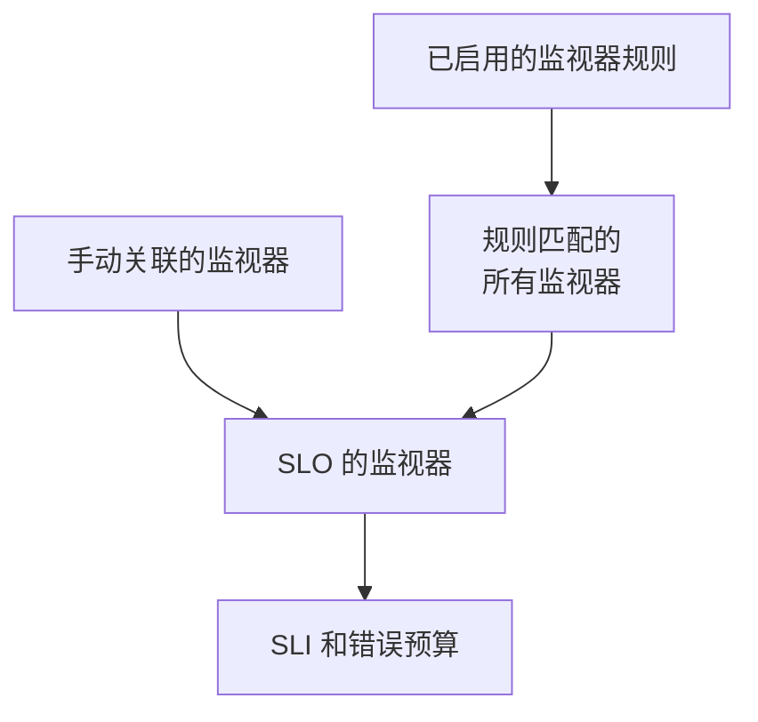

# 监视器与监视器规则

SLO 测量关联到它的监视器的可用性。您可以手动关联监视器，也可以让监视器规则关联所有匹配的监视器，或两者并用。本页介绍 SLO 侧边菜单 **配置** 下的 **监视器** 页面和 **Monitor Rules** 页面。

:::cards
- [手动选择监视器](#手动关联监视器): 最适合一小组固定的监视器。
- [用规则关联监视器](#用规则关联监视器): “所有带 Production 标签的监视器”，自动保持最新。
- [匹配条件](#匹配条件): 规则可以匹配的字段和运算符。
:::

## SLO 测量哪些监视器

SLO 测量的是您手动关联的监视器，加上至少一条已启用的监视器规则所匹配的所有监视器，两者的并集。

创建表单不会询问监视器，因此新 SLO 没有监视器。在有至少一个监视器之前，它无法被评估：它的页面显示 **No monitors attached**，它的 **概览** 提供两种关联监视器的方式。

## 手动关联监视器

您需要编辑该 SLO 的权限。

:::steps
### 打开监视器页面

打开 SLO，进入 **监视器**。

### 选择监视器

点击 **Add Monitors**，从项目中选择监视器。只会列出尚未关联的监视器。

### 保存列表

点击 **Add Monitors**。监视器以来源 **Manual** 出现在列表中，并从下一次评估开始计入 SLI。
:::

要从 SLO 中移除某个监视器，请点击该行的 **移除**。监视器本身不会改变，只是不再计入该 SLO 的 SLI 和错误预算。

**监视器** 页面为每个监视器显示：

| 列 | 显示内容 |
| --- | --- |
| **当前状态** | 监视器的当前状态；当它没有被检查或尚未报告任何内容时，显示 **已归档**、**已禁用**、**探测器未启用**、**探测器已断开连接** 或 **未知**。 |
| **来源** | 如果是 SLO 的某条监视器规则关联的，显示 **Rule**；如果是有人手动关联的，显示 **Manual**。 |
| **标签** | 监视器的标签。 |

## 用规则关联监视器

监视器规则描述 SLO 应该测量的监视器，例如“所有带 Production 标签的监视器”或“所有名称以 api- 开头的监视器”。每个匹配的监视器都会被关联，不仅是现在，每当监视器被创建或更改时也会如此，因此没人需要记着下个月有人会添加的监视器。

:::steps
### 打开 Monitor Rules

打开 SLO，进入 **Monitor Rules**，点击 **创建SLO Monitor Rule**。

### 为规则命名

在 **基本信息** 中输入 **名称**，并可在 **描述** 中说明这些监视器为何属于该 SLO。

### 选择要匹配的内容

在 **匹配条件** 中点击 **添加条件**，选择字段和运算符，然后输入或选择值。有两个或更多条件时，选择 **匹配全部** 或 **匹配任一**。监视器规则至少需要一个条件。

### 保存规则

点击 **创建SLO Monitor Rule**。规则创建后即处于启用状态，SLO 的监视器会立即重新评估：每个匹配的监视器都以来源 **Rule** 关联。
:::

规则表格显示每条规则的名称、以文字描述的匹配条件以及是否启用。要暂停某条规则，请在其编辑表单中关闭 **已启用**。**View Monitors** 会打开 SLO 的 **监视器** 页面。

### 匹配条件

每个条件比较监视器的一个字段：

| 字段 | 比较对象 | 运算符 |
| --- | --- | --- |
| **监视器标签** | 监视器的标签。 | **包含任一**、**包含全部**、**不包含任何** |
| **监视器类型** | 从类型列表中选择的监视器类型。 | **等于**、**不等于** |
| **监视器名称** | 监视器的名称。 | **包含**、**不包含**、**等于**、**不等于**、**开头为**、**结尾为**、**匹配模式**、**不匹配模式** |
| **监视器描述** | 监视器的描述。 | 与 **监视器名称** 相同 |

模式可以是正则表达式（例如 `^api-.*`），也可以是 `*` 通配符（例如 `*checkout*`），不区分大小写。两者都不是的模式（例如 `api-(01`）会在保存时被拒绝，而不是悄无声息地什么都匹配不到。要关联项目中的所有监视器，请添加一个 **监视器名称** 匹配模式 `.*` 的条件。

| 您想要 | 条件 |
| --- | --- |
| 所有生产环境监视器 | **监视器标签** 包含任一 _Production_ |
| 所有 API 监视器 | **监视器类型** 等于 _API_ |
| 除手动监视器外的所有监视器 | **监视器类型** 不等于 _Manual_ |
| 所有名称以 api- 开头的监视器 | **监视器名称** 匹配模式 `^api-` |
| checkout 监视器，但不包括 staging 的 | **匹配全部**：**监视器名称** 匹配模式 `*checkout*`，且 **监视器标签** 不包含任何 _Staging_ |

### 规则何时运行

- 创建、编辑、开启、关闭或删除规则时，SLO 的监视器会立即重新评估。
- 创建监视器，或监视器的标签、名称或描述发生变化时，项目中的每条监视器规则都会检查它，包括您的监视器标签规则为它添加的标签。
- 删除标签时，规则中用到该标签的 SLO 会重新评估。
- 即使 SLO 已关闭或已归档，规则也会保持其监视器列表最新，因此恢复时会使用正确的监视器。

规则在每次保存时都会重新同步，因此 **Run Now** 用于补上 SLO 错过的内容。它位于每一行、规则自己的页面（**查看**）以及表格的批量操作中。运行一条规则会一起重新评估 SLO 所有已启用的监视器规则，随后对话框会告诉您关联和取消关联了多少个监视器。运行规则需要编辑 SLO 监视器规则的权限。请参阅[对现有资源运行规则](/docs/configuration/run-rules-now)。

### 哪些监视器属于规则

- 只要有已启用的规则匹配，监视器就保持关联；一旦没有规则匹配，就会立即取消关联。
- 关闭或删除规则只会取消关联那些不再被其他已启用规则匹配的监视器。
- 规则只会取消关联由规则关联的监视器。手动关联的监视器永远不会被碰巧匹配它的规则接管，也不会在不再匹配时被取消关联。它的来源保持为 **Manual**。

## 规则开启时的手动选择

只要至少有一条规则处于启用状态，SLO 的监视器就由规则管理：

- 无法手动添加监视器：**Add Monitors** 被禁用，横幅显示 **This SLO's monitors are managed by its monitor rules**，并附有 **Manage Monitor Rules** 链接；
- 规则关联的监视器无法手动移除，因为规则会再次关联它们：它们的 **移除** 按钮被锁定，提示信息会说明原因；
- 在开启规则之前手动关联的监视器仍然可以移除。

API 也是如此。关闭所有规则即可重新自己选择监视器。

## 监视器计入的 SLO

监视器的页面会列出测量它的 SLO：打开监视器，进入其侧边菜单中的 **SLOs**。在暂停或更改监视器之前查看一下，就能知道哪些目标依赖它。已归档的 SLO 不会显示，因为它们不会被评估。

## 从 Auto-Add Monitors With Labels 迁移

早期版本的 SLO 表单中有一个 **Auto-Add Monitors With Labels** 设置。升级时，每个使用该设置的 SLO 都会获得一条已启用的、名为 **Auto-add monitors with labels** 的监视器规则，匹配相同的标签，因此它会继续测量完全相同的监视器。SLO API 的 `monitorLabels` 字段已弃用：请改用 SLO 监视器规则。

:::details 如果仍有东西保存旧设置怎么办？
升级前打开的仪表板标签页，或为旧版本编写的 API 客户端或工作流，仍可能保存旧设置。为避免 SLO 因此悄无声息地丢失监视器：

- **没有监视器规则的 SLO** 会把保存的标签转换为一条 **Auto-add monitors with labels** 规则，并立即重新评估其监视器。保存空列表会像以前一样取消关联该设置所关联的监视器。
- **已有监视器规则的 SLO**，无论规则是否开启，都会忽略通过旧设置保存的标签，因为测量什么由它的规则决定。
- **创建第一条监视器规则** 时，如果该 SLO 的监视器是由旧设置关联的，会先把该设置转换为规则，因此新规则会被添加在旁边，而不是取而代之。

您删除的转换规则会保持删除状态，除非之后其监视器仍处于关联状态，例如仍在运行旧版本的服务器在升级期间重新关联了它们：下一次监视器变更或下一条新规则会再次转换这些标签。升级完成后请再次删除该规则。
:::

## 历史记录

每次关联和取消关联，以及每条规则的创建、编辑或删除，都会出现在 SLO 的 **Feed** 中。规则变更也会记录在其 **审计日志** 中。请参阅 [SLO 动态与审计日志](/docs/slo/feed-and-audit-logs)。

## 故障排除

:::details Add Monitors 被禁用
SLO 至少有一条监视器规则处于启用状态，因此其监视器由规则管理。修改规则，或全部关闭以手动选择监视器。
:::

:::details 监视器的移除按钮被锁定
某条监视器规则关联了该监视器，并会再次关联它。修改或关闭匹配它的规则。
:::

:::details 本应被规则匹配的监视器没有关联
检查规则是否已启用，以及在 **匹配全部** 下每个条件是否都满足。监视器标签规则添加的标签也会计入。点击规则上的 **Run Now** 重新同步 SLO。
:::

:::details 保存规则时因模式错误而失败
该值既不是正则表达式，也不是 `*` 通配符，例如有未闭合的括号。修正模式，或改用 **包含**。
:::

## 后续步骤

:::cards
- [SLO 概览](/docs/slo/introduction): 如何合并多个监视器的停机时间。
- [错误预算](/docs/slo/error-budget): 监视器的停机时间消耗的是什么。
- [对现有资源运行规则](/docs/configuration/run-rules-now): Run Now 对每种规则的作用方式。
:::
