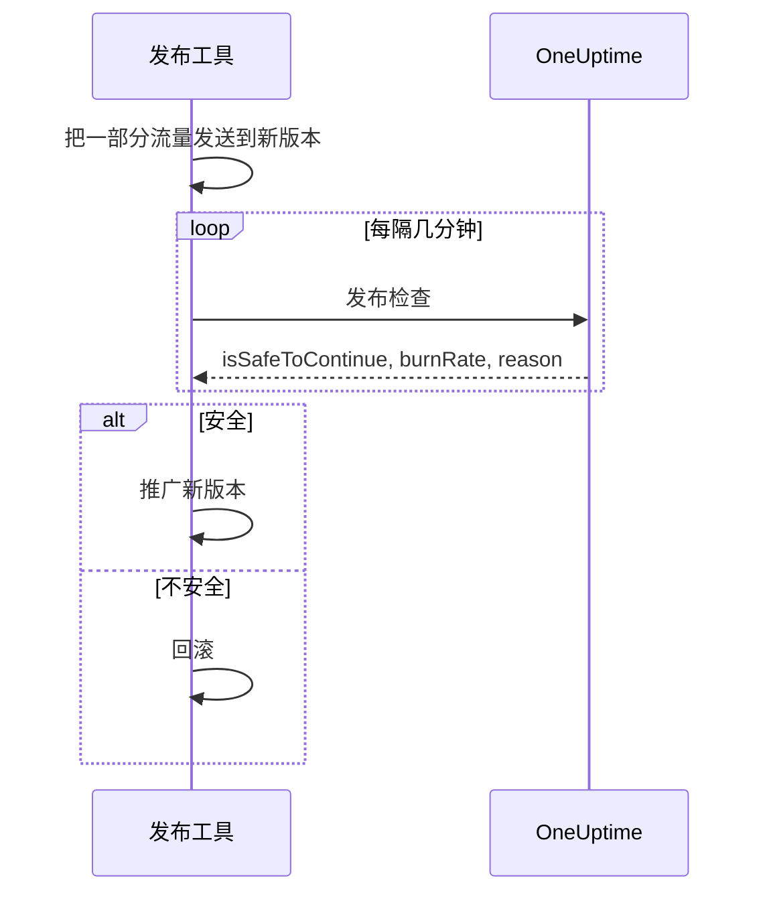

# 发布检查

发布检查会在发布进行期间询问 SLO“继续推出这个发布是否安全？”，并根据 SLO 在最近几分钟内消耗错误预算的速度作答。Argo Rollouts、Flagger 或部署流水线会在金丝雀版本接收流量时询问它，并在答复为否时回滚发布。OneUptime 本身不部署任何东西：您的发布工具照常执行发布，OneUptime 告诉它这次发布表现如何。

:::cards
- [询问检查](#询问检查): 一个带 API 密钥的请求，以及它的答复。
- [Argo Rollouts](#argo-rollouts): 中止发布的分析。
- [Flagger](#flagger): 暂停金丝雀版本的 webhook。
- [GitHub Actions](#github-actions): 部署后执行回滚的步骤。
- [关闭功能标志](#关闭功能标志): 在 SLO 的预算消耗过快时关闭功能标志的工作流。
:::

## 工作原理

[部署闸门](/docs/slo/error-budget-policy#部署闸门) 在发布之前作答，依据的是整个合规窗口的错误预算。一个出了问题的发布，在最初十分钟里几乎花不掉一个月预算中的任何部分，因此发布检查读取的是发布所改变的东西：最近几分钟的消耗率。



检查会给出以下三种结论之一：

| 结论 | 条件 | `isSafeToContinue` |
| --- | --- | --- |
| `Pass` | 窗口消耗错误预算的速度等于或慢于 `maxBurnRate`。 | `true` |
| `Fail` | 消耗得更快，或 SLO 的错误预算策略冻结了部署。 | `false` |
| `NotEnoughData` | 窗口中的请求少于 `minimumRequestCount`，或 SLO 的监视器在窗口中没有记录任何状态。数据太少，无法认定发布是安全的。 | `false` |

消耗率为 1 时，窗口恰好达到 SLO 的目标，因此默认 `maxBurnRate` 为 `1`，表现比目标差的发布都不会通过。

检查读取什么取决于 SLO 衡量的对象：

- [请求 SLO](/docs/slo/request-slos) 根据其服务在窗口内的请求评判，这些请求在 span 到达时从 span 中读取。添加 `serviceVersion` 即可只评判新版本的请求：OneUptime 会将其与 span 的 `service.version` 资源属性匹配，OpenTelemetry SDK 会根据 `OTEL_RESOURCE_ATTRIBUTES=service.version=1.4.2` 设置该属性。这样，金丝雀版本只按它自己的请求评判，而不会被旧版本的请求稀释。
- [基于指标的 SLO](/docs/slo/request-slos#基于指标的-slo) 根据其指标在窗口内的事件评判，这些事件按其 SLI 的方式计数，因此 `minimumRequestCount`、`goodRequestCount` 和 `totalRequestCount` 都是事件数。带上 `serviceVersion` 时，只计入 `service.version` 资源属性为该值的指标数据点：OpenTelemetry SDK 会像在 span 上一样，在其指标上设置该属性。
- 监视器可用率 SLO 根据其监视器在窗口内的状态时间线评判。`minimumRequestCount` 不适用于这类 SLO，带有 `serviceVersion` 的检查会被拒绝：监视器没有版本。

## 开始之前

您需要一个衡量发布所影响内容的 SLO。所发布服务的请求 SLO 最适合评判金丝雀版本，因为它读取的正是该服务自己的请求。

## 设置发布检查

:::steps
### 为发布流程提供密钥

创建一个项目 [API 密钥](/docs/api-reference/api-reference)，其角色需要能读取 SLO，然后把它存为发布工具或流水线的机密。

### 复制 SLO 的 ID

打开 SLO，从地址中复制它的 ID：`/slos/<slo-id>`。

### 手动询问一次检查

使用密钥和 ID 运行 [询问检查](#询问检查) 下的请求。它会返回 `isSafeToContinue` 和一条 `reason`。

### 将检查加入发布流程

从 [Argo Rollouts](#argo-rollouts)、[Flagger](#flagger) 或 [GitHub Actions](#github-actions) 询问检查，并在 `isSafeToContinue` 为 `false` 时回滚。
:::

## 询问检查

检查就是对 SLO 的 `release-check` 地址发出的 `GET` 或 `POST` 请求。可以通过查询字符串发送选项，也可以使用 `POST` 以 JSON 请求体发送：

```bash
curl -sS "https://oneuptime.com/api/service-level-objective/<slo-id>/release-check?windowInMinutes=10&serviceVersion=1.4.2" \
  -H "ApiKey: $ONEUPTIME_API_KEY"
```

它先给出结论，再给出结论所依据的数据：

```json
{
  "isSafeToContinue": false,
  "verdict": "Fail",
  "reason": "The last 10 minutes burned the error budget at 3.2x, faster than the 1x this check allows (SLI 99.68% against the 99.9% target).",
  "sloId": "<slo-id>",
  "sloName": "Checkout requests",
  "sliType": "Request Success",
  "targetPercentage": 99.9,
  "windowInMinutes": 10,
  "maxBurnRate": 1,
  "burnRate": 3.2,
  "sliPercentage": 99.68,
  "deploymentsAllowed": true,
  "errorBudgetPolicyTier": null,
  "sloStatus": "Healthy",
  "checkedAt": "2026-11-15T12:00:00.000Z",
  "goodRequestCount": 2492,
  "totalRequestCount": 2500,
  "minimumRequestCount": 1,
  "serviceVersion": "1.4.2"
}
```

选项：

| 选项 | 默认值 | 作用 |
| --- | --- | --- |
| `windowInMinutes` | `10` | 检查回看多长时间，以整分钟计，范围为 1 到 360。 |
| `maxBurnRate` | `1` | 能够通过的最快消耗率。`2` 允许窗口以目标所允许速度的两倍消耗预算。 |
| `minimumRequestCount` | `1` | 仅限请求 SLO：检查进行评判所需的最少请求数。设为 `0` 时，没有请求的窗口也会通过。 |
| `serviceVersion` | 无 | 仅限请求 SLO：只评判 span 带有此 `service.version` 的请求。 |
| `includeDeploymentGate` | `true` | 在 SLO 的错误预算策略冻结部署期间不予通过。设为 `false` 时，只由消耗率决定。 |
| `failWithStatusCode` | `false` | 以 HTTP 状态码 412 而不是 200 答复否，供只读取状态码的工具使用。 |

答复的字段：

| 字段 | 内容 |
| --- | --- |
| `isSafeToContinue` | `true` 表示继续发布，`false` 表示回滚。 |
| `verdict` | `Pass`、`Fail` 或 `NotEnoughData`。 |
| `reason` | 写入发布日志的一句话，说明测量了什么，以及检查为何这样作答。 |
| `burnRate` 和 `sliPercentage` | 窗口消耗错误预算的速度，以及窗口内的 SLI。 |
| `goodRequestCount` 和 `totalRequestCount` | 仅限请求 SLO：窗口中的请求数，以及其中良好的请求数。 |
| `deploymentsAllowed` 和 `errorBudgetPolicyTier` | SLO 的错误预算策略是否允许部署，以及 SLO 所处的级别。 |
| `checkedAt` | 检查进行测量的时间。 |

无法测量的 SLO（没有服务的请求 SLO、没有阈值的延迟 SLO、没有可计数指标的基于指标的 SLO、没有监视器的监视器可用率 SLO）会得到 HTTP 400 答复，并说明需要修复什么，这样发布会因明确的错误而停止，而不是依据猜测继续。在自托管安装上，请改用它自己的地址，而不是 oneuptime.com。

## Argo Rollouts

带有 `web` 指标的分析会在金丝雀发布的每一步询问检查，检查失败时 Argo Rollouts 会中止发布并缩减金丝雀版本。请先把 API 密钥存为机密：

```bash
kubectl create secret generic oneuptime --from-literal=api-key="$ONEUPTIME_API_KEY"
```

然后添加模板，并在金丝雀发布的第一步之后运行它：

:::tabs
@tab AnalysisTemplate
```yaml title="oneuptime-release-check.yaml"
apiVersion: argoproj.io/v1alpha1
kind: AnalysisTemplate
metadata:
  name: oneuptime-release-check
spec:
  args:
    - name: version
    - name: api-key
      valueFrom:
        secretKeyRef:
          name: oneuptime
          key: api-key
  metrics:
    - name: slo-burn-rate
      interval: 2m
      count: 5
      failureLimit: 0
      successCondition: result == true
      provider:
        web:
          url: "https://oneuptime.com/api/service-level-objective/<slo-id>/release-check?windowInMinutes=10&serviceVersion={{args.version}}"
          headers:
            - key: ApiKey
              value: "{{args.api-key}}"
          jsonPath: "{$.isSafeToContinue}"
```
@tab Rollout
```yaml title="rollout.yaml"
apiVersion: argoproj.io/v1alpha1
kind: Rollout
metadata:
  name: checkout
spec:
  strategy:
    canary:
      steps:
        - setWeight: 10
        - analysis:
            templates:
              - templateName: oneuptime-release-check
            args:
              - name: version
                value: "1.4.2"
        - setWeight: 50
        - pause: { duration: 10m }
```
:::

分析会询问五次，每次间隔两分钟，第一次答复为否就会中止发布。传入的版本应与金丝雀版本的 Pod 在 `OTEL_RESOURCE_ATTRIBUTES` 中设置的版本相同。如果金丝雀版本在第一个权重下可能没有流量，请在地址中添加 `&minimumRequestCount=0`，否则没有流量的金丝雀版本会以 `NotEnoughData` 让分析失败。

## Flagger

Flagger 会在分析的每一步调用 `rollout` webhook，并在 webhook 持续失败时暂停并回滚金丝雀版本。Flagger 的 webhook 不发送任何请求头，因此请通过 Flagger 负载测试器询问检查，它会为 webhook 运行一条命令：

```yaml title="canary.yaml"
apiVersion: flagger.app/v1beta1
kind: Canary
metadata:
  name: checkout
spec:
  analysis:
    interval: 1m
    threshold: 2
    maxWeight: 50
    stepWeight: 10
    webhooks:
      - name: oneuptime-release-check
        type: rollout
        url: http://flagger-loadtester.test/
        timeout: 30s
        metadata:
          type: bash
          cmd: "curl -sSf -H \"ApiKey: $ONEUPTIME_API_KEY\" 'https://oneuptime.com/api/service-level-objective/<slo-id>/release-check?windowInMinutes=5&failWithStatusCode=true'"
```

设置 `failWithStatusCode=true` 后，否的答复是 HTTP 412，因此 `curl -f` 会以错误退出，webhook 随之失败。通过 Kubernetes 机密，在负载测试器的环境中以 `ONEUPTIME_API_KEY` 提供密钥。当失败的检查达到 `threshold` 次时，Flagger 会回滚金丝雀版本。

## GitHub Actions

一次性完成部署的流水线仍然可以观察这次发布：部署，询问检查几次，并在答复为否时回滚。

```yaml title=".github/workflows/deploy.yml"
name: Deploy
on:
  push:
    branches: [main]

jobs:
  deploy:
    runs-on: ubuntu-latest
    steps:
      - uses: actions/checkout@v4
      - name: Deploy
        run: ./deploy.sh
      - name: Watch the release against the SLO
        env:
          ONEUPTIME_API_KEY: ${{ secrets.ONEUPTIME_API_KEY }}
          SLO_ID: <slo-id>
          VERSION: ${{ github.sha }}
        run: |
          for attempt in 1 2 3 4 5; do
            sleep 120
            CHECK=$(curl -sS "https://oneuptime.com/api/service-level-objective/$SLO_ID/release-check?windowInMinutes=10&serviceVersion=$VERSION" \
              -H "ApiKey: $ONEUPTIME_API_KEY")
            echo "$CHECK" | jq -r '.reason'
            if [ "$(echo "$CHECK" | jq -r '.isSafeToContinue')" != "true" ]; then
              exit 1
            fi
          done
      - name: Roll back
        if: failure()
        run: ./rollback.sh
```

答复为否时该步骤会失败，任何不含 `isSafeToContinue: true` 的答复（ID 错误、密钥无法读取该 SLO、完全没有答复）也会让它失败，因此流水线绝不会依据它没有得到的答复继续。请在服务启动时把 `service.version` 设置为提交（`${{ github.sha }}`），这样检查只评判新版本。

## 关闭功能标志

由功能标志控制的发布，只要关闭功能标志就能回滚。工作流可以替您完成这一步：当 SLO 的某条 [消耗率规则](/docs/slo/burn-rate-alerts) 触发警报或声明事件时，工作流会在 LaunchDarkly 或 Unleash 中关闭该功能标志。这样，有问题的发布几分钟内就会被撤销，无需等人处理。

:::steps
### 复制消耗率规则的 ID

打开 SLO，进入 **消耗速率规则**。打开要用来关闭功能标志的那条规则的菜单，选择 **显示 ID**。快速消耗规则最适合这一用途，因为有问题的发布开始后几分钟内它就会触发。

### 从模板创建工作流

打开 **工作流**，点击 **创建工作流**。在 **或者从模板开始** 下选择 **SLOs** 类别，再选择您所用功能标志服务的模板：

| 模板 | 需要提供的内容 |
| --- | --- |
| **Turn a LaunchDarkly flag off when an SLO burns too fast** | 一个能更新该功能标志的 API 访问令牌，以及功能标志所在项目、功能标志本身和环境各自的键。 |
| **Turn an Unleash flag off when an SLO burns too fast** | 您的 Unleash 地址、一个服务账号令牌或个人访问令牌，以及功能标志所在的项目、它的名称和环境。 |

将规则的 ID 粘贴到 **Burn Rate Rule ID** 中，填写其余内容，然后创建工作流。

### 开启工作流

工作流创建时处于关闭状态。准备好后，在工作流的 **生成器** 顶部打开 **已启用** 开关。
:::

每当项目中的某条消耗率规则触发警报或声明事件时，工作流就会启动。它的 **如果 / 否则** 只让您粘贴了 ID 的那条规则继续往下走，下一步会调用功能标志服务：在 LaunchDarkly 中是 `turnFlagOff` 指令，并附上一条写明规则和 SLO 的备注；在 Unleash 中是针对该环境的 `off`。无论定向设置如何，两者都会为该环境中的所有人关闭功能标志。如果功能标志服务拒绝该调用，这次运行就会失败，其日志会说明原因。规则的警报仍会照常呼叫人员。

**生成器** 上的 **运行工作流** 会像您选择的规则刚刚触发一样运行工作流，因此它会真的关闭功能标志。请先用测试环境中的功能标志试一试。

如果使用其他功能标志服务，或使用有自己地址的 LaunchDarkly 实例，请从任一模板开始，并把它的 API 步骤改为在该环境中为所有人关闭功能标志的调用。请像这两个模板一样，选择连用户分群和定向规则也能覆盖的调用，否则渐进式发布仍会继续提供该功能标志。

## 后续步骤

:::cards
- [请求与延迟 SLO](/docs/slo/request-slos): 衡量服务的请求，这是最适合评判金丝雀版本的 SLI。
- [错误预算策略](/docs/slo/error-budget-policy): 在预算不足时冻结部署。
- [消耗率警报与事件](/docs/slo/burn-rate-alerts): 当预算消耗过快时提醒您的团队。
:::
