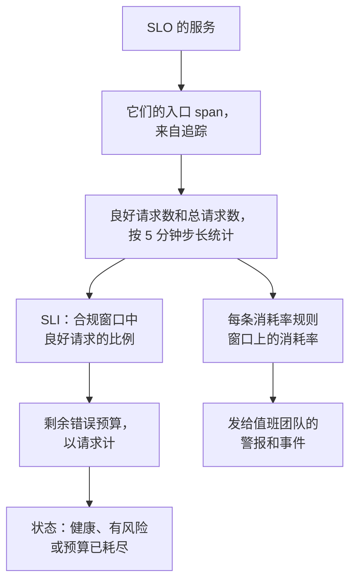

# 请求与延迟 SLO

请求 SLO 衡量用户从一个服务实际得到了什么：该服务的请求中成功的比例，或响应足够快的比例。OneUptime 根据您的服务已经在发送的追踪来统计这些请求，因此无需设置任何监视器：选择服务和目标，OneUptime 就会每 5 分钟测量一次。

:::cards
- [创建请求 SLO](#创建请求-slo): 服务、延迟阈值和目标。
- [只统计部分请求](#只统计部分请求): 一个端点，或除健康检查外的所有请求。
- [基于指标的 SLO](#基于指标的-slo): 计数器或直方图，适用于不发送追踪的服务。
- [请求如何计数](#请求如何计数): 哪些 span 会被计入，以及何时计入。
- [发布检查](/docs/slo/release-checks): 回滚消耗错误预算的发布。
:::

## 请求成功率与请求延迟

| 衡量对象 | 请求在什么情况下算作不良 | 其错误预算统计的是 |
| --- | --- | --- |
| **请求成功率** | 其 span 的状态为 `Error`。没有状态的 span 算作良好，这与 OpenTelemetry 的定义一致。 | 失败的请求 |
| **请求延迟** | 耗时超过 SLO 的 **延迟阈值（ms）**，无论其状态如何。 | 慢请求 |

SLI 是合规窗口中良好请求所占的比例，错误预算则是目标允许的不良请求：在 99.9% 时，每 1,000 个请求中允许 1 个。延迟 SLO 会把快速失败的请求算作良好，因此请从两个方面衡量重要的服务：一个 SLO 衡量它是否正常工作，另一个衡量它是否够快。

## 工作原理

请求是 SLO 某个服务的入口 span：即请求或消息进入该服务时的 span，也就是 [追踪](/docs/telemetry/traces-explorer#追踪和-span) 列表默认显示的那些 span。经过 SLO 中两个服务的请求，会在每个服务中各计一次。

除此之外，请求 SLO 的工作方式与其他 SLO 相同。它的状态、消耗率规则、错误预算策略、所有者和通知都一样，只是错误预算以请求而不是分钟计。

## 开始之前

- 这些服务向 OneUptime 发送追踪：请参阅 [OpenTelemetry](/docs/telemetry/open-telemetry)。每个服务都以其 `service.name` 出现在 [服务目录](/docs/telemetry/services) 中。
- 一个可以创建 SLO 的角色：项目所有者、项目管理员，或具有 Create Service Level Objective 权限的自定义角色。

## 创建请求 SLO

:::steps
### 打开 SLO

从顶部栏的 **产品** 菜单打开 **SLOs**，然后点击 **创建服务级别目标**。

### 选择衡量对象

在 **衡量对象** 下，选择 **请求成功率** 或 **请求延迟**，再选择要统计其请求的 **服务**。如果选择 **请求延迟**，还要设置 **延迟阈值（ms）**：在此时间内得到响应的请求算作足够快，例如 `300`。若只想统计其中部分请求，请输入 **请求过滤器**：参见 [只统计部分请求](#只统计部分请求)。点击 **下一步**。

### 命名并设定目标

输入 **名称**（例如“Checkout requests”）和 **目标（%）**：必须为良好的请求所占的比例。点击 **创建服务级别目标**。

### 等待第一批数字

第一次评估在 5 分钟内进行，会统计过去 6 小时的请求，因此 SLO 立即就有数字。之后的评估还会统计更早的请求，直到覆盖整个合规窗口。
:::

服务自己的 **SLOs** 页面列出衡量该服务的 SLO，其中的 **创建服务级别目标** 会打开同一表单，并已选好该服务。之后若要更改 SLO 的衡量对象、服务、阈值或过滤器，请打开它的 **设置** 并点击 **编辑衡量对象**。

## 只统计部分请求

请求 SLO 会统计其服务的每个请求。**请求过滤器** 可以只统计重要的请求，例如结账端点；也可以排除部分请求，例如会让 SLI 看起来比用户实际得到的更好的健康检查。请把它写成追踪搜索，使用与追踪浏览器相同的 [搜索语法](/docs/telemetry/search-syntax#匹配值)：

| 请求过滤器 | 统计的请求 |
| --- | --- |
| `@http.route:/checkout*` | 路由以 `/checkout` 开头的请求。 |
| `-@http.route:/health` | 除健康检查外的所有请求。 |
| `@http.request.method:[POST, PUT]` | POST 和 PUT 请求。 |
| `name:"POST /checkout"` | span 名称为 `POST /checkout` 的请求。 |

每个条件都必须匹配，因此 `@http.route:/checkout* -@http.route:/checkout/health` 会统计除健康检查外的结账请求。带 `@` 的条件是请求的 span 的属性，`name:` 是 span 的名称。自由文本和浏览器的其他字段（例如 `status:` 和 `duration:`）在这里不能用作过滤条件：SLO 已经决定了哪些请求算作不良或慢请求。一个过滤器最多包含 10 个条件，共 500 个字符以内。

**概览** 会在 SLO 的服务下方显示过滤器，**设置** 会在 **衡量对象** 下方显示它。更改过滤器后，会从头重新统计 SLO 的请求。

## 基于指标的 SLO

如果您的服务已经把请求统计为指标，或者不发送追踪，请改为根据计数器或直方图衡量 SLO。在 **衡量对象** 下，选择 **指标** 以及发送该指标的 **服务**，然后在 **指标** 步骤中填写：

| 字段 | 填写内容 |
| --- | --- |
| **指标** | 指标的名称，从项目的指标中选择或直接输入，例如 `http_requests_total` 或 `http.server.request.duration`。 |
| **良好事件** | **计数器，按条件判定** 或 **直方图，按值判定**。 |
| **良好条件** | 对于计数器：哪些事件算作良好，写成对其属性的搜索，例如 `@http.response.status_code:<500`。 |
| **良好上限值** | 对于直方图：良好观测值不超过的值，使用指标自身的单位，例如对于以秒为单位的直方图，300 ms 写作 `0.3`。请使用它的某个桶边界。 |
| **指标过滤器** | 可选：要计入的序列，例如 `-@http.route:/health`。 |

计数器的事件是它在每个 5 分钟步长中增长的量，与 Prometheus 的 `increase()` 读取计数器的方式相同：重启的计数器会重新从零开始计数，累积计数器和 delta 计数器都会计入。直方图的事件是它的观测值，其中良好的是落在不超过该值的桶中的观测值。只有来自 SLO 服务的、该指标自身的数据点才会计入：同名的 Gauge 不会计入任何内容。每个云指标都是 Gauge，基于 Gauge 的 SLO 会在其页面上说明这一点，指标选择器也会说明：请用指标监视器以及该监视器可用率的 SLO 来衡量云指标。

除此之外，基于指标的 SLO 的工作方式与请求 SLO 相同，只是其错误预算、消耗率规则和发布检查都以事件计。更改指标后，会从头重新统计它的事件。

## 请求如何计数

OneUptime 以 5 分钟为一个步长统计每个 SLO 的良好请求数和总请求数，并保存这些计数，因此 SLO 从自己的计数中读取窗口，而不必每次都读取所有 span：

- 每个步长在结束 2 分钟后统计，以便纳入迟到的 span；下一次评估还会重新统计最后两个步长，以纳入到得更晚的 span。
- 新 SLO 从过去 6 小时开始。之后的每次评估最多再统计一天更早的请求，从最新的开始，直到覆盖整个窗口。
- 只有仍在 [遥测保留期](/docs/telemetry/data-retention#遥测保留多长时间) 内的请求才能被统计。已统计的步长会保留 400 天，比任何合规窗口都长，因此比保留期更长的窗口会随着 SLO 运行时间的增长而逐渐填满。
- 更改 SLO 的衡量对象、服务、延迟阈值或请求过滤器后，会从头重新统计它的请求。更长的合规窗口则通过向更早的时间统计来填满。

当计数只覆盖合规窗口的一部分时，**概览** 会用 **窗口已填充 23%** 指示器提示这一点，**剩余错误预算** 磁贴也会在数字下方重复说明。计数覆盖整个窗口后，两者都会消失。

## 以请求计的错误预算

预算是在窗口内统计到的请求中目标所允许的不良请求，因此会随流量增长：在 99.9% 时，包含 2,000,000 个请求的窗口允许 2,000 个失败请求。在 **概览** 上：

- **剩余错误预算** 显示总共多少个不良请求中还剩多少个，或者 SLO 超出预算多少个。
- **预算可撑时长** 显示按当前消耗率预算还能撑多久，前提是流量保持不变。
- 摘要会统计 SLO 的服务数量，延迟 SLO 还会在目标下方显示其阈值。

消耗率警报、通知和动态同样以请求表示预算。请求 SLO 不会发布 `oneuptime.slo.error.budget.remaining.seconds` 指标；请改用 `oneuptime.slo.error.budget.remaining.percent` 绘制图表。

请求 SLO 与任何新 SLO 一样，会获得 **Fast burn**、**Slow burn** 和 **Slow leak** 规则。在只有寥寥几个请求的清闲时段，一次失败就可能造成快速消耗，因此规则可以忽略请求过少的窗口：设置规则的 **最少请求数**，规则就会跳过请求数少于该值的长窗口。

## 故障排除

:::details SLO 显示 正在等待请求
它的服务在窗口内都还没有处理过任何请求。请检查这些服务是否向 OneUptime 发送追踪，以及它们的 span 中是否包含入口 span：如果一个服务的 span 全部是内部 span，就没有可统计的请求。如果 SLO 设置了 **请求过滤器**，请用它在 [追踪浏览器](/docs/telemetry/traces-explorer) 中搜索：如果它在那里匹配不到任何请求，SLO 也就没有可统计的请求。
:::

:::details 更改服务后 SLI 变了
更改 SLO 的衡量对象、服务、延迟阈值或请求过滤器后，会从过去 6 小时开始重新统计它的请求，因此 SLI 和预算会从那里重新开始。**窗口已填充 23%** 指示器显示目前已统计了窗口的多少。
:::

## 后续步骤

:::cards
- [发布检查](/docs/slo/release-checks): 让 Argo Rollouts、Flagger 或流水线回滚消耗预算的发布。
- [消耗率警报与事件](/docs/slo/burn-rate-alerts): 当预算消耗过快时提醒您的团队。
- [错误预算策略](/docs/slo/error-budget-policy): 约定预算减少时团队要做的事。
:::
