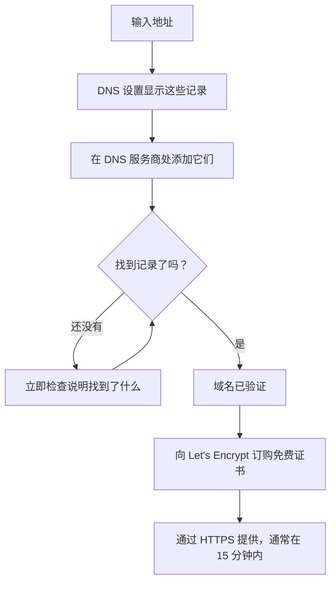

# 状态页品牌与域名

状态页是客户会看的唯一一个 OneUptime 界面，所以它应该看起来像您自己的页面，并放在您自己的域名上，例如 `status.yourcompany.com`。本页逐张卡片介绍 **品牌** 页面，然后把状态页放到您的域名上：添加域名，添加它的 DNS 记录，免费的 SSL 证书就会自动随之而来。

> [!TIP]
> 初次使用？请先按照指南操作：[发布状态页面](/docs/guides/status-page)。

:::cards
- [品牌页面](#品牌页面): 徽标、主题、标题、网站图标、链接、页脚、颜色和语言。
- [自定义 HTML、CSS 和 JavaScript](#自定义-htmlcss-和-javascript): 内置设置覆盖不到的一切。
- [自定义域名](#自定义域名): 您自己的主机名，附带免费证书。
- [状态列](#解读域名的状态列): 每个域名在通往 HTTPS 的路上走到了哪一步。
:::

## 各项品牌设置的位置

打开一个状态页，其侧边菜单的 **品牌** 区块中有三个项目：

| 页面 | 在那里设置什么 |
| ---- | ------------------ |
| **品牌** | 徽标和封面图片、主题（浅色、深色或跟随每位访问者的设备设置）、页面标题和描述、网站图标、页眉链接、概览页面描述、版权行和页脚链接。折叠在 **更多设置** 下的：历史图表颜色、语言和搜索引擎索引。 |
| **自定义域名** | 您自己的域名、它的 DNS 记录以及免费的 SSL 证书。 |
| **HTML、CSS 和 JavaScript** | 页眉 HTML、页脚 HTML、自定义 CSS、自定义 JavaScript。 |

有三项看起来像品牌设置的内容，实际位于 **状态页面 → 您的页面 → 高级 → 高级设置**（`{id}/settings`），因为它们决定的是页面显示什么，而不是页面的外观：总体正常运行时间百分比、哪些监视器状态会计入不可用时间，以及“Powered by OneUptime”这一行。前两项是那里 **状态页显示的内容** 卡片中的行，而“Powered by OneUptime”这一行在它下方的 **更多设置** 中有单独的卡片。

品牌设置以前分散在 **基本品牌**、**页眉**、**页脚**、**概览页面** 和 **语言** 几个独立的界面中。它们的旧地址（`{id}/header-style`、`{id}/footer-style`、`{id}/overview-page-branding` 和 `{id}/languages`）现在都会打开 **品牌** 页面，所以旧的书签和链接仍然有效。

## 品牌页面

**状态页面 → 您的页面 → 品牌 → 品牌**（`{id}/branding`）。每张卡片单独保存。在徽标、主题、标题和网站图标之后，卡片按状态页从上到下的顺序排列：页眉的链接、概览顶部的文字，然后是页脚。很少有人修改的内容折叠在底部的 **更多设置** 下。

### 徽标和封面图片

第一张卡片 **徽标和封面图片** 有一个 **编辑图片** 按钮，会打开两个步骤：

| 步骤 | 字段 |
| ---- | ------ |
| **徽标** | 徽标上传（占位符 `Upload logo`）、**深色主题徽标**（占位符 `Upload logo for the dark theme`，为深色背景设计的可选徽标）和 **徽标替代文本**（占位符 `Logo of My Company`）。替代文本留空时，会改用状态页的标题。 |
| **封面图片** | **封面**，用于页眉后方宽横幅的上传（占位符 `Upload cover image`），以及 **封面图片替代文本**。如果封面纯属装饰，替代文本请留空。 |

徽标、深色主题徽标、封面图片和网站图标是上传到状态页自身项目中的文件，每次保存其中任何一个时都会检查这一点，无论是通过仪表板、API、Terraform 还是工作流。上传到其他项目的文件会被拒绝，提示与已不存在的文件相同："The logo's file could not be found. Upload the logo again."、"The dark theme logo's file could not be found. Upload the dark theme logo again."、"The cover image's file could not be found. Upload the cover image again." 或 "The favicon's file could not be found. Upload the favicon again." 从页面重新上传图片即可解决。

您的状态页只显示其自身项目的图片；无法显示的图片会被省略，就像页面没有图片一样。仪表板、API 和 Terraform 读取页面图片的方式相同：来自其他项目的图片会作为没有图片返回。页面发送的电子邮件（发给订阅者，以及发给私有用户、关于其登录的邮件）以同样的方式显示徽标：页面无法显示的徽标也会从邮件中省略，而不是显示为一张损坏的图片。

这些邮件把徽标放在邮件之中，因此即使邮件客户端不从互联网加载图片或无法访问 OneUptime，徽标也能显示：PNG、JPEG、GIF、WebP 或 SVG 徽标会以与邮件页眉大小相称的图片放入邮件。字样是文本而不是图形的 SVG 徽标则改为从它的地址显示，因为服务器没有可用来绘制这些文字的字体：请在设计工具中把文本转换为轮廓，或者上传 PNG。

### 主题

徽标正下方的 **主题** 卡片决定页面在访问者眼中的样子。从它的三个选项中选一个，选择会立即保存；没有 **编辑** 按钮。

| 选项 | 访问者看到的内容 |
| ------ | ----------------- |
| **浅色** | 浅色页面，无论访问者的设备如何设置。在此设置出现之前创建的状态页都是 **浅色**，因此外观和以往一样。 |
| **深色** | 深色页面，无论访问者的设备如何设置。 |
| **跟随访问者的设备** | 按访问者设备的设置显示浅色或深色，页面打开期间也会随设备切换。页面页脚中的太阳或月亮按钮让访问者自行切换，浏览器会记住这一选择。 |

在深色页面上，徽标放在浅色底板上，因此为白色页面设计的徽标依然清晰可辨。设置了 **深色主题徽标** 的页面，会在深色页面上改为原样显示该徽标，不加底板，包括页眉和登录页面。页面发送的邮件始终显示徽标。

在页面的 OneUptime 地址 `/status-page/:id` 上，主题为 **浅色** 或 **深色** 的页面页脚中也有太阳或月亮按钮，这样您可以在选择之前，以另一种主题查看页面及其 **深色主题徽标**。在那里所做的选择只持续到页面重新加载，且不会被记住，因此页面总是以自己的主题打开，对您和打开该地址的任何人都是如此。在页面的自定义域名上，主题为 **浅色** 或 **深色** 的页面没有该按钮。

从现在起创建的状态页以 **跟随访问者的设备** 开始。通过 API 和 Terraform，该字段为 `theme`，取值为 `Light`、`Dark` 或 `System`（**跟随访问者的设备**）之一，必须按此拼写；其他任何值都会被拒绝。未设置 `theme` 的 Terraform 配置会得到 `Light`，因此在此设置出现之前编写的配置绝不会对它管理的页面计划任何更改。

主题写在页面的 HTML 中，因此页面从一开始就以该主题绘制：深色页面在加载时不会闪白，浏览器也会让滚动条、表单字段以及手机上的地址栏与之匹配。页面的每个部分都遵循主题，包括私有状态页的登录页面。正常运行时间条保留您选择的颜色。在深色页面上，状态颜色的文字如果本身难以看清，会改用该颜色的较浅色调；太暗而看不清的条形会加上较浅的边框。

您的自定义 CSS 和 HTML 在两种主题中都会生效；[自定义 HTML、CSS 和 JavaScript](#自定义-htmlcss-和-javascript) 介绍了如何为深色主题设置样式。

### 标题、描述和网站图标

- **标题和描述**：页面在浏览器标签页和订阅者邮件中显示的名称，以及搜索引擎显示的描述。**编辑** 会打开 **页面标题**（占位符 `e.g., Acme Status`）和 **页面描述**。搜索引擎和链接预览会显示它们，所以请为客户而不是为您的团队撰写。
- **网站图标**：**编辑网站图标** 会打开 **网站图标** 上传：浏览器标签页中的小图标。

### 页眉链接

**页眉链接** 表包含状态页页眉中的链接，例如您的网站、文档或支持门户。每个链接都有 **标题** 和 **链接**（一个 URL，占位符 `https://link.com`），您可以拖动它们来调整顺序。没有链接时，表格会说明这些链接的用途，下方是 **添加页眉链接**。

### 概览页面描述

**概览页面描述** 是状态页概览上的第一项内容，位于公告、总体状态和您的资源之上。**编辑描述** 会打开一个 markdown 字段。用它写一句背景说明：这个页面涵盖什么，以及去哪里获取支持。您放进去的图片会显示给页面的每位访客。

### 页脚

- **版权信息**：**编辑版权信息** 会打开一个字段 **版权信息**，占位符为 `Acme, Inc.`。
- **页脚链接**：与页眉链接相同的 **标题** 和 **链接** 组合，通过拖动排序，用 **添加页脚链接** 添加。

页眉链接用于导航；页脚链接用于细则，例如法律声明、隐私和条款。

### 更多设置

页面的最后一个区块折叠在 **更多设置** 下，因为很少有人会修改其中的内容。折叠时，其标题会列出它的四个区块（**默认条形颜色**、**条形颜色规则**、**语言** 和 **搜索引擎索引**），并显示与新状态页初始设置不同的每一项：不同于每个页面初始绿色的默认条形颜色、不同于推荐规则的条形颜色规则、不是英语的默认语言、更短的语言列表，或已关闭的搜索引擎索引。点击即可展开：它是一张卡片，各区块上下排列，每个都有自己的标题，用分隔线隔开。

**历史图表颜色。** 除了 **主题**，这是状态页上仅有的内置颜色设置。正常运行时间历史记录中的每个条形代表一天。

- **默认条形颜色**：**编辑默认条形颜色** 会打开 **默认条形颜色** 选择器。它是没有任何条形颜色规则匹配的那一天的颜色。每个新状态页都从绿色开始。
- **条形颜色规则**：一张有序的规则表，通过拖动排序。每条规则都有 **当正常运行时间百分比大于或等于** 和 **则，使用此条形颜色**；表格的列名为 `When Uptime Percent >=` 和 `Then, Bar Color is`。规则从上往下检查，一天的正常运行时间首先达到的规则决定其颜色，所以请把较高的百分比放在较低的上面：位于百分比相同或更低的规则下方的规则永远不会为任何一天着色。新规则的颜色已经预先选好，是其他规则尚未使用的颜色；请改为您想要的颜色。
- **条形颜色预览**：一天可能出现的每种颜色，按大多数人看到的样子（**正常色觉**）和红绿色盲人士看到的样子（**绿色盲（红绿色盲）**、**红色盲（红绿色盲）**）显示。当两种颜色在他们看来一样，或某条规则永远不会为任何一天着色时，它会发出警告。

页面没有数据的日子，不论规则如何，始终显示为带斜条纹的灰色。没有规则时，一天采用当天出现过的最严重监视器状态的颜色，哪怕只持续了很短时间：Offline 两分钟就会让整天变成 Offline 的颜色。因此，在仪表板中创建的状态页从推荐规则开始，它们按停机时长为一天着色：

| 正常运行时间百分比至少为 | 条形颜色 | 按整天计算 |
| ------------------------- | --------- | ------------- |
| 100 | `#22c55e` 绿色 | 无停机 |
| 99 | `#fde047` 淡黄色 | 最多停机 14 分 24 秒 |
| 95 | `#c2410c` 深橙色 | 最多停机 72 分钟 |
| 0 | `#7f1d1d` 极深的红色 | 停机超过 72 分钟 |

一天的正常运行时间按当天有数据的部分来计算，计入在 **计为停机时间** 中选择的状态。推荐颜色不仅色相不同，亮度也不同，因此红绿色盲人士（约每十二名男性中有一人）也能区分；而监视器状态初始使用的 Operational 绿色和 Offline 红色在他们看来几乎一样。在这些规则之前创建的页面，或通过 API 或 Terraform 创建的页面，在您添加规则之前没有任何规则：空的 **条形颜色规则** 表格和 **条形颜色预览** 都提供 **使用推荐规则**。通过 API 时，请在创建状态页的请求中发送 `"miscDataProps": {"addRecommendedBarColorRules": true}`。

图表覆盖多少天不在这里设置。那是 **高级 → 高级设置** 上 **状态页显示的内容** 卡片中的 **正常运行时间历史记录**，范围为 1 到 90 天。哪些监视器状态算作宕机，则是同一卡片同一行中的 **计为停机时间**。

**语言。** **语言** 区块设置访客在页面页脚看到的语言切换器。**编辑语言** 会打开两个字段：

| 字段 | 作用 |
| ----- | ------------ |
| **默认语言** | 首次访问者看到的语言，从一个以该语言本身和英语同时命名每种语言的列表中选择（`Deutsch (German)`）。默认为英语，访客随时可以在页脚切换。 发给订阅者的消息也使用该语言，除非他们订阅时是以另一种语言阅读该页面的。 |
| **已启用的语言** | 一个多选框，占位符 `All languages`。留空则提供所有支持的语言；只选几种，页脚就只列出这些语言。 |

OneUptime 内置十八种语言：英语、德语、法语、西班牙语、意大利语、葡萄牙语、荷兰语、丹麦语、挪威语、瑞典语、俄语、日语、韩语、简体中文、繁体中文、印地语、波斯语和阿拉伯语。波斯语和阿拉伯语从右向左阅读，因此以这两种语言显示的页面从右侧开始排布；如果其中一种是页面的默认语言，页面一打开就是如此。正常运行时间条仍然从左侧最早的一天开始。

**搜索引擎索引。** 一个开关 **允许搜索引擎索引此状态页** 决定 Google、Bing 等搜索引擎能否收录该页面。它默认开启。没有 **编辑** 按钮：开关在切换的那一刻就会保存。关闭后，页面会附带 `noindex, nofollow`（一个 robots 元标签和一个 `X-Robots-Tag` 响应头）提供；拥有链接的任何人仍然可以打开它。搜索引擎可能需要几周时间才能移除已经收录的页面。此开关只作用于自定义域名上的页面。预览 URL 始终附带 `noindex, nofollow` 提供，因此状态页只有在设置了自定义域名之后才会出现在搜索结果中。

> [!TIP]
> 当页面仅供内部使用或仍在搭建中时，请关闭 **允许搜索引擎索引此状态页**，以免一个半成品页面开始出现在您品牌名称的搜索结果中。

## 正常运行时间百分比和停机状态

两者都位于 **状态页面 → 您的页面 → 高级 → 高级设置**（`{id}/settings`）上 **状态页显示的内容** 卡片的 **正常运行时间历史记录** 行中。没有 **编辑** 按钮：每一项都在您更改的那一刻保存。

- **显示总体正常运行时间百分比**：一个开关，默认关闭。开启时，旁边的 **精度** 决定百分比显示几位小数：`99%`、`99.9%`、`99.99%`（默认）或 `99.999%`。在 OneUptime Cloud 上，开启百分比需要 **Scale** 套餐；它的精度在任何套餐上都可以更改。
- **计为停机时间**：以彩色标签显示的监视器状态，这些状态下的时间会在此页面上计入不可用时间。例如，您可以在这里决定降级状态是否计入不可用时间。至少会保留一个状态处于选中状态。

它们以前是两张独立的卡片 **总体正常运行时间百分比** 和 **停机监视器状态**，各自藏在一个 **编辑** 按钮后面。卡片的其余部分请参阅 [选择页面上显示什么](/docs/status-pages/index#选择页面上显示什么)。

## 自定义 HTML、CSS 和 JavaScript

**状态页面 → 您的页面 → 品牌 → HTML、CSS 和 JavaScript**（`{id}/custom-code`）有四张卡片，每张单独编辑，并存储在状态页的一列中：

| 卡片 | 列 | 包含的内容 |
| ---- | ------ | ------------- |
| **页眉 HTML** | `headerHTML` | 代替页面页眉（徽标和页眉链接）显示的 HTML（占位符 `Insert Custom HTML here.`）。 |
| **页脚 HTML** | `footerHTML` | 代替页面页脚（包括其链接以及语言和主题切换）显示的 HTML。 |
| **自定义 CSS** | `customCSS` | 整个页面的样式（占位符 `Insert Custom CSS here.`）。 |
| **自定义 JavaScript** | `customJavaScript` | 页面运行的脚本（占位符 `Insert Custom JavaScript here.`）。 |

> [!IMPORTANT]
> 自定义 HTML、CSS 和 JavaScript 只在已验证的自定义域名上提供。它们在默认地址 `/status-page/:id` 上是关闭的，因为该地址与 OneUptime 的已登录源相同。

在 OneUptime Cloud 上，添加或更改其中任何一项都需要 **Growth** 套餐。清空任何一项在所有套餐上都可以，所以试用期间添加的自定义代码随时都可以删除。

**没有品牌色选择器。** 除了让页面变成浅色或深色的 **主题**，任何地方唯一的内置颜色设置，就是 **品牌** 页面 **更多设置** 下的 **默认条形颜色** 和历史图表条形颜色规则。字体、背景色、强调色和布局调整都通过 **自定义 CSS** 实现。如果您一直在找“品牌色”字段，答案就在这里：没有这样的字段，这个文本框就是实现它的方式。

**深色主题中的自定义代码。** 您的自定义 CSS 和 HTML 在两种主题中都会生效。页面为深色时，其 `<html>` 元素带有 `dark` 类，因此以 `html.dark` 开头的 CSS 规则只为深色主题设置样式：`html.dark .my-banner { background: #1e293b; }`。不带它的规则在两种主题中都会生效，因此您为浅色页面设置的背景色或文字颜色在深色页面上也会保留：请在两种主题中检查您的自定义 CSS。如果页面有自定义 CSS，或页眉、页脚中的 HTML，**主题** 卡片会在选项下方提示这一点。

> [!WARNING]
> 自定义 JavaScript 在访客的浏览器中运行，而且是在人们恰恰认为出了问题时才会打开的页面上运行。请保持它短小，尽量自行托管它加载的内容，并在依赖它之前进行测试。

## 自定义域名

默认情况下，状态页可以通过其 **概览** 界面上的预览 URL 访问。要把它放到您自己的主机名上，请前往 **状态页面 → 您的页面 → 品牌 → 自定义域名**（`{id}/domains`）。

**自定义域名** 卡片说明了该怎么做：把每个域名的 CNAME 记录指向您安装的状态页 CNAME 记录，OneUptime 就会为该域名签发 SSL 证书并替您续期。尚未设置任何内容时，表格会显示 **未找到自定义域名**，下方是 **添加自定义域名**。表格有两列 **域名** 和 **状态**，以及 **域名**、**CNAME 有效** 和 **SSL 已预配** 的过滤器。

把页面放到您的域名上需要三步，全部在本页完成，只有前两步需要您来做：

1. **添加域名**：输入访问者将打开的地址，例如 `status.yourcompany.com`。
2. **添加它的 DNS 记录**：在您的 DNS 服务商处添加。**DNS 设置** 对话框会显示这些记录：地址的 CNAME 记录，以及在项目第一次使用某个域名时，一条证明该域名归项目所有的 TXT 记录。
3. **免费的 SSL 证书会自动签发**：一旦找到这些记录就会签发。没有需要点击的按钮。



### 开始之前

- **您的安装需要一个状态页 CNAME 记录。** OneUptime Cloud 已经有了。在自托管安装中，请把它设为指向您 OneUptime 服务器的主机名（A 记录），并确保服务器在 80 和 443 端口上响应：访问者和 Let's Encrypt 都通过这两个端口访问每个自定义域名。没有它时，卡片和 **DNS 设置** 对话框会显示 "Custom Domains not enabled for this OneUptime installation"，而不是显示记录。
- **自托管服务器会先接受检查。** **添加自定义域名** 和 **DNS 设置** 会在“此服务器尚未准备好使用自定义域名”下方说明，在任何自定义域名能够工作之前服务器还需要什么：CNAME 记录设置是否已设置、它的主机名能否解析、它能否通过 80 端口访问到这个 OneUptime 并在 443 端口上接受连接，以及服务器是否签发免费证书。每一行都会说明要更改什么、在哪里更改。这些检查从服务器本身运行，因此您网络之外的人也必须能通过相同的端口访问该主机名。

:::tabs
@tab Docker Compose
```ini title="config.env"
STATUS_PAGE_CNAME_RECORD=oneuptime.yourcompany.com
```
@tab Kubernetes
```yaml title="values.yaml"
statusPage:
  cnameRecord: oneuptime.yourcompany.com
```
:::

### 添加域名

:::steps
#### 打开 添加自定义域名

在 **自定义域名** 上点击 **添加自定义域名**。对话框只需要填写一项。

#### 输入地址

在 **域名**（占位符 `status.example.com`）中输入访问者将打开的完整地址，例如 `status.yourcompany.com`。也可以粘贴链接：只会保留其中的主机名。要使用某个域名的根，直接输入该域名本身。

#### 使用免费证书，或上传您自己的证书

**更多字段** 默认折叠，其标题会说明该域名将使用哪种证书："我们为此域名签发免费的 SSL 证书并自动续期。" 只有在使用您自己的证书时才需要展开它：打开 **上传自定义证书**，然后以 PEM 格式粘贴 **证书** 和 **证书私钥**。此时两者都是必填项。

#### 继续

点击 **继续**。如果项目已验证该地址所在的域名，域名就会被添加，并打开它的 **DNS 设置**，其中显示要添加的 CNAME 记录。如果尚未验证，OneUptime 会把该域名添加到 **项目设置 → 高级 → 域名**，打开的 **DNS 设置** 会显示两条记录，让您无需离开本页就能当场验证该域名。
:::

域名的完整名称在添加时就固定了，因此 **编辑** 只能更改它的证书。若要使用另一个地址，请添加该地址并删除旧的域名。 仪表板或表单已在使用的名称，无论在哪个项目中，都会被拒绝：一个域名只显示一个状态页、仪表板或表单。

向项目添加域名需要创建项目域名的权限（**Create Domain**，或 Project Owner 或 Project Admin），验证它则需要 **Edit Domain**。没有这些权限时，对话框会说明谁可以执行此操作。

### DNS 设置和验证

**DNS 设置** 对话框显示仍需在 DNS 服务商处添加的每条记录，每行一个字段，每个字段都有复制按钮：

| 记录 | **类型** | **名称** | **值** |
| ------ | -------- | -------- | --------- |
| 证明该域名归项目所有，直到它通过验证 | `TXT` | 域名，例如 `yourcompany.com` | 它的验证文本，`oneuptime-verification-…` |
| 把地址指向 OneUptime | `CNAME` | 完整地址，例如 `status.yourcompany.com` | 您安装的状态页 CNAME 记录 |

每个域名只需添加一次 TXT 记录：之后该域名下的每个地址只需要自己的 CNAME 记录。对于该域名下的地址，两者位于不同的名称上，因为带有 CNAME 记录的名称不能有任何其他记录；对于域名的根，ALIAS 或 CNAME 拉平记录与 TXT 记录并存。

> [!NOTE]
> 对于没有子域名的根域名，对话框会添加一条说明：许多 DNS 服务商不允许在那里使用 CNAME 记录。请改用您服务商的 ALIAS、ANAME 或 CNAME 拉平记录，填写相同的值。

点击 **立即检查** 可立即查询这些记录。它会先检查 TXT 记录，一旦找到，就把域名添加到状态页并检查它的 CNAME 记录。随后每条记录都会显示自己的状态：**已找到**、**值不正确**、**尚未找到** 或 **无法检查**，并在下方说明 OneUptime 查询了什么、得到了什么，以及需要更改什么：

- “我们查询了 status.yourcompany.com 的 CNAME 记录，但什么也没有得到。”记录还不存在，或者尚不可见：新记录可能需要一段时间才会出现。
- “我们查询了 status.yourcompany.com 的 CNAME 记录，得到的是 other.example.net，但预期是 oneuptime.yourcompany.com。”记录指向了别处：请更改它的值。
- “我们查询了 status.yourcompany.com 的 CNAME 记录，但什么也没有得到，不过该名称以地址 203.0.113.10 应答。”该名称有一条 A 记录，或者它的 DNS 服务商对它进行了代理或拉平（Cloudflare 的橙色云朵就会这样），这会让所有人都看不到 CNAME 记录：请替换 A 记录，或把该名称设为“仅 DNS”。

OneUptime 会跟随整条 CNAME 链，因此指向您自己的某个名称、而该名称又指向您安装的记录的记录也算数。即使 DNS 服务商隐藏了 CNAME 记录，只要发往该名称的请求能到达 OneUptime，也同样算数。

找到 CNAME 记录后，对话框会显示“您的 CNAME 记录已验证。”以及证书接下来会发生什么。免费证书会在那一刻订购。如果发往该地址的请求仍然无法到达 OneUptime，例如自托管服务器前面的代理没有把该地址传递下去，对话框会说明这一点：在请求能够到达之前，证书无法签发。

OneUptime 每 15 分钟检查一次每个未验证域名的 CNAME 记录，一旦记录生效就会完成验证，无论您是否回来查看。在域名通过验证并且证书就位之前，它所在的行有一个 **DNS 设置** 操作，会打开同一个对话框。对于证书订购一直失败或证书已过期的已验证域名，那里的 **立即检查** 会重新订购，并显示上一次订购失败的原因。每个域名每 15 分钟最多订购一次；在此期间，OneUptime 会自行不断重试。

### SSL 证书

每个自定义域名都会获得 Let's Encrypt 签发的免费证书，签发和续期都是自动的。不需要点击任何东西：

- **立即检查** 会在找到记录的那一刻订购证书。随后对话框会说明证书通常在 15 分钟内生效。
- 当每 15 分钟一次的检查验证了某个域名时，它会在同一次检查中为该域名订购证书。
- 续期是自动的，会在证书到期前很早进行。如果在续期证书时您的 DNS 短暂无响应，证书会继续提供，并在之后的尝试中续期。DNS 检查失败绝不会移除仍然有效的证书。

新证书会在签发后 15 分钟内提供，因为证书就是以这个频率写入响应您域名的服务器的。状态列说的是 _通常_ 在 15 分钟内：当许多域名同时等待时，它们会被分批处理。

每个 OneUptime 证书都通过一个共享的 Let's Encrypt 账户订购，而 Let's Encrypt 会限制一个账户在短时间内可以下的新订单数量，以及同一域名的订单可以失败的次数。OneUptime 会让它所有的订单（新域名、**立即检查**、重新签发和续期）合计保持在这些限制之内，并且续期始终优先，这样大量新域名永远不会耽误让现有域名保持在线的续期。

如果订购失败，域名的状态列会显示出来，下一行附有原因，**DNS 设置** 中的 **立即检查** 也会显示。OneUptime 会自行继续尝试，每连续失败一次就多等一会儿，这样一个订单一直失败的域名不会耗尽其他所有域名需要的订单。常见原因是您的域名上有不允许 `letsencrypt.org` 的 CAA 记录，以及在自托管安装中 Let's Encrypt 无法通过 80 端口访问服务器；在自托管安装中，worker 日志里有详细信息。修复原因后，点击 **立即检查** 即可立即重新订购。每个域名每 15 分钟最多下一个订单；在此期间点击会显示上一次订购的结果。

如果您在 **更多字段** 下上传了自己的证书，OneUptime 会改为提供该证书，在保存后 15 分钟内生效。请在它到期之前，通过编辑域名上传替换证书。

没有 Let's Encrypt 账户密钥 `LETS_ENCRYPT_ACCOUNT_KEY`（Helm chart 中为 `letsEncrypt.accountKey`）的自托管安装不签发免费证书。在这种安装中，域名的 CNAME 记录一经验证即可访问，状态列也会如此显示：请通过您自己的代理或负载均衡器为其提供 HTTPS，或在 **更多字段** 下上传证书。

### 重新签发证书

自动续期能覆盖常见情况，但有时您需要立刻获得一张全新的证书：一把您不想再保留的私钥、一张您自己的扫描器不认可的证书，或者一个在上游发生了变化的域名。一旦为某个域名订购了免费证书，它所在的行就会显示 **Reissue SSL** 操作。

它的对话框 **Reissue SSL Certificate for this Status Page** 会向 Let's Encrypt 为该域名申请一张新证书，并用它替换正在提供的证书。在此期间，您的状态页会继续使用现有证书保持在线，新证书会在 15 分钟内提供。点击 **Reissue SSL Certificate** 即可订购。

> [!NOTE]
> 每个域名每 24 小时只能重新签发一次。Let's Encrypt 会限制同一域名的签发频率，而每个 OneUptime 证书都通过一个共享账户订购，包括让其他所有人的页面保持在线的自动续期。在这个时间段内，对话框会告诉您还剩多长时间，而不会下单。如果当时正在为该域名订购证书，或者安装的 Let's Encrypt 订单暂时用完了，对话框会说明这一点，不会订购任何内容，这次点击也不会计为您的重新签发。

使用您上传证书的域名不会出现这个操作：没有可以重新签发的 Let's Encrypt 证书，所以请改为通过编辑域名上传新证书。在域名的第一张证书订购之前也不会出现，而第一张证书会在其 CNAME 记录验证后自动订购。

同样的按钮和同样的 24 小时限制，也出现在 **仪表板 → 您的仪表板 → 品牌 → 自定义域名** 下的仪表板自定义域名上，它们的工作方式与状态页自定义域名相同：请参阅 [共享与公开仪表板](/docs/dashboards/sharing#自定义域名)。

### 解读域名的状态列

**状态** 列以八种状态之一，说明每个域名在通往 HTTPS 的路上走到了哪一步。订购失败时，原因位于下一行。

| 状态列显示的内容 | 含义 |
| --------------------------- | ------------- |
| 等待 DNS：请添加 CNAME 记录。 | 尚未找到 CNAME 记录。打开 **DNS 设置** 查看记录，在您的 DNS 服务商处添加它，然后点击 **立即检查** 或等待每 15 分钟一次的检查。 |
| 正在签发免费证书，通常在 15 分钟内完成。 | 记录已验证，证书正在订购或写入。无需任何操作。 |
| 暂时无法签发免费证书。我们会继续尝试。 | 记录已验证，但订购其证书失败了，原因见下一行。修复原因后，打开 **DNS 设置** 并点击 **立即检查**，即可立即重新订购。 |
| 证书已过期。我们会继续尝试续期。 | 由于续期失败，域名的证书已过期。打开 **DNS 设置** 并点击 **立即检查**，即可立即续期并查看原因。 |
| 证书已签发，将自动续期。 | 完成。域名通过 HTTPS 提供其证书，由 OneUptime 负责续期。 |
| 证书已签发，但续期失败。我们会继续尝试。 | 域名仍在提供有效的证书，但上一次续期失败了，原因见下一行。OneUptime 会在证书到期前很早再次尝试。 |
| 正在使用您上传的证书。 | 记录已验证，域名使用您上传的证书提供服务。 |
| 已验证。正在使用您自己的代理提供的 HTTPS。 | 在没有 Let's Encrypt 账户密钥的自托管安装上，记录已验证，域名可以访问。除非您上传证书，否则其 HTTPS 由您自己的代理负责。 |

:::details 添加记录很久之后，域名仍停留在“等待 DNS”
打开 **DNS 设置** 并点击 **立即检查**：它会在记录下方说明 OneUptime 查询了什么、得到了什么。检查记录的名称是否为完整域名，例如 `status.yourcompany.com`，以及它的值是否与您安装的 CNAME 记录一致。如果它说该名称以地址应答，说明该名称有一条 A 记录，或者被它的 DNS 服务商代理了：请替换 A 记录，或把该名称设为“仅 DNS”。在根域名上，请使用 ALIAS、ANAME 或拉平的 CNAME 记录。
:::

:::details 状态列显示无法签发免费证书
在您的域名上查找没有包含 `letsencrypt.org` 的 CAA 记录；在自托管安装中，检查您的服务器是否在 80 端口上响应。修复原因后，在 **DNS 设置** 中点击 **立即检查** 重新订购。
:::

### 谁可以检查和重新签发

**立即检查**、订购域名证书和 **Reissue SSL** 都会更改域名，因此需要编辑该域名的权限：**Edit Status Page Domain**，或包含该权限的角色（Project Owner、Project Admin、Project Member、Status Page Admin 或 Status Page Member）。

只能读取该域名的人，例如 Viewer 或 Status Page Viewer，仍然可以看到 **状态** 列以及 **DNS 设置** 中要添加的记录。对他们来说，**立即检查** 和 **Reissue SSL** 处于锁定状态，并会说明需要哪项权限。无论如何，OneUptime 都会继续自行检查每个域名并订购其证书。

API 密钥也是如此。只能读取状态页域名的密钥无法在 `/status-page-domain` 上调用 `verify-cname`、`check-dns`、`order-ssl` 或 `reissue-ssl`。如有需要，请授予它 **Read Status Page Domain** 和 **Edit Status Page Domain**。找不到记录时，`verify-cname` 会拒绝请求，并用 **DNS 设置** 所显示的相同措辞说明它查询了什么、得到了什么；无论哪种情况，`check-dns` 都会答复它查询的每条记录。

## Powered by OneUptime

“Powered by OneUptime”这一行不是品牌设置。它在 **状态页面 → 您的页面 → 高级 → 高级设置**（`{id}/settings`）上 **状态页显示的内容** 卡片下方的 **更多设置** 中有单独的卡片 **Powered by OneUptime**，其中的开关是 **显示“由 OneUptime 提供支持”品牌标识**，默认开启。关闭它即可隐藏这一行；它会立即保存。在 OneUptime Cloud 上，隐藏它需要 **Scale** 套餐。自托管时，隐藏它属于 Enterprise Edition：在 Community Edition 上，每个状态页都会显示这一行。

## 后续步骤

:::cards
- [状态页概览](/docs/status-pages/index): 页面显示什么，以及谁可以查看。
- [状态页资源与分组](/docs/status-pages/resources-and-groups): 选择访客在页面上实际看到的内容。
- [订阅者与公告](/docs/status-pages/subscribers): 带有您徽标并链接到您域名的电子邮件。
- [公共 API](/docs/status-pages/public-api): 以 JSON 形式读取页面，在您自己的域名上也可以。
:::
