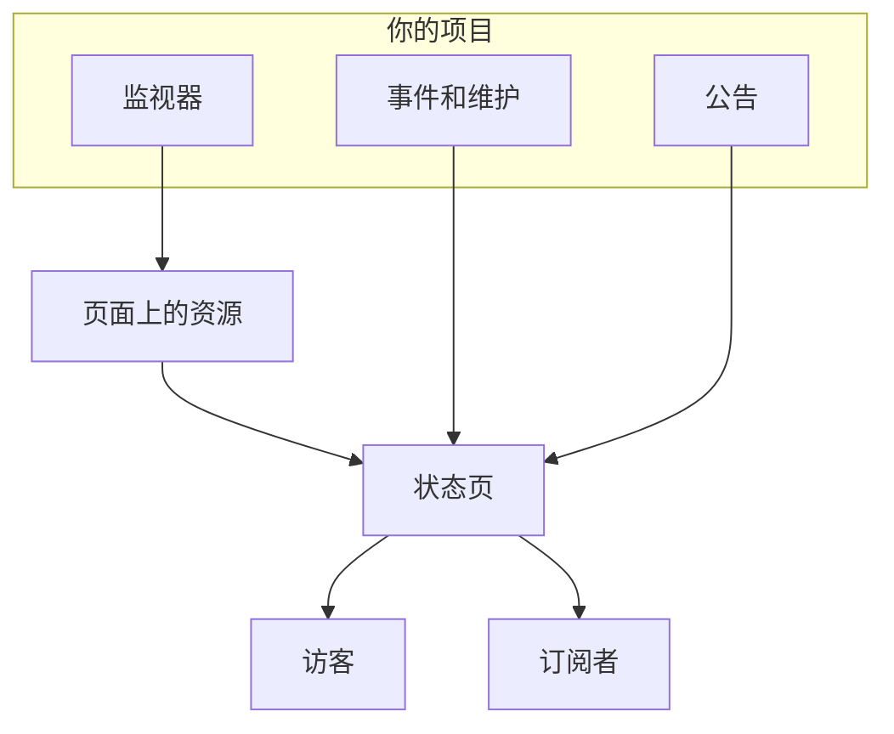

# 状态页概览

状态页是你所监控的一切的公开门面：一个客户可以直接打开的 URL，而不必发邮件问你是不是只有他们遇到了问题。它显示你选择公开的服务的当前状态、你正在处理的事件、你计划的维护，以及你想置顶的任何公告。

凌晨 2 点出故障时，支持队列首先链接到的就是状态页。订阅者收到的通知也从这里发出，所以值得在需要它之前就设置好，而不是在故障期间。

:::cards
- [创建状态页](#创建一个状态页): 开始只需两个字段，其余的都可以之后再设置。
- [选择显示的内容](#选择页面上显示什么): 事件、片段、公告、维护和正常运行时间，都在一张卡片里。
- [决定谁能看到](#限制谁能看到这个页面): 任何拥有链接的人、仅限登录的人，或任何知道密码的人。
- [归档状态页](#归档状态页): 不删除页面就让它下线。
:::

## 工作原理

状态页位于顶部栏 **产品** 菜单中的 **状态页面** 下，属于核心产品之一。本页的所有内容都是按状态页分别设置的：一个项目可以运行任意多个状态页，例如面向客户的公开页面、面向内部受众的私密页面，或面向特定市场的按地区划分的页面。

页面把你放在上面的监视器显示为它的资源。事件和计划维护通过这些监视器到达页面，公告则直接发布到页面上。访客阅读页面，订阅者则通过他们选择的渠道获知每一次变化。

## 一览

- **两个字段即可创建。** 新状态页只要求填写 **名称** 和 **描述**。资源、品牌和域名都在之后配置。
- **资源就是访客看到的内容。** 页面上的每一行都是一个 **状态页面 资源**：一个监视器（或监视器组），有自己的显示名称、提示和正常运行时间选项。组把长页面分成多个部分，并且可以嵌套。
- **从第一天起就有预览 URL。** 每个状态页都有一个预览链接，所以在有自定义域名之前就可以查看它。
- **面向访客的路由由设置控制。** 事件、片段、公告和计划事件分别只在 **状态页显示的内容**（位于 **高级设置**）中对应的开关打开时才出现，订阅页面只在 **显示订阅者页面** 打开时才出现。
- **谁能看到是一个选择。** 任何拥有链接的人、仅限登录的人（私人用户、SAML SSO 或 OIDC），或任何知道密码的人，在页面的 **访问** 屏幕上选择，**更多设置** 下还有可选的 IP 允许列表。
- **订阅者会自动收到通知。** 电子邮件、短信、Slack、Microsoft Teams 和 Webhook 订阅者都可以关注页面，每个渠道都有自己的开关。

## 关键术语

| 术语 | 含义 |
| --- | --- |
| **状态页** | 一个公开（或私密）的页面，有自己的品牌、域名、资源和订阅者。即 `StatusPage` 模型。 |
| **资源** | 访客看到的一行：显示在页面上的一个监视器或监视器组，带有显示名称和正常运行时间选项。 |
| **组** | 容纳资源的命名部分。组可以嵌套在其他组中，每一层都会汇总其下所有内容的状态。 |
| **公告** | 你发布到一个或多个状态页的消息，有开始时间和可选的结束时间。 |
| **订阅者** | 通过电子邮件、短信、Slack、Microsoft Teams 或 Webhook 关注页面的人（或系统）。 |
| **自定义域名** | 你自己的域名（`status.example.com`），通过 CNAME 记录指向页面。OneUptime 免费为它签发 SSL 证书并负责续期。 |
| **私人用户** | 可以登录私密状态页的账户。与你的 OneUptime 项目用户相互独立。 |

## 创建一个状态页

:::steps
### 打开创建表单

打开 **状态页面 → 所有状态页面**，然后点击 **创建状态页面**。

### 为页面命名

在 **创建新状态页** 对话框中填写 **名称**（必填，至少两个字符），以及可选的 **描述**，然后点击 **创建状态页面**。

这就是整个创建表单。返回的列表显示 **名称**、**描述**、**标签** 和 **所有者**，并且可以按 **状态页 ID**、**名称** 和 **描述** 筛选。

### 打开新页面

打开新页面后会进入它的 **概览** 屏幕，上面有两张卡片：带有页面本身链接的 **Status Page Preview URL**，以及可以编辑刚才设置的名称、描述和标签的 **状态页详情**。项目有状态页自定义字段后，它们后面还会跟一张 **自定义字段** 卡片。
:::

通过 API 或 Terraform 创建的页面也受下面所述设置的相同套餐限制。在 OneUptime Cloud 上，如果创建页面时打开了你的套餐不包含的设置（例如私密、隐藏某个列表、自定义 HTML、CSS 或 JavaScript、邮件报告、短信、Slack、Microsoft Teams 或 Webhook 订阅者、IP 允许列表），会被 `402 Payment Required` 拒绝，消息中会写明所需的套餐。每项设置所需的套餐都在下文与该设置一起给出。像这个表单一样保留默认值的设置，在所有套餐上都可用。

接下来，大致按有用程度排序：

- 添加资源，让页面上有内容。参见 [状态页资源与分组](/docs/status-pages/resources-and-groups)。
- 设置页面标题、网站图标、徽标和封面，然后绑定自定义域名。参见 [状态页品牌与域名](/docs/status-pages/branding-and-domains)。
- 决定人们可以通过哪些渠道订阅。参见 [订阅者与公告](/docs/status-pages/subscribers)。
- 在 **高级设置** 中调整页面上显示的内容。

## 各项功能都在哪里

打开一个状态页后，它自己的左侧菜单分为九个部分。把它当作本组文档其余部分的地图。

| 部分 | 包含的内容 |
| --- | --- |
| **基础** | **概览**、**公告**、**所有者**。 |
| **资源** | 一个 **资源** 屏幕（左侧是组，右侧是所选组的监视器）和 **Monitor Rules**。 |
| **订阅者** | **电子邮件订阅者**、**SMS 订阅者**、**Slack 订阅者**、**MS Teams 订阅者**、**Webhook 订阅者**、**订阅者设置**。 |
| **通知日志** | **通知日志**：发送给订阅者的内容。 |
| **品牌** | **品牌**（徽标、标题、网站图标、链接、页脚、颜色和语言，都在一个页面上）、**自定义域名**、**HTML、CSS 和 JavaScript**。 |
| **安全** | **访问**（谁能看到页面）、**私人用户**、**SSO**、**OIDC**、**SCIM**。 |
| **人工智能** | **MCP**。 |
| **开发者** | **Terraform**、**API**、**AI 助手**：以代码形式管理页面。 |
| **高级** | **嵌入状态**、**报告**、**自定义字段**、**高级设置**、**审计日志**、**删除状态页面**。 |

只有 **基础** 和 **资源**（也就是页面显示的内容）一开始是展开的。其他每个部分都像 OneUptime 每个菜单中不常用的部分一样，一开始是折叠的：点击部分的标题即可显示其中的页面。当你位于某个部分的页面上时，例如 **高级设置** 或 **电子邮件订阅者**，该部分会自动展开。

在开始查找之前，有两个命名上的特点值得了解：

- 只有在项目启用了监视器组时，**资源** 项才叫 **资源**。否则它显示为 **监视器**。无论哪种情况都是同一个屏幕。
- 没有单独的组页面。组和资源已经合并，旧的 `/groups` 路由现在会重定向到资源屏幕。

在单个页面之外，**状态页面** 部分本身列出 **所有状态页面**，**更多** 部分包含 **公告**。折叠的 **设置** 部分包含 **公告模板**、**订阅者模板**、**自定义字段**、**所有者规则** 和 **标签规则**，它们作用于整个项目，由所有状态页共享。折叠的 **高级** 部分包含 **已归档**：你下线的状态页（参见 [归档状态页](#归档状态页)）。

**标签规则** 和 **所有者规则** 为新状态页添加标签并分配所有者。规则分两步：先是 **匹配**，即状态页必须满足的条件，然后是 **标签**（或 **所有者**），即规则要添加的内容，规则的 **名称** 会根据你的选择自动填写。新规则必须至少添加一个标签或所有者；编辑时不会强制要求，什么都不添加的旧规则会在列表中标记为 **不添加任何内容**。参见 [标签与所有者规则](/docs/configuration/label-and-owner-rules)。

## 访客看到什么

公开页面是一个独立的应用，只有少量路由：

- `/`：**概览**。
- `/incidents` 和 `/incidents/:id`：事件列表和单个事件。
- `/announcements` 和 `/announcements/:id`。
- `/scheduled-events` 和 `/scheduled-events/:id`。
- `/subscribe/email`、`/subscribe/sms`、`/subscribe/slack`、`/subscribe/microsoft-teams`、`/subscribe/webhooks`。
- `/confirm-subscription/:id`、`/update-subscription/:id` 和 `/unsubscribe/:token`：订阅者收到的消息中的链接。
- `/rss`：订阅源。
- `/login`、`/sso` 和 `/master-password`：只在私密页面上有意义。

顶部导航栏始终显示 **概览**；其余项只在启用时出现。**事件**、**公告** 和 **计划事件** 各自需要打开对应的开关；**订阅** 需要同时打开 **显示订阅者页面** 和至少一个订阅渠道。私密页面还会有一个 **退出** 项。

单个事件、片段、公告或计划事件，只有在页面会把它列出来时才能打开，无论它的历史时间窗口如何：私密的事件或片段、在状态页上隐藏的事件或片段、在状态页上隐藏的计划事件，或安排在之后显示的公告，通过链接也找不到。

### 概览页面

概览是大多数访客唯一会看到的页面。它从上到下依次显示：

1. **当前的公告**：开始时间已过、结束时间未到的公告。
2. **整体状态横幅**：一行文字，概括是所有资源还是部分资源受到影响。
3. **整体正常运行时间百分比**（如果你打开了它）：在所有资源都正常运行时，显示在整体状态横幅的末尾。默认关闭。
4. **资源组**：每个组及其资源、它们的当前状态和正常运行时间历史条。
5. **活动事件**（包括活动的片段）。
6. **计划维护事件**。

一个什么都没有的新页面会显示空状态，提示你从仪表板添加资源，这就是你该前往 **资源** 屏幕的信号。

访客看到的概览最多是 15 秒前的，而你从页面上撤下的内容会在一秒内消失：你在状态页上隐藏、设为私密、限定到其他页面或删除的事件、片段或计划事件，你结束、推迟或删除的公告，你删除的公开备注，以及你从页面移除或删除的资源、组或监视器。其他编辑（例如新标题）会在这 15 秒内显示出来。

关于是什么让事件出现在此页面上、又是什么让它再次消失，参见 [事件状态与严重级别](/docs/incidents/states-and-severities)。

## 选择页面上显示什么

访客看到的内容在一张卡片中设置：**状态页面 → 您的页面 → 高级 → 高级设置** 上的 **状态页显示的内容**。页面可以显示的每个列表都有一行，然后是 **正常运行时间历史记录**（包括整体正常运行时间百分比，以及哪些状态计为停机时间）和“Powered by OneUptime”一行。没有编辑按钮：开关在你切换时立即保存，天数在你离开输入框或按 Enter 时保存，从列表中的选择在你做出选择时保存。

- **显示事件**（`showIncidentsOnStatusPage`）：默认打开。它下面的 **显示最近 … 天**（`showIncidentHistoryInDays`，默认 14）决定事件列表向前追溯多远，**显示事件标签**（`showIncidentLabelsOnStatusPage`）默认关闭。
- **仅显示限定到此页面的事件**（`onlyShowScopedIncidents`）：同样位于事件这一行，默认关闭。打开后，页面只显示通过 **仅限这些状态页面** 限定到它的事件，也只就这些事件通知订阅者。没有限定到任何页面的事件，包括监视器、Slack、Microsoft Teams、API 或 AI 自行创建的事件，在有人把此页面加给它们之前，永远不会到达此页面。它还决定哪些事件会把它们的片段带到页面上，所以即使 **显示事件** 关闭，它也会保留。对于共享监视器但面向不同受众的页面，参见 [每个受众一个状态页](/docs/status-pages/one-status-page-per-audience)。
- **显示片段**（`showEpisodesOnStatusPage`）：默认打开，带有 **显示最近 … 天**（`showEpisodeHistoryInDays`，默认 14）和 **显示片段标签**（`showEpisodeLabelsOnStatusPage`，默认关闭）。片段是有自己端点的独立模型，而不是事件的一种视图。
- **显示公告**（`showAnnouncementsOnStatusPage`）：默认打开，带有 **显示最近 … 天**（`showAnnouncementHistoryInDays`，默认 14）。
- **显示计划维护事件**（`showScheduledMaintenanceEventsOnStatusPage`）：默认打开，带有 **显示最近 … 天**（`showScheduledEventHistoryInDays`，默认 14）和 **显示事件标签**（`showScheduledEventLabelsOnStatusPage`，默认关闭）。
- **正常运行时间历史记录**：与页面正常运行时间有关的一切，都在一行里：
  - **显示最近 … 天**（`showUptimeHistoryInDays`）是每个资源旁边正常运行时间条的长度。默认 90，必须在 1 到 90 之间。资源或组上的每个 **显示正常运行时间百分比** 和 **显示状态历史记录图表** 选项都读取这个数字，整体正常运行时间百分比也是如此。
  - **显示总体正常运行时间百分比**（`showOverallUptimePercentOnStatusPage`）：默认关闭。打开后，在一切正常运行时，整体状态横幅的末尾会显示整个页面的一个正常运行时间百分比，即其资源和组的平均值。打开期间，**精度**（`overallUptimePercentPrecision`）决定显示几位小数：`99%`、`99.9%`、`99.99%`（默认）或 `99.999%`。每个资源和组都有自己的精度。
  - **计为停机时间**（`downtimeMonitorStatuses`）：这些监视器状态的时间会计入页面上每个正常运行时间百分比（每个资源的、每个组的和整体的）的停机时间。每个状态都是一个带有自身颜色的标签。从列表中添加一个，或用它的 **×** 删除一个，更改会立即保存。新状态页一开始包含项目中所有非正常运行的状态。至少保留一个状态：最后一个无法删除，因为一个都没有的话，页面上的每个正常运行时间都会显示 100%。
- **显示“由 OneUptime 提供支持”品牌标识**：默认打开，所以访客页面的页脚显示“Powered by OneUptime”。关闭它即可隐藏这一行。该列以相反的方式存储它，即 `hidePoweredByOneUptimeBranding`。

**关闭的列表** 会从页面上消失，如果它在导航栏中有对应项，也会一起消失；它的公开端点会拒绝请求，页面的订阅者也不会收到这类事件的通知。这时它的行只显示开关：隐藏的列表追溯多远、是否显示标签，都不会改变任何东西。

**套餐。** 在 OneUptime Cloud 上，你的套餐无法更改的设置旁边会显示所需的套餐。四个列表开关、三个标签开关和片段的历史需要 **Growth**；显示整体正常运行时间百分比和隐藏“Powered by OneUptime”一行需要 **Scale**。其他历史时间窗口、**正常运行时间历史记录**、**精度**、**计为停机时间** 和 **仅显示限定到此页面的事件** 在所有套餐上都可以更改，并且各自单独保存：整体正常运行时间百分比已经打开的页面，可以在任何套餐上更改它的精度。把设置恢复成新页面的样子（再次显示某个列表、隐藏标签或整体正常运行时间百分比、显示“Powered by OneUptime”一行、把片段的历史恢复为 14 天）在所有套餐上都可用，所以试用期间改动的设置不会因为缺少套餐而无法恢复：开关会说明它仍然可以改回去，以及再次更改需要哪个套餐。

页面是否显示 **订阅** 项（**显示订阅者页面**，`showSubscriberPageOnStatusPage`，默认打开），以及访客可以通过哪些渠道订阅，并不在这个屏幕上设置：两者都在 **订阅者 → 订阅者设置** 上的 **渠道** 卡片中（参见 [订阅渠道](/docs/status-pages/subscribers#订阅渠道)）。

卡片下方是 **将状态页导出为 JSON**，它会把状态页自身的设置下载为一个可以再次导入的文件，以及 **Archive status page**（参见 [归档状态页](#归档状态页)）。整体正常运行时间百分比和停机状态过去是这里两张独立的卡片，各自藏在一个 **编辑** 按钮后面；现在它们是这张卡片中的行。

**颜色在哪里。** 正常运行时间条的颜色不在这里：**默认条形颜色** 和条形颜色规则位于 **状态页面 → 您的页面 → 品牌 → 品牌** 的 **更多设置** 下。任何地方都没有主题或品牌色设置；超出这些控件的任何内容都通过 **自定义 CSS** 实现。

## 上线前先预览

每个状态页的 **概览** 屏幕上都有一张 **Status Page Preview URL** 卡片，带有直接打开页面的链接。在你还在添加资源、还没有任何自定义域名时使用它。

在后台，每个公开路由在 `/status-page/{statusPageId}/...` 下都有一个预览版本：预览概览、预览事件列表、预览订阅页面等等。这意味着从仪表板预览中获取的 URL 或截图，与绑定自定义域名后客户看到的内容并不一致，所以请仔细检查你粘贴到运行手册或邮件中的任何链接。

## 限制谁能看到这个页面

并不是每个状态页都面向公众。谁能看到页面是一个选择，即 **状态页面 → 您的页面 → 安全 → 访问** 上的第一张卡片 **谁可以查看此状态页**：

- **任何拥有链接的人**：页面是公开的。每个新状态页都从这里开始。
- **仅限登录的人**：访客会进入 `/login`，以私人用户身份登录，或使用你的 SSO 或 OIDC 提供方登录（见下文）。在这个选项下方，卡片会列出为页面设置的登录方式（它有多少私人用户、SSO 和 OIDC 是否打开，每项都链接到对应的屏幕），并且在选中这个选项时，如果还没有人能登录，它会提示这一点。
- **任何知道密码的人**：访客会进入 `/master-password`，用你与他们共享的一个密码解锁页面。任何人都不需要账户。选择它时，如果页面还没有密码，会在同一个对话框中要求设置密码；如果已经有密码，你可以保留它或输入新的。之后，选项下方的 **更改密码** 用于替换它。密码以哈希形式存储，无法再次显示，输入过旧密码的人最多还能继续查看页面 7 天。

选择一个选项时会要求你确认，并说明访客会受到什么影响，然后立即保存。没有编辑按钮。

**图片。** 页面所显示内容（公开备注、公告、描述）中的图片，通过它自己那个又长又无法猜测的地址打开，这个地址无需登录即可使用，因此订阅者收到的邮件中也能显示它。页面本身仍然要求登录或密码。

**它存储了什么。** 这个选择对应三列，API 和 Terraform 像以前一样读写它们：`isPublicStatusPage`、`enableMasterPassword` 和 `masterPassword`。只有在页面不公开、`enableMasterPassword` 打开并且设置了密码时，访客才会被要求输入密码；开关打开但没有密码的私密页面是一个登录页面。选择 **任何拥有链接的人** 也会关闭 `enableMasterPassword`，因为公开页面从不要求密码。**访问** 屏幕只写入选择所改变的列。

**套餐。** 在 OneUptime Cloud 上，把页面设为私密需要 **Growth** 套餐：在更低的套餐上，两个私密选项会显示所需的套餐，并且无法选择。再次设为公开（**任何拥有链接的人**）在所有套餐上都可用，所以在试用结束后或降级到更低套餐后仍保持私密的页面，随时都可以重新公开；对话框会说明再次设为私密需要 **Growth**。在 **仅限登录的人** 和 **任何知道密码的人** 之间切换在所有套餐上都可用，**更改密码** 也一样。

### 私人用户

在 **状态页面 → 您的页面 → 安全 → 私人用户** 上添加可以登录的人。有一个 **批量添加** 操作：粘贴一组电子邮件地址，每个地址都会收到一封邀请邮件。私人用户有自己的忘记密码和重置密码流程，与你的 OneUptime 项目账户相互独立。

**私人用户和密码不会叠加。** 当选择 **任何知道密码的人** 时，私人用户无法登录（他们同样要输入密码），**私人用户** 屏幕会说明这一点，并提供返回 **访问** 的链接。

### SSO 和 OIDC

对于与你的身份提供方关联的私密页面，**状态页面 → 您的页面 → 安全 → SSO** 用于配置 SAML：你输入登录 URL、颁发者和 x509 证书，签名和摘要方法已在 **更多字段** 下预先填好。**状态页面 → 您的页面 → 安全 → OIDC** 用于配置 OpenID Connect：你输入颁发者、客户端 ID 和密钥，发现 URL、作用域和声明名称已在 **更多字段** 下预先填好。**SCIM** 会自动从 IdP 预配私人用户。在 OneUptime Cloud 上，这三项都需要 Scale 或更高的套餐。在自托管安装中，SSO 和 OIDC 是每个版本的一部分，SCIM 需要 [企业版](/docs/self-hosted/enterprise)。

关闭或删除状态页的 SSO 或 OIDC 提供方，会让通过它登录的私人用户退出登录：他们的会话会在下一次请求时结束，再次打开提供方也不会恢复这些会话，他们需要重新通过它登录。新的证书或客户端密钥、其他 URL 或新名称会让所有人保持登录。在要求使用 SSO 的页面上，关闭最后一个提供方后，在你重新打开一个提供方或关闭 **登录时要求使用 SSO** 之前，任何人都无法登录；要换到另一个提供方，请先设置并测试新的提供方，再关闭旧的。

在提供方下方，**SSO 设置** 卡片中有 **登录时要求使用 SSO** 开关（`requireSsoForLogin`，默认关闭），切换后立即保存。打开它时会先要求确认，因为从那以后，私人用户无法再用电子邮件和密码登录：只有你的 SSO 或 OIDC 提供方放行的人才能看到页面。打开之前，先用该屏幕上的链接测试 SSO。它只在选择 **仅限登录的人** 时才有意义，**访问** 屏幕会在该选项下把它显示为 **要求使用 SSO**。打开期间，用电子邮件和密码登录的私人用户也会在下一次请求时退出登录：只有 SSO 或 OIDC 提供方建立的会话才算数。在 OneUptime Cloud 上，打开它需要 **Scale** 套餐，关闭它在所有套餐上都可用。Scale 试用结束后或降级到更低套餐后仍要求 SSO 的页面，会一直要求 SSO，直到有人把它关闭：它的 **SSO** 和 **OIDC** 页面会在套餐升级提示下方显示用于此目的的开关。

### IP 允许列表

在 **访问** 的 **更多设置** 下，**IP 允许列表** 部分（`ipWhitelist` 列）把页面限制在已知的网络。无论页面向谁开放，它都会生效：来自任何其他地址的访客都会被拒绝，即使有密码或私人用户账户也一样。每行输入一项：一个 IPv4 或 IPv6 地址，或一个 IPv4 范围，例如 `10.0.0.0/8`；两者都不是的行会在保存时被拒绝。留空则允许所有地址。列表生效期间，折叠的 **更多设置** 标题会显示 **IP 允许列表** 及其中的条目数。在 OneUptime Cloud 上，更改它需要 **Scale** 套餐；清空它在所有套餐上都可用。

## 可嵌入徽章与 RSS 订阅源

有两种方式可以在页面本身以外的地方展示状态。

**嵌入式状态徽章。** 在 **状态页面 → 您的页面 → 高级 → 嵌入状态** 上打开 **启用嵌入式状态徽章**（`enableEmbeddedOverallStatus`，默认关闭），然后在 **安全令牌** 卡片上点击 **重新生成令牌**，为徽章生成令牌（`embeddedOverallStatusToken`）。徽章由 `/api/status-page/badge/<status-page-id>?token=<token>` 提供，屏幕会在 **徽章预览** 下显示它以及可复制的代码片段，这样你就可以把当前的整体状态放进你的文档、应用的页脚或营销页面中。

**RSS 订阅源。** 每个状态页都提供 `/rss`：一个标题为“{页面标题} Updates”的订阅源，其中使用 **品牌** 中的页面 **页面标题**，没有时则使用页面名称，条目分别以 `Incident: `、`Announcement: ` 和 `Scheduled Maintenance: ` 为前缀。对于更愿意把你的更新导入阅读器或聊天机器人、而不是通过电子邮件订阅的人来说，这很方便。

如果你更愿意自己拉取数据，状态页背后有用于概览、事件、计划维护事件、公告和片段的公开读取端点，参见 [公共 API](/docs/status-pages/public-api)。

## 归档状态页

归档状态页可以让它下线，而不必删除它。归档的状态页：

- **处于下线状态。** 它的 URL、自定义域名、嵌入徽章、公共 API 和 MCP 服务器都会像页面不存在一样作出响应（“Status Page not found”），所以访客无法区分归档的页面和从未存在过的页面。仪表板的预览链接也会失效。
- **不向订阅者发送任何内容。** 没有事件、片段、维护或公告通知，没有报告，也没有订阅确认。任何人都无法订阅它。
- **离开状态页列表。** 在 **状态页面 → 高级 → 已归档** 下可以找到它。
- **保留所有内容。** 它的资源、组、品牌、域名、私人用户和订阅者都会保留，所以取消归档后页面会完全按原样恢复上线。

要归档一个状态页，打开它并前往 **高级 → 高级设置 → Archive status page**。要归档多个，在 **状态页面** 列表中选中它们并选择 **归档**。要恢复一个，打开 **状态页面 → 高级 → 已归档**，选中它并选择 **取消归档**，或者打开它并点击其页面顶部横幅上的 **取消归档**。

## 后续步骤

:::cards
- [状态页资源与分组](/docs/status-pages/resources-and-groups): 把监视器放到页面上，并把它们组织成多个部分。
- [状态页品牌与域名](/docs/status-pages/branding-and-domains): 你的徽标和颜色，以及使用你自己域名的页面。
- [订阅者与公告](/docs/status-pages/subscribers): 五个订阅渠道，以及发布公告。
- [每个受众一个状态页](/docs/status-pages/one-status-page-per-audience): 每个客户、站点或地区一个页面，以及每个事件通知其中哪些页面。
:::
