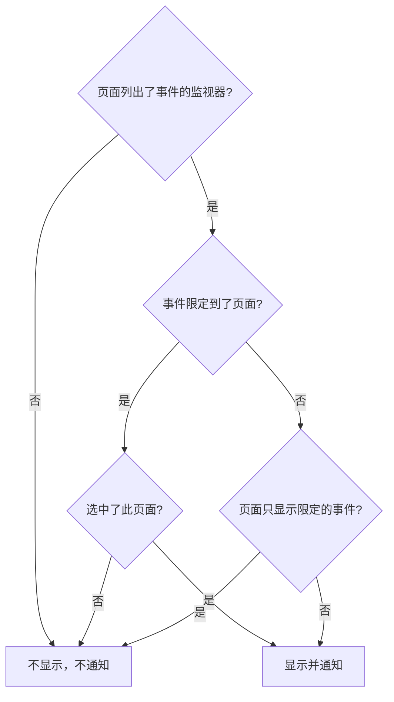

# 每个受众一个状态页

不同的人需要不同的消息。一个客户不想听到另一个客户的故障，一个站点的员工也不想在每次另一个站点断网时都收到一封邮件。在 OneUptime 中，受众的单位是状态页：每个状态页都有自己的订阅者、自己的品牌和自己的私密性。所以，给每个受众一个自己的页面，再逐个事件决定哪些页面会得知它。

过去，共享的基础设施让这件事很难做到。事件通过它的监视器到达状态页，所以一个由十个站点页面共享的监视器，会把一次只影响两个站点的故障告诉全部十个站点。唯一的变通办法是为每一种站点组合准备一个页面或一个监视器。本页介绍解决这个问题的设置：

- 事件上的 **仅限这些状态页面**，让它只在你挑选的页面上显示和通知。
- 状态页上的 **仅显示限定到此页面的事件**，让还没有人限定范围的事件在有人作出决定之前不会到达这些页面中的任何一个。这包括监视器、Slack、Microsoft Teams、API 或 AI 自行创建的事件。
- 一份记录，说明哪些页面已被告知事件已创建，这样之后添加的页面只会被告知一次，其他页面也不会被再次告知。
- 一份 **将通知** 摘要，在你声明事件或发布公开备注之前显示谁会得知这个事件，以及 **预览**，显示每个页面的订阅者将收到什么。

:::cards
- [进行设置](#为每个受众设置一个页面): 每个受众一个页面，以及让未限定范围的事件远离它们的开关。
- [限定事件](#把事件限定到状态页): 在声明时或之后挑选页面。
- [添加或移除页面](#添加和移除状态页): 添加的页面会告知谁，以及移除页面会撤回什么。
- [每条消息都带有什么](#每条消息都带有什么): 每个页面都会得到的值，以及它们会告诉每个受众什么。
:::

## 何时使用

- **托管服务提供商**：每个客户一个状态页，使用客户共享的监视器。
- **拥有多个站点、工厂或地区的组织**：每个都有需要告知的员工。
- **内部 IT**：每个部门或楼宇一个页面。

如果你的受众乐意自己选择，一个页面可能就够了：让订阅者挑选他们关心的资源（参见 [订阅者与公告](/docs/status-pages/subscribers)）。当你要替他们逐个事件作出选择，或者一个受众绝不能看到另一个受众的事件时，就为每个受众使用一个页面。

## 事件如何到达状态页

事件通过它的监视器到达状态页。当页面的某个资源是事件的某个监视器时（直接或通过页面上的监视器组），页面会显示该事件并就它通知订阅者。有两项设置可以缩小这个范围：

- 事件上的 **仅限这些状态页面**（`statusPages`）。留空时，事件会像以往一样到达列出其监视器的每个页面。选了页面后，它只会到达列出其监视器的页面 **当中** 被选中的那些。
- 状态页上的 **仅显示限定到此页面的事件**（`onlyShowScopedIncidents`，默认关闭）。打开后，页面绝不会显示没有限定到特定状态页的事件，也绝不会就它通知任何人。



对于列出了事件某个监视器的页面：

| 事件的情况 | **仅显示限定到此页面的事件** 关闭的页面 | 打开的页面 |
| --- | --- | --- |
| 没有限定到任何状态页 | 显示并通知 | 不显示，不通知 |
| 限定到状态页，并且选中了此页面 | 显示并通知 | 显示并通知 |
| 限定到状态页，但不是此页面 | 不显示，不通知 | 不显示，不通知 |

一个没有列出事件任何监视器的页面，无论你选择什么都不会显示它，而没有监视器的事件根本不会通知任何状态页订阅者。通常的规则仍然叠加适用：事件必须 **在状态页面上可见** 且不是私密的，页面必须打开 **显示事件**，只选择了部分资源或事件类型的订阅者只会收到他们所选的内容。

凡是取决于事件到达哪些页面的内容，都由同样的规则决定：

- 公开状态页上的事件列表、概览和事件自己的页面，以及状态页 [公共 API](/docs/status-pages/public-api)；
- 事件创建、状态变化、收到公开备注或收到事后分析时发送的电子邮件、短信、Slack、Microsoft Teams 和 Webhook 消息；
- 通过邮件发送的状态页报告中的事件数量，它只计算页面所显示的事件。

当事件片段的至少一个事件到达某个页面时，该片段就到达这个页面。它的通知会发到它的事件所到达的每个页面，而在它的事件都没有到达的状态页上，它的页面是找不到的。私密事件不会到达任何页面，所以它永远不会把它的片段带到某个页面上，而私密片段则根本不会在任何页面上显示。

## 为每个受众设置一个页面

:::steps
### 为每个受众创建一个状态页

为每个受众创建一个页面，例如 `Site 01` 到 `Site 10`。如果受众在内部，就把它们设为私密（参见 [限制谁能看到这个页面](/docs/status-pages/index#限制谁能看到这个页面)）。私密页面的订阅者仍然可以通过每条消息中的链接无需登录就取消订阅（参见 [管理和取消订阅](/docs/status-pages/subscribers#管理和取消订阅)）。给它们加上 `Region East` 之类的标签，这样选择器就可以一次点击添加带有某个标签的所有页面。

### 把共享监视器放到每个页面上

把共享监视器作为资源添加到每个页面（参见 [状态页资源与分组](/docs/status-pages/resources-and-groups)）。**资源 → Monitor Rules** 下的规则可以根据监视器的标签替你完成这件事。

### 打开“仅显示限定到此页面的事件”

在这些页面中的每一个上打开它。它位于 **状态页面 → 您的页面 → 高级 → 高级设置** 上的 **状态页显示的内容** 卡片中，在 **显示事件** 下方，切换后立即保存。从那以后，除非有人选中站点页面，否则不会有任何内容到达它。

### 添加每个受众的订阅者

对于员工，在 **电子邮件订阅者** 上使用 **批量添加**，并且优先使用每个人自己的地址，而不是像 `site03-all@` 这样的邮件列表：列表上的任何人都可以为列表上的所有人取消订阅。如果你添加的订阅者取消了订阅，页面的所有者和添加它的人会收到邮件（参见 [共享地址和邮件列表](/docs/status-pages/subscribers#共享地址和邮件列表)）。

### 让响应者能读取状态页

选择器只列出这个人能读取的状态页，而事件角色无法读取状态页。在响应者的事件角色之外，再给他们 **Status Page Viewer** 角色；它可以限定到带有特定标签的页面。没有它，选择器就是空的。

### 决定每条消息的内容

在 **事件 → 设置 → 自定义字段** 中，定义你的团队每次都要回答的事件自定义字段，例如 `Impact`（下拉列表）、`Expected Resolution`（日期和时间）和 `Acknowledgement`（是/否开关）。把它们拖成你希望询问和列出的 **顺序**，并打开 **创建时显示** 让声明表单询问它们，在必须回答的字段上打开 **创建时必填**，在每个受众都可以阅读的字段上打开 **包含在订阅者通知中**。这样它们就会出现在每个页面的默认邮件中。参见 [自定义字段](/docs/incidents/settings#自定义字段)。

### 为每个页面的邮件设置品牌（可选）

在 **Scale** 套餐上，为每个页面提供一个 **自定义 SMTP 配置**，并为事件的各类事件链接自定义模板；它们可以用 `{{incident.customFields.<key>}}` 放入任何字段。在你编写模板时，它下方的 **实时预览** 会显示用示例值填好的样子。参见 [自定义模板需要什么](/docs/status-pages/subscribers#自定义模板需要什么)，在使用 `{{affectedStatusPages}}` 之前，还请参见 [每条消息都带有什么](#每条消息都带有什么)。

### 保存选好页面的事件模板（可选）

一个 `Region East outage` 模板可以带上东部站点的页面，以及自定义字段的默认答案。

### 在第一次故障之前检查每个页面的邮件

选好共享监视器和两个站点页面后开始 **声明事件**，在提交之前的摘要中，打开 **是** 旁边的 **预览**：它会显示每个页面的订阅者会收到的邮件，以及它使用哪个模板、为什么使用。**发送测试邮件给我** 会把一封邮件发到你自己的收件箱。在你声明事件之前，不会向其他任何人发送任何内容，所以完成后不提交就离开表单即可。参见 [谁会收到通知](#谁会收到通知)。
:::

## 把事件限定到状态页

### 声明时

在 **事件 → 所有事件 → 声明事件** 上，**受影响的资源** 步骤在监视器和其他资源之后、**更多字段** 下有 **仅限这些状态页面**。它的占位符 **列出这些监视器的所有状态页面** 就是留空时的含义。按名称挑选页面，或者打开选择器的 **标签** 选项卡并挑选一个标签，以添加带有它的每个页面。

表单会在以下情况下警告你：

- 所选页面没有列出事件的任何监视器，或者根本没有关联监视器。事件不会在该页面上显示，也不会通知它的订阅者；
- 你还在同一步骤中监视器的正下方设置了 **将监视器状态更改为**。参见 [监视器状态是共享的](#监视器状态是共享的)；
- 你还勾选了 **事件详情** 步骤中 **更多字段** 下的 **私密事件**。私密事件会在所有状态页上隐藏，包括你选中的那些。

紧接在 **受影响的资源** 之后的 **详情** 步骤，会询问标记了 **创建时显示** 的事件自定义字段（参见 [声明事件](/docs/incidents/declaring-incidents)）。它的答案会发到事件到达的每个页面：自定义字段的值属于事件，而不属于某个状态页。

**从模板创建** 会根据模板填写这个字段。模板的页面在创建它时于它的 **受影响的资源** 步骤中设置，之后在它的 **状态页面范围** 卡片上设置（**事件 → 设置 → 事件模板**）。与其他模板字段一样，你自己设置的列表优先。即使响应者无法读取状态页，模板的页面也会被填入：设置模板的人已经为每个用它声明事件的人选好了这些页面。

### 谁会收到通知

在 **受影响的资源** 步骤中 **更多字段** 下、选择器正下方的 **通知状态页订阅者** 下面，以及在你提交之前的摘要中，表单会显示事件将到达谁：

> 将通知：
>
> - Site 03（最多 电子邮件 41 人）
> - Site 07（最多 电子邮件 18 人）

在它下面，**不通知：** 下列出那些列出了监视器但不会被告知的页面及原因：不是事件所限定的页面之一，是只显示限定到它的事件的页面，或者是不显示事件的页面。

当没有人会被告知时，摘要什么也不显示：事件没有监视器、没有状态页列出它们、页面还没有订阅者、**通知状态页订阅者** 已关闭，或者事件是私密的。只有当原因在于状态页范围时它才会发出警告，并写出它排除的页面：事件没有被限定，而列出其监视器的页面只显示限定到它们的事件；它被限定到了其他页面；或者它所限定的页面没有列出它的任何监视器。在摘要中，**通知状态页订阅者** 像其他每个复选框一样显示为 **是** 或 **否**，**是** 旁边有 **预览**；当复选框关闭、事件是私密的或没有关联监视器时，不会提供它。

当你在事件的 **公开备注** 页面上撰写备注时，针对事件当前的情况，**通知状态页订阅者** 下也会出现同样的摘要。在那里，当事件在状态页上隐藏时它也会说明，因为那时什么都不会发送。

这些数量是“最多”。它们按渠道统计每个页面已确认且未取消订阅的订阅者，而只选择了部分资源或事件类型的订阅者可能不会收到这条消息。你无法读取的页面不会写出名称。它们会被计为“另有 … 个您无权访问的状态页面”。

摘要中 **是** 旁边以及备注复选框旁边的 **预览**，会显示他们将收到什么：选择一个页面，即可看到它的订阅者将收到的邮件及其主题，以及它使用哪个模板、为什么使用，例如由于页面没有 **自定义 SMTP 配置**，页面的自定义模板不会被使用。**发送测试邮件给我** 会把该页面的邮件发送到你自己的账户邮箱，不会发给其他任何人。你无法读取的页面会被计数，但不会被预览。参见 [发送前预览邮件](/docs/status-pages/subscribers#发送前预览邮件)。

### 声明之后

打开事件并前往 **高级 → 设置**。**状态页面范围** 卡片列出事件所限定的页面，**编辑状态页面范围** 用于更改它们。事件的 **概览** 以只读方式把同一个列表显示为 **状态页面范围**，并带有一个 **在设置中更改** 链接。

在 **事件 → 所有事件** 上，**状态页** 筛选器可以找到限定到你所选页面的事件，或者没有限定到任何页面的事件。

### 通过 API

`statusPages` 是一个状态页 ID 列表，用于 `POST /api/incident` 和事件的更新，也用于事件模板。每个页面都必须属于事件所在的项目；另一个项目的页面会被拒绝。你添加的每个页面也必须是你能读取的，就像在选择器中一样，否则请求会被拒绝。无论你能否读取，事件或模板已有的页面都会保留，而你能读取的事件模板中的页面，可以在声明事件时选中。由此还会派生出两列，它们都不由你设置：

- `isScopedToStatusPages` 由 `statusPages` 计算得出。你为它发送的任何值都会被忽略。
- `statusPagesNotifiedOnCreation` 是已被告知事件已创建的页面的记录。参见 [添加状态页](#添加状态页)。

要在不发送任何内容的情况下查看事件会到达谁，请调用受众端点：

```bash
curl -X POST https://oneuptime.com/api/incident/subscriber-audience \
  -H "apikey: $ONEUPTIME_API_KEY" \
  -H "Content-Type: application/json" \
  -d '{
    "monitorIds": ["<monitor-id>"],
    "statusPageIds": ["<status-page-id>"]
  }'
```

对于已经存在的事件，改为发送 `{"incidentId": "<incident-id>"}`。回答会列出每个将收到通知的页面以及每个渠道的数量（`email`、`sms`、`slack`、`microsoftTeams`、`webhook`）、被排除的页面及原因，以及调用方无法读取的页面数 `hiddenStatusPageCount`。它从不返回地址。

## 还没有人限定范围的事件

监视器条件、Slack、Microsoft Teams、API 和 AI 都可以自行创建事件，而它们都不知道共享监视器上的故障影响了哪些站点。这样的事件没有限定到任何页面，所以每个列出该监视器的页面都会在大约一分钟内显示它，并通知它的订阅者。一封邮件一旦发给了订阅者，就无法收回。

**仅显示限定到此页面的事件** 就是用来阻止这种情况的。打开了它的页面会忽略每一个未限定范围的事件。事件仍然会被创建，值班策略仍然会呼叫响应者，它的所有者仍然会收到通知，但这些页面都不会得知它。然后，响应者弄清楚受影响的是谁，在事件的 **设置** 选项卡上添加这些页面，并勾选 **向新添加的页面发送事件创建通知**。它们的订阅者会在大约一分钟内收到通知。

## 添加和移除状态页

### 添加状态页

一个页面的订阅者只会被告知一次事件已创建。所以当你在 **状态页面范围** 卡片上添加页面时，编辑表单会提供 **向新添加的页面发送事件创建通知**，默认勾选：

- 勾选时，事件的“已创建”通知会再次排队，并且只发给尚未被告知的页面。事件保存着已被告知页面的记录，所以其他页面不会听到两次。
- 不勾选时，添加的页面开始显示该事件，并会得知此后的一切，但不会被告知它已创建。

只有当勾选它会发送一些内容时，复选框才会出现：你添加的页面中至少有一个尚未被告知，并且事件在声明时打开了 **通知状态页订阅者**、在状态页上可见且不是私密的。有些情况会自动为你处理：

- **通知仍在排队，或者此刻正在发送。** 排队的发送会在发出时读取页面，正在运行的发送会在完成时再次读取页面，然后告知这期间添加的页面。所以没有复选框：你添加的页面无论如何都会被告知。（如果那次发送失败，这期间添加的页面会包含在它的 **重试** 所发送的页面中。）
- **你添加的每个页面都已经被告知过。** 例如你移除后又重新添加的页面，或者一个曾到达所有站点、现在缩小到其中两个站点的事件。没有人会被再次告知，所以没有复选框。
- **事件从未被通告过。** 当它在发布时没有 **通知订阅者此事件已创建**，或者在声明时没有监视器，就没有人被告知过。勾选复选框只会告知你添加的页面，而不会告知它原本就限定到的页面。
- **事件是在这项功能发布之前声明的。** 它的“已创建”通知已发给列出其监视器的每个页面，并且没有这些页面的记录。添加页面不会再次发送它，所以不提供复选框。
- **事件处于隐藏状态。** 隐藏期间不会发送任何内容。当你重新打开 **在状态页面上可见** 时，**事件设置** 卡片会为其范围内从未被告知的页面（例如在它隐藏期间添加的页面）提供 **通知订阅者此事件已创建**。

之后添加的页面会得知接下来发生的事情：之后的公开备注、状态变化和事后分析。在它被添加之前发出的备注和状态变化不会发给它。如果它需要补上进度，请发布一条公开备注。

同一份记录让失败的“已创建”通知上的 **重试** 从它中止的地方继续：已经被告知的页面会被跳过。只有当一个页面的每个订阅者都收到了消息时，这个页面才算已被告知；有消息失败的页面，或发送中途停止的页面，会重新完整地发送一遍。每个页面完成时都会写入记录，所以即使是被中断的发送也是如此。记录是按页面保存的，而不是按订阅者：在发送中途停止的页面上，已经收到消息的订阅者会收到第二次。

如果想改为从头开始，例如在修正了模板或 SMTP 设置之后，请在 **重试** 确认中勾选 **再次发送到每个状态页面，包括已送达的页面**：按钮会变为 **重新发送到所有页面**，记录会被清空，事件现在到达的每个页面都会再次收到它。在一条完整发出的通知之后，事件 **概览** 上的 **订阅者通知状态** 会提供 **重新发送**，它做同样的事。两个确认都会列出它现在会到达的页面，或者说明它不会到达任何人；普通的 **重试** 确认会把已经到达的页面列为不会再次发送，因为它会跳过它们。对于被跳过的通知，或者仍在排队或正在发送的通知，两者都不会提供，对于无权编辑事件的人也不会提供。

通过 API，在更改 `statusPages` 的更新中发送 `"miscDataProps": {"notifyAddedStatusPagesOfIncidentCreated": true}`。你自己把 `subscriberNotificationStatusOnIncidentCreated` 设回 `Pending`，仍然会像以往一样把“已创建”通知重新发送到事件到达的每个页面：记录会随之清空。在失败之后，它会改为从失败的发送中止的地方继续。要在失败之后也发送到每个页面，请在那次更新中加上 `"miscDataProps": {"resendIncidentCreatedToAllStatusPages": true}`。对于被跳过的通知，或者正在排队或发送的通知，该请求会被拒绝。

写入 `shouldStatusPageSubscribersBeNotifiedOnIncidentCreated` 不属于以上任何一种。它在声明事件时选择，之后没有任何项目角色可以通过 API 更改它。以系统身份写入的工作流和实例的主管理员可以更改，但那只会保存新值。像复制整个事件的工作流那样原样写回，不会再次发送任何内容，之后再打开它，也不会发送事件在声明时没有发送的“已创建”通知。在那条通知发出之前关闭它，通知就会被跳过。

### 移除状态页

移除页面不会撤回任何内容。该页面停止显示事件，它的订阅者也不会再听到关于它的任何消息，甚至不会得知它已解决。当你移除一个已经被告知过该事件的页面时，编辑表单会警告你，并建议发布一条收尾的公开备注。请先在页面仍在列表中时发布这条备注，然后再移除页面。

清空整个列表与移除页面不同：那样事件就根本不受限定了。它会再次在列出其监视器的每个页面上显示并通知，只显示限定到它们的事件的页面除外。表单也会就此警告你。

### 所选状态页被删除时

删除一个状态页，会把它从每个限定到它的事件中移除。所选页面全部被删除的事件仍然保持限定，只是限定到了空集：它会在每个状态页上隐藏，而不是在列出其监视器的每个页面上显示。**状态页面范围** 卡片会说明这一点。要再次显示它，请选择其他页面，或清空列表。

事件模板的工作方式相同。页面全部被删除的模板仍然保持限定：由 [表单](/docs/forms/on-submit#事件模板) 或工作流的 **Create One Incident** 步骤根据它声明的事件会在每个状态页上隐藏，模板的 **状态页面范围** 卡片会警告你，**声明事件** 开始时不会选中任何页面，并要求你选择事件所针对的页面。在模板上选择其他页面，或者以空列表保存它，即可停止限定由它声明的事件。

## 一人一封邮件

对于限定到特定状态页的事件，在其中多个页面上订阅的电子邮件地址或电话号码，每次发送只会收到一封邮件或一条短信，而不是每个页面一封。页面按名称顺序处理，所以这个人收到的是第一个页面的模板、品牌和取消订阅链接。

Webhook、Slack 和 Microsoft Teams 消息从不合并。它们的负载写明了所针对的状态页，按页面监听的集成必须看到每一个页面。

这只在一次发送之内适用。一个同时订阅了 `Site 03` 和 `Site 05`、并通过 `Site 03` 收到“已创建”邮件的人，在之后添加 `Site 05` 时会再次收到它。没有限定到任何页面的事件，会像以往一样为每个订阅发送一条消息。

## 每条消息都带有什么

事件到达的每个页面都会得到相同的值：它们属于事件，而不属于某个状态页。

- **默认消息中的自定义字段。** 打开了 **包含在订阅者通知中** 的事件自定义字段，会按它们的 **顺序** 列在每个页面的创建、状态变化、公开备注和事后分析消息中：电子邮件、Slack、Microsoft Teams 和 Webhook，但不包括短信。这既不需要 Scale 套餐，也不需要自定义 SMTP。参见 [通知中的事件自定义字段](/docs/status-pages/subscribers#通知中的事件自定义字段)。
- **更新。** 单独更改一个自定义字段不会告知任何人。下一条公开备注或状态变化会带上当前的值，所以要告诉各站点 `Expected Resolution` 变了，请先更改字段，再发布一条公开备注。
- **备注模板。** 选择一个备注模板，会用事件的当前值填入 `{{incident.title}}` 和 `{{incident.customFields.<key>}}` 等占位符，你仍然可以在发布之前编辑备注。参见 [备注模板](/docs/incidents/settings#备注模板)。
- **其他受众的名称。** 自定义订阅者模板中的 `{{affectedStatusPages}}`，以及备注模板中的 `{{incident.affectedStatusPages}}`，会列出事件到达的页面，消息发往的每个人都会读到这个列表：`Site 03` 的订阅者会得知 `Site 07` 也受到了影响。在同一个组织的站点之间，这可能正是你想要的。在客户之间，它会把一个客户告诉另一个客户，所以请把两者都从这些页面所收到的模板和备注中去掉。

## 与计划维护的区别

计划维护事件也有一个 **状态页面** 列表，但它的工作方式不同：

- **计划维护是替换。** 事件只会显示在它列表中的页面上，无论这些页面是否列出了它的监视器。
- **事件是缩小。** 它的列表只能在已经列出其监视器的页面中进行选择。选择一个没有列出任何监视器的页面不会产生任何效果，表单也会这样提示。请先把监视器放到那个页面上。

这可以防止一次误选把事件放到一个完全关于其他内容的页面上。这也意味着，没有监视器的事件无论你选多少个页面，都不会到达任何状态页。

## 监视器状态是共享的

一个监视器只有一个状态，列出该监视器的每个状态页都会显示它。限定事件不会改变这一点。如果事件设置了 **将监视器状态更改为**，或者监视器自己宕机了，那么在列出它的每个页面上监视器都会变红，包括事件没有限定到的页面，以及只显示限定到它们的事件的页面。当你把状态变化和所选页面结合使用时，声明表单会警告你。

**当每个站点都需要自己的状态时，为每个站点配置一个手动监控。** 为每个站点创建一个 [手动监控](/docs/monitor/manual-monitor)，例如 `Site 03 network`，并只在该站点的页面上列出它。把受影响站点的手动监控关联到事件上，如果你希望它们的状态改变，就设置 **将监视器状态更改为**，并把共享监视器留给应该看到它的页面。这样事件就只会到达带有其监视器的站点，状态变化也只会显示在它们的页面上。

## 记录了什么

- **事件信息流。** 限定事件的“已创建”条目会列出它所限定的页面。对列表的每次更改都会添加一条条目，列出添加和移除的页面，以及添加的页面是否会收到“已创建”通知。
- **每条订阅者通知。** 事件信息流中的 **订阅者通知已发送** 条目有一个 **More Information** 面板，列出这次发送所到达的每个页面：每个渠道上发送了多少条、失败了多少条，以及它的邮件所用的主题。它还列出它跳过的页面及原因（已经被告知，或不显示事件）、被范围排除的页面，以及电子邮件和短信是否按地址只发送了一次。当这次发送把自定义字段的值放进了消息时，面板的最后会在 **Custom fields sent** 下列出它们。
- **通知的状态。** 每条通知的状态消息会说明每个页面上每个渠道发送了多少条、失败了多少条，并在失败之后说明 **重试** 会做什么。因服务器重启或停止响应而中途被中断的发送，会被标记为失败，并附上一条以 `Interrupted:` 开头的消息，而不是一直处于进行中。参见 [检查发送了什么](/docs/status-pages/subscribers#检查发送了什么)。
- 每个状态页上的 **通知日志** 显示该页面发送的每一条消息。

关于信息流本身，参见 [事件备注、负责人与动态](/docs/incidents/notes-owners-and-feed)。

## 权限

- **选择一个状态页需要对它的读取权限。** 状态页是在状态页角色下读取的，而不是事件角色，并且状态页可以按标签进行限制。给响应者 **Status Page Viewer**，如果你愿意，可以限定到某些标签。没有它，选择器就是空的，API 也会拒绝调用方无法读取的页面，无论是在事件上还是在事件模板上。
- **编辑者看不到的页面会被保留。** 只能读取事件部分页面的编辑者，在选择器中只能看到那些页面，保存时会保留他们看不到的页面。
- **事件所限定的页面是事件的一部分。** 就像它的监视器一样，任何能读取该事件的人，无论能否读取那些状态页，都能在 **状态页面范围** 卡片、概览和事件信息流中看到它们的名称。
- **一次发送到达了哪里，也是事件的一部分。** 一旦通知发出，它的状态消息和信息流条目就会写出它所发往的每个状态页，以及每个页面上发送了什么、失败了什么，任何能读取该事件的人，无论能否读取那些状态页，都能看到它们。只有下面这两个用于预先查看的摘要和预览，才只限于这个人能读取的页面。
- **受众摘要** 对可以声明或编辑事件、或在事件上发布公开备注的角色开放。它只写出这个人能读取的页面的名称。事件将通知的其他页面会被计为“另有 … 个您无权访问的状态页面”，并且它从不显示地址。
- **预览** 对同样的角色开放，只预览这个人能读取的页面，每十分钟最多六十次。和摘要一样，它从不显示地址。**发送测试邮件给我** 只发送到这个人自己的账户邮箱，而且要在该邮箱验证之后，每 15 分钟最多十次。
- **再次发送通知**，对于事件的“已创建”通知，需要编辑事件的权限；对于备注，需要编辑公开备注的权限和发布会通知订阅者的公开备注的权限这两者，告知订阅者备注有编辑时也是如此。在该通知正在发送时，这些操作都不会被接受。

## 升级自托管服务器

让事件留在它所限定的页面上的，是发送订阅者通知的工作进程。在升级到带有此功能的版本的发布过程中，仍处于旧版本的工作进程会像以往一样发送它取到的通知：发给列出事件监视器的每个状态页，包括只显示限定到它们的事件的页面。所以，请在任何人把事件限定到状态页或打开 **仅显示限定到此页面的事件** 之前，等待工作进程的部署全部完成，或者把旧的工作进程缩容到零。使用 Helm 时，`migrate.hook: true` 还会在任何新 Pod 启动之前运行数据库迁移。

## 后续步骤

:::cards
- [订阅者与公告](/docs/status-pages/subscribers): 订阅者渠道，以及每种事件会发送什么。
- [声明事件](/docs/incidents/declaring-incidents): 声明表单，一步一步来。
- [事件状态与严重级别](/docs/incidents/states-and-severities): 还有什么会让事件不出现在状态页上。
- [手动监控](/docs/monitor/manual-monitor): 由你自己设置状态的监视器。
:::
