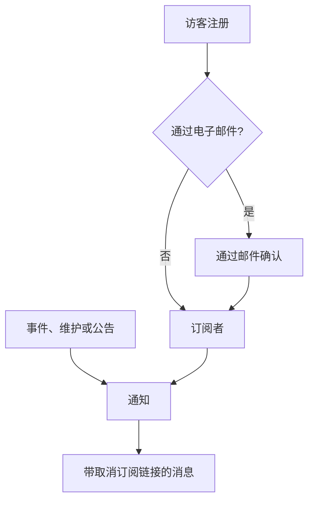

# 订阅者与公告

状态页是人们会去查看的地方。订阅者则是那些宁愿不必去查看的人：他们只需提供一次电子邮件地址、电话号码、Slack Webhook 或 HTTP 端点，之后你的更新就会主动送到他们面前。

公告是同一项工作的另一半。监视器可以告诉访客结账正在返回 500 错误；但没有哪个监视器能告诉他们你周六要迁移数据库、某个第三方提供商今天状况不佳，或者他们昨天读到的那个事件已经彻底结束。公告是用于传达所有检查看不到的事情的自由文本渠道，并且会分发到同一个订阅者列表。

本页涵盖这两部分：五个订阅渠道以及访客如何注册，订阅者可以选择接收哪些内容，双重确认和取消订阅的流程，订阅者每月可以收到的邮件报告，以及如何撰写、安排公告并为其制作模板。

:::cards
- [订阅渠道](#订阅渠道): 访客可以注册的渠道，以及他们注册的页面。
- [订阅者会收到什么](#订阅者会收到哪些通知): 公告、维护、事件和片段，以及对它们的编辑。
- [检查发送了什么](#检查发送了什么): 每条通知的状态，以及重试和重新发送。
- [公告](#公告): 向一个或多个状态页发布通知。
:::

## 工作原理



每个状态页都有自己的订阅者。访客在页面的 **订阅** 页面上注册，电子邮件地址在收到任何内容之前要先通过链接确认；或者由你的团队在仪表板上添加。从那以后，每个到达该页面的事件、计划维护事件和公告都会通知它的订阅者，各自通过他们注册时使用的渠道，并且每条消息都带有取消订阅的链接。

## 订阅渠道

状态页支持五个渠道。这些渠道以及访客注册所用的页面，都在一个地方开关：**状态页面 → 您的页面 → 订阅者 → 订阅者设置** 上的 **渠道** 卡片。每个开关在你切换时立即保存：

- **显示订阅者页面**（`showSubscriberPageOnStatusPage`）：默认打开。在状态页的导航栏中放置 **订阅** 项，访客在那里通过下面的渠道注册。
- **电子邮件**（`enableEmailSubscribers`）：默认打开。其他渠道在你打开之前都是关闭的。
- **SMS**（`enableSmsSubscribers`）：默认关闭。在 OneUptime Cloud 上，每条短信都从项目的短信和通话余额中支付，除非页面有自己的 **Twilio 配置**（参见[下文](#邮件页脚自定义-smtp-和-twilio)）。要打开它，还需要在 **项目设置 > 通知 > 通知设置** 的 **通知渠道** 卡片中为项目打开 **SMS**，项目所有者、**Billing Admin** 或拥有 **Manage Billing** 的人可以这样做。
- **Slack**（`enableSlackSubscribers`）：默认关闭。
- **Microsoft Teams**（`enableMicrosoftTeamsSubscribers`）：默认关闭。
- **Webhook**（`enableWebhookSubscribers`）：默认关闭。

这些开关决定访客可以如何自行注册，状态页会拒绝通过已关闭的渠道注册。它们不会阻止通知：你的团队在仪表板上、通过 API 或通过工作流添加的订阅者，无论哪些渠道打开，都会收到更新。

在 OneUptime Cloud 上，你的套餐不包含的开关旁边会显示套餐名称：**SMS** 和 **显示订阅者页面** 需要 **Growth**，**Slack**、**Microsoft Teams** 和 **Webhook** 需要 **Scale**。关闭渠道在所有套餐上都可用，所以试用期间打开的渠道随时都可以再次关闭；开关下方会说明这一点。

每个渠道在状态页侧边菜单的 **订阅者** 下也有自己的列表：**电子邮件订阅者**、**SMS 订阅者**、**Slack 订阅者**、**MS Teams 订阅者** 和 **Webhook 订阅者**。你可以在那里查看谁已注册、手动添加某人，或者为某个订阅者给自己留一条 **备注**（`internalNote`）。渠道关闭期间，列表顶部会说明这一点，渠道的开关就在旁边，所以无需离开列表就能打开它。

**一个开关是不够的。** 只有当 **显示订阅者页面** 打开 *并且* 至少有一个渠道打开时，状态页导航栏中的 **订阅** 项才会出现。如果你打开了 **电子邮件**，却让 **显示订阅者页面** 保持关闭，访客就无法到达表单。

## 访客在订阅页面上看到什么

**订阅** 页面有一个子菜单，每个已启用的渠道一个选项卡。每个选项卡只要求它需要的最少信息：

| 选项卡 | 地址 | 标题 | 要求填写的内容 |
| --- | --- | --- | --- |
| **电子邮件** | `/subscribe/email` | **通过电子邮件订阅** | **您的电子邮件**，占位符为 `subscriber@company.com`。 |
| **短信** | `/subscribe/sms` | **通过短信订阅** | **您的电话号码**，占位符为 `+11234567890`。 |
| **Slack** | `/subscribe/slack` | **通过 Slack 订阅** | **Slack 工作区名称**（用于验证）和 **Slack 传入 Webhook URL**，占位符为 `https://hooks.slack.com/services/...`。 |
| **MS Teams** | `/subscribe/microsoft-teams` | **通过 Microsoft Teams 订阅** | **Microsoft Teams 工作区名称** 和 **Microsoft Teams 传入 Webhook URL**，占位符为 `https://outlook.office.com/webhook/...`。 |
| **Webhook** | `/subscribe/webhooks` | **通过 Webhook 订阅** | **Webhook URL**，占位符为 `https://example.com/webhook`。每个状态页事件都会向它发送一个 JSON `POST` 请求。 |

提交按钮上写着 **订阅**。通过短信、Slack、Microsoft Teams 或 Webhook 注册后会显示 *您已成功订阅。* 通过电子邮件注册后，会提示确认链接已发送，如果没有收到请检查垃圾邮件文件夹（参见 [电子邮件的双重确认](#电子邮件的双重确认)）。**电子邮件**、**短信**、**Slack** 和 **MS Teams** 选项卡还带有 **新订阅** / **管理现有订阅** 的切换，这样已经订阅的人无需翻找旧消息就能回到自己的偏好设置。

## 让订阅者自己选资源和事件类型

默认情况下，订阅者会收到页面上的所有内容。**高级订阅者设置** 卡片中的两个开关可以改变这一点：

- **允许订阅者选择资源**（`allowSubscribersToChooseResources`）：默认关闭。打开后，订阅表单会多出一个 **订阅所有资源** 开关；取消勾选它，就会出现 **选择要订阅的资源**，让访客挑选单个资源。
- **允许订阅者选择事件类型**（`allowSubscribersToChooseEventTypes`）：默认关闭。形式相同：一个 **订阅所有事件类型** 开关，取消勾选时下方会出现 **选择要订阅的事件类型**。

无论打开其中哪一个，订阅表单仍然只有一页。在更新的发送位置（电子邮件地址、电话号码、工作区或 Webhook）下方是 **偏好设置**，它折叠成一行，说明访客将收到什么。所有资源和所有类型的事件都已预先选中，所以它一开始显示“您将收到此状态页的所有更新。”，想要接收所有内容的访客无需展开它就可以直接按 **订阅**。其他人则展开 **偏好设置**，缩小资源或事件类型的范围；再次折叠后，这一行会随所选内容变化（“您将仅收到所选资源的更新。”）。两者都关闭时，就没有 **偏好设置**：表单只有更新的发送位置，然后是 **订阅**。

**更新订阅** 页面（见下文）会以展开的形式显示相同的选项，因为订阅者去那里正是为了更改它们。

事件类型有 `Incident`、`Announcement` 和 `Scheduled Event`。

**监视器组代表其中的每个监视器。** 页面上的资源要么是监视器，要么是监视器组。选择了某个监视器组的订阅者，会收到该组中任何监视器的事件、计划维护事件（包括其备注）和公告的通知，就像他们选择了那个监视器一样，状态页也是这样显示它们的。只选择了其他资源的人不会收到通知；同时选择了某个监视器和包含它的组的人，只会收到一条通知，而不是两条。

这些选择记录在订阅者记录上，分别为 **Is Subscribed to All Resources**（`isSubscribedToAllResources`，默认 true）、**Is Subscribed to All Event Types**（`isSubscribedToAllEventTypes`，默认 true）、**Subscribed to Resources** 和 **Subscribed to Event Types**。

**订阅者只能在自己页面的资源中选择。** 无论由谁写入，**Subscribed to Resources** 指向的都是订阅者自己所在状态页的资源：页面上的访客、仪表板上的队友、API 密钥或工作流。访客从页面向他们展示的内容中选择，所以监视器已归档、因而被页面隐藏的资源是无法选择的。另一个状态页的资源，或页面对访客隐藏的资源，会像不匹配任何内容的 ID 一样，被一个指出字段和 ID 的 `400` 拒绝。更改只检查它所添加的资源，所以订阅会保留它已经指向的资源，例如在被选中之后其监视器才被归档的资源。订阅者只会通过自己页面的资源收到某个事件的通知。

适用场景：一个涵盖多个产品的页面。只使用你的 API 的客户，不希望每次营销网站出现波动时都收到通知；与其眼看着他们彻底取消订阅，不如让他们自己缩小列表。

同一张卡片还包含 **订阅者时区**。

## 电子邮件的双重确认

电子邮件订阅者总是需要确认。当使用电子邮件地址创建订阅者、并且创建时不是已确认状态时，**Is Subscription Confirmed**（`isSubscriptionConfirmed`）会被强制设为 `false`，并生成一个六位数的 **Subscription Confirmation Token**。然后 OneUptime 会发送一个确认链接，形如 `{statusPageUrl}/confirm-subscription/{statusPageSubscriberId}?verification-token={token}`。访客会进入 **确认订阅** 页面，确认完成后会看到 *订阅确认成功*。

短信、Slack、Microsoft Teams 和 Webhook 订阅者会跳过这一步：它们在创建时 `isSubscriptionConfirmed` 就已设为 `true`。你的团队在 **电子邮件订阅者** 上添加的电子邮件订阅者也是如此：那里的 **不发送确认链接** 默认打开。关闭它，该地址就会像自行注册一样进行确认。

**未确认就意味着收不到消息。** 为通知获取订阅者的查询会按 `isUnsubscribed: false` 和 `isSubscriptionConfirmed: true` 筛选。从未点击链接的电子邮件地址会留在你的 **电子邮件订阅者** 列表中，却什么也收不到。如果有人坚称自己已经订阅却什么都没收到，先检查这一列。

没有关闭电子邮件确认的开关：对于通过状态页注册的任何人，它都是无条件的。另一个按订阅者设置的列 **Send You Have Subscribed Message**（`sendYouHaveSubscribedMessage`，默认 true）控制订阅者确认后发出的“你已订阅”邮件。

## 管理和取消订阅

订阅者收到的每条消息都带有一个取消订阅链接，形如 `{statusPageUrl}/unsubscribe/{statusPageSubscriberId}-{token}`：位于邮件底部、短信或 Slack 或 Microsoft Teams 消息的正文中，以及 Webhook 负载中的 `unsubscribeUrl`。令牌是属于这一个订阅的随机密钥，所以该链接无需登录即可使用。私密状态页也是如此，尽管那里其他一切都需要已登录的访客。

唯一的例外是来自 **public** 状态页的短信，它带的是订阅者的 **更新订阅** 链接（见下文）。该页面在公开状态页上无需登录即可使用，而且它的链接短 57 个字符。短信按每 160 个字符的分段计费，所以较长的链接会让大多数默认短信多出一个分段。自定义短信模板中的 `{{unsubscribeUrl}}` 遵循同样的规则。来自私密状态页的短信带的是取消订阅链接。

短信日志（状态页和项目设置中 **通知日志** 的 **SMS** 选项卡）保存每条短信的文本，能读取它的项目成员比能管理订阅者的人更多。所以日志显示的取消订阅链接中，令牌被替换为 `[redacted]`，例如 `{statusPageUrl}/unsubscribe/{statusPageSubscriberId}-[redacted]`。只有订阅者自己的手机会收到可用的链接。API 也从不返回新订阅者的令牌，即使在创建它的请求的响应中也不会。

**打开链接不会改变任何东西。** 页面会显示状态页的名称和徽标，以及链接所属的订阅：完整的电子邮件地址、只显示后四位的电话号码、Slack 或 Microsoft Teams 工作区名称，或者 Webhook 的主机。它会询问 *您要停止接收此状态页的通知吗？* 只有按下 **取消订阅** 才会取消订阅，所以会打开消息中每个链接的邮件扫描器和链接预览器无法取消任何人的订阅。页面上不会显示其他任何内容，其中的自定义 JavaScript 也不会运行。确认两次，或者打开一个已经取消的订阅的链接，只会显示它已被取消。在公开状态页上，取消订阅页面还会链接到订阅者的 **更新订阅** 页面，以便改为选择要接收哪些通知。

**更新订阅** 页面 `{statusPageUrl}/update-subscription/{statusPageSubscriberId}` 的标题是 **更新订阅**，并告诉访客可以在那里更新偏好设置或取消订阅。它包含：

- 页面允许的任何资源和事件类型选择器。
- 一个 **取消订阅** 开关，说明为取消订阅所有资源。它写入 **已取消订阅**（`isUnsubscribed`，默认 false）。
- 一个写着 **更新订阅** 的提交按钮；保存后显示 *您的更改已保存。*

在私密状态页上，它和页面的其他部分一样需要已登录的访客。丢失了链接的人可以在 **订阅** 页面上使用 **管理现有订阅**，然后按 **发送管理链接**。链接会发送到订阅本身（它的电子邮件地址、电话号码，或者它的 Slack 或 Microsoft Teams 频道），绝不会发送到请求中的地址，而且无论是否匹配到订阅，页面的回答都相同，所以无法用它来查出谁订阅了。该消息链接到 **更新订阅** 页面，并把两个链接都交给自定义模板：`manageSubscriptionUrl` 和 `unsubscribeUrl`。

支撑这一切的端点是 `POST .../subscribe/:statusPageId`、`POST .../manage-subscription/:statusPageId`、`POST .../get-subscription/:statusPageId/:subscriberId`、`PUT .../update-subscription/:statusPageId/:subscriberId`，以及 `GET` 和 `POST .../unsubscribe/:statusPageId/:subscriberId/:token`。取消订阅的 `GET` 只描述链接。`POST` 无论请求体是什么都会取消订阅，包括一键取消订阅请求的 `List-Unsubscribe=One-Click` 请求体。对于错误的令牌、已删除的订阅者和另一个状态页的订阅者，两者给出的回答都相同，所以无法用它们来查出谁订阅了。

取消订阅是翻转一个标志，而不是删除一行，所以记录会以设置了 **已取消订阅** 的状态留在渠道列表中，这在你之后需要解释某个地址为什么不再收到邮件时很有用。无论是谁取消了订阅（订阅者通过链接或 **更新订阅** 页面，或者队友在仪表板上或通过 API），它还会记录 **取消订阅于**（`unsubscribedAt`）。每个订阅者列表都有一个 **取消订阅于** 列和筛选器。再次关闭 **已取消订阅** 会清除它。在 OneUptime 开始记录这一点之前取消的订阅没有日期。

在取消订阅页面出现之前发送的消息中的链接仍然可用：**更新订阅** 链接仍然会打开那个页面。很旧的消息中带有 `/api/status-page-subscriber/unsubscribe/{statusPageSubscriberId}`，它过去一打开就会取消订阅。现在它不再改变任何东西：它会进入取消订阅页面，页面会说明该链接已过时，请使用最近一条消息中的链接。

### 共享地址和邮件列表

任何能读取某个邮箱的人都可以取消它的订阅。对于某人自己注册的地址，这正是目的所在。对于你的团队添加的地址，例如像 `site03-all@` 这样的站点邮件列表，这意味着一个读者就可以在下一次故障之前，把列表上的所有人从页面上移除。所以：

- **尽可能用每个人自己的地址添加他们。** **批量添加** 表单和电子邮件订阅者表单在电子邮件字段的说明中都这样提示。
- **团队会得到通知。** 你的团队添加的订阅者，是指从仪表板、用 API 密钥（REST API、Terraform、脚本）或由工作流添加的订阅者；API 把它读作 **Is Added By Team**（`isAddedByTeam`）。当这样的订阅者通过链接或 **更新订阅** 页面取消订阅时，状态页的每个所有者（所有者用户以及所有者团队的成员）都会收到一封邮件，其中写明该订阅者，并附有指向页面订阅者列表的链接。如果是队友添加的，添加它的队友也会收到。没有所有者的页面只会给那位队友发邮件，所以 API 密钥或工作流添加到没有所有者的页面上的订阅者不会被报告。在状态页上自行注册的人永远不会被报告。在 OneUptime 开始记录这一点之前由 API 密钥或工作流添加的订阅者，无法与自行注册的人区分开，因此也不会被报告。
- **订阅者列表会显示出来。** 每个列表上方都有一条通知，列出你的团队添加的、在过去 30 天内取消订阅的订阅者。

取消订阅页面会在这类订阅的读者确认之前警告他们：如果这是一个共享地址，取消订阅会停止发给所有接收者的通知，并且团队会得到通知。

## 订阅者会收到哪些通知

订阅者会收到上述三种事件类型的通知，但每个来源都有自己的开关，所以不会意外发送任何内容。

### 公告通知

公告本身带有 **Should subscribers be notified?**（`shouldStatusPageSubscribersBeNotified`），在创建表单中显示为 **计划与通知** 下的 **通知状态页订阅者** 复选框，默认打开。订阅者只在公告开始显示时收到一次通知，所以这一点在创建公告时决定；编辑无法更改它。之后写入它的工作流只会保存它：原样写回绝不会再次发送公告，打开它不会发送，在通知发出之前关闭它会跳过该通知。如果公告在 **受影响的监视器** 下指定了监视器，通知的范围就限定于这些监视器：在订阅者可以选择资源的页面上，它会发给这些监视器的订阅者、包含它们的监视器组的订阅者，以及所有资源的订阅者。留空则通知所有订阅者。在一个既不直接列出、也不通过组列出这些监视器的状态页上，公告是写给阅读该页面的所有人的，所以该页面上所有接收公告的订阅者都会收到通知。

### 计划维护事件

计划维护事件有自己的一组订阅者列：**Should subscribers be notified when event is created?**、**Should subscribers be notified when event is changed to ongoing?**、**Should subscribers be notified when event is changed to ended?**，以及用于提前提醒的 **Subscriber notifications before the event** 和 **Next subscriber notification before the event at?**。事件上的 **状态页面** 决定它出现在哪些页面上，**Should be visible on status page?** 决定它是否出现。

**创建计划维护事件** 和 **声明事件** 一样，先走两个步骤，然后是检查：

1. **事件**：**标题**、**描述**、**开始** 和 **结束**。新事件从你的时钟上的下一个整点开始，持续一小时；只有在时间不对时才需要更改。移动 **开始** 时 **结束** 会随之移动，所以时间窗口的长度保持不变，而且事件必须在开始之后结束。**所有者** 和 **标签** 在 **更多字段** 下。
2. **受影响的资源**：先是 **监视器**，选好监视器后，其正下方会出现 **将监视器状态更改为**：事件开始时，这些监视器会变为该状态，结束时恢复为正常运行。然后是 **其他受影响的资源**：维护涉及的主机、集群、容器主机、数据库、IoT 设备群、网络站点和服务。然后是 **在这些状态页上显示事件**，然后是 **订阅者通知**，它折叠成一行，说明将会发生什么。默认显示“事件的状态页订阅者会在其安排时、开始时和结束时收到通知。”展开它可以更改 **事件安排时**、**事件开始时**、**事件结束时** 和 **事件前提醒**；这一行会随你的勾选变化，检查步骤中也会显示它。

从主机、Kubernetes、Proxmox、Ceph 或 Docker Swarm 集群、Docker 或 Podman 主机、vCenter、存储阵列、IoT 设备群、数据库、服务或网络站点的 **计划维护** 选项卡打开 **创建计划维护事件**（以及 **从模板创建**），会打开同一个表单，并在 **其他受影响的资源** 下预先选好该资源，面包屑导航会返回那个选项卡。清单项的 **计划维护** 选项卡会选中该项指向的主机、服务或 Kubernetes 集群，面包屑导航会经由那个资源的选项卡返回。

只有标题需要输入：其他一切都有默认值，所以 **下一步** 会直接走完其他步骤而不要求填写任何内容，最后的检查上有 **创建计划维护事件**。在你选择状态页之前，不会通知任何人。三个 **事件…时** 设置在创建事件时选择，之后写入 **事件安排时** 的工作流只会保存它：原样写回或打开它都不会发送任何内容，在“已安排”通知发出之前关闭它，该通知会被跳过。事件的 **Maintenance Details** 卡片上的 **编辑** 按钮用于更改其标题、时间窗口和标签（**事件**），以及其状态页和提醒（**状态页面**）。其 **受影响的资源** 卡片上的 **编辑** 按钮与表单的询问方式相同：**监视器**，有监视器时是 **将监视器状态更改为**，然后是 **其他受影响的资源**，卡片会在监视器下方显示该状态。能编辑事件的人可以在事件开始之前更改其监视器状态。事件开始时（到达开始时间，或者有人手动、从 Slack 或 Microsoft Teams、或通过 API 把它移到进行中的状态时），它的监视器会变为它在那一刻所持有的状态，运行期间添加的监视器也是如此。把它从 **Scheduled** 直接移到你自己放在 **Ongoing** 和 **Ended** 之间的状态（例如 "Verifying"），也会以同样的方式开始它：它的监视器会像在 **Ongoing** 中一样变为它的状态，并在结束时恢复为正常运行。从那以后，状态就不能再更改了：卡片的 **编辑** 以只读方式显示它，并附有“事件已开始，因此无法再更改。”，API 会以 "Change Monitor Status to can no longer be changed: this event has already started." 拒绝更改。写回事件已经持有的状态仍然会被接受。计划维护模板（**设置 → 事件模板**）使用相同的步骤，前面是模板名称，最后是它的重复计划。无论模板是否指定了监视器，它都会询问 **将监视器状态更改为**，因为它的状态也适用于从它安排事件时所选的监视器。现有模板的 **受影响的资源** 卡片以同样的方式询问，并显示模板所选的状态，未选择时显示 **监视器保持当前状态。** 能编辑模板的人可以在那里更改它。

**哪些状态页？** 事件一旦指定了监视器，显示这些监视器的状态页就会在 **在这些状态页上显示事件** 下被建议出来：“显示受影响监视器的状态页面：”后面跟着每个页面的名称。点击名称即可添加该页面，或点击 **全部添加** 添加所有页面。直接或通过监视器组列出了其中一个监视器的页面都算在内。只会建议你能看到的状态页，已归档的页面和不显示计划维护事件的页面会被排除。不会替你选择任何内容：你选择的状态页会显示该事件，并且在默认通知设置下会告知它的订阅者，所以这仍然由你决定。事件 **编辑** 中的 **状态页面** 步骤和计划维护模板的表单，也会以同样的方式根据事件或模板的监视器给出建议。

**你自己的状态。** 事件在 **Ongoing** 中以及在你自己放在 **Ongoing** 和 **Ended** 之间的每个状态中都处于进行中，例如一个 "Verifying" 步骤。你自己放在 **Ongoing** 之前的状态表示还没有开始，放在 **Ended** 之后的状态（"Reviewing"）表示已经结束。所有询问事件是否在进行中的地方都遵循这一条规则。这样的事件会在它的状态页上（概览、事件自己的页面和 RSS 订阅源中）显示为进行中，在 **计划维护** 和 **首页** 下的 **Ongoing** 列表、它们的菜单徽章以及 **首页** 上的 **进行中的维护** 磁贴中也是如此，Microsoft Teams 应用会把它列为进行中的维护。它的监视器保持在维护中，它所覆盖的网络站点和遥测序列保持静默，其监视器上的 SLO 消耗率告警会被暂缓。到达 **结束** 时，它会像进行中的事件一样结束，如果 **事件结束时** 打开，它的订阅者会收到通知。把它从 **Ongoing** 或 "Verifying" 直接移到你自己放在 **Ended** 之后的状态，会像 **Ended** 一样结束它：它的监视器恢复为正常运行，事件的标题栏会显示它持续了多久。从 **Ongoing** 移到 "Verifying"，或从 **Ended** 移到 "Reviewing"，不会再次开始或结束任何内容。状态的位置是指它在 **计划维护 → 设置** 下 **事件状态** 页面的列表中的位置。

**等待开始、结束和完成。** 其余的也由同一个位置决定。事件在 **Scheduled** 中，以及在你自己放在 **Scheduled** 和 **Ongoing** 之间的每个状态中（例如一个 "Confirmed" 步骤），等待它的 **开始**。到达开始时间时，它会像从 **Scheduled** 开始一样从那里开始：它会进入 **Ongoing**，它的监视器会变为它的 **将监视器状态更改为**，它的所有者会收到通知，如果 **事件开始时** 打开，它的订阅者也会收到通知。在那之前，它会被列在即将到来的事件中（在它的状态页的概览、计划事件页面和 RSS 订阅源中，以及有人向 Microsoft Teams 应用询问计划维护时），事件前的提醒也仍然会发给它的订阅者。它的信息流和它的状态页时间线会用与 **Scheduled** 相同的时钟显示这样的状态。你自己放在 **Scheduled** 之前的状态（"Draft" 或一个审批步骤）也还没有开始，但它在等待一个人：在那里，到了时间也不会有任何东西开始事件，它也不会被列为即将到来。事件在 **Ended**、**Completed** 以及你自己放在 **Ended** 之后的每个状态中都已经结束，事件的 **概览** 在各处都把它当作已经结束：它的标题栏、它的 **测量** 卡片以及它显示的时间线。它在 **Completed** 以及你自己放在它之后的每个状态（"Archived"）中已经完成：这就是让它的所有者提醒（**Remind until event is Completed**）停止的条件，是 Slack 和 Microsoft Teams 拒绝 **Mark as Complete** 的原因，也是它的信息流和它的状态页时间线标记为完成的状态。在 **Ended** 中，或在 **Ended** 和 **Completed** 之间的 "Reviewing" 中，它已经结束但尚未完成。

**网络站点会跟随每一次状态变化。** 事件所覆盖的网络站点，在事件进行期间不会把其计划中断计入上层站点。事件状态的每一次变化都会立即在两个方向上重新计算它们的状态，包括它回退时，例如它当前所处状态的条目从其 **状态时间线** 中被删除时：从 "Verifying" 回退到 **Scheduled** 后，它会立即停止静默它们，而不是等到下一次巡检，巡检仍然每五分钟运行一次作为安全保障。

**信息流为编辑记录了什么。** 一次编辑会在事件的 **计划 维护 信息流** 中添加一条 **Scheduled Maintenance was updated.** 条目（也会发布到它的 Slack 和 Microsoft Teams 频道），它所更改的每项内容占一行，并附上新值：标题、**开始**、**结束**、描述、事件前的提醒、事件影响的内容、**将监视器状态更改为**、它显示在哪些状态页上以及它的标签。按原样保存的值不会有对应的行，所以在没有任何更改的情况下保存 **Maintenance Details** 卡片（它每次都会发送标题、时间窗口、标签、状态页和提醒），或者 API 客户端、工作流或 Terraform 按原样写回事件，都根本不会添加条目。只要指向同一时刻，时间就被视为相同，无论它是怎么写的（没有写时区的时间是 UTC，与它的存储方式一致），提醒、状态页、受影响的资源和标签只要是相同的集合，顺序不同也视为相同。去掉所有提醒、状态页或标签会分别记录为 "No reminders before the event."、"Not shown on any status page." 或 "All labels removed."，去掉除监视器之外的最后一个受影响资源（例如最后一个主机、集群或服务）会记录为 "No other affected resources."。只有在它的标签发生变化或它的 **发送提醒** 开关被切换时，事件的提醒规则才会重新匹配，等待下一次提醒的计时才会重新开始。关闭了 **Remind While Event is Scheduled** 的提醒规则（**计划维护 → 规则 → Reminder Rules**）从事件开始时计算第一次提醒，所以在开始时间尚未到来时把 **开始** 移到另一个时间，那次提醒也会随之移动；在事件处于计划状态期间进行提醒的规则，其提醒保持不变。监视器的信息流也以同样的方式记录对其名称、描述和标签的编辑。

如果创建事件时关闭了 **事件安排时**（在创建表单 **受影响的资源** 步骤的 **订阅者通知** 中），它上面新的公开备注会以关闭 **Notify status page subscribers** 的状态开始，复选框下方有一行说明原因。这适用于事件的 **公开备注** 页面，以及 **计划 维护 信息流** 上打开同一个备注编辑器的 **Add Public Note**。没有明确选择而发布的备注也遵循同样的 **事件安排时** 设置：Slack 和 Microsoft Teams 中的备注、工作流，以及省略了 `shouldStatusPageSubscribersBeNotifiedOnNoteCreated` 的 API 请求。明确的 `true` 或 `false` 总会被保留。**事件安排时** 只关闭事件创建时发送的那条通知。提醒（**Subscriber notifications before the event**，在创建表单上用 **事件前提醒** 设置）以及由 **事件开始时** 和 **事件结束时** 设置的通知是单独的设置，仍然会发出。如果订阅者已经通过这些方式得知了该事件，例如通过提醒或进行中的通知，请勾选复选框，就这条备注通知他们。

从事件 **概览** 页面顶部的按钮打开的 **将计划维护标记为“`<state name>`”** 对话框，有一个 **通知状态页订阅者** 复选框，同时作用于状态变化和对话框中的 **公开备注**（折叠在 **添加公开备注** 下）。对于创建时打开了 **事件安排时** 的事件，它和以前一样以打开状态开始。对于创建时关闭了它的事件，它以关闭状态开始，下方显示同样的说明行，但有两种情况例外，此时它以打开状态开始，与自动状态变化会发出的通知保持一致：

- 你把事件移到它的进行中状态，或者从尚未开始的状态移到你自己放在 **Ongoing** 和 **Ended** 之间的状态（它开始了），并且 **事件开始时** 打开。
- 你把事件移到已结束或已完成的状态，或者从进行中的状态移到你自己放在 **Ended** 之后的状态（它结束了），并且 **事件结束时** 打开。

**随状态变化发送的备注就是唯一的消息。** 在那个对话框中（或在 **更改状态** 批量操作中）打开 **通知状态页订阅者** 并写一条 **公开备注**，订阅者会在每个渠道上收到这条备注，而不是一条单独的状态变化消息：一条消息，而不是两条。状态变化会显示 **已发送的通知**，它的状态消息会说明是由备注传达的。备注在状态变化保存之后发布：在事件的信息流以及 Slack 和 Microsoft Teams 中，它跟在变化之后；没有保存的状态变化不会发布备注，也不会通知任何人。只有空格的备注不会发布，订阅者会收到状态变化消息。复选框关闭时，状态变化和它的备注都不会通知任何人。通过 API，备注随状态变化一起放在 `POST /api/scheduled-maintenance-state-timeline` 的 `"miscDataProps": {"publicNote": "..."}` 中，`shouldStatusPageSubscribersBeNotified` 同时决定两者（省略时，状态变化会通知，而它的备注不会）。事件的工作方式相同；参见 [事件状态与严重级别](/docs/incidents/states-and-severities#把状态变更告诉状态页订阅者)。

**备注会写明新的状态。** 由于它是唯一的消息，随状态变化发送的备注会像状态变化消息那样，在每个渠道上说明事件现在的状态：邮件主题为 `[Ongoing Scheduled Maintenance] <title>`，详情中显示 **状态** 行，短信为 `Maintenance <title> on <status page> is Ongoing.`，Slack 和 Microsoft Teams 消息中带有一行 `**Status:** Ongoing`，Webhook 的 `ScheduledMaintenanceNoteCreated` 负载在 `data` 中带有 `scheduledMaintenanceState`。单独发布的备注保持原样。发布备注需要 **Create Scheduled Maintenance Status Page Note**（内置的计划维护角色和项目角色都有）：没有它的人看不到 **添加公开备注**，他们带着备注发送的状态变化会被拒绝，所以事件会保持原状态，而不会在无人知晓的情况下改变。

事件 **状态时间线** 页面上的手动表单和计划维护列表中的 **更改状态** 批量操作不会参考这些设置：它们的 **通知状态页订阅者** 复选框总是以打开状态开始。

从模板创建的事件会从模板获取 **事件安排时** 以及它的其他订阅者设置。**从模板创建** 用模板的值填写创建表单，由 **设置 → 事件模板** 下的模板安排的重复事件也会复制这些值。

### 事件

`Incident` 是第三种事件类型。是什么让事件首先到达状态页（它影响哪些资源、哪些状态让它保持可见），在 [事件状态与严重级别](/docs/incidents/states-and-severities) 中介绍。对于声明时没有通知订阅者的事件，其公开备注以关闭 **通知状态页订阅者** 的状态开始；参见 [事件备注、负责人与动态](/docs/incidents/notes-owners-and-feed#发布公开备注)。

事件的消息（创建、状态变化、公开备注和事后分析）会发给列出其某个监视器的每个状态页的订阅者。有两项设置可以缩小这个范围。事件上的 **仅限这些状态页面** 把它限定在你从中挑选的页面上，状态页上的 **仅显示限定到此页面的事件** 会挡开每个没有限定到它的事件。对于限定到特定页面的事件，在其中多个页面上订阅的电子邮件地址或电话号码，每次发送只会收到一封邮件或一条短信，而不是每个页面一封；Webhook、Slack 和 Microsoft Teams 消息从不合并。声明表单和 **公开备注** 页面会在发送任何内容之前显示谁将收到通知。参见 [每个受众一个状态页](/docs/status-pages/one-status-page-per-audience)。

#### 事后分析

订阅者只在事件的事后分析发布时收到一次通知，也就是状态页第一次显示它的时候。当 **在状态页上发布** 打开并且事后分析有备注时，状态页才会显示事后分析；它的附件随备注一起显示，绝不会单独显示。所以对一条已写好的备注打开发布会发布它，为一份已打开发布的事后分析撰写备注也会发布它。同一表单上的 **通知订阅者** 决定是否通知他们。之后：

- **再次保存不会通知任何人。** **编辑事后分析备注** 表单每次保存都会发送整个事后分析，API 客户端、Terraform 或工作流也可能把整个事件写回；已经发布的内容不是新消息。
- **编辑已发布的事后分析也不会通知任何人。** 状态页会立即显示新的备注，事件信息流会把它记录一次，即 **Postmortem Note updated**，但订阅者已经收到过通知了。备注前后的空白不算作更改。
- **从状态页上撤下它不会通知任何人，再次发布则会再次通知他们**：他们看到了它消失。清空已发布事后分析的备注也会把它从状态页上撤下。
- **打开了发布但没有备注的事后分析什么也不显示**，所以在它的备注写好之前，不会通知任何人。
- **事件被隐藏期间发布的事后分析，会在事件变为可见时发送。** 状态页只在它显示的事件上显示事后分析（**在状态页面上可见** 打开，并且事件不是私密的），所以在事件被隐藏期间不会通知任何人，通知的状态显示为 **尚未发送：事件在状态页面上隐藏**。打开 **在状态页面上可见** 会发送一次（对于私密事件，需要同时关闭 **私密事件**），事件 **设置** 页面上的开关会在你保存之前提示这一点。隐藏事件后再次显示不会再发送任何内容，显示一个事后分析已经发送过或未发布的事件也不会发送任何内容。早期版本以这种方式跳过的事后分析，如果你升级时其事件仍然被隐藏，也会以同样的方式发送；而其事件在那之后已变为可见的，则保持未发送，因为状态页从那时起就已经显示了它。
- **通知订阅者在通知发出时读取。** 关闭它时发布的事后分析不会被通告，之后再打开它也不会补发它发布时没有发送的通知。

通知的状态在事件的 **事后分析** 页面上；失败的通知提供 **重试**（参见 [重试和重新发送](#重试和重新发送)）。通过 API，对一条已写好的 `postmortemNote` 把 `showPostmortemOnStatusPage` 写为 `true` 会发布它，即使请求把整个事件（包括其当前的通知状态）写回也是如此；让隐藏的事件变为可见（把 `isVisibleOnStatusPage` 写为 `true`，对于私密事件把 `isPrivate` 写为 `false`）会发送一份正在等待它的事后分析。把 `subscriberNotificationStatusOnPostmortemPublished` 写为 `Pending` 会再次发送它。已经在等待或正在发送的通知不会被第二次排队，在准备通知期间发布的事后分析也只会被通告一次。AI 自动生成的事后分析草稿绝不会写入已打开发布的事后分析，所以未经审阅的草稿永远不会到达订阅者。

#### 发送前预览邮件

**预览** 是一个小链接，位于它所预览的值旁边：在 **声明新事件** 最后一步 **通知状态页订阅者** 下的 **是** 旁边，以及你撰写公开备注时 **通知状态页订阅者** 复选框旁边。它会打开 **预览通知**，显示每个状态页的订阅者将收到的邮件，这封邮件由发送通知时所用的相同代码、模板和设置构建并渲染，所以你看到的就是他们收到的：

- 选择一个状态页即可查看它的邮件，以及它的主题和每个渠道的“最多”数量；
- 有一行说明使用哪个模板以及原因，例如由于页面没有 **自定义 SMTP 配置**，页面的自定义模板不会被使用；
- 当不会发送任何内容时（没有监视器、私密或隐藏的事件、**通知状态页订阅者** 已关闭，或者没有显示该事件的状态页），它会说明这一点，而不是显示邮件。

只会预览你能看到的状态页；其他的只计数。邮件显示在一个不运行脚本的沙盒框架中。其中的取消订阅链接只是示例，因为每个订阅者的邮件都带有他们自己的链接。

**发送测试邮件给我** 会把所显示页面的邮件发送到你自己的账户邮箱，主题开头加上 `[Test]`，如果页面有 **自定义 SMTP 配置**，就通过它发送。它绝不会发送到任何其他地址，需要你的账户邮箱已经验证，每个人每 15 分钟可以发送十封测试邮件。

#### 通知中的事件自定义字段

打开了 **包含在订阅者通知中** 的事件自定义字段（位于 **事件 → 设置 → 自定义字段**）会随事件的消息一起发出：创建、状态变化、公开备注的发布或更新，以及事后分析。这在所有提供自定义字段的套餐上都可用；它既不需要自定义模板，也不需要自定义 SMTP。

- **电子邮件** 在详情框中、事件自身的行下方，按字段的 **顺序** 列出它们。事件没有值的字段会被省略。是/否字段显示为 **是** 或 **否**，日期是所选的那一天（对于在 UTC−10:59 到 UTC+13 之间任何时区选择的日期，无论收件人身在何处，都是同一天），日期和时间按状态页的订阅者时区显示，长文本保留其换行，富文本以格式化的形式显示，链接规则与备注相同。在第一条包含它的消息发送时，其中的内嵌图片会对收件人变为可见。
- **Slack** 和 **Microsoft Teams** 以同样的方式列出它们，每行一个。
- **Webhook** 负载把它们放在 `data.customFields` 中，以每个字段的 **模板变量** 为键：`{ "name": ..., "type": ..., "value": ... }`，值按存储的原样提供（事件没有值时为 `null`）。字段重命名时键不会改变。
- **SMS** 会省略它们。短信按分段计费，默认短信已经接近一个分段；自定义短信模板可以用 `{{incident.customFields.<key>}}` 放入任何字段。
- **Incident episode** 通知不带自定义字段：一个片段把各自拥有自己值的事件归为一组。每个成员事件自己的通知会带上它的字段。

事件信息流中的 **订阅者通知已发送** 条目会在 **Custom fields sent** 下列出每次发送放进消息的值。订阅者通常在你的团队之外，所以只为可以安全地与他们共享的字段打开这个设置。

状态页侧边菜单中的 **通知日志** 部分（`{id}/notification-logs`）是你需要查看页面实际发送了什么时要去的地方。

### 事件片段

事件片段会在 `shouldStatusPageSubscribersBeNotifiedOnEpisodeCreated` 中记录创建时是否通知了订阅者。用 **创建片段** 按钮或通过 **分组规则** 创建的片段会打开它；API 请求可以在把它设为 `false` 的情况下创建片段。

在创建时把它设为 `false` 的片段上，新的公开备注会以关闭 **Notify status page subscribers** 的状态开始，下方有一行说明原因，这适用于片段的 **公开备注** 页面，以及 **片段动态** 上打开同一个备注编辑器的 **Add Public Note**。你仍然可以勾选它。没有明确选择而发布的备注也遵循同样的设置：Slack 备注、工作流，以及省略了 `shouldStatusPageSubscribersBeNotifiedOnNoteCreated` 的 API 请求。明确的 `true` 或 `false` 总会被保留。只有这项设置起作用：与事件不同，把片段设为私密不会改变复选框的初始状态。

这只涉及公开备注。片段的状态变化（**确认**、**解决** 和自动解决）仍然会通知订阅者，因为片段的状态变化对话框和其 **状态时间线** 页面上的表单都没有 **通知状态页订阅者** 复选框。

以较后的状态创建的片段（通过 **创建片段** 表单上的 **初始状态**，或通过 API 发送的状态）只会通过它的创建通知通告一次：无论它的第一个状态是什么，都绝不会作为单独的状态变化发送，而创建时把 `shouldStatusPageSubscribersBeNotifiedOnEpisodeCreated` 设为 `false` 的片段则根本不会通告它。其状态时间线的第一行会把该通知记录为已跳过，并附上原因。

### 告知订阅者有编辑

订阅者只在公告或公开备注发布时收到一次通知。之后编辑它会改变状态页显示的内容，但不会通知任何人，除非你在那次编辑中要求通知。

公告的编辑表单，以及事件、计划维护事件或事件片段上公开备注的编辑表单，都有一个 **将此更新通知订阅者** 复选框。它每次都以未勾选状态开始，所以修正一个错别字会悄无声息；当更改很重要时再勾选它，例如新的维护时间窗口、修订后的影响范围、更正后的客户更新。创建表单上没有它，创建表单有自己的 **通知状态页订阅者** 选项。在公告上，它位于 **公告** 步骤中，就在描述下方。

在勾选该复选框的情况下保存时，订阅者收到的编辑内容会被标记为一次更新，而不是一条新发布：

- **电子邮件** 使用它自己的模板，例如主题 `[Announcement Updated] <title>` 和标题 `Announcement Updated: <title>`，或备注邮件详情框中的 **Updated Note**。
- **SMS**、**Slack** 和 **Microsoft Teams** 会说明公告或备注已更新。
- **Webhook** 订阅者会收到 `AnnouncementUpdated`、`IncidentNoteUpdated`、`ScheduledMaintenanceNoteUpdated` 或 `EpisodeNoteUpdated` 作为 `eventType`，最新内容在 `data` 中。

更新会发给原始消息如今会到达的同一批人：相同的渠道开关、相同的资源和事件类型偏好，以及相同的可见性检查（隐藏的事件或关闭了 **显示公告** 的页面仍然不会发送任何内容）。

有两种情况会有意不发送任何内容，并记录原因：

- **原始通知还没有发出。** 如果公告或备注仍在等待通告，那条通知在发送时才会读取该项，因此已经包含你的编辑，单独的“已更新”消息只会让人困惑。如果原始通知正在发送，更新会转而等待，在原始发送完成后再发出：那次发送在你编辑之前读取了该项，所以订阅者收到的可能是编辑之前的文本。
- **公告被安排在之后显示。** 在 **开始显示公告时间** 到来之前，它不在任何状态页上，上线时收到通知的人看到的就是编辑后的版本。

编辑过的项会在原始状态旁边显示一个 **更新通知状态**，状态相同（**Sending Soon**、**已发送的通知**、**失败** 等）。失败的更新通知上的 **重试** 会重新发送更新，绝不会发送原始的“已发布”消息。每个状态页都可以用 **Subscriber Announcement Updated**、**Subscriber Incident Note Updated**、**Subscriber Scheduled Maintenance Note Updated** 和 **Subscriber Episode Note Updated** 模板事件类型自定义这些消息；没有自定义模板时，使用内置的更新措辞。

通过 API，在你更改的字段旁边，于 `miscDataProps` 中发送这个选择：

```json
{
  "data": {
    "description": "The maintenance now starts on Sunday at 02:00 UTC."
  },
  "miscDataProps": {
    "notifySubscribersOfUpdate": true
  }
}
```

作为 `PUT /api/status-page-announcement/<announcement-id>`（或 `incident-public-note`、`scheduled-maintenance-public-note`、`incident-episode-public-note`）的请求体。省略 `miscDataProps`，编辑就会像以前一样静默进行。

## 检查发送了什么

每条订阅者通知都有自己的状态，显示在它所涉及的内容旁边。对于事件，就是事件 **概览** 上的“已创建”通知、其 **状态时间线** 的每一行、每条公开备注以及它的 **事后分析**。计划维护事件和公告以同样的方式显示它们的状态，事件片段则显示在其公开备注上。点击状态可以阅读它的消息，其中说明发生了什么。公开备注以带有自己措辞的徽章显示状态：

| 状态 | 在公开备注上 | 含义 |
| --- | --- | --- |
| **Sending Soon** | **Notifying subscribers soon** | 已排队。发送它的作业每分钟运行一次。 |
| **Notifications Being Sent** | **Notifying subscribers** | 作业正在逐一处理订阅者。 |
| **已发送的通知** | **Subscribers notified** | 已经发出。它意味着什么见下文。 |
| **失败** | **Notification failed** | 并非每个订阅者都收到了，或者发送中止了。消息会说明发送了什么以及 **重试** 会做什么。 |
| **Notifications skipped.** | **Subscribers not notified** | 本来就不应该发送任何内容，例如因为事件在状态页上隐藏。消息会说明原因。 |

### 如何计算发送

事件和事件片段的通知（创建、状态变化、公开备注的发布或更新，以及事后分析）按消息逐条计数：

- **一条消息被计为已发送**，是在邮件服务器或短信提供商接收了它，或者 Slack、Microsoft Teams 或 Webhook 端点作出了响应之后。“已发送”是 OneUptime 所能看到的范围：邮件服务器之后仍可能把邮件退回。
- **一条消息被计为失败**，是在它被拒绝、发送它时出错，或者在 4 分钟内没有收到响应时。一次失败就会让通知变为 **失败**；其他订阅者仍然会收到它。
- **每个订阅者都会被送达。** 状态页的订阅者每次读取 10,000 个，直到最后一个，同时有 20 条消息在发送中。通知在开始 20 分钟后不再开始发送新消息：到那时还没有送达的状态页和订阅者会被列为未发送，通知会被标记为 **失败**。
- **计数按状态页记录。** 状态消息会为每个状态页列出每个渠道上发送了多少条、失败了多少条，例如 `Site 03: 41 email sent. Site 07: 16 email, 2 SMS sent; 2 email failed.` 事件信息流中的 **订阅者通知已发送** 条目会列出相同的计数，以及每个页面的邮件所用的主题。每个状态页上的 **通知日志** 会显示每一条消息。

计划维护和公告的通知还没有以这种方式计数。它们的消息不等响应就交给发送方，所以 **已发送的通知** 意味着它们已被交出，并且一次发送最多送达每个状态页的 10,000 个订阅者。

### 被中断的发送

服务器中途重启或停止响应的发送无法完成，也没有其他东西会了结它。所以，一条在 40 分钟后（比任何发送被允许的时间都长）仍然处于 **Notifications Being Sent** 的通知会被标记为 **失败**，并附上一条以 `Interrupted:` 开头、说明 **重试** 会做什么的消息。这适用于上面的每一种通知，包括计划维护和公告。这项检查每 5 分钟运行一次。

### 重试和重新发送

**重试** 会出现在 **失败** 的通知上。它把通知放回队列，发送作业的下一次运行（一分钟之内）会再次发送它。对于事件，在通知发出之后也可以再次发送：公开备注上的 **重新发送通知**，以及事件 **概览** 上“已创建”通知的 **重新发送**。两者都会先询问，列出它现在会到达的状态页，以及每个渠道的“最多”数量。对于被跳过的通知，或者仍在排队或正在发送的通知，这些都不会提供。参见 [事件备注、负责人与动态](/docs/incidents/notes-owners-and-feed#公开备注何时真正触达订阅者)。

再次发送的通知会按发出时的情况发送：发给那时它会到达的状态页，以及那时的订阅者。对于事件，这意味着此后加入或移出其范围的页面会被计入，此后订阅或取消订阅的人也会被计入。

**进度按状态页保存，而不是按订阅者保存。**

- **事件的“已创建”通知** 会在某个状态页的每个订阅者都收到它之后记录该页面，**重试** 会跳过这些页面。有消息失败的页面，或发送中途停止的页面，会重新完整地发送一遍，所以那个页面上已经收到它的订阅者会收到第二次。要再次发送到每个页面，请使用 **重新发送到所有页面**（参见 [添加状态页](/docs/status-pages/one-status-page-per-audience#添加状态页)）。
- **其他每一种通知**（状态变化、公开备注、事后分析，以及片段、计划维护事件和公告的通知）都不保存这样的记录。**重试** 会再次发送到每个状态页，包括已经收到它的订阅者。

对于限定到特定状态页的事件，每人一封邮件或一条短信的规则只在每次发送之内适用，所以本身就是一次发送的重试，可能会到达收到过第一次的人。参见 [一人一封邮件](/docs/status-pages/one-status-page-per-audience#一人一封邮件)。

## 邮件报告

状态页可以按计划给订阅者发送报告邮件：页面上每个资源在一段时间内的正常运行时间、停机时间和事件。它在 **状态页面 → 您的页面 → 高级 → 报告** 的 **邮件报告** 卡片中设置。

- **发送邮件报告** 用于打开和关闭报告，切换后立即保存。无论哪种情况都无需填写任何内容。
- **第一次打开报告时**，页面会得到一个计划：每月 1 日 09:00 发送一份报告，从下一个月的 1 日开始，每份报告涵盖它之前的整个日历月，所以 11 月 1 日发送的报告涵盖 10 月。09:00 采用报告时区，除非你更改，否则为 UTC。
- **报告打开期间**，卡片会显示下一份报告何时发出以及它涵盖的日期、报告的发送频率、每份报告涵盖什么以及时区。**编辑计划** 在一个页面上更改它们：**频率**，以及 **首份报告时间**，之后的每份报告都按你设定的频率在一天中的同一时间跟进。**更多字段** 下有 **报告时区** 和 **报告周期**：上一个完整的日历周期（每周报告涵盖周一到周日），或者截止于报告发送时的滚动天数。下一份报告及其日期会在你编辑时、保存之前计算出来。如果报告打开时卡片上显示 **尚未安排**，请用 **编辑计划** 保存计划：这会计算出下一份报告何时发出。
- **关闭报告** 会保留计划。再次打开后，报告会从计划中的下一个日期开始再次发送，所以关闭了一个月的页面不会补发它错过的报告。
- 卡片下方的 **发送测试报告** 会把一份报告发送到你提供的地址，这样无论报告是否打开，你都能看到订阅者会收到什么。它需要打开报告所需的条件：编辑页面的权限，以及在 OneUptime Cloud 上的 **Growth** 套餐。

报告发给页面的电子邮件订阅者；短信、Slack、Microsoft Teams 和 Webhook 订阅者不会收到。当页面有 **自定义 SMTP 配置** 时，链接到页面的 **Subscriber Report** 模板会取代内置邮件（参见 [自定义通知模板](#自定义通知模板)）。在 OneUptime Cloud 上，打开报告需要 **Growth** 或更高的套餐，在更低的套餐上，开关旁边会显示套餐名称。关闭报告在所有套餐上都可用，所以试用期间设置为发送报告的页面随时都可以停止：开关下方会说明这一点，而再次打开报告需要 **Growth**。

**通过 API 或 Terraform**，在没有 `reportStartDateTime` 或 `reportRecurringInterval` 的情况下打开 `isReportEnabled`，会给页面相同的默认计划，而不是让报告保持打开却什么都没有安排。你随之发送的计划会被保留，页面已有的计划也会被保留。只发送 `reportRecurringInterval` 而不发送 `reportStartDateTime` 时，第一份报告会在该间隔的下一个周期开始时的 09:00 发出：每日计划为第二天，每周计划为下一个周一，每月计划为下个月的 1 日，每年计划为 1 月 1 日；每小时的计划从下一个整点开始。服务器会计算 `sendNextReportBy`，即下一份报告发出的时间，并拒绝它无法读取的 `reportStartDateTime` 或 `reportRecurringInterval`。

## 自定义通知模板

**订阅者设置** 的 **通知模板** 选项卡列出此状态页使用的模板，列为 **模板名称**、**事件类型** 和 **通知方式**，这样你可以按事件类型和渠道改变措辞，而不必为所有内容接受同一条固定消息。

项目范围的模板位于上一级，在 **状态页面 → 设置 → 订阅者模板**，与 **公告模板** 相邻。

### 自定义模板需要什么

在 OneUptime Cloud 上，订阅者通知模板是 **Scale** 套餐的功能；自托管安装没有套餐限制。模板只有在该页面的 **通知模板** 选项卡上链接到状态页之后才会被使用，而且有两个渠道还需要页面通过你自己的提供方发送：

| 渠道 | 在页面具备以下条件时使用链接的模板 |
| --- | --- |
| **电子邮件** | 一个 **自定义 SMTP 配置**（参见[下文](#邮件页脚自定义-smtp-和-twilio)） |
| **SMS** | 一个 **Twilio 配置** |
| **Slack** 和 **Microsoft Teams** | 无需其他条件 |

没有这些条件时，页面发送它的默认邮件或短信。当链接的电子邮件或短信模板因此无法使用时，**通知模板** 选项卡会以 **自定义模板需要配置** 说明这一点。自定义 SMTP 和 Twilio 配置需要 **Growth** 或更高的套餐。Webhook 订阅者总是收到标准的 JSON 负载。

要把事件自定义字段放进消息，以上这些都不需要。标记了 **包含在订阅者通知中** 的字段，在所有提供自定义字段的套餐上，都会出现在默认的电子邮件、Slack、Microsoft Teams 和 Webhook 消息中（参见 [通知中的事件自定义字段](#通知中的事件自定义字段)）。自定义模板用于你自己在自己布局中的任何位置放置它们。

### 事件变量

五种事件类型（**Subscriber Incident Created**、**Subscriber Incident State Changed**、**Subscriber Incident Note Created**、**Subscriber Incident Note Updated** 和 **Subscriber Incident Postmortem Published**）的模板，除了它们自己的变量之外，还可以使用以下变量：

| 变量 | 填入的内容 |
| --- | --- |
| `{{incidentLabels}}` | 事件的标签，以逗号分隔。 |
| `{{affectedStatusPages}}` | 显示该事件的每个状态页的名称，以逗号分隔。 |
| `{{incident.customFields.<key>}}` | 按字段的 **模板变量** 取得的事件自定义字段的值，无论该字段是否标记了 **包含在订阅者通知中**。 |

键是字段的 **模板变量**，字段重命名时它不会改变；模板表单会在模板正文下方列出项目的事件自定义字段，每个都附有它的变量（参见 [插入变量](#插入变量)）。用旧的 `{{customFields.<key>}}` 保存的模板也会以同样的方式填写。事件没有值的字段会留空。在邮件正文中，普通字段像其他任何值一样被转义，而富文本、长文本或日期和时间字段会以 HTML 形式放入：格式化的 Markdown、它的各行，或者每个订阅者时区一行。富文本字段中的内嵌图片会对收件人变为可见。

**其中两个是内部数据。** `{{affectedStatusPages}}` 会写出事件到达的每个受众的名称：在 [每个受众一个状态页](/docs/status-pages/one-status-page-per-audience) 的情况下，一个站点的订阅者会知道还有哪些站点受到影响，一个客户会知道其他客户的名称。自定义字段可能包含写给你的团队的备注。只把它们放在订阅者可以看到这些内容的模板中。

**放置标签和自定义字段需要事件访问权限。** `{{incidentLabels}}` 和 `{{incident.customFields.<key>}}` 会读取你的团队的事件记录，而状态页并不显示这些记录。所以放置它们的模板，只有能读取每个事件及其自定义字段的人才能保存：**Project Owner**、**Project Admin**、**Project Member** 或 **Viewer**，或者 **Incident Admin**、**Incident Member** 或 **Incident Viewer**，并且没有被限制在某些标签或自己负责的事件上。仅有 **Status Page Admin** 和 **Status Page Member** 可以编写模板，但不能添加这些占位符；对于已经包含它们的模板，他们仍然可以编辑其余部分。`{{affectedStatusPages}}` 不需要比模板本身更多的权限。

### 备注模板中的状态

**Subscriber Incident Note Created** 和 **Subscriber Scheduled Maintenance Note Created** 的模板可以用 `{{incidentState}}` 和 `{{scheduledMaintenanceState}}` 写出事件的状态。对于随状态变化发布的备注，那是变化所移到的状态，即使在发送消息时事件已经继续变化；对于其他任何备注，则是发送消息时事件的状态。**Note Updated** 模板获取的是发送更新时事件的状态。没有自己主题的自定义邮件模板，对于随状态变化发布的备注，会退回使用状态变化的主题：`[Incident Resolved] <title>` 或 `[Scheduled Maintenance Ongoing] <title>`。

### 插入变量

你从来不需要手动输入变量的名称。在模板正文下方（以及邮件模板的主题下方），**模板变量** 列出模板的事件可以使用的每个变量，以及它会填入什么：状态页的变量、事件自身的变量，对于事件类事件，还有按名称列出的项目事件自定义字段。它在你展开之前保持折叠，点击一个变量就会把它放到光标所在的位置。邮件模板的 HTML 编辑器的工具栏中还有 **插入变量**，在这些字段中的任何一个里输入 `{{` 都会在光标下方打开列表：继续输入可以缩小范围，用方向键选择，然后按 Enter 或 Tab。对于报告模板，列表的末尾是它的循环能访问的内容，例如 `{{#each report.resources}}` 中的 `{{this.resourceName}}`。模板自己的页面保存着完整的 **模板变量参考**。

### 模板中的值

**电子邮件** 模板的正文以 HTML 发送，所以 OneUptime 放入其中的值会被转义：标题、名称、严重级别或状态以及 URL，会按它们所包含的字符原样读出，其中的标记（例如标题为 `<a href="...">` 的事件）会显示为文本，而不会变成链接。描述、备注、事后分析和 `{{resourcesAffected}}` 已经是 HTML，会原样放入。模板自己的 HTML 会按你写的原样发送。主题和短信按原样显示文本，所以它们会原封不动地得到每个普通值，而描述、备注、事后分析和富文本字段则以纯文本形式得到：它们的 Markdown 格式会被去掉，HTML 标签和注释也会被去掉，例如 `<b>`、`</p>` 或 `<!-- draft -->`。不构成这些内容开头的 `<`（如 `p99 < 200 ms` 中的）会保留。要保留尖括号，请把文本放进行内代码中，例如用单个反引号括起来的 `Map<String, Integer>`：围栏代码块会被省略，注释中的任何内容也会被省略。Slack 或 Microsoft Teams 消息是 Markdown，所以在每条订阅者消息中（事件、事件片段、计划维护事件或公告的消息，以及欢迎消息和测试消息），每个普通值（标题、状态页的名称、严重级别或状态、受影响的资源、自定义字段的文本）都会针对 Markdown 进行转义，无论是在默认消息中还是在你自己的模板中：它按所包含的字符原样读出，显示在一行上，其中的方括号、`<` 或 `<!channel>` 之类的提及会显示为文本，而不会变成链接、图片或提醒。描述和备注已经是 Markdown，会原样放入。

到达邮件中的 Markdown（描述、备注、公告）里的链接和图片，只有在地址为 `http`、`https` 和 `mailto` 时才会保留（图片为 `http` 和 `https`）；其他任何链接都会显示为它的文本。

### 实时预览

在你编写模板时，模板正文下方的 **实时预览** 会用示例值填写它，就像每条通知用真实值填写一样。邮件模板会在沙盒框架中显示为邮件的样子，HTML 值以 HTML 显示，其他每个值都被转义；其他渠道显示它们将要发送的文本。模板的事件不提供的占位符会列在预览下方：它们会按原样发送。报告模板没有预览，因为它们在报告发送时用报告自己的数据填写。

## 邮件页脚、自定义 SMTP 和 Twilio

**订阅者设置** 上的另外三张卡片控制订阅者消息如何从你的项目发出：

- **邮件页脚设置**：**启用自定义邮件页脚文本** 和 **订阅者电子邮件通知页脚文本** 为订阅者邮件加上你自己的页脚。
- **自定义 SMTP**：**自定义 SMTP 配置** 让订阅者邮件通过你自己的邮件服务器发送，而不是默认服务器。
- **Twilio 配置**：**Twilio 配置** 是用于短信订阅者的 Twilio 账户。

如果你有电子邮件订阅者，值得尽早设置自定义 SMTP：来自你自己域名的邮件被过滤的可能性要低得多，在凌晨 2 点阅读它的客户也更有可能信任它。

## 公告

公告是一条项目级记录（`StatusPageAnnouncement` 模型），你把它分发到一个或多个状态页，可以选择限定到特定的监视器，并有一个显示它的时间窗口。

你可以从 **状态页面 → 更多 → 公告** 创建公告，也可以从单个状态页侧边菜单中的 **公告** 创建。从状态页创建时，该页面已经被选中，所以只需要填写标题和描述：**下一步** 会走完其余步骤，检查上的 **创建公告** 会把你带回该页面的 **公告** 列表（如果你中途取消选择了该页面，则回到项目的列表）。创建表单有两个步骤，然后是检查：

1. **公告**：**标题**（必填，至少两个字符）和 **描述**（Markdown，必填：这是人们在状态页上阅读的正文）。**附件** 用于应随公告一起在状态页上提供的文件，位于 **更多字段** 下。
2. **状态页面**：**在这些状态页上显示公告**，一个必填的多选项（一条公告可以同时面向多个页面），以及 **受影响的监视器**：如果一个都不选，就会通知所有订阅者。选好监视器后，显示这些监视器的状态页会在状态页选择器下方被建议出来（“显示受影响监视器的状态页面：”，后面跟着每个页面的名称）。点击名称即可添加该页面，或点击 **全部添加**；不会替你选择任何内容。在它们下方，**计划与通知** 折叠成一行，说明将会发生什么：“立即显示，并一直显示到您结束它为止。 开始显示时会通知订阅者。”展开它可以更改 **开始显示公告时间**（默认为现在）、**停止显示公告于**（留空：公告会一直显示，直到你设置结束时间）或 **通知状态页订阅者**（默认打开）。这一行会随你的回答变化。结束时间必须晚于开始时间，并且对于新公告，必须是尚未到来的时间：已经结束的公告永远不会显示。

检查步骤显示同样的一行。**从模板创建** 用模板填写表单；从状态页创建时，模板自己的状态页会与该页面一起保留。

公告自己的页面用同样的两个步骤编辑它。**将此更新通知订阅者** 位于描述下方（参见 [告知订阅者有编辑](#告知订阅者有编辑)），**计划** 包含开始和结束。设置一个已经过去的结束时间，就是撤下公告的方法。

访客在 `/announcements` 阅读公告，分为 **活动公告** 和 **过往公告**，每条都标有 **公告于**。当前上线的公告也会置顶在概览页面上。没有可显示的内容时，页面显示 *无公告*，并附有至今尚未发布任何公告的说明。

附件通过 `GET {statusPageCrudPath}/status-page-announcement/attachment/:statusPageId/:announcementId/:fileId` 提供，受与状态页本身相同的读取检查保护，所以私密页面上的附件仍然是私密的。

## 公告的排期是怎么工作的

**Show At**（`showAnnouncementAt`）和 **End At**（`endAnnouncementAt`）驱动着一切，但概览页面和公告列表问的是不同的问题，这种差异常常让人困惑。

- **概览页面** 在 `showAnnouncementAt` 已经过去、并且 `endAnnouncementAt` 在将来或为空时显示公告。
- **`/announcements` 列表** 显示 `showAnnouncementAt` 落在公告历史时间窗口（`showAnnouncementHistoryInDays`，默认 14）内的公告，然后在客户端把它们分为活动的和过往的。

有两个后果值得在规划时考虑：

- **没有结束日期的公告永远不会过期。** 把 **停止显示公告于** 留空，它就会无限期地置顶在概览页面上。凡是有时限的内容都要设置结束日期。
- **一条旧但仍处于活动状态的公告可能会从列表中消失。** 如果它是在 `showAnnouncementHistoryInDays` 天之前开始的，它会从 `/announcements` 中掉出，但仍留在概览上。如果你有长期发布的通知，请调大历史时间窗口。

**图片跟随公告。** 公告描述中的图片从 **开始显示公告时间** 起对所有人开放，在那之前不开放。在公告被安排在之后显示期间，它的图片只对你的项目成员开放，就像公告本身只在仪表板中显示一样。一旦它开始显示，它的图片就对所有人开放，无论是在状态页上，还是在订阅者收到的邮件中。在它结束之后仍然如此，因为它的状态页仍然会在 **过往公告** 下列出它，它的链接也继续有效。把公告移到更晚的时间，它的图片在那之前会再次变为私密。

公告是否出现，在 **高级设置** 上的 **状态页显示的内容** 卡片中设置：**显示公告**（`showAnnouncementsOnStatusPage`，默认 true），以及它下面的 **显示最近 … 天**（`showAnnouncementHistoryInDays`，默认 14）。**显示公告** 关闭时，公告端点会直接拒绝请求。

## 公告模板

如果你反复发布同一类通知（每月的维护预告、反复出现的第三方降级），就把它预先准备好。**状态页面 → 设置 → 公告模板** 保存 `StatusPageAnnouncementTemplate` 模型。它的表单依次是 **模板信息**（**模板名称**、**模板描述**），然后是公告自己的步骤：**公告**（**标题**、**描述**）和 **状态页面**（**在这些状态页上显示公告**、**受影响的监视器** 和默认打开的 **通知状态页订阅者**），所以分发范围和是否通知的决定只需做一次，而不是每次都做。模板不保存计划：用它创建的公告会在创建时开始显示，除非你在 **计划与通知** 下更改。

## Webhook 订阅者与 SSRF 防护

Webhook 订阅者在每个状态页事件发生时都会收到一个 JSON `POST` 请求，这使它们成为把状态页更新导入你自己系统的最简单方式，例如聊天机器人、内部仪表板或工单队列。事件负载包含 `data.customFields`，即标记了 **包含在订阅者通知中** 的事件自定义字段（参见 [通知中的事件自定义字段](#通知中的事件自定义字段)）。

由于订阅是公开页面上的公开操作，OneUptime 会保护目标地址：

- 通用的 **Webhook URL** 在被接受之前会经过验证，私有、环回、链路本地和云元数据地址会被拒绝。你无法把订阅指向 OneUptime 部署自身网络内部的任何东西。
- **Slack 传入 Webhook URL** 必须以 `https://hooks.slack.com/services/` 开头。
- **Microsoft Teams 传入 Webhook URL** 必须是位于 `office.com`、`office365.com`、`logic.azure.com` 或 `environment.api.powerplatform.com` 或其子域名上的 `https` 地址。

如果 Webhook 订阅在注册时被拒绝，首先要检查的是内部 URL 或格式错误的 URL。

## 后续步骤

:::cards
- [状态页概览](/docs/status-pages/index): 状态页是什么，以及它是如何组成的。
- [状态页资源与分组](/docs/status-pages/resources-and-groups): 订阅者从中选择的监视器和组。
- [每个受众一个状态页](/docs/status-pages/one-status-page-per-audience): 把事件限定到订阅者应该得知它的页面。
- [状态页品牌与域名](/docs/status-pages/branding-and-domains): 你的消息所链接的页面的外观。
:::
