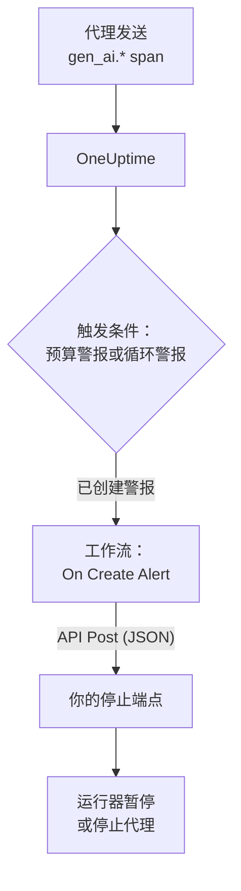

# AI 代理熔断器

AI 代理很少因为崩溃而失败。它失败的方式是停不下来：反复重试一个坏掉的工具，再次规划同一个步骤，或者启动更多子代理，而每一轮都在消耗更多 token。本页用 OneUptime 已有的部件为此搭建一个熔断器：一个发现失控代理的警报，以及一个调用你自己的端点来让代理停下的工作流。

:::cards
- [选择触发条件](#选择触发条件): 针对支出，或针对被反复调用的某个工具发出警报。
- [搭建停止端点](#搭建停止端点): 让代理暂停的小服务。
- [搭建工作流](#搭建工作流): 从新警报到调用你的端点。
- [测试熔断器](#测试熔断器): 先手动触发，再在真实条件下触发。
:::

## 工作原理



熔断器监视代理已经在发送的 OpenTelemetry（直接发送或 [通过网关](/docs/telemetry/ai-gateways) 发送），在请求路径之外而不是之中起作用。它不会给每次模型调用增加任何东西，更换提供商、SDK 或网关也不会让它失效。

代价是速度：它在几分钟内而不是几毫秒内让失控的代理停下。请在代理内部保留步数上限和超时，让熔断器去拦截从它们之间漏过去的情况。

| 触发条件 | 能发现什么 | 发出警报所需时间 |
| --- | --- | --- |
| 来自指标监视器的预算警报 | 不论原因，持续上涨的支出 | 最长 15 分钟，再加上监视器约一分钟 |
| 来自跟踪监视器的循环警报 | 被反复调用的同一个工具 | 1 到 5 分钟 |

## 开始之前

- 代理正在向 OneUptime 发送 GenAI span。请参阅 [AI / LLM 可观测性](/docs/telemetry/ai-llm-observability)。
- 一个可以暂停或停止代理运行器、且能从 OneUptime 访问的 HTTPS 端点。你将在 [搭建停止端点](#搭建停止端点) 中搭建它。
- 在项目中创建监视器和工作流的权限。

## 选择触发条件

两种触发条件的结局相同：监视器创建一个警报，新警报启动工作流。你可以两种都设置，工作流不在乎是哪一种触发的。

### 预算警报

支出是代理失控最可靠的信号。预算每 15 分钟汇总一次当天的 AI 支出，并以两个指标发布：`oneuptime.llm.budget.spend.usd` 和 `oneuptime.llm.budget.percent.used`，每个指标都在 `oneuptime.llm.budget.id` 中带有预算的 ID。

:::steps
1. 打开 **产品 → AI / LLM → 预算** ，点击 **创建LLM Cost Budget** 。设置 **每日预算（美元）** ，并在 **服务（可选）** 中选择代理的服务，让预算只监视这个代理。
2. 在新预算的行菜单中选择 **显示 ID** ，复制该 ID。
3. 针对 `oneuptime.llm.budget.percent.used` 创建一个 [指标监控](/docs/monitor/metrics-monitor)，用属性 `oneuptime.llm.budget.id` 等于复制的 ID 进行过滤，并把 **时间范围** 设为 **Past 30 Minutes** 。
4. 添加一个会创建警报的条件 **Greater Than Or Equal To** `100`，并给它一个包含代理名称的 **警报标题** ，例如 `LLM budget exceeded: support-bot`。工作流和你的端点都会读取这个标题。
:::

请按 ID 而不是名称过滤：重命名预算会重命名它的序列，按旧名称过滤的监视器会悄无声息地不再匹配。时间范围请保持 30 分钟：预算每 15 分钟发布一个点，更短的范围会在两个点之间什么都找不到，警报就会反复打开又解决。

在 `80` 处再加一个严重程度较低的条件，可以在熔断器于 `100` 处触发之前，先通过警报的值班策略提醒一个人。

### 循环警报

卡住的代理会留下可辨认的痕迹：同一个工具 span 一遍又一遍地出现。正常运行不会在几分钟内调用同一个工具几十次，所以计数能比预算更早发现循环。

:::steps
1. 打开 **监控** ，点击 **创建监视器** ，并在 **更多监视器类型** 下选择 **追踪** 。
2. 在 **更多字段** 下，把 **按遥测服务过滤** 设为代理的服务，把 **按属性过滤** 设为 `gen_ai.tool.name` 等于你预计它会循环调用的工具，例如 `search_web`。如果你的插桩会以工具命名各自的 span，请改把这个名称填入 **Span 名称** 。
3. 把 **监视器跟踪（时间）** 设为 **最近 5 分钟** 。
4. 添加条件 **Span Count** **Greater Than** 一个正常运行在五分钟内达不到的数，例如 `50`，并让它创建一个标题类似 `Agent loop: support-bot` 的警报。
:::

再加一个跟踪监视器，把 **按跨度状态过滤** 设为 **错误** 并使用更低的计数，可以发现重试风暴：一个不断失败的工具，和一个不断重试它的代理。

## 搭建停止端点

工作流会向你运行的端点发送带 JSON 正文的 `POST`。“停止”具体意味着什么由你决定。按影响从小到大：

| 动作 | 效果 |
| --- | --- |
| 停止新的工作 | 运行器不再为该代理启动新的运行 |
| 取消它的运行 | 该代理正在进行的运行被取消 |
| 暂停整个池 | 所有工作进程排空，直到有人重置熔断器 |

一个用 Express 编写、按代理触发熔断的最小端点：

```typescript title="circuit-breaker.ts"
import express from "express";

const app = express();
app.use(express.json());

const tripped = new Set<string>(); // agents whose breaker is open

app.post("/circuit-breaker", (req, res) => {
  if (req.headers["authorization"] !== `Bearer ${process.env.KILL_TOKEN}`) {
    return res.status(401).end();
  }

  const alertTitle: string = req.body.alertTitle ?? "";

  // "LLM budget exceeded: support-bot" -> "support-bot"
  const agent: string = alertTitle.split(": ").pop() ?? "unknown";

  tripped.add(agent); // your run loop checks this set
  abortActiveRuns(agent); // cancel that agent's runs in flight

  // Answer fast; do the slow cleanup in the background.
  return res.status(200).json({ tripped: agent });
});
```

请按这些规则搭建它：

- 让触发保持幂等。一次预警加一次超限，或同时到来的预算警报和循环警报，都可能让它触发不止一次，而第二次触发不能改变任何东西。
- 在一两秒内响应，把清理工作放到后台。工作流把任何 2xx 响应都视为成功。
- 要求提供密钥。任何能调用该端点的人都能停掉你的代理，所以请校验 bearer 令牌，工作流会从一个秘密全局变量中发送它。
- 手动重置。触发后的熔断器会一直保持触发状态，直到有人查看过这次运行：在 **产品 → AI / LLM → 对话** 下打开代理的对话，阅读或重放它做过的事。

请求从 OneUptime 发出。在 OneUptime Cloud 上，你的端点必须能从互联网访问。自托管安装会拒绝私有网络地址，除非管理员允许：请参阅 [出站网络访问](/docs/workflows/configuration#出站网络访问)。

## 搭建工作流

先把端点的令牌保存到工作流可以使用但不会显示它的地方：打开 **工作流 → 全局变量** ，点击 **创建工作流 变量** ，命名为 `AGENT_KILL_TOKEN`，把令牌填入 **内容** ，并打开 **密钥** 。秘密值会从运行日志和步骤跟踪中被抹去。

:::steps
### 创建工作流

打开 **产品 → 工作流** ，点击 **创建工作流** 。点击 **从零开始** ，命名为 `AI agent circuit breaker`，再点击 **创建工作流** 。它会在 **生成器** 中以关闭状态打开。

### 添加触发器

点击虚线框 **Choose what starts this workflow** ，在 **Add Trigger** 面板中选择 **On Create Alert** 。点击触发器，在 **Select Fields** 中勾选标题和描述，然后点击 **保存** 。块上的 ID `alert-on-create-1` 是后续块引用它的方式。

### 检查标题

点击 **添加组件** ，选择 **If / Else** ，把触发器的 **Success** 连接点连到它。把 **Value to check** 设为警报标题（点击 **{ }** 后选择它），把 **Comparison** 设为 **包含** ，把 **Compare with** 设为你的触发条件标题共有的开头，例如 `LLM budget exceeded`。

### 调用你的端点

添加 **API Post (JSON)** ，把 **If / Else** 的 **Yes** 连接点连到它。把它的 **URL** 设为你的端点，例如 `https://agents.example.com/circuit-breaker`，并填写下面的标头和正文。

### 报告失败

添加 **Send Message to Slack** 或 **Send Email** ，把 API 块的 **Error** 连接点连到它。没能触发的熔断器，正是必须有人看到的那个警报。

### 打开它

在 **生成器** 顶部打开 **已启用** 。
:::

API 块的 **Request Headers** ：

```json title="Request Headers"
{
  "Authorization": "Bearer {{global.variables.AGENT_KILL_TOKEN}}",
  "Content-Type": "application/json"
}
```

它的 **Request Body** ：

```json title="Request Body"
{
  "source": "oneuptime-circuit-breaker",
  "alertId": "{{local.components.alert-on-create-1.returnValues.model._id}}",
  "alertTitle": "{{local.components.alert-on-create-1.returnValues.model.title}}",
  "alertDescription": "{{local.components.alert-on-create-1.returnValues.model.description}}"
}
```

要对多个触发条件作出反应，请让它们的标题以相同的方式开头，或者从 **No** 连接点串联更多 **If / Else** 块。画布请参阅 [编写工作流](/docs/workflows/authoring)，`{{…}}` 引用请参阅 [变量](/docs/workflows/variables)。

## 测试熔断器

:::steps
1. 手动触发。打开 **警报** ，点击 **创建警报** ，创建一个标题为 `LLM budget exceeded: test` 的警报。运行会出现在 **工作流 → 日志 → 运行记录** 下，你的端点会收到请求。
2. 在真实条件下触发。在一个测试代理的服务上创建一个限额极小的预算，例如 `0.01` 美元，把一个预算监视器指向它，然后让代理运行：百分比超过 100，警报打开，工作流运行，熔断器触发。对于循环警报，给测试代理一个总是失败的工具。
3. 触发两次。再创建一次同样的警报：你的端点必须在不改变任何东西的情况下接受第二次触发。
:::

## 熔断器随时间的行为

- 工作流在警报创建时运行，所以一个触发条件每个警报只触发一次熔断器，而不是每次评估触发一次。
- 预算按 UTC 日计算，所以百分比会在 UTC 午夜从 0 重新开始。届时预算警报可能会解决，而下一个糟糕的日子会打开一个新警报，再次触发熔断器。
- 只要条件仍然满足，监视器就会让警报保持打开。打开 **自动解决警报** 后，条件不再满足时警报会解决，下一次超限会打开一个新警报。
- 重置在两边都由人来决定：在 OneUptime 中解决警报，在你的运行器中重置熔断器。
- 项目中的每个新警报都会启动工作流。把其他警报挡在熔断器之外的正是 **If / Else** ：不要省略它。

## 故障排除

:::details 工作流没有运行
检查 **生成器** 顶部的 **已启用** 是否已打开：工作流创建时处于关闭状态。然后检查警报是否是在你打开工作流之后创建的：触发器只为新警报启动运行。
:::

:::details 工作流运行了，但总是走 No 分支
标题为空或不匹配。触发器的 **Select Fields** 中未勾选的字段会以空值到达，所以请勾选标题。然后把警报标题与 **Compare with** 对比：**包含** 必须能在其中找到完全相同的文本。
:::

:::details 你的端点返回 401
`Authorization` 标头与你的端点期望的令牌不一致。检查 `{{global.variables.AGENT_KILL_TOKEN}}` 中的名称，以及全局变量中保存的值。秘密变量的值无法读回，如有疑问，请用 **Update Content** 重新输入。
:::

:::details 预算警报反复打开又解决
监视器的 **时间范围** 短于预算两点之间的 15 分钟。请把它设为 **Past 30 Minutes** 。
:::

:::details 请求始终到不了你的端点
在 **工作流 → 日志 → 运行记录** 下打开这次运行，查看 **API Post (JSON)** 步骤：那里写明了请求失败的原因。在 OneUptime Cloud 上，端点必须能从互联网访问；自托管安装会拒绝私有网络地址，除非管理员允许。
:::

## 后续步骤

:::cards
- [AI / LLM 可观测性](/docs/telemetry/ai-llm-observability): 预算、成本，以及熔断器监视的 span。
- [跟踪监控](/docs/monitor/traces-monitor): span 过滤器和条件的详细说明。
- [工作流](/docs/workflows/index): 触发器、组件、变量和运行。
- [AI 网关](/docs/telemetry/ai-gateways): 让所有代理的模型调用通过一个导出发送。
:::
