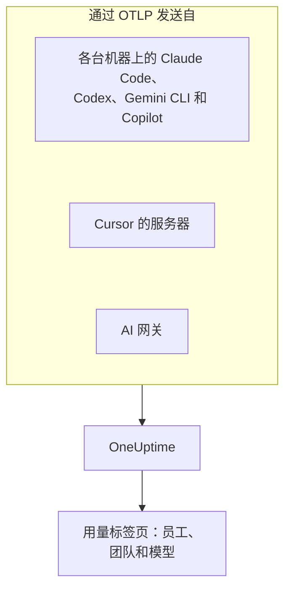

# AI 编程助手

你的工程师在使用 Claude Code、Cursor、Codex、Gemini CLI 和 Copilot，账单不断增长。本页回答管理者关心的问题： **谁在用哪个工具、用哪些模型，以及每个人和每个团队花了多少钱** 。

大多数编程助手会自行导出 OpenTelemetry，因此无需在开发者的机器上安装任何东西：把导出指向 OneUptime，token、成本和工具使用情况就会和你自己应用的 AI 调用放在一起。这里的一切都通过 OpenTelemetry 到达；OneUptime 不会轮询任何厂商的管理或计费 API。

:::cards
- [支持矩阵](#支持矩阵): 每个工具发送什么，以及它是否指明某个人。
- [员工和团队归属](#员工和团队归属): 为支出标上姓名和团队的键。
- [用量标签页](#用量标签页): 支出表格对编程助手能显示什么、不能显示什么。
- [从哪里开始](#从哪里开始): 第一天就能看到结果的推广顺序。
:::

## 工作原理

每个工具都用你的摄取密钥把遥测发送到 OneUptime 的 OTLP 端点：从每台开发者机器、从厂商的服务器（Cursor），或从你的模型流量经过的网关。



## 开始之前

1. 在 **项目设置 → 遥测与 APM → 摄取密钥** 下创建一个遥测摄取密钥。
2. 你的 OTLP 端点是 `https://oneuptime.com/otlp`；如果你自托管 OneUptime，则是 `https://YOUR-ONEUPTIME-HOST/otlp`。
3. 每次导出都会在 `x-oneuptime-token` 请求头中发送密钥。

整个团队的机器共用一个摄取密钥就可以。它会出现在每台开发者机器上，因此请把它当作只能发送数据的共享凭据，并像其他凭据一样定期轮换。

## 支持矩阵

一个工具能给你什么，取决于三件事：它是否发送 OpenTelemetry，它的遥测如何到达 OneUptime，以及其中是否有内容指明某个人。

| 工具 | 发送什么 | 如何到达 OneUptime | 指明谁 | 指南 |
| --- | --- | --- | --- | --- |
| Claude Code | 指标和日志；跟踪为测试版 | 从每台机器；环境变量或托管设置文件 | 使用 Claude 账号登录时为 `user.email` | [Claude Code](/docs/telemetry/claude-code) |
| Cursor | 指标和日志 | 从 Cursor 的服务器，在 Cursor 仪表盘中设置一次；仅限 Enterprise 套餐 | 整数 `cursor.user.id` | [Cursor](/docs/telemetry/cursor) |
| OpenAI Codex | 跟踪、指标和日志，各自在 `~/.codex/config.toml` 中开启 | 从每台机器，每种信号一个完整 URL | span 和指标上不指明任何人：你需要在 `[otel.span_attributes]` 中自行设置 `user.id` 和 `user.email` | [OpenAI Codex](/docs/telemetry/openai-codex) |
| Gemini CLI | 跟踪、指标和日志 | 从每台机器，通常经由本地 Collector | 登录时为 `user.email` | [Gemini CLI 与 GitHub Copilot](/docs/telemetry/gemini-cli-and-copilot) |
| GitHub Copilot | 跟踪、指标和日志，仅来自其代理功能 | 从编辑器或代理宿主 | 不指明任何人：你需要在每台机器上自行设置 `enduser.id` 和 `user.email` | [Gemini CLI 与 GitHub Copilot](/docs/telemetry/gemini-cli-and-copilot) |
| Cline | 指标和日志 | 在 Cline 的组织仪表盘中集中配置 | 匿名化的 `user_id` | — |
| LiteLLM 和 Portkey | 经过网关的每次调用的跟踪 | 从网关进程 | 使用 LiteLLM 时为虚拟密钥的所有者 | [AI 网关](/docs/telemetry/ai-gateways) |
| 你自己的应用 | 你的 GenAI 插桩发送的内容 | 从你的应用 | 你设置为 `user.id` 的人 | [AI / LLM 可观测性](/docs/telemetry/ai-llm-observability) |
| Windsurf、JetBrains AI、Amazon Bedrock、Azure OpenAI | 没有自己的 OpenTelemetry | 只能经由你放在前面的网关 | 网关指明的人 | [AI 网关](/docs/telemetry/ai-gateways) |

短横线表示 OneUptime 还没有该工具的指南。它的遥测仍会像其他 OpenTelemetry 一样被摄取。

:::details GitHub Copilot 究竟导出什么
Copilot 只从其代理功能导出 OpenTelemetry：VS Code 的聊天和代理模式、Copilot CLI 背后的代理宿主、Copilot SDK，以及通过 Copilot 插件在 JetBrains IDE 中运行的代理工作流。对于行内补全、github.com 上的 Copilot 和 Copilot 代码审查，GitHub 没有记录任何导出。Copilot 不发送任何用户属性，因此请通过 `resourceAttributes` 或 `OTEL_RESOURCE_ATTRIBUTES` 为每台机器设置 `enduser.id` 和 `user.email`。
:::

:::details Amazon Bedrock、Azure OpenAI、Windsurf 和 JetBrains AI
- **Amazon Bedrock** ：`InvokeModel` 和 `Converse` API 不发送 OpenTelemetry。Bedrock AgentCore 则不同：AWS 为它记录了指标、span 和日志，默认发送到 CloudWatch。设置 `DISABLE_ADOT_OBSERVABILITY=true` 会关闭运行时的默认 ADOT 配置，这样你就可以把 ADOT SDK 指向 OneUptime。
- **Azure OpenAI** ：该服务不发送任何内容，其 Azure Monitor 指标也没有用户维度。请对客户端插桩，或在前面放置 API Management 或其他网关。
- **Windsurf** ：没有记录任何遥测导出。按用户的数据位于 Windsurf 的 Enterprise API 中，OneUptime 不会轮询它。
- **JetBrains AI Assistant 和 Junie** ：不导出用量。JetBrains 的 OpenTelemetry 插件是在 IDE 内接收你自己应用的遥测；它不会向外发送任何内容。
:::

## 员工和团队归属

遥测到达时，OneUptime 会把发起调用的人及其团队复制到列中，因此 **用量** 标签页无需属性筛选即可对人员和团队排名。

### 作为员工读取的属性

在 span 上，按以下顺序，第一个出现的键胜出：

| 列 | 键（优先者在前） |
| --- | --- |
| 员工 ID | `user.id`、`enduser.id`、`litellm.metadata.user_api_key_user_id`、`metadata.user_api_key_user_id`、`traceloop.association.properties.user_id`、`langfuse.user.id`、`user.account_uuid`、`user.account_id`、`cursor.user.id` |
| 员工邮箱 | `user.email`、`litellm.metadata.user_api_key_user_email`、`metadata.user_api_key_user_email`、`traceloop.association.properties.user_email`、`enduser.email` |
| 团队 / 成本中心 | `team.id`、`team`、`cost_center`、`department`、`litellm.metadata.user_api_key_team_id`、`litellm.team.id`、`metadata.user_api_key_team_id`、`cursor.team.id` |

在指标数据点上，列表更短，并从邮箱开始，因为发送指标的编程助手会自行发送 `user.email`：

| 列 | 键（优先者在前） |
| --- | --- |
| 员工 | `user.email`、`user.id`、`user.account_uuid`、`user.account_id`、`cursor.user.id` |
| 团队 / 成本中心 | `team.id`、`team`、`cost_center`、`department`、`cursor.team.id` |
| 模型 | `gen_ai.request.model`、`model`、`cursor.model.name` |

这些键的读取方式：

- **每个键也会以 `resource.` 前缀形式读取。** OTLP 摄取会把资源属性存放在该前缀下，因此 `OTEL_RESOURCE_ATTRIBUTES=team.id=platform` 会以 `resource.team.id` 的形式到达。不带前缀的键优先尝试，因此 span 上的值胜过整个进程上的值。
- **调用有邮箱时，用量标签页显示人员的邮箱，否则显示 ID。** 显示同一邮箱的行会合并，因此一位工程师用两台机器也只占一行。
- **只从 AI 调用中读取身份。** `user.id`、`user.email` 和 `team.id` 是浏览器和后端 span 也会携带的通用键；只有已被识别为 AI 调用的 span 才会填入这些列。
- **不会从日志记录中读取身份。** 这对 Codex 很重要，因为它只在日志上放置 `user.email`。
- LiteLLM 用两种方式书写这些键：其默认的 `otel` 回调使用 `metadata.` 前缀，而可选的 OpenTelemetry v2 模式（`LITELLM_OTEL_V2=true`）使用 `litellm.` 命名空间。OneUptime 两者都读取，因此标准代理无需额外设置即可工作。

### 团队和成本中心

没有任何插桩会发送 `team.id`、`team`、`cost_center` 或 `department`：这些由你的组织设置，通常通过工具进程上的 `OTEL_RESOURCE_ATTRIBUTES`。

```bash
export OTEL_RESOURCE_ATTRIBUTES="team.id=platform,team=Platform_Engineering,cost_center=eng-123,department=engineering"
```

在你已经配置开发者机器的地方设置它：MDM 配置文件、托管设置文件或来自 dotfiles 的 shell 配置文件。值中不能包含空格：请使用下划线，或 `%20` 这样的百分号编码。Codex 没有资源属性，因此请改为在它的 `[otel.span_attributes]` 中设置相同的键。

若要按应用区分支出，请使用服务名称（`OTEL_SERVICE_NAME`，或工具自己的设置）。 **应用 / 服务** 细分只涵盖发送 GenAI span 的工具。

### 有意不视为员工的内容

一次调用可能涉及两个不同的人：发起调用的员工，以及调用所服务的客户。以下键代表客户，OneUptime 从不把它们读入身份列：

- `gen_ai.user` 和 `llm.user`：插桩对 OpenAI 请求参数 `user` 的回显，OpenAI 将其描述为你的最终用户的标识符。
- `litellm.metadata.user_api_key_end_user_id`、`metadata.user_api_key_end_user_id` 和 `litellm.end_user.id`：LiteLLM 的最终用户，与作为员工的密钥所有者不同。

如果把客户 ID 当作员工读取，一个服务 40,000 名客户的支持机器人就会变成 40,000 名虚构的员工，而真正负责这笔支出的工程师看起来却什么都没花。这些键会保留在 span 的属性中，跟踪查看器的 **LLM** 标签页会把它们显示为最终用户。

### 隐私

员工邮箱列包含个人数据。跟踪的 **清理规则** 对这一列的作用与对其来源属性完全相同，因此屏蔽邮箱的规则也会屏蔽这一列。你可以在 **跟踪 → 设置** 下找到它们。

## OneUptime 读取的编程助手指标

编程助手用自己的前缀而不是 `gen_ai.*` 命名指标，因此 OneUptime 按名称识别每一个：

| 指标 | 工具 | 单位 |
| --- | --- | --- |
| `claude_code.token.usage` | Claude Code | token |
| `claude_code.cost.usage` | Claude Code | USD |
| `cursor.token.usage` | Cursor | token |
| `cursor.cost.usage` | Cursor | USD，Cursor 自己的估算 |
| `codex.turn.token_usage` | OpenAI Codex | token |
| `codex.turn.cost_microusd` | OpenAI Codex | 百万分之一美元：OneUptime 会换算，所以不要自己换算 |

OneUptime 还会从 `gen_ai.client.token.usage`、`gen_ai.client.token.count`、`llm.token.usage` 和 `llm.usage.tokens` 读取 token，从 `gen_ai.client.cost`、`gen_ai.client.cost.usd`、`gen_ai.usage.cost`、`litellm_spend_metric` 和 `litellm.cost.total` 读取成本。

阅读数字之前需要了解两点：

- **有意不读取 `gemini_cli.token.usage`。** Gemini CLI 会把 token 发送两次，一次作为自己的指标，一次作为 `gen_ai.client.token.usage`，同时读取会使其翻倍。它的 token 只通过 `gen_ai.client.token.usage` 计算一次。Gemini CLI 不发送成本指标：请开启它的跟踪，让每次调用都能计价。
- **只计算输入和输出 token。** token 类型从 `gen_ai.token.type`、`llm.token.type`、`type`、`cursor.token.type` 或 `token_type` 读取，只计算 `input` 和 `output`（或旧的 `prompt` 和 `completion`）。缓存读写、Codex 的 `total`（重复了其他值）和 `reasoning_output`（`output` 的一部分）都不计入，因此来自指标的总数会小于工具发送的所有值之和。

## 用量标签页

打开 **产品 → AI / LLM** ，进入 **用量** 。它按支出对 **员工** 、 **团队** 、 **模型** 、 **提供商** 和 **应用 / 服务** 排名，除非你另选时间范围，否则为最近 7 天。没有指明任何人的调用计入 **未归属** ：如果 **未归属** 这一行很大，说明有工具仍需设置身份。

### 编程助手指标是回退，而不是附加

GenAI span 优先：只有对 span 没有报告的数字才会读取指标，两者从不相加（ [原因](/docs/telemetry/ai-llm-observability#span-优先指标补充) ）。对编程助手来说，这有一个直接的后果： **如果同一个项目接收带成本的 GenAI span，编程助手的支出就不会显示。** 请为编程助手单独准备一个项目，并使用它自己的摄取密钥。

回退生效时，对于只发送指标的工具，每种细分能显示的内容如下：

| 细分 | 来自指标 |
| --- | --- |
| **员工** | 是，来自上面的每个身份键，包括不带前缀和带 `resource.` 前缀的形式 |
| **团队** | 是，来自团队键 |
| **模型** | 是：Claude Code 和 Codex 发送不带前缀的 `model`，Cursor 发送 `cursor.model.name` |
| **提供商** | 否：编程助手的指标不指明提供商 |
| **应用 / 服务** | 否：它们的指标不属于任何 OneUptime 服务 |

从指标读取的行只携带成本：其调用和 token 单元格显示 `—`，因为支出计数器没有逐次调用的细节，而在那里显示 0 就等于声称此人没有发起任何调用。该表会标注 **来自 GenAI 指标** 。

## 没有 OpenTelemetry？在前面放一个网关

对于 Windsurf、JetBrains AI、Bedrock 模型 API、Azure OpenAI 以及其他任何没有自己导出功能的工具，请在前面放置一个 AI 网关。这样每次调用都会经过一个发送 OpenTelemetry 的进程，你只需配置一次导出。

**为每位员工使用一个虚拟密钥来运行 LiteLLM。** LiteLLM 会在每个 span 上标注密钥所有者的 ID 和邮箱，OneUptime 将其读作员工，并把密钥的团队读作团队。它还会用你在代理上设置的自定义费率自行为每次调用计价，它报告的成本优先于 OneUptime 的估算。不要为此使用它的最终用户 ID：那是客户。设置方法见 [AI 网关](/docs/telemetry/ai-gateways)。

围绕网关做规划之前，有两个限制：

- **网关只能看到经过它的流量。** Cursor 自己的基础 URL 覆盖是按用户的设置，只涵盖聊天模型（Tab 补全仍使用 Cursor 的模型），因此请优先使用 Cursor 的原生导出。
- **网关看到的是模型调用，而不是代理。** 它会记录提示词和回答，但不会记录工具自身遥测所报告的工具调用、文件编辑以及接受或拒绝的决定。

## 提示词内容：各工具的默认设置不同

提示词和回答是这条管道中风险最高的数据：其中经常包含源代码、客户数据和粘贴进去的凭据。请检查每个工具的默认设置：

| 工具 | 默认是否包含提示词内容 |
| --- | --- |
| Claude Code | 关闭：每种内容都有自己的开启变量 |
| Cursor | 关闭：只有可选的 `conversation_content` 系列会发送消息文本 |
| OpenAI Codex | 关闭：`log_user_prompt` 默认为 `false` |
| Gemini CLI | **开启** ：`logPrompts` 默认为 `true`，因此开启遥测时请把它设为 `false` |
| GitHub Copilot | 关闭：`captureContent`，托管设置可以用 `lockCaptureContent` 锁定 |
| LiteLLM | 使用默认的 `otel` 回调时开启（用 `turn_off_message_logging` 关闭）；在 OpenTelemetry v2 模式下关闭 |

Codex 默认还会把它的指标发送给 OpenAI：请参阅 [OpenAI Codex](/docs/telemetry/openai-codex)。在你有意采集内容的地方，跟踪的 **清理规则** 和 **丢弃过滤器** 会像对其他遥测一样对其生效。

## OneUptime 尚未做到的事

- **没有厂商管理或计费连接器。** OneUptime 不会轮询 Anthropic 的 Admin API、Cursor 的 Admin API、OpenAI 的用量和成本端点、GitHub 的 Copilot 计费，也不会轮询 Windsurf 或 JetBrains 的 API。需要与发票一致的数字时，请从厂商处获取。
- **除非工具报告，否则成本是估算值。** 报告的成本会原样使用；否则 OneUptime 按标价为 token 计价。Cursor 的 `cursor.cost.usage` 本身就是估算值。
- **不会读取日志记录上的身份。** Codex 只在日志上发送的 `user.email` 不会与支出关联。
- **尚未读取 Cursor 的 `cursor.user.email`** ，因此 Cursor 用户显示为其整数 `cursor.user.id`。
- **Codex 的 span 不指明模型** ，因此 OneUptime 无法为其计价：Codex 显示按人员的 token，其成本只出现在总数中。
- **工具变化很快。** 如果本页说某个工具没有导出功能，请在围绕网关构建之前查看其最新文档。

## 从哪里开始

按以下顺序推广；每一步本身都有用。请使用一个尚未从你自己的应用接收 GenAI span 的项目，否则 [回退规则](#编程助手指标是回退而不是附加) 会让编程助手的支出无法显示在页面上。

1. **Gemini CLI** ，如果有人在用的话。它无需设置即可发送 `user.email`，因此能展示端到端的归属效果。也请开启它的跟踪：它不发送成本指标。
2. **Claude Code** ：为整个团队的机器准备一个托管设置文件，免费获得 `user.email`、真实的成本指标，以及按开发者划分的接受率、提交、拉取请求和代码行数。
3. **Cursor** ，使用 Enterprise 套餐：在 Cursor 仪表盘中设置一个页面，无需改动任何开发者机器，不过人员会以整数形式到达。
4. **Copilot 和 Codex** ，两者都需要在每台机器上设置身份。请在配置机器时完成：没有身份就到达的调用，事后无法归属。
5. **LiteLLM 网关** ，用于其他所有工具，每位员工一个虚拟密钥。

## 后续步骤

:::cards
- [Claude Code](/docs/telemetry/claude-code): 为一台机器或整个团队开启 Claude Code 的导出。
- [Cursor](/docs/telemetry/cursor): 从 Cursor 仪表盘发送 Cursor 的团队遥测。
- [OpenAI Codex](/docs/telemetry/openai-codex): 配置 Codex 的三个导出器，并在其 span 上标注身份。
- [AI / LLM 可观测性](/docs/telemetry/ai-llm-observability): 每次 AI 调用的对话、警报、成本和预算。
:::
