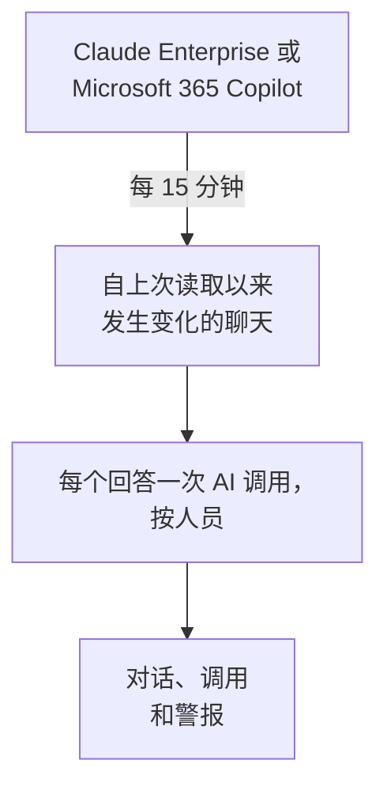

# 公司的 AI 工具

以按人员划分的对话形式，查看你的员工向公司付费的 AI 工具提了什么问题。用只能读取的凭据连接 Claude Enterprise 或 Microsoft 365 Copilot，OneUptime 就会每 15 分钟把每个新聊天导入 **对话** 。除非你另行选择，否则只有项目所有者和管理员可以阅读。

:::cards
- [先告知你的员工](#先告知你的员工): 他们的聊天是他们自己的话。
- [连接工具](#连接工具): 粘贴凭据，选择谁可以阅读，测试后连接。
- [隐私](#隐私): 谁可以阅读对话，以及是否保留所写内容。
- [其他 AI 工具](#其他-ai-工具): ChatGPT Enterprise、Gemini、Open WebUI、LibreChat 和编程助手。
:::

## 先告知你的员工

> [!IMPORTANT]
> 这些是你的员工自己写下的话。在连接工具之前，请告诉他们与该工具的聊天会被保留以及谁可以阅读，并与法务或人力资源团队确认你们的政策和当地法律有何要求。

## 工作原理

OneUptime 每 15 分钟向工具请求自上次读取以来发生变化的聊天。每个回答都会成为提问人的一次 AI 调用，并带上自上一个回答以来提出的问题；每个聊天成为一个对话。

聊天和你应用的 AI 调用以相同方式到达，因此清理规则、丢弃过滤器、保留期和 AI 警报都适用于它们。这些工具按席位付费，因此这些调用没有 token，也没有成本。一个问题如果一小时没有回答，会单独导入，这样 AI 从未回答的聊天也会显示。

## 开始之前

- Project Owner 或 Project Admin 角色。只有他们可以连接、修改或删除工具。
- 负责创建凭据的工具管理员：下面每个工具的部分会说明是谁。
- 已告知你的员工，并已得到法务或人力资源团队的答复。

## 连接工具

:::steps
### 打开连接

打开 **产品 → AI / LLM → 连接** 。在 **公司的 AI 工具** 中点击工具的磁贴。

### 粘贴凭据

在 **凭据** 中填写工具要求的内容。密钥会加密存储，之后不会再显示。

### 选择谁可以阅读

在 **隐私** 中按 [隐私](#隐私) 的说明设置 **谁可以阅读对话** 和 **保留所写内容** 。

### 测试

在 **测试** 中点击 **测试连接** 。OneUptime 只统计最近 7 天的聊天数量：不会读取、显示或保留任何人写的内容。

### 连接

点击 **连接** 。第一次读取会在一分钟内开始，并导入最近 7 天的数据。
:::

## Claude Enterprise

OneUptime 通过 Compliance API 读取你组织的每个 claude.ai 聊天：谁提的问题、向 Claude 问了什么、Claude 如何回答，以及使用了哪个模型。收到新消息的聊天会被重新读取，已经导入的回答会被识别并跳过。

:::steps
### 开启 Compliance API

你组织的主所有者在 claude.ai 中打开 Organization settings、API，并开启 Compliance API。

### 创建合规访问密钥

在同一位置创建一个具有 `read:compliance_user_data` 范围的密钥。它以 `sk-ant-api01-` 开头。

### 连接 Claude Enterprise

把密钥粘贴到 **合规访问密钥** 中。
:::

## Microsoft 365 Copilot

OneUptime 从 Microsoft Graph 读取每个人的 Copilot 交互历史：他们在 Teams、Outlook、Word、Excel、PowerPoint、Loop 或 Copilot Chat 中向 Copilot 问了什么、得到了什么回答，以及在哪个应用中。一个提示词和它的回答成为一次 AI 调用，一个 Copilot 会话成为一个对话。大型租户会分批读取，并从上次读取停止的地方继续。

:::steps
### 注册应用

在 Microsoft Entra ID 中注册一个应用，并为它创建客户端密码。

### 授予权限

为该应用授予 Microsoft Graph 的 `AiEnterpriseInteraction.Read.All` 和 `User.Read.All` 应用程序权限，并授予管理员同意。

### 连接 Copilot

填写 **目录（租户）ID** 、 **应用程序（客户端）ID** 和 **客户端密钥** 。如果只读取部分人员，请在 **更多字段** 中的 **仅限此组中的人员** 填入某个组的对象 ID，并同时为应用授予 `GroupMember.Read.All`。对于 Azure Government，请在同一位置修改 **云** 。
:::

## 隐私

| 设置 | 作用 |
| --- | --- |
| **谁可以阅读对话** | **项目所有者和管理员** （默认）：项目中的其他人在 OneUptime 的任何地方都看不到这些对话，也看不到组成它们的 AI 调用。 **所有可以读取 AI 调用的人** ：所有可以读取项目跟踪的人。 |
| **保留所写内容** | 开启（默认）：保留问题和回答。关闭：OneUptime 保留提问人、时间、模型和所用应用，但不保留所写内容。 |

对谁可以阅读的更改会在一分钟内生效。关闭 **保留所写内容** 只影响之后读取的聊天；之前保留的内容会一直保留到其保留期结束。

如果要保留所写内容但遮盖其中一部分，例如邮箱地址或卡号，请使用 **跟踪 → 设置** 中的 **清理规则** ：它们在任何内容存储之前生效。对话的保留时间与该连接的服务保留其跟踪的时间相同：参见 [数据保留](/docs/telemetry/data-retention)。删除连接会停止它的读取；它读取过的内容仍然只对同样的人可读，直到保留期结束。

## 其他 AI 工具

这些工具没有 OneUptime 可以用来读取员工聊天的 API，或者需要其他途径。

### ChatGPT Enterprise

OpenAI 只会应要求为工作区开放其 Compliance API，并且没有公开其记录包含哪些内容，因此 OneUptime 目前还无法读取 ChatGPT Enterprise 的聊天。把你的 OpenAI 组织作为 [提供商账户](/docs/telemetry/ai-provider-accounts#openai) 连接，可以看到它的 API 用量和成本，但其中不包括 ChatGPT。

### Gemini for Google Workspace

Google 没有提供读取员工 Gemini 聊天的 API。Google Vault 会为电子取证保留这些聊天。

### 编程助手

Claude Code、Codex、Gemini CLI、GitHub Copilot 和 Cursor 会发送自己的 OpenTelemetry：参见 [AI 编程助手](/docs/telemetry/ai-coding-assistants)。

### Open WebUI 和 LibreChat

自托管的聊天应用通过你设置的 API 调用模型。在模型前面放一个 LiteLLM 代理，并按 [AI 网关](/docs/telemetry/ai-gateways#litellm-proxy) 的说明把它的跟踪发送到 OneUptime：每个聊天的提示词和回答都会作为 AI 调用到达。每人一个虚拟密钥可以说明是谁提的问题；所有人共用的密钥则说明不了任何人。Open WebUI 自带的 OpenTelemetry 导出跟踪的是它的 Web 请求和数据库调用，而不是聊天。

## 故障排除

:::details 测试找不到任何聊天
最近 7 天没有人使用该工具，或者凭据属于另一个组织或租户。对于 Copilot，请检查 **仅限此组中的人员** 中的组是否就是你想要的组。
:::

:::details 凭据有效，但无法读取连接所需的内容
对于 Copilot，请为应用的 Graph 权限授予管理员同意；指定组时还要授予 `GroupMember.Read.All`。对于 Claude Enterprise，请使用 `read:compliance_user_data` 范围创建密钥。
:::

:::details 有人看不到对话
**谁可以阅读对话** 设置为 **项目所有者和管理员** 。所有者或管理员可以在连接所在行中用 **编辑** 修改。
:::

:::details 对话显示了提问人，但没有内容
读取时 **保留所写内容** 处于关闭状态。开启后只影响之后读取的聊天。
:::

## 后续步骤

:::cards
- [AI / LLM 可观测性](/docs/telemetry/ai-llm-observability): 阅读和回放对话，并在回答出问题时收到通知。
- [AI 提供商账户](/docs/telemetry/ai-provider-accounts): 你的 OpenAI、Anthropic、Azure、Bedrock 和 Vertex AI 账户的用量和成本。
- [AI 编程助手](/docs/telemetry/ai-coding-assistants): 编程工具上每位工程师的支出。
- [数据保留](/docs/telemetry/data-retention): 对话会保留多长时间。
:::
