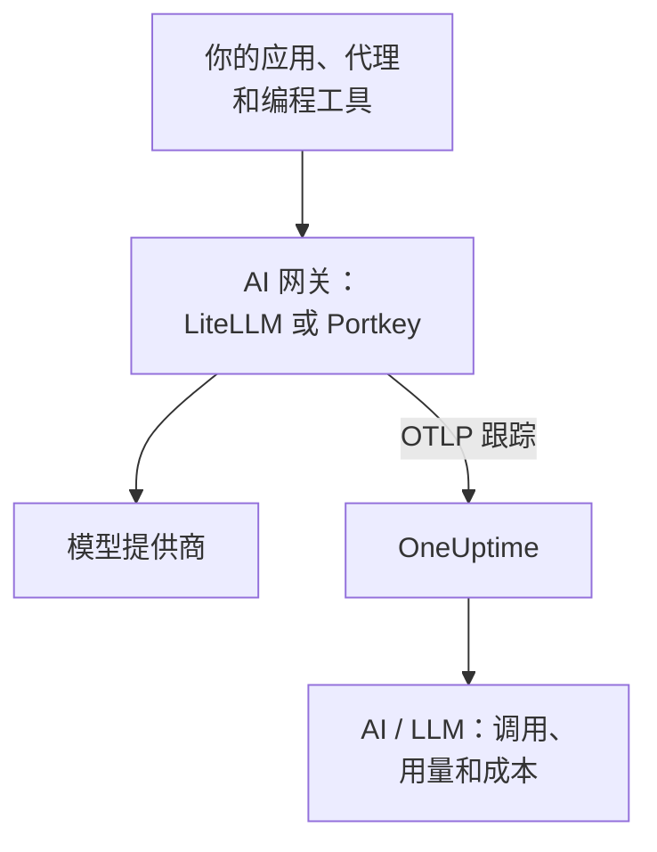

# AI 网关(LiteLLM、Portkey)

AI 网关位于你的应用和模型提供商之间，所以每次模型调用都会经过它。把网关的 OpenTelemetry 发送到 OneUptime 一次，它背后的每次调用都会带着模型、token、成本，以及（除非你关闭）提示词和回答到达 [AI / LLM](/docs/telemetry/ai-llm-observability)，无需逐个为应用插桩。

:::cards
- [LiteLLM Proxy](#litellm-proxy): 内置导出，用三个变量完成设置。
- [谁花了什么](#每位员工一个虚拟密钥): 每位员工一个 LiteLLM 虚拟密钥，就能识别每个人。
- [Portkey](#portkey): 自托管网关有内置导出；其他情况下为应用插桩。
- [检查调用是否到达](#检查调用是否到达): 你应该看到什么，看不到时怎么办。
:::

## 工作原理



| | LiteLLM Proxy | Portkey（自托管或 Enterprise） | Portkey（开源或托管版） |
| --- | --- | --- | --- |
| 导出到 OneUptime | 内置 | 内置，实验性 | 无：改为给应用插桩 |
| 要设置的端点 | `https://oneuptime.com/otlp/v1/traces` | `https://oneuptime.com/otlp` | 应用自己的导出器 |
| 能识别每个人 | 能，每位员工一个虚拟密钥 | 不能 | 只有应用发送的内容 |
| 提示词和回答 | 发送，除非你关闭 | 始终发送 | 取决于插桩 |

## 开始之前

- 一个摄取密钥：打开 **项目设置 → 遥测与 APM → 摄取密钥** ，点击 **创建摄取密钥** 。
- 你的 OTLP 基础 URL：`https://oneuptime.com/otlp`，如果你自托管 OneUptime，则为 `https://YOUR-ONEUPTIME-HOST/otlp`。OneUptime 接受基于 HTTP 的 OTLP，protobuf 和 JSON 均可。
- 密钥通过每个导出请求的 `x-oneuptime-token` 标头传递。

## LiteLLM Proxy

LiteLLM 的 OpenTelemetry 回调是开源代理的一部分，官方 Docker 镜像（`ghcr.io/berriai/litellm`）已包含它需要的软件包。

:::steps
### 打开 otel 回调

在代理的 `config.yaml` 中把 `otel` 加入回调：

```yaml title="config.yaml"
model_list:
  - model_name: gpt-4o
    litellm_params:
      model: openai/gpt-4o
      api_key: os.environ/OPENAI_API_KEY

litellm_settings:
  callbacks: ["otel"]
```

### 让导出器指向 OneUptime

在代理上设置三个变量：

```bash
export OTEL_EXPORTER="otlp_http"
export OTEL_ENDPOINT="https://oneuptime.com/otlp/v1/traces"
export OTEL_HEADERS="x-oneuptime-token=YOUR_INGESTION_TOKEN"
```

### 启动代理

:::tabs
@tab Docker
```bash
docker run \
  -v $(pwd)/config.yaml:/app/config.yaml \
  -e OPENAI_API_KEY="sk-..." \
  -e OTEL_EXPORTER="otlp_http" \
  -e OTEL_ENDPOINT="https://oneuptime.com/otlp/v1/traces" \
  -e OTEL_HEADERS="x-oneuptime-token=YOUR_INGESTION_TOKEN" \
  -e OTEL_SERVICE_NAME="litellm-gateway" \
  -p 4000:4000 \
  ghcr.io/berriai/litellm:main-stable \
  --config /app/config.yaml
```
@tab pip
```bash
pip install 'litellm[proxy]' opentelemetry-api opentelemetry-sdk opentelemetry-exporter-otlp
litellm --config config.yaml
```
:::

单独安装 `litellm[proxy]` 不包含 OpenTelemetry 软件包，所以请一并安装它们。

### 通过它发送一个请求

调用一次代理，然后按 [检查调用是否到达](#检查调用是否到达) 中的说明检查 AI / LLM。
:::

| 变量 | 值 | 说明 |
| --- | --- | --- |
| `OTEL_EXPORTER` | `otlp_http` | 也会作为 `OTEL_EXPORTER_OTLP_PROTOCOL` 读取 |
| `OTEL_ENDPOINT` | `https://oneuptime.com/otlp/v1/traces` | 完整路径 `/v1/traces` 适用于所有 LiteLLM 版本；也会作为 `OTEL_EXPORTER_OTLP_ENDPOINT` 读取 |
| `OTEL_HEADERS` | `x-oneuptime-token=YOUR_INGESTION_TOKEN` | 以逗号分隔的 `key=value` 对；也会作为 `OTEL_EXPORTER_OTLP_HEADERS` 读取 |
| `OTEL_SERVICE_NAME` | 你的网关名称 | 调用显示在其下的服务；未设置时为 `litellm` |

### LiteLLM 发送的内容

每次调用都带有 `gen_ai.system`、`gen_ai.request.model`、`gen_ai.response.model`、`gen_ai.usage.input_tokens` 和 `gen_ai.usage.output_tokens`，以及它的参数、提示词和回答：OneUptime [读取这次调用](/docs/telemetry/ai-llm-observability) 所需的一切。

从 LiteLLM 1.81 起，这些属性位于请求的 `Received Proxy Server Request` span 上，不再有单独的 `litellm_request` span。当一个请求进行多次模型调用时，每次调用都会在那里覆盖上一次调用的属性，所以请设置 `USE_OTEL_LITELLM_REQUEST_SPAN=true`，为每次调用得到一个 `litellm_request` span。

LiteLLM 会自己为每次调用计价，包括你在代理上配置的自定义费率，并以 `gen_ai.cost.total_cost` 报告价格。OneUptime 优先使用报告的价格而不是自己的估算，只有当 LiteLLM 无法为调用计价时（例如没有设置价格的自定义模型），才会 [根据 token 估算](/docs/telemetry/ai-llm-observability)。

### 每位员工一个虚拟密钥

给每个人一个自己的 LiteLLM 虚拟密钥，他们发出的每次调用到达时都会带着身份。LiteLLM 会把密钥所有者的 ID、邮箱和团队写到 span 上，OneUptime 把它们读作员工和团队，所以 **用量** 标签页无需在每个人的机器上做任何设置，就能按人排出支出。

虚拟密钥需要代理上有数据库和主密钥（`DATABASE_URL` 和 `LITELLM_MASTER_KEY`）。先用邮箱创建一个用户，再为该用户创建密钥：

```bash
curl -X POST "http://localhost:4000/user/new" \
  -H "Authorization: Bearer YOUR_MASTER_KEY" \
  -H "Content-Type: application/json" \
  -d '{"user_email": "alice@example.com"}'

curl -X POST "http://localhost:4000/key/generate" \
  -H "Authorization: Bearer YOUR_MASTER_KEY" \
  -H "Content-Type: application/json" \
  -d '{"user_id": "USER_ID_FROM_THE_FIRST_CALL", "team_id": "platform"}'
```

| LiteLLM 的 span 属性 | OneUptime 将其读作 |
| --- | --- |
| `metadata.user_api_key_user_id` | 员工的 ID |
| `metadata.user_api_key_user_email` | 员工的邮箱 |
| `metadata.user_api_key_team_id` | 团队 |
| `metadata.user_api_key_end_user_id` | 绝不读作员工：这是你的应用为它自己的客户发送的 `user` |

在 LiteLLM 的 OpenTelemetry v2 模式中，同样的值会带着 `litellm.` 前缀到达（`litellm.metadata.user_api_key_user_email` 等），OneUptime 也会读取它们。

### 不发送提示词

`otel` 回调默认会发送完整的提示词和回答。要不发送它们，请使用以下选项之一：

:::tabs
@tab 所有回调
```yaml title="config.yaml"
litellm_settings:
  callbacks: ["otel"]
  turn_off_message_logging: true
```
@tab 仅 OTel 回调
```yaml title="config.yaml"
litellm_settings:
  callbacks: ["otel"]

callback_settings:
  otel:
    message_logging: False
```
@tab 环境变量
```bash
export OTEL_INSTRUMENTATION_GENAI_CAPTURE_MESSAGE_CONTENT="NO_CONTENT"
```
:::

`callback_settings` 是顶层键，不是 `litellm_settings` 下的键。要保留提示词但遮盖其中一部分，请改用 **跟踪 → 设置** 下的清理规则。

:::details LiteLLM 的 OpenTelemetry v2 模式
较新的 LiteLLM 版本有一个可选的 OpenTelemetry v2 模式（`LITELLM_OTEL_V2=true`，无需修改 `config.yaml`）。它为每个请求发送一条跟踪，把 HTTP 处理、身份验证、防护规则和模型调用作为名称类似 `chat gpt-4o` 的 GenAI span。在 v2 模式下，提示词默认关闭；用 `OTEL_INSTRUMENTATION_GENAI_CAPTURE_MESSAGE_CONTENT` 打开它们。成本以 `litellm.cost.total` 到达，OneUptime 也会读取它。请只使用其中一种模式，不要同时使用两种。
:::

## Portkey

Portkey 能发送什么，取决于你如何运行它：

| 部署方式 | 导出到 OneUptime |
| --- | --- |
| 自托管或 Enterprise 网关 | 内置（实验性）：设置下面的变量 |
| 开源网关（`portkey-ai/gateway`） | 无：为调用它的应用插桩 |
| 托管网关（portkey.ai） | 网关上没有：为调用它的应用插桩 |

Portkey 也有自己的 OpenTelemetry 端点（`api.portkey.ai/v1/otel`）。它是把跟踪接收进 Portkey，方向与本页相反。

### 自托管和 Enterprise 网关

在网关的容器上设置这些变量：

```yaml title="docker-compose.yml"
services:
  portkey-gateway:
    environment:
      EXPERIMENTAL_GEN_AI_OTEL_TRACES_ENABLED: "true"
      EXPERIMENTAL_GEN_AI_OTEL_EXPORTER_OTLP_ENDPOINT: "https://oneuptime.com/otlp"
      EXPERIMENTAL_GEN_AI_OTEL_EXPORTER_OTLP_HEADERS: "x-oneuptime-token=YOUR_INGESTION_TOKEN"
```

- 填写 OTLP 基础 URL：Portkey 会自己加上 `/v1/traces`。
- 标头是以逗号分隔的 `key=value` 对。`EXPERIMENTAL_GEN_AI_OTEL_RESOURCE_ATTRIBUTES` 以同样的方式添加资源属性，例如 `deployment.environment=production`。
- Portkey 只以 JSON 格式通过 HTTP 发送 OTLP，OneUptime 无需中间的收集器即可接受。
- 每次调用都是一个名为 `{operation} {model}` 的 span，例如 `chat gpt-4o`，位于服务 `portkey` 下，带有 `gen_ai.provider.name`、请求的模型和实际响应的模型、token 计数、`gen_ai.conversation.id`，以及 `gen_ai.input.messages` 和 `gen_ai.output.messages` 中的消息。
- 完整的提示词和回答始终包含在内。请用 **跟踪 → 设置** 下的清理规则遮盖需要遮盖的内容。
- 每次调用在响应后单独发送，没有批处理，也没有重试：导出失败就会丢失。请把它当作可观测性，而不是审计日志。
- 如果你的 `x-portkey-trace-id` 是有效的跟踪 ID（32 个十六进制字符），Portkey 会复用它，让网关的 span 接入你自己应用的跟踪。

Portkey 把这个导出标记为实验性。如果变量没有效果，请对照 Portkey 的最新文档检查你的网关版本。

### 开源和托管网关

开源网关没有导出器，托管网关也无法设置它的变量。请改为给调用 Portkey 的应用插桩。Portkey 使用 OpenAI 的 API，所以 [AI / LLM 可观测性](/docs/telemetry/ai-llm-observability) 中的 GenAI 插桩（OpenLLMetry、OpenInference、OpenLIT）即使在基础 URL 指向 Portkey 时，也会跟踪你的 SDK 的调用：

```python
from traceloop.sdk import Traceloop
from openai import OpenAI

Traceloop.init(
    app_name="my-ai-agent",
    api_endpoint="https://oneuptime.com/otlp",
    headers={"x-oneuptime-token": "YOUR_INGESTION_TOKEN"},
)

client = OpenAI(
    base_url="https://api.portkey.ai/v1",   # or your gateway's URL
    default_headers={"x-portkey-api-key": "PORTKEY_API_KEY"},
)
# Calls through Portkey are now traced to OneUptime.
```

这些 span 描述的是你的应用发出的调用：它请求的模型、等待的时间、拿回的 token。网关在途中做出的决定，例如回退、重试或命中缓存，会留在 Portkey 中。要在 OneUptime 中看到这些，请使用自托管网关的导出。

## 检查调用是否到达

:::steps
1. 通过网关发送一个请求，等几秒钟。
2. 打开 **产品 → AI / LLM → 调用** 。这次调用会连同提供商、模型和 token 一起列出。
3. 点击这次调用打开它的跟踪，再打开该 span 的 **LLM** 标签页：模型、token、参数，以及（除非你关闭了）提示词和回答。
4. 打开 **用量** ：这次调用计入总计，成本为网关报告的或 OneUptime 估算的金额。
:::

## 故障排除

:::details LiteLLM 没有任何数据到达
暂时设置 `OTEL_EXPORTER="console"`。如果代理的输出中出现 span，说明 LiteLLM 在跟踪，问题出在端点或密钥上。`DEBUG_OTEL="true"` 会显示导出器在做什么。
:::

:::details 密钥被拒绝
密钥缺失、未知或已过期时，OneUptime 返回 `401`；密钥已停用或是浏览器密钥时，返回 `422`。请在 **项目设置 → 遥测与 APM → 摄取密钥** 下创建一个服务器密钥，并通过 `x-oneuptime-token` 发送。
:::

:::details 端点不对
LiteLLM 使用完整路径 `https://oneuptime.com/otlp/v1/traces`。Portkey 使用基础 URL `https://oneuptime.com/otlp`，并自己加上 `/v1/traces`。
:::

:::details span 到达了，但没有出现在 AI / LLM 中
在 **跟踪** 中按网关的服务（`litellm`、`portkey` 或你的 `OTEL_SERVICE_NAME`）过滤，查看原始 span。只有带 `gen_ai.*` 属性的 span 才算作模型调用：请检查回调是否为 `otel`，以及这次调用是否发往了模型。
:::

:::details 支出显示为未归属
这些调用没有指明是谁。请按 [每位员工一个虚拟密钥](#每位员工一个虚拟密钥) 的做法，给每位员工一个自己的虚拟密钥。你的应用发送的 `user` 字段指的是它的客户而不是员工，永远不会被读作员工。
:::

:::details 多次调用中只显示最后一次
从 LiteLLM 1.81 起，一个请求中的多次模型调用共享同一个 span。请设置 `USE_OTEL_LITELLM_REQUEST_SPAN=true`，为每次调用得到一个 span。
:::

## 后续步骤

:::cards
- [AI / LLM 可观测性](/docs/telemetry/ai-llm-observability): 这些调用的对话、警报、用量和每日成本预算。
- [AI 编程助手](/docs/telemetry/ai-coding-assistants): 在自己不发送遥测数据的工具前面放一个网关。
- [AI 代理熔断器](/docs/telemetry/ai-agent-circuit-breaker): 当警报触发时让失控的代理停下。
- [跟踪监控](/docs/monitor/traces-monitor): 针对 span 模式发出警报，例如在循环中被调用的工具。
:::
