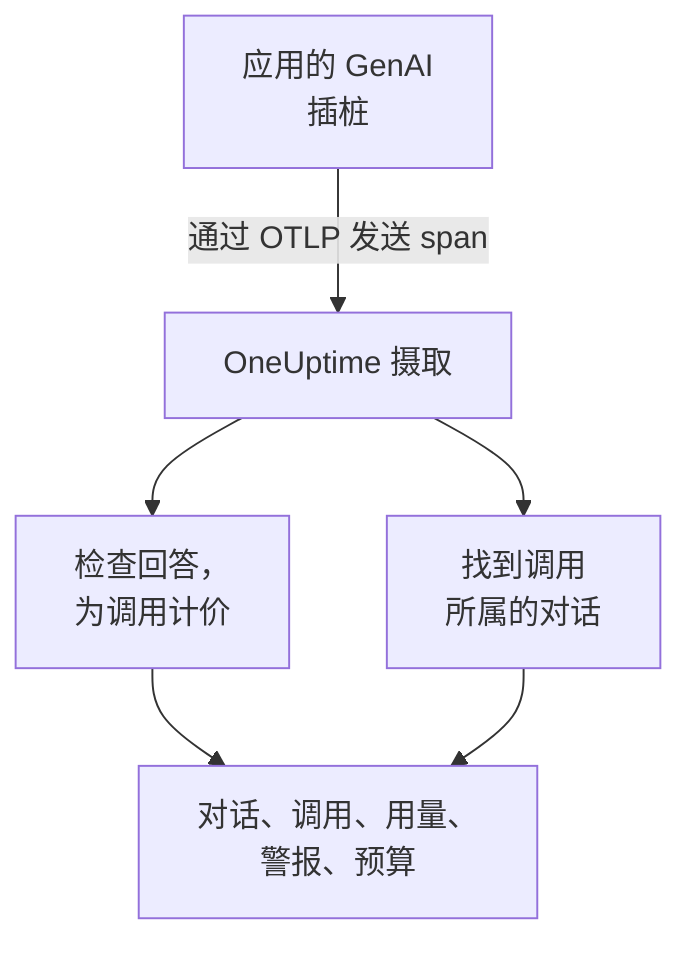
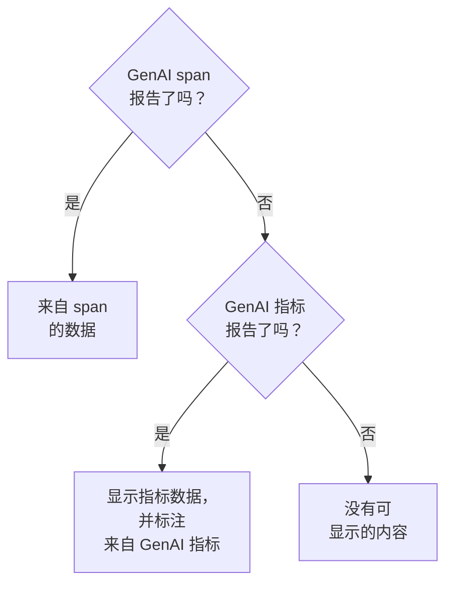

# AI / LLM 可观测性

阅读 AI 进行过的每一段对话，按当时的节奏重新播放，并在 AI 回答不佳时收到通知。OneUptime 完全基于标准 OpenTelemetry 构建这一切：只要你的应用发送遵循 **GenAI 语义约定** （`gen_ai.*`）的 span，你就能得到对话、警报、用量和成本，无需专有 SDK。

:::cards
- [开始设置](#五步完成设置): 五个步骤，从第一个 span 到被标记的回答。
- [重新播放对话](#阅读和重新播放对话): 按对方看到的样子、按当时的节奏阅读一段聊天。
- [接收警报](#ai-回答不佳时收到通知): 针对失败、被拒绝、被截断、被标记或过慢的回答的现成警报。
- [关注支出](#查看谁在花什么钱): 按人员、团队、模型和应用划分的成本，以及每日预算。
:::

## 工作原理

应用的 GenAI 插桩把对模型的每次调用导出为一个 OpenTelemetry span。span 到达时，OneUptime 读取它的 `gen_ai.*` 属性，检查回答是否有问题，为调用计价，并把它归入所属的对话。



在 **可观测性** 下打开 **产品 → AI / LLM** 。这个产品有七个标签页：

| 标签页 | 显示内容 |
| --- | --- |
| **对话** | AI 进行过的每一段对话，需要关注的排在最前。列表上方显示：对话数、AI 回答数、需要关注的数量、成本和典型回答时间。 |
| **调用** | 每一次模型、嵌入、代理和工具调用。可按服务、提供商、模型、操作、人员、团队或对话筛选；点击某次调用即可在跟踪查看器中打开。 |
| **用量** | 某个时间范围内的调用、token 和成本，按员工、团队、模型、提供商或应用排名。 |
| **警报** | 针对 AI 回答不佳的现成警报，以及你的 AI / LLM 监视器。 |
| **预算** | 每日成本上限，以可设置警报的指标形式发布。 |
| **定价** | 为内置价目表中没有的模型设置你自己的价格。 |
| **设置** | 下面的五个步骤，以及你项目的端点。 |

在跟踪查看器中，每次 AI 调用的 span 还有一个 **LLM** 标签页：提供商、模型、token、成本、请求参数，以及提示词和回答。

## 开始之前

- 一个你可以在其中创建遥测摄取密钥的 OneUptime 项目。
- 一个调用模型的应用，以及适用于其语言的 GenAI 插桩： **OpenLLMetry** （Traceloop）、 **OpenInference** （Arize）、 **Vercel AI SDK** ，或适用于 OpenAI、Anthropic 和 Gemini 的 OpenTelemetry 插桩。

> [!TIP]
> 经过 LiteLLM 或 Portkey 等网关的模型流量，可以从网关导出，而不必从每个应用导出：请参阅 [AI 网关](/docs/telemetry/ai-gateways)。关于工程师使用的编程助手，请参阅 [AI 编程助手](/docs/telemetry/ai-coding-assistants)。

## 五步完成设置

只需第一步就能看到调用。之后的每一步都会让你看到更多。

:::steps
### 发送你的 AI 调用

在 **项目设置 → 遥测与 APM → 摄取密钥** 下创建一个摄取密钥（ [OpenTelemetry 快速入门](/docs/telemetry/open-telemetry#创建摄取密钥) 会逐步介绍）。然后把你的插桩指向 OneUptime：

:::tabs
@tab Python
```bash
pip install traceloop-sdk opentelemetry-exporter-otlp
```

```python
from traceloop.sdk import Traceloop

Traceloop.init(
    app_name="my-ai-agent",
    api_endpoint="https://oneuptime.com/otlp",
    headers={"x-oneuptime-token": "YOUR_INGESTION_TOKEN"},
)
# Your OpenAI, Anthropic and LangChain calls are now traced.
```
@tab Node.js
```bash
npm install @traceloop/node-server-sdk
```

```typescript
import * as traceloop from "@traceloop/node-server-sdk";

traceloop.initialize({
  appName: "my-ai-agent",
  baseUrl: "https://oneuptime.com/otlp",
  headers: { "x-oneuptime-token": "YOUR_INGESTION_TOKEN" },
});
```
@tab OpenTelemetry SDK
```bash
export OTEL_EXPORTER_OTLP_ENDPOINT="https://oneuptime.com/otlp"
export OTEL_EXPORTER_OTLP_HEADERS="x-oneuptime-token=YOUR_INGESTION_TOKEN"
export OTEL_EXPORTER_OTLP_PROTOCOL="http/protobuf"
export OTEL_SERVICE_NAME="my-ai-agent"
```
:::

自托管 OneUptime？请用 `https://YOUR-ONEUPTIME-HOST/otlp` 代替 `https://oneuptime.com/otlp`。调用一次模型，这次调用就会出现在 **调用** 中。

### 记录说了什么

只有当你的插桩记录了内容时，对话中才会显示人们问了什么、AI 答了什么。除非你设置 `TRACELOOP_TRACE_CONTENT=false`，OpenLLMetry 会记录提示词和回答。OpenTelemetry 插桩只有在你要求时才会记录：

```bash
export OTEL_INSTRUMENTATION_GENAI_CAPTURE_MESSAGE_CONTENT=true
```

较新的 OpenTelemetry 插桩接受 `span_only`、`event_only` 或 `span_and_event`，而不是 `true`。即使没有记录内容，对话仍会显示其耗时、成本和问题。提示词可能包含敏感数据： [隐私与脱敏](#隐私与脱敏) 说明了如何在存储前将其屏蔽。

### 把调用归入对话

聊天应用每一轮调用一次模型。在每次 AI 调用上把 `gen_ai.conversation.id`（或 `session.id`）设为你的聊天 ID，每个聊天就会显示为一段对话，无论它用了多少次调用和多少个跟踪。使用 OpenLLMetry 时，每个请求设置一次即可：

```python
from traceloop.sdk import Traceloop

Traceloop.set_association_properties({
    "session_id": chat.id,
    "user_email": user.email,
})
```

使用 Vercel AI SDK 时，把聊天 ID 作为 `experimental_telemetry: { metadata: { sessionId } }` 传入。没有对话 ID 的调用仍会显示，每次一个请求（一个跟踪）。

### 说明是谁问的

在每次 AI 调用上设置 `user.id` 或 `user.email`（上面的关联属性会设置邮箱）。这样每段对话都会显示对方是谁，你可以按人员搜索列表， **用量** 标签页也会按员工对支出排名。 [员工和团队归属](/docs/telemetry/ai-coding-assistants#员工和团队归属) 列出了 OneUptime 读取的所有身份键。

### 标记不佳的回答

OneUptime 会在每个回答到达时检查它，并标记出了什么问题：

| 问题 | 含义 | 判断依据 |
| --- | --- | --- |
| 失败 | 调用以错误结束，因此没有回答 | span 状态 Error、`error.type`，或结束原因 `error` |
| 被拒绝 | AI 拒绝回答，或安全过滤器拦截了回答 | 因拒绝或安全原因结束（`content_filter`、`refusal`、`SAFETY` 等）、回答中的拒绝，或以英文固定拒绝语开头的回答 |
| 被截断 | 回答在 token 上限处停止 | 结束原因 `length`、`max_tokens` 或 `MAX_TOKENS` |
| 空 | 既没有文本也没有工具调用 | 记录的内容为空，或输出 token 为 0 |
| 被标记 | 你的应用发送的评估认为回答不佳 | `gen_ai.evaluation.result` 事件 |

前四种无需你做任何事。若要标记被你的护栏、评估或“踩”按钮否决的回答，请在 span 仍处于打开状态时，向回答的 span 添加一个 `gen_ai.evaluation.result` 事件，并把 `gen_ai.evaluation.score.label` 设为 `fail`：

```python
from opentelemetry import trace

trace.get_current_span().add_event(
    "gen_ai.evaluation.result",
    {
        "gen_ai.evaluation.name": "relevance",
        "gen_ai.evaluation.score.label": "fail",
        "gen_ai.evaluation.explanation": "The answer is about another product.",
    },
)
```

`incorrect`、`wrong`、`unhelpful`、`toxic`、`unsafe` 和 `hallucination` 等标签也算作失败。OneUptime 从不把你的对话发给另一个 AI 去评判：每项检查只读取调用本身携带的信息。
:::

## 阅读和重新播放对话

对话会像聊天应用显示历史记录那样整段打开：对方说的话在右边，AI 的回答在左边，附带模型、时间、token 和成本，工具调用夹在中间，出问题的地方会在发生处标出。回答下方的 **详情** 会显示它停止的原因、它的评估，以及指向跟踪中该调用的链接。

底部的进度条会按对方经历的样子重新播放对话：

| 控件 | 作用 |
| --- | --- |
| **重新播放** | 从第一条消息开始，按当时的节奏播放对话。回答在路上时，“AI 正在回答…”会计时。点击任意消息的时间即可从那里开始播放。 |
| **跳过等待** | 默认开启：缩短任何超过 3 秒的静默。 |
| `1x` | 更改速度：1x、2x、4x 或 8x。 |
| **K** 、 **J** 或 **←** 、 **L** 或 **→** | 播放或暂停、后退一条消息、前进一条消息。 |

页面地址会保存播放停止时的消息（`?step=`），因此你分享的链接会在那个时刻打开。

## AI 回答不佳时收到通知

**警报** 标签页列出了大多数 AI 应用需要的警报。选择其中一个会打开已填好内容的 **创建监视器** ，保存前你可以修改任何内容：

| 警报 | 何时通知你 | 严重性 |
| --- | --- | --- |
| 回答出错 | 15 分钟内超过 5% 的回答失败、被拒绝、被截断、为空或被标记 | Warning |
| AI 调用失败 | 5 分钟内超过 10% 的模型调用以错误结束 | Critical |
| AI 拒绝回答 | 30 分钟内超过 5% 的回答是拒绝 | Warning |
| 回答被截断 | 30 分钟内有 3 个或更多回答在 token 上限处停止 | Warning |
| 回答被标记 | 某项评估把回答标记为不佳 | Warning |
| 回答缓慢 | 15 分钟内超过 10% 的回答耗时超过 30 秒 | Warning |
| AI 停止回答 | AI 在 30 分钟内没有给出任何回答 | Critical |

基于回答比例的警报还会等到至少有 3 个不佳回答才触发，因此两个回答中有一个不佳不会呼叫任何人。Critical 警报会采用你项目中最严重的警报严重性，Warning 警报则采用下一级：在新项目中分别是 High 和 Low。

每个警报都是一个 **AI / LLM** 监视器。它的设置决定什么算作不佳回答（ **出现以下情况时将回答计为不佳** 、 **或耗时超过（秒）** ）、每次检查回看多远（ **时间窗口** ，默认 15 分钟）、监视哪些 **应用** ，以及在 **更多字段** 下监视哪个 **模型** 。 **预览** 会显示监视器此刻会统计到什么。它的条件比较三个数字： **不佳的 AI 回答 (%)** 、 **不佳的 AI 回答** 和 **AI 回答** 。

现成警报会触发一个能自行解决的警报，并在回答不佳期间把监视器显示为 **Degraded** 。它的事件已填好但处于关闭状态：如需呼叫某人，请将其开启。

## 查看谁在花什么钱

**用量** 标签页显示某个时间范围（除非你另选，否则为最近 7 天）内的调用、token 和成本，以及按五种细分之一列出的前 25 名表格： **员工** 、 **团队** 、 **模型** 、 **提供商** 和 **应用 / 服务** 。没有指明任何人的调用计入 **未归属** ，从不丢弃。

人员和团队来自调用上的身份属性：请参阅 [员工和团队归属](/docs/telemetry/ai-coding-assistants#员工和团队归属)。

### span 优先，指标补充

GenAI span 携带一次调用的模型、token 和成本，因此只要有 span，它们就能回答一切。有些工具发布 token 和成本指标而不发送 GenAI span，大多数编程助手就是如此。OneUptime 只会为 span 没有报告的数字读取这些指标，并且从不把两者相加：许多插桩会为同一次调用同时发送两者，相加会让每一美元被计算两次。



| 位置 | 回退到指标的内容 | 何时 |
| --- | --- | --- |
| 输入和输出 token | 两个总数 | span 的 token 总数都为 0 |
| 成本（USD） | 成本，Codex 以微美元计的成本会换算为 USD | span 的成本总数为 0 |
| LLM 调用 | 无：仅限 span | — |
| **员工** 、 **团队** 、 **模型** 表 | 仅成本；调用和 token 单元格显示 `—` | 该表没有找到 span 行 |
| **提供商** 、 **应用 / 服务** 表 | 无：仅限 span | — |
| 对话 | 无：对话由 span 构建 | — |

取自指标的数字会标注 **来自 GenAI 指标** ，因为它在 **调用** 中没有对应的行。所以，一旦你的 GenAI span 报告了某个数字，只发送指标的工具所占的那部分就不会显示。若要单独查看这类工具的支出，请把它发送到一个没有 GenAI span 到达的专用项目。

## 一次调用的成本

插桩报告的成本（`gen_ai.usage.cost`）会原样使用，即使它为 0。没有报告时，OneUptime 会在 span 到达时，根据 token 数量和内置价目表估算成本，价目表涵盖 OpenAI、Anthropic、Google Gemini、Mistral、DeepSeek、xAI、Cohere、Amazon Nova 和 Meta Llama 的常用模型。先按实际响应的模型定价，再按请求的模型定价。

模型按最长的名称前缀匹配，因此 `gpt-4o-2024-08-06` 和 `us.anthropic.claude-sonnet-4-5-20250929-v1:0` 这类带日期或厂商修饰的 ID 也能找到其系列的价格。价目表不认识的模型，即使是新发布的，也绝不会被猜测：在你为它定价之前，其成本保持为 0。估算使用标价，不含缓存或批处理折扣。

若要自行为模型定价（协商费率、微调模型或你自托管的模型），请在 **定价** 标签页的 **自定义 LLM 定价** 中添加： **模型前缀** 、 **输入价格（每 100 万 token 美元）** 和 **输出价格（每 100 万 token 美元）** 。在你的价格和内置价目表之间，匹配最长前缀的胜出；长度相同时，你的价格胜出。价格适用于保存后大约一分钟起到达的调用；已存储的调用保留原有成本。

## 每日成本预算

预算按 UTC 日以 USD 跟踪一天的支出。OneUptime 每 15 分钟汇总当天的 AI 支出（来自 span，或在没有 span 报告支出时来自 GenAI 成本指标），显示在预算上，并发布两个指标：

| 指标 | 含义 |
| --- | --- |
| `oneuptime.llm.budget.spend.usd` | 当天到目前为止的支出，单位为 USD |
| `oneuptime.llm.budget.percent.used` | 支出占每日上限的百分比 |

两者都携带 `oneuptime.llm.budget.id` 和 `oneuptime.llm.budget.name`，以及预算的范围（如果有）。

:::steps
### 创建预算

在 **预算** 标签页上，点击 **创建LLM Cost Budget** 。为它设置名称和 **每日预算（美元）** ，范围留空表示整个项目，或者选择 **服务（可选）** 、 **LLM 提供商（可选）** 或 **LLM 模型（可选）** 。多个预算可以监视不同的范围。

### 为它设置警报

在 `oneuptime.llm.budget.percent.used` 上创建一个 [指标监控](/docs/monitor/metrics-monitor)，并按 `oneuptime.llm.budget.id` 筛选（重命名预算时名称会变）。添加一个触发警告的条件 `>= 80`，以及一个触发严重警报的条件 `>= 100`。

### 扩大窗口

把监视器的滚动窗口设为 30 分钟。预算每 15 分钟发布一个点，因此默认的 1 分钟窗口在两个点之间找不到任何东西。
:::

预算警报还可以运行一个工作流来阻止失控的代理：请参阅 [AI 代理熔断器](/docs/telemetry/ai-agent-circuit-breaker)。

## 仪表盘和指标警报

`gen_ai.client.token.usage` 和 `gen_ai.client.operation.duration` 等 GenAI 指标会作为普通的 OpenTelemetry 指标到达。你可以在 [仪表盘](/docs/dashboards/index) 上绘制它们，或用 [指标监控](/docs/monitor/metrics-monitor) 为它们设置警报，例如当按模型分组的 `gen_ai.client.operation.duration` 的 p95 超过阈值时。

## 隐私与脱敏

AI 调用以跟踪 span 的形式存储，因此跟踪的 **清理规则** 和 **丢弃过滤器** 也适用于它们：在存储之前屏蔽某个属性或丢弃某个 span。两者都在 **跟踪 → 设置** 下。员工邮箱列会与其来源属性一起被清理，因此屏蔽邮箱的规则也会覆盖这一列。

读取对话所需的权限与跟踪相同：能读取项目跟踪的人才能读取其对话，其他人都不能。

## OneUptime 读取的属性

OneUptime 读取 OpenTelemetry GenAI 约定，以及 OpenLLMetry、OpenInference、Vercel AI SDK 和 LiteLLM 使用的写法，因此常用的库可以直接使用。对每个值，span 上出现的第一个键胜出：

| 值 | 键（按尝试顺序） |
| --- | --- |
| 提供商 | `gen_ai.system`、`gen_ai.provider.name`、`llm.system`、`llm.provider` |
| 操作 | `gen_ai.operation.name`、`llm.request.type`、`openinference.span.kind` |
| 请求的模型 | `gen_ai.request.model`、`llm.model_name`、`llm.request.model` |
| 响应的模型 | `gen_ai.response.model`、`llm.response.model` |
| 输入 token | `gen_ai.usage.input_tokens`、`gen_ai.usage.prompt_tokens`、`llm.token_count.prompt`、`llm.usage.prompt_tokens` |
| 输出 token | `gen_ai.usage.output_tokens`、`gen_ai.usage.completion_tokens`、`llm.token_count.completion`、`llm.usage.completion_tokens` |
| 总 token | `gen_ai.usage.total_tokens`、`llm.token_count.total`、`llm.usage.total_tokens` |
| 成本（USD） | `gen_ai.usage.cost`、`gen_ai.usage.cost_usd`、`gen_ai.usage.total_cost`、`llm.usage.total_cost`、`gen_ai.cost.total_cost`、`litellm.cost.total` |
| 对话 | `gen_ai.conversation.id`、`session.id`、`langfuse.session.id`、`traceloop.association.properties.session_id`、`ai.telemetry.metadata.sessionId` |
| 代理 | `gen_ai.agent.name`、`agent.name` |
| 工具 | `gen_ai.tool.name`、`tool.name`、`ai.toolCall.name` |
| 结束原因 | `gen_ai.response.finish_reasons`、`gen_ai.response.finish_reason`、`llm.response.finish_reason`、`ai.response.finishReason` |
| 错误 | `error.type` |

当 span 带有其中任意一个值，或任何以 `gen_ai.`、`llm.` 或 `traceloop.` 开头的属性时，它就算作一次 AI 调用。没有报告总数时，总 token 为输入加输出。`gen_ai.usage.total_tokens` 和 `gen_ai.usage.cost` 这两个键不属于约定，约定对两者都没有定义；OneUptime 读取它们是因为常见的插桩会发送它们。

身份键（谁发起了调用，以及其团队）列在 [员工和团队归属](/docs/telemetry/ai-coding-assistants#员工和团队归属) 中。

### 提示词和回答从哪里读取

对话视图按以下顺序读取一次调用的消息：

- `gen_ai.client.inference.operation.details` 事件；
- `gen_ai.input.messages`、`gen_ai.output.messages` 和 `gen_ai.system_instructions` 属性；
- 旧的按角色划分的事件：`gen_ai.system.message`、`gen_ai.user.message`、`gen_ai.assistant.message`、`gen_ai.tool.message` 和 `gen_ai.choice`；
- 带索引的属性：OpenLLMetry 的 `gen_ai.prompt.N.content` 和 `gen_ai.completion.N.content`，OpenInference 的 `llm.input_messages.N.message.content` 和 `llm.output_messages.N.message.content`；
- `gen_ai.prompt`、`gen_ai.completion`、`ai.prompt.messages`、`ai.response.text`、`input.value` 和 `output.value` 中的消息数组。

## 故障排除

:::details 调用已到达，但没有任何对话显示文本
你的插桩没有记录内容。请按 [记录说了什么](#记录说了什么) 中的说明开启；在那之前的调用仍然没有文本。
:::

:::details 一个聊天的每次调用都显示为单独的对话
这些调用没有对话 ID。请按 [把调用归入对话](#把调用归入对话) 中的说明，在聊天的每次调用上设置 `gen_ai.conversation.id` 或 `session.id`。
:::

:::details 调用显示了 token，但成本为 $0
模型不在内置价目表中，或者 span 没有指明模型。请在 **定价** 标签页上添加该模型的价格；此后到达的调用会被定价。
:::

:::details 用量标签页显示“来自 GenAI 指标”，调用和 token 显示 `—`
这些数字来自只发送指标、不发送 GenAI span 的工具，例如编程助手。指标携带成本，但没有逐次调用的细节，因此这些单元格保持为空。请参阅 [span 优先，指标补充](#span-优先指标补充)。
:::

:::details 预算监视器在两种状态之间来回切换
监视器的滚动窗口短于 15 分钟，因此有时找不到任何点。请把它设为 30 分钟。
:::

## 后续步骤

:::cards
- [AI 编程助手](/docs/telemetry/ai-coding-assistants): Claude Code、Cursor、Codex、Gemini CLI 和 Copilot 按工程师划分的支出。
- [AI 网关](/docs/telemetry/ai-gateways): 通过一个 LiteLLM 或 Portkey 网关跟踪每个应用的模型调用。
- [AI 代理熔断器](/docs/telemetry/ai-agent-circuit-breaker): 预算警报触发时阻止失控的代理。
- [OpenTelemetry](/docs/telemetry/open-telemetry): 每种信号的端点、摄取密钥和限制。
:::
