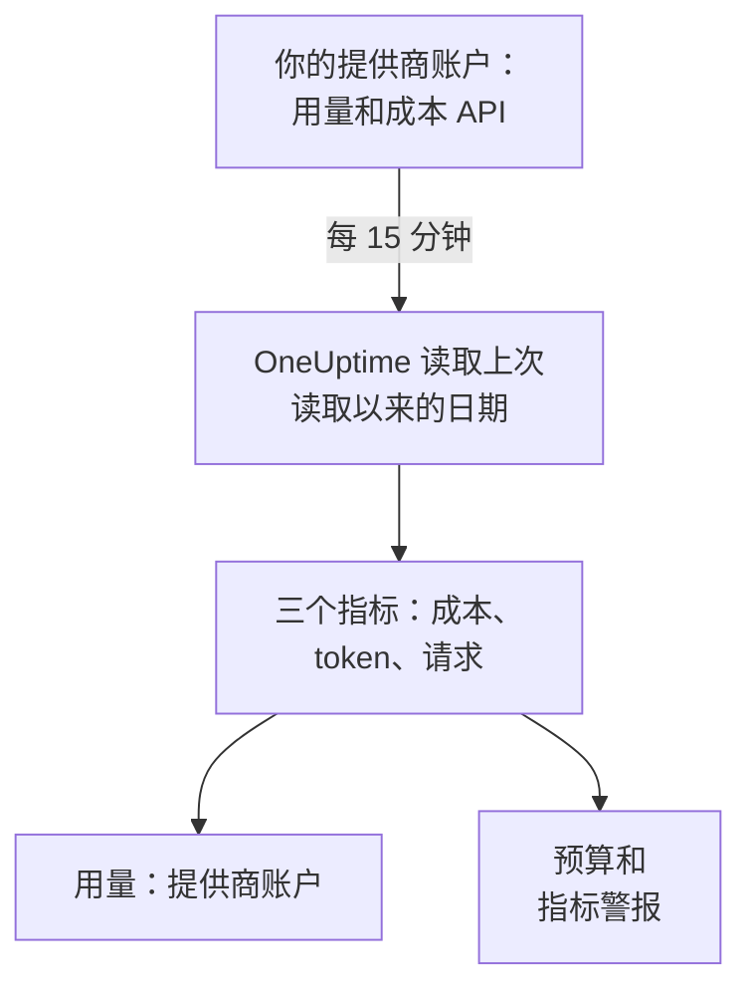

# AI 提供商账户

无需修改应用，即可查看你的 AI 提供商账户用了多少、花了多少。用只能读取的凭据连接 OpenAI、Anthropic、Azure OpenAI 和 Microsoft Foundry、Amazon Bedrock 或 Google Vertex AI 账户，OneUptime 就会每 15 分钟读取一次它的用量，写入 **用量** 、 **预算** 以及可以设置警报的指标。

:::cards
- [连接账户](#连接账户): 选择提供商，粘贴凭据，测试后连接。
- [每个提供商提供什么](#每个提供商提供什么): 成本、token 和请求，以及每个提供商如何分组。
- [查看用量](#查看用量): 按模型、人员、项目或资源、API 密钥和连接查看。
- [预算和警报](#预算和警报): 针对账单的每日预算，以及针对指标的警报。
:::

## 工作原理

OneUptime 每 15 分钟向每个已连接的账户请求按 UTC 日统计的用量，并把它保存为该连接专属服务的三个指标。每次读取都会获取上次读取以来的日期，并重新读取包括今天在内的最近 3 天，因为提供商会不断补充今天的数据，并修正刚过去的几天。

账户的用量就是它按天被收费的内容。其中没有对话、提示词或回答：如需这些，请按 [AI / LLM 可观测性](/docs/telemetry/ai-llm-observability) 的说明发送你应用的 AI 调用。两者分开保存，因此不会重复计算。

## 开始之前

- Project Owner 或 Project Admin 角色。只有他们可以连接、修改或删除账户；所有能读取项目遥测数据的人都能看到连接和用量。
- 由账户管理员提供的该账户凭据。下面每个提供商的部分会说明需要哪种凭据以及在哪里创建。
- 无需安装任何东西：OneUptime 从自己的服务器调用提供商的 API。

## 连接账户

:::steps
### 打开连接

打开 **产品 → AI / LLM → 连接** 。在 **你的 AI 提供商账户** 中点击提供商的磁贴。

### 粘贴凭据

在 **凭据** 中填写提供商要求的内容。密钥会加密存储，之后无论在仪表板还是通过 API 都不会再显示。 **名称** 以及大多数人不会修改的设置位于 **更多字段** 中。

### 测试

在 **测试** 中点击 **测试连接** 。OneUptime 会读取最近 7 天的用量，并显示它找到的内容：成本、token、请求、模型、人员、密钥和项目。在你连接之前不会保存任何内容。

### 连接

点击 **连接** 。第一次读取会在一分钟内开始，并导入最近 30 天的数据。
:::

已连接的账户会列在磁贴下方，并显示 **状态** 和 **上次读取** 。 **立即读取** 会立即读取， **测试** 会重新检查已保存的设置， **关闭** 会停止读取并保留已读取的数据， **编辑** 会修改设置：留空的密钥会保留已存储的值。 **View error** 会显示读取失败的原因，其中不含任何密钥。

## 每个提供商提供什么

| 提供商 | 成本 | 分组方式 | 凭据 |
| --- | --- | --- | --- |
| OpenAI | OpenAI 报告的金额 | 项目、API 密钥、人员和模型 | 管理员密钥 |
| Anthropic | Anthropic 报告的金额 | 工作区、API 密钥、人员和模型 | 管理员密钥 |
| Azure OpenAI 和 Microsoft Foundry | 根据 token 估算 | 资源和模型 | 拥有 Monitoring Reader 的应用 |
| Amazon Bedrock | 根据 token 估算 | 区域和模型 | 可读取 CloudWatch 的访问密钥 |
| Google Vertex AI | 根据 token 估算 | 区域和模型 | 拥有 Monitoring Viewer 的服务账户 |

除 Anthropic 外，每个提供商还会统计请求数：Anthropic 的用量报告没有请求数。估算成本使用 [一次调用的成本](/docs/telemetry/ai-llm-observability#一次调用的成本) 中的价目表和你在 **定价** 中设置的价格，并标记为估算值。价目表不认识的模型没有成本，直到你在那里为它定价。

这些凭据都不能调用模型：每一种都只读取用量、成本或指标。

## OpenAI

OneUptime 用管理员密钥读取你的 OpenAI 组织：按天、模型、项目、API 密钥和人员统计的 completions 和 embeddings 用量，以及按项目和明细项统计的每天成本。每一项成本会分摊给使用过该模型的密钥和人员，因此人员所在的行也有成本。项目名、密钥名和人员的邮箱会替换 OpenAI 的 ID。

:::steps
### 创建 OpenAI 管理员密钥

在 OpenAI 的控制台中打开 Settings、Organization、Admin keys，然后创建一个密钥。只有组织所有者可以创建。它以 `sk-admin-` 开头。

### 连接 OpenAI

把密钥粘贴到 **管理员密钥** 中。
:::

## Anthropic

OneUptime 用管理员密钥读取你的 Claude API 组织：按天、模型、工作区、API 密钥和人员统计的消息用量报告，以及按工作区和明细项统计的成本报告，并以同样的方式分摊。使用组织的密钥或 Console 登录的 Claude Code 也包含在这些报告中，归在使用它的人员或密钥下。

:::steps
### 创建 Anthropic 管理员密钥

在 Claude Console 中打开 Settings、Admin keys，然后创建一个密钥。只有组织管理员可以创建。它以 `sk-ant-admin01-` 开头。

### 连接 Anthropic

把密钥粘贴到 **管理员密钥** 中。
:::

## Azure OpenAI 和 Microsoft Foundry

OneUptime 从 Azure Monitor 读取订阅中的每个 Azure OpenAI 和 Foundry 资源：按天、资源和模型统计的 token 和请求。Azure Monitor 统计的是 token 而不是金额，也不指明人员或密钥，因此成本是 OneUptime 的估算值，人员和密钥为空。

:::steps
### 注册应用

在 Microsoft Entra ID 中注册一个应用，并为它创建客户端密码。

### 允许它读取指标

在订阅上为该应用授予 Monitoring Reader 角色。

### 连接 Azure

填写 **目录（租户）ID** 、 **应用程序（客户端）ID** 、 **订阅 ID** 和 **客户端密钥** 。对于 Azure Government，请在 **更多字段** 中修改 **云** 。
:::

## Amazon Bedrock

OneUptime 读取你指定的每个区域的 CloudWatch 指标 `AWS/Bedrock`：按天和模型统计的输入、输出和缓存 token 以及调用次数。CloudWatch 统计的是 token 而不是金额，也不指明人员或密钥：成本是 OneUptime 的估算值，每个区域显示为一个项目。

:::steps
### 创建访问密钥

创建一个 IAM 用户或角色，其策略允许 `cloudwatch:GetMetricData` 和 `cloudwatch:ListMetrics`，并为它创建访问密钥。

### 连接 Bedrock

填写 **访问密钥 ID** 、 **秘密访问密钥** 和 **区域** ，以逗号分隔：如果不修改，则为 `us-east-1`。
:::

## Google Vertex AI

OneUptime 读取 Vertex AI 为其模型（Gemini 以及 Claude 等合作伙伴模型）发布的 Cloud Monitoring 指标：按天、区域和模型统计的输入和输出 token 以及调用次数。Cloud Monitoring 统计的是 token 而不是金额，也不指明人员或密钥：成本是 OneUptime 的估算值。

:::steps
### 创建服务账户

在项目中创建一个具有 Monitoring Viewer 角色的服务账户，并为它创建 JSON 密钥。

### 连接 Vertex AI

填写 **项目 ID** ，并把整个密钥文件粘贴到 **服务账户密钥（JSON）** 中。
:::

## 查看用量

打开 **用量** 并选择 **提供商账户** 。这里会显示你的账户在该时间范围内报告的成本、token 和请求，并按 **模型** 、 **人员** 、 **提供商** 、 **项目或资源** 、 **API 密钥** 或 **连接** 排名。由于提供商按整天报告，时间范围从第一天的 UTC 零点开始。

**提供商账户** 和 **你的 AI 调用** 永远不会相加。你的应用使用某个已连接账户的密钥发起的调用会同时出现在两者中，相加就会重复计算。

## 预算和警报

一个预算只统计其中一种。在 **预算** 中创建预算，并把 **支出统计来源** 设为 **提供商账户** ：它统计已连接账户在该 UTC 日被收费的金额，如果你设置了 **LLM 提供商（可选）** 和 **LLM 模型（可选）** ，则按它们缩小范围。提供商会延迟几分钟到几小时报告一天的用量，因此如果需要在几分钟内收到警报，请改为对 **你的 AI 调用** 设置预算。

每个账户的用量都保存为三个指标，你可以在 [仪表板](/docs/dashboards/index) 上绘制图表，或用 [指标监控](/docs/monitor/metrics-monitor) 设置警报：

| 指标 | 说明 |
| --- | --- |
| `oneuptime.llm.provider.cost` | 一天的成本，以 USD 计 |
| `oneuptime.llm.provider.tokens` | 一天的 token 数，按 `gen_ai.token.type` 区分：`input`（包含缓存的 token）、`output`、`cache_read` 和 `cache_write` |
| `oneuptime.llm.provider.requests` | 一天的请求数 |

每个数据点的时间戳都是其 UTC 日的开始。它带有 `oneuptime.llm.connection.id` 和 `oneuptime.llm.connection.name`，以及提供商给出的 `gen_ai.provider.name`、`gen_ai.request.model`、`user.email`、`oneuptime.llm.provider.project` 和 `oneuptime.llm.provider.api_key`。估算成本带有 `oneuptime.llm.cost.estimated`。

## 何时读取

| 读取 | 时间 |
| --- | --- |
| 第一次 | 连接后一分钟内，回溯 30 天 |
| 之后 | 每 15 分钟 |
| 密钥或权限被拒绝之后 | 60 分钟后 |
| 其他任何失败之后 | 15 分钟后 |
| 已关闭 | 重新开启前不读取 |

没有遥测功能的套餐不会读取任何内容。删除连接会停止它的读取，并保留它读取过的内容，直到服务的保留期将其删除。

## 为什么 OneUptime 没有自己的网关

OneUptime 读取你的账户；它从不位于你的应用和提供商之间。代理会持有你的提供商密钥，并给你的应用的每次模型调用多加一跳。如果你的模型流量已经经过 LiteLLM、Portkey 或 OpenRouter，请按 [AI 网关](/docs/telemetry/ai-gateways) 的说明把网关的跟踪发送到 OneUptime，并连接账户以获取账单。

## 故障排除

:::details 测试提示密钥或机密未被接受
请检查你是否完整复制、它是否已被吊销，以及它是否是该提供商要求的类型：OpenAI 或 Anthropic 的管理员密钥，而不是项目密钥或 API 密钥。
:::

:::details 凭据有效，但无法读取连接所需的内容
为它授予本页为该提供商列出的角色：Azure 订阅上的 Monitoring Reader、AWS 上的两个 CloudWatch 操作、Google Cloud 项目上的 Monitoring Viewer。
:::

:::details 测试通过，但今天没有任何数据
提供商会在几分钟到几小时后报告一天的用量，并在之后一两天内修正。后续读取会把它导入。
:::

:::details 成本与发票不同
报告的成本是提供商在税费、赠金和折扣之前的金额。估算成本是按目录价，或按你在 **定价** 中设置的价格计算的 token 费用。
:::

## 后续步骤

:::cards
- [AI / LLM 可观测性](/docs/telemetry/ai-llm-observability): 你自己应用的 AI 调用的对话、警报和成本。
- [公司的 AI 工具](/docs/telemetry/ai-company-tools): 你的员工向 Claude Enterprise 和 Microsoft 365 Copilot 提了什么问题。
- [AI 网关](/docs/telemetry/ai-gateways): 跟踪经过 LiteLLM、Portkey 或 OpenRouter 的每次模型调用。
- [指标监控](/docs/monitor/metrics-monitor): 针对提供商指标设置警报。
:::
