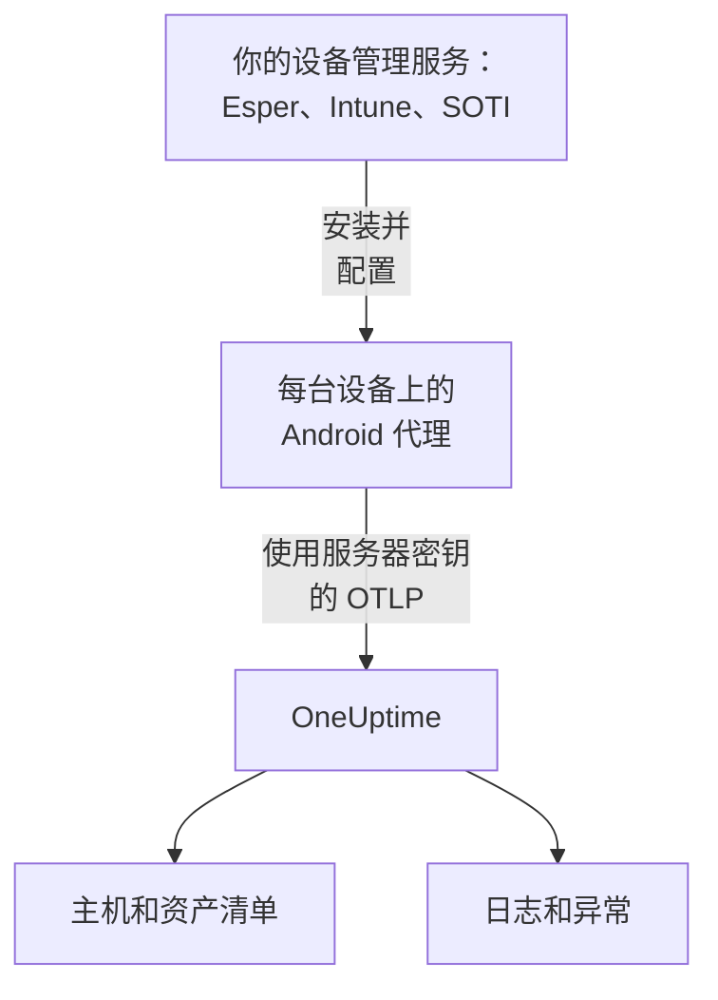

# Android 代理

OneUptime Android 代理会把你的组织拥有的 Android 设备（例如点餐自助终端、POS 终端、手持终端或数字标牌播放器）的情况上报到 OneUptime：它的内存、存储、网络、电池和温度，它的重启，安装在上面的应用，以及其上各个应用的崩溃和日志。你的设备管理服务会一次性为整个设备群安装并配置它。每台设备都会成为 **主机** 中的一台主机和 **资产清单** 中的一个条目，与你的服务器和 Windows 机器并列。

:::cards
- [何时使用](#代理还是应用插桩): 代理看到的是设备，应用插桩看到的是你的应用。
- [使用 Esper 部署](#使用-esper-部署): 上传 APK，推送设置，启动一次。
- [设置](#设置): 其托管配置中的每个键。
- [读取其他应用的日志](#读取其他应用的日志): 通过 adb 或你的设备管理服务授予一次 READ_LOGS。
- [日志会话](#日志会话): 一段时间内每个应用的日志，由设备前的人允许。
:::

## 工作原理

代理是一个以前台服务方式运行的小应用。它每分钟读取一次设备的健康状况，并连同设备的重启、已安装的应用和日志，使用 **服务器** 摄取密钥通过 OTLP 发送到你的 OneUptime。设备启动时它会自行启动；网络中断期间，它把收集到的数据保留在设备上，并在网络恢复后发送。它从不让休眠的设备保持唤醒，并会压缩发送的数据。



## 代理还是应用插桩

| | 应用中的 [OpenTelemetry Android](/docs/rum/android-setup) | Android 代理 |
| --- | --- | --- |
| 能看到什么 | 你的应用：它的崩溃、ANR、屏幕、会话、请求和工作流 | 设备：内存、存储、网络、电池、重启、已安装的应用，以及每个应用的崩溃和 ANR |
| 显示在哪里 | **真实用户监控** 、 **追踪** 和 **异常** | **主机** 、 **资产清单** 、 **日志** 和 **异常** |
| 如何安装 | 写在应用的代码中 | 作为应用，通过你的设备管理服务安装 |

在你拥有的设备上，两者都用，并在两边给设备取相同的名称：代理的 `device_name` 设置，以及你的应用设置的 `host.name` 。这样设备在 **资产清单** 中就是一个条目，应用的遥测和设备的遥测汇集在一起。

## 开始之前

- 运行 Android 7.0 或更高版本的设备，并由支持 Android 托管配置的设备管理服务管理：Esper、Microsoft Intune、Workspace ONE、SOTI 以及其他 Android Enterprise 设备管理服务。如果只有一台设备，用 adb 就够了。
- 一个 **服务器** 摄取密钥，在 **项目设置 → 遥测与 APM → 摄取密钥** 中通过 **创建摄取密钥** 创建。
- 代理： `oneuptime-android-agent.apk` ，附在每个 [OneUptime 发布版本](https://github.com/OneUptime/oneuptime/releases/latest) 中。
- 从设备到你的 OneUptime URL 的出站 HTTPS。由于每个请求都携带摄取密钥，代理会拒绝不是 `https://` 的 URL。

## 使用 Esper 部署

:::steps
### 上传 APK

在 Esper 控制台中，把 `oneuptime-android-agent.apk` 上传到 **App Library** ，并把它添加到要监视的设备的蓝图（blueprint）中。

### 推送设置

在蓝图中，打开代理的 **Managed Configuration** ，粘贴它的设置。使用 Esper Agent 8.00.0764 或更高版本时，Esper 会在每台设备上填入占位符：

```json title="Managed configuration"
{
  "oneuptime_url": "https://oneuptime.com",
  "oneuptime_token": "YOUR_TELEMETRY_INGESTION_TOKEN",
  "device_name": "${esper.deviceName}",
  "device_serial": "${esper.serialNumber}",
  "device_type": "kiosk",
  "labels": "region=emea"
}
```

如果你自行托管 OneUptime，请把你自己的 URL 填入 `oneuptime_url` 。然后对设备执行 Converge，让它们读取新设置。

### 启动一次

在新安装的应用被打开过一次之前，Android 不会在开机时启动它。请在 Multi-App mode 的蓝图中为代理开启 **Launch on Start** ，或在每台设备上打开一次代理。此后，每次设备开机以及每次更新之后，它都会自行启动。

### 在 OneUptime 中找到设备

一分钟内，每台设备都会以其 `device_name` 命名，出现在 **主机** 下和 **资产清单** 中。设备上代理自己的界面会说明它是否正在上报，以及没有上报时是什么阻止了它。
:::

其他设备管理服务的用法相同：把 APK 添加为业务线（LOB）应用或内部应用，在其应用配置中设置相同的键，并在每台设备上打开一次。

## 设置

代理从其托管配置中读取以下键。没有托管配置的设备，可以改在代理自己的界面上设置 URL、摄取密钥和设备名称。在那里输入的密钥会使用 Android Keystore 加密存储。

| 键 | 设置的内容 | 默认值 |
| --- | --- | --- |
| `oneuptime_url` | 你的 OneUptime URL | `https://oneuptime.com` |
| `oneuptime_token` | 一个 **服务器** 摄取密钥 | 无：没有它，代理什么也不发送 |
| `device_name` | 设备在 **主机** 和 **资产清单** 中的名称，也是它在那里的身份标识 | 设备型号加上其 Android ID 的开头部分 |
| `device_serial` | 设备的序列号，从 Android 10 起 Android 不再向应用提供 | 无 |
| `device_type` | 设备是什么，例如自助终端、POS 终端或手持终端 | `Android device` |
| `device_location` | 设备在哪里，例如门店编号 | 无 |
| `labels` | 主机的标签，写成以逗号分隔的 `name=value` 对 | 无 |
| `collection_interval_seconds` | 上报频率，30 到 600 秒 | `60` |
| `logcat_enabled` | 是否发送从 Logcat 读取的内容 | `true` |
| `logcat_min_level` | 在 Android 12 及更早版本上发送的 Logcat 行的最低级别： `verbose` 、 `debug` 、 `info` 、 `warn` 、 `error` 或 `fatal` | `warn` |
| `installed_apps_enabled` | 是否发送已安装的应用 | `true` |

设备管理服务没有填入的占位符（例如原样发来的 `${esper.deviceName}` ）会被忽略，代理的界面也会说明这一点。设备开始上报后，请保持 `device_name` 不变：新名称就是一台新主机。

代理的界面、它的通知，以及你的设备管理服务为这些键显示的标题和说明，都以设备的语言显示，涵盖 OneUptime 仪表板支持的每一种语言。

## 读取其他应用的日志

Android 只允许拥有 READ_LOGS 权限的应用读取其他应用的日志，而且只有 adb 能授予这个权限：应用自己不能，设备策略也不能。在每台设备上授予一次，它就会在重启和更新后一直保持授予状态：

```bash
adb shell pm grant com.oneuptime.androidagent android.permission.READ_LOGS
```

使用 Esper 时，请通过 **Secure Remote ADB** 运行该命令：为设备开启 ADB 访问，用 `espercli secureadb connect -d DEVICE_ID` 连接，然后运行命令。授予权限后，Android 会重启代理，代理随即开始读取。

之后代理读取的内容取决于 Android 版本：

- Android 13 及更高版本：每个应用的崩溃和 ANR。Android 只向屏幕上显示的应用展示其他应用的日志行，而且要经设备前的人允许，因此在后台运行的代理无法读取它们。可以用 [日志会话](#日志会话) 在一段时间内请求获取它们。
- Android 12 及更早版本：每个应用的崩溃和 ANR，以及每个应用 `logcat_min_level` 及以上级别的日志行。

没有 READ_LOGS 时，代理仍会上报其他所有内容，它的界面和设备的日志会说明如何授予该权限。

### 崩溃堆栈和重启原因

Android 会把每个应用崩溃、原生崩溃和 ANR 的完整报告，以及每次重启的原因，保存在它的 DropBox 中。当代理拥有 READ_LOGS 和使用情况访问权限，并在 Android 15 及更高版本上拥有 READ_DROPBOX_DATA 时，它会读取每个应用的这些内容。与 READ_LOGS 一样，用 adb 授予一次：

```bash
adb shell pm grant com.oneuptime.androidagent android.permission.READ_DROPBOX_DATA
adb shell appops set com.oneuptime.androidagent GET_USAGE_STATS allow
```

第一条命令适用于 Android 15 及更高版本；使用情况访问权限也可以在设备的 **设置 → 使用情况访问权限** 中开启。设备策略无法授予这些权限，代理的界面会列出仍需运行的命令。授予之后， **异常** 中的每个崩溃都有完整的堆栈追踪，原生崩溃有其信号和崩溃所在的库，ANR 有其主线程的堆栈， **日志** 中的重启则有 Android 给出的原因。代理读取的内容中的卡号、电子邮件地址、令牌和密码会在发送前被替换为 `[card number]` 、 `[email]` 、 `[token]` 和 `[redacted]` 。

### CPU 使用率

Android 8 及更高版本不向应用提供设备的 CPU 使用率。只有设备所有者应用才能读取它，而且只在硬件会报告它的设备上可行。代理在成为设备所有者时读取它；你可以用 adb 在没有任何账号、也没有其他设备所有者的设备上进行设置：

```bash
adb shell dpm set-device-owner com.oneuptime.androidagent/.admin.AgentDeviceAdminReceiver
```

已由你的设备管理服务拥有的设备不能再有第二个所有者，因此无法获取其 CPU 使用率，代理的界面也会说明这一点。此时它的 CPU 使用率不会出现在主机列表中，也不会为它提供 **High CPU Utilization** 模板。

## 日志会话

日志会话会在一段时间内发送设备上每个应用的日志，用于排查设备的问题。在 Android 13 及更高版本上，这是读取其他应用日志行的唯一方法，因为 Android 只向屏幕上显示的应用展示它们，而且要经设备前的人允许。

:::steps
### 发起请求

在 **主机** 中打开设备，再打开 **日志** ，然后在 **日志会话** 中点击 **请求日志会话** 。选择设备发送日志的时长（15 分钟到 4 小时），以及它发送的最低级别： **信息** 、 **调试** 或 **详细** 。

### 在设备上允许

一分钟内，设备会显示一条通知，说明有人请求了它的日志，并附上此人的名字。设备前的人打开代理并点按 **允许** 。在 Android 13 及更高版本上，Android 随后会询问是否允许访问所有设备日志，此人也要允许。

### 查看日志行

会话显示为 **正在收集** ，每个应用的日志行都会进入设备的日志。点击 **显示日志行** 即可单独查看该会话的日志行。会话会在时间到期时结束，或在有人于设备上停止它、或在 OneUptime 中取消它时结束。
:::

会话需要 READ_LOGS 和 `logcat_enabled` ；缺少它们时显示为 **不可用** 。一台设备上同一时间只运行一个会话。一小时内无人允许的请求会过期；设备在会话期间重启时，会话随之结束，因为 Android 的权限会随代理进程一起结束。请求会话需要编辑该主机的权限，主机的 **审计日志** 会记录是谁、在何时提出了请求。

## 上报的内容

| 内容 | 在 OneUptime 中的位置 |
| --- | --- |
| 内存、存储、网络和运行时间 | **主机** 中该设备的页面：与服务器的收集器发送的指标相同，因此主机警报模板同样适用 |
| 电池电量和温度，以及设备是否接通外部电源 | 指标 `hw.battery.charge` 、 `hw.temperature` 和 `android.battery.plugged` |
| 热状态 | 指标 `android.thermal.status` 和 `android.thermal.headroom` |
| CPU 使用率 | 指标 `system.cpu.utilization` ：在 Android 7 上，以及在代理是 [设备所有者](#cpu-使用率) 的 Android 8 及更高版本上 |
| 重启 | **日志** ，用 `@event.name:device.boot` 查找：设备此前运行了多久、是否正常关机、关机了多久、为什么重启，以及重启循环 |
| 已安装的应用 | **日志** ，用 `@event.name:android.package.inventory` 查找：每天一次，以及每次安装、更新和移除 |
| 每个应用的崩溃和 ANR | **异常** ，作为未处理异常，以应用命名；代理读取 [DropBox](#崩溃堆栈和重启原因) 时附带其堆栈 |
| 制造商、型号、序列号、操作系统版本、安全补丁级别和固件 | 该设备在 **资产清单** 中的条目 |

在 **主机** 中，设备的操作系统显示为 Android，并带有 Android 的标志。

设备在过去一小时内的启动次数是指标 `android.boot.recent_count` ，不断重启的设备会在每次启动时记录一条警告日志。在 **主机** 中，Android 设备会获得自己的警报模板：Device Unplugged、Low Battery、Device Overheating、Restart Loop 和 Storage Nearly Full，以及 Host Stopped Reporting、Host Restarted 和 High Memory Utilization，并在上报 CPU 使用率后获得 High CPU Utilization。每个警报最先给出的调试命令都是 adb 命令。请参阅 [主机监控](/docs/monitor/host-monitor#android-设备) 。

## 故障排除

:::details 设备没有出现在主机中
在设备上打开代理：它的界面会说明问题所在，例如缺少摄取密钥、URL 无法使用，或者上传失败及其原因。安装后从未打开过代理的设备并没有启动它：请打开一次，或开启 **Launch on Start** 。
:::

:::details 代理提示 OneUptime 拒绝了摄取密钥
请使用已开启且未过期的 **服务器** 密钥。设备发来的 **浏览器** 密钥会被拒绝。
:::

:::details 没有来自其他应用的日志
按照 [读取其他应用的日志](#读取其他应用的日志) 中的说明授予 READ_LOGS。在 Android 13 及更高版本上，除非有 [日志会话](#日志会话) 正在运行，否则只会读取其他应用的崩溃和 ANR。
:::

:::details 日志会话一直停留在等待审批
设备前还没有人允许它。必须有人在设备上打开代理并点按 **允许** ，在 Android 13 及更高版本上，还要在代理显示在屏幕上时允许 Android 的提示。被 Android 的提示拒绝的会话显示为 **已拒绝** ：请重新请求一个。
:::

:::details 两台设备显示为一台主机
它们的 `device_name` 相同。请使用因设备而异的占位符，例如 `${esper.deviceName}` 或 `${esper.serialNumber}` 。
:::

## 后续步骤

:::cards
- [Android 端设置](/docs/rum/android-setup): 使用 OpenTelemetry Android 为你自己的应用插桩。
- [主机](/docs/telemetry/hosts): 主机的页面、读数和警报。
- [主机监控](/docs/monitor/host-monitor): 在设备停止上报或存储空间不足时收到警报。
- [异常](/docs/telemetry/exceptions): 分诊你的设备上报的崩溃和 ANR。
:::
