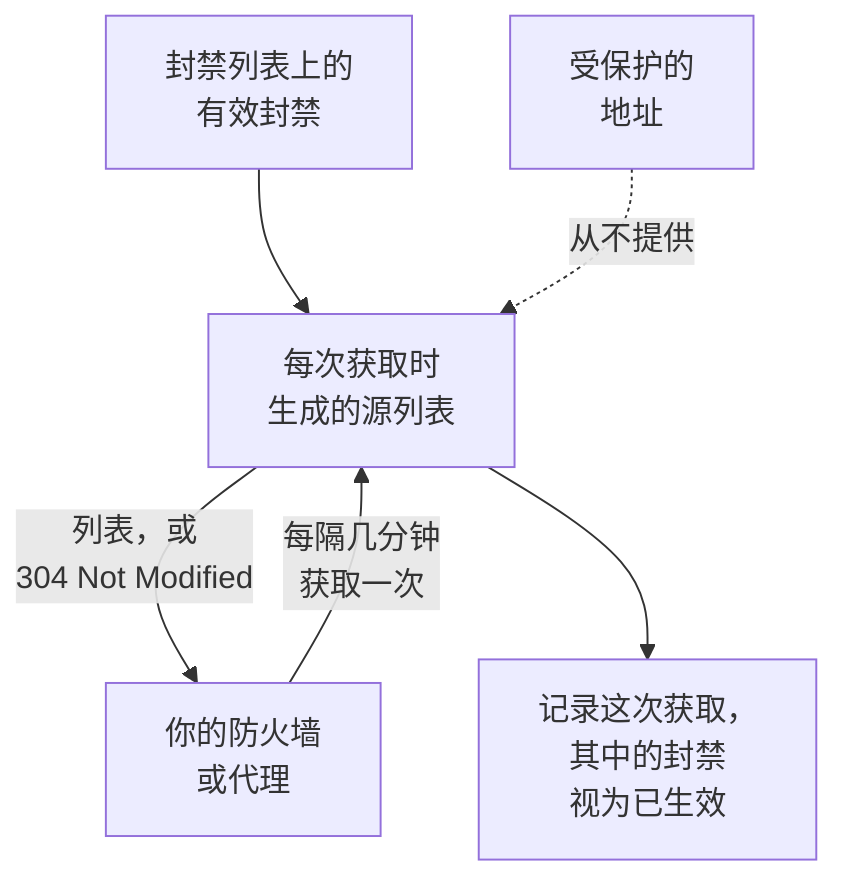

# 适用于防火墙和代理的封禁列表源

封禁列表源是一个秘密 URL，防火墙或代理每隔几分钟从中读取项目的[封禁列表](/docs/telemetry/security-cases#封禁列表)。Palo Alto Networks、FortiGate、Check Point、Cisco Secure Firewall、OPNsense 和 pfSense 把它当作外部列表读取；从 OneUptime 复制的命令则通过 nftables、ipset、nginx、HAProxy 或 Windows 防火墙应用它。由防火墙主动连接 OneUptime，因此 OneUptime 不需要进入你网络的路由，也不需要防火墙的密码。

:::cards
- [创建源](#创建源)：选择防火墙，复制密钥，按照它的步骤操作。
- [设置防火墙](#设置防火墙)：每种防火墙和代理的步骤，以及获取频率。
- [封禁何时生效](#封禁何时生效)：只有在防火墙获取了包含它的列表之后。
- [轮换或撤销密钥](#轮换或撤销密钥)：新密钥与旧密钥重叠一天，或立即全部停用。
:::

## 工作原理



每次获取时，都会根据那一刻有效的封禁生成列表。过期或解除的封禁会从下一次获取中消失，受保护的地址永远不会出现在列表中，即使它是在被封禁之后才受保护的。只有在防火墙获取了包含某个封禁的列表之后，该封禁才在源上视为已生效。

## 开始之前

- 能从 `https` URL 读取地址列表的防火墙或代理，或者可以用 root 或管理员身份运行命令的 Linux 或 Windows 主机。
- 防火墙能通过 HTTPS 访问 OneUptime：`https://oneuptime.com`，或你自己的 OneUptime 服务器地址。
- 可以创建源的角色：项目所有者、项目管理员或安全管理员。安全成员和安全查看者可以查看源及其获取记录。请参阅[角色](/docs/permissions/reference#角色)。

## 创建源

:::steps
### 打开封禁列表源

打开 **产品 → 安全事件 → 剧本 → 封禁列表源**。

### 新建一个源

点击 **创建封禁列表源**，并选择读取它的 **防火墙**。**名称** 是封禁列表在显示封禁生效位置时对该源的称呼；留空时会以防火墙命名，例如“FortiGate feed”。在 **更多字段** 下，**提供** 用于选择 IPv4 和 IPv6、仅 IPv4 或仅 IPv6，**允许的来源地址** 用于限制谁可以读取该源。

### 复制密钥

源的页面打开时会显示它的密钥，且只显示一次：OneUptime 只保存它的哈希。复制密钥，然后点击 **完成**。在你离开页面之前，页面上的步骤会为你填好密钥。

### 按照防火墙的步骤操作

**设置防火墙** 会显示要粘贴的 URL、防火墙发送密钥的方式，以及在防火墙自己的控制台中要执行的步骤，并已填好相应的值。在那里选择其他防火墙，即可查看它的步骤。防火墙第一次获取后，源的状态会变为 **正在读取**，**获取记录** 中也会列出这次获取。
:::

## 源提供的内容

| 文件 | 适用于 | 内容 |
| --- | --- | --- |
| `blocklist.txt` | Palo Alto Networks、pfSense、ipset、HAProxy、Windows 防火墙以及其他任何防火墙 | 每行一个地址或范围。 |
| `blocklist.txt?comments=1` | 会跳过以 `#` 开头的行的 FortiGate、Check Point、Cisco Secure Firewall 和 OPNsense | 每个地址或范围之前有一行说明封禁原因。 |
| `nftables.nft` | nftables | 供 `nft -f` 使用的文件，会清空并重新填充 `inet oneuptime` 表中的 `blocklist_v4` 和 `blocklist_v6` 集合。 |
| `nginx.conf` | nginx | 每个地址或范围一行 `deny`。 |
| 在文件名后加上 `.md5`，例如 `blocklist.txt.md5` | Cisco Secure Firewall | 文件的 MD5，让防火墙只在列表变化时才下载。 |

源的 URL 是 `https://oneuptime.com/api/blocklist-feed/<feed ID>/<file>`，源的页面会显示为你的防火墙填好的 URL。加上 `?comments=1` 后，列表如下：

```text
# OneUptime case CASE-42 until 2026-11-21 10:42 UTC
203.0.113.7
# OneUptime blocklist until lifted
198.51.100.0/24
```

源提供动作为 **封禁** 的有效封禁。它从不提供质询，因为防火墙无法执行质询；仅提供 IPv4 或仅提供 IPv6 的源会排除另一类地址。由于 nftables 不接受同一集合中相互重叠的条目，nftables 文件会排除已被列表中其他范围包含的地址。

没有任何封禁时，`blocklist.txt` 只包含一个地址 `192.0.2.1`（仅提供 IPv6 的源为 `2001:db8::1`）。这是专供文档使用的地址，互联网上没有来自它的流量：Palo Alto Networks 和 Cisco 在收到空列表时会保留上一次读取的列表，因此空列表会让你已解除的封禁继续生效。

每个响应都带有 `ETag`。防火墙在 `If-None-Match` 中把它发回时，只要列表没有变化，就会收到 `304 Not Modified`，OneUptime 提供的命令也是这样做的。

## 防火墙如何发送密钥

| 方式 | 防火墙发送的内容 | 使用者 |
| --- | --- | --- |
| 基本认证 | 任意用户名（例如 `oneuptime`），密码为密钥 | Palo Alto Networks（仅限 HTTPS）、FortiGate 和 Check Point |
| Bearer 令牌 | `Authorization: Bearer <secret>` | 用于 nftables、ipset、nginx、HAProxy 和 Windows 防火墙的命令 |
| URL 中的密钥 | `https://oneuptime.com/api/blocklist-feed/<feed ID>/<secret>/blocklist.txt` | 文档中没有说明发送密钥方式的 Cisco Secure Firewall、OPNsense 和 pfSense |

没有密钥或密钥错误的请求会收到 `401 Unauthorized`。包含错误密钥的 URL 会收到 `404 Not Found`，与不存在的地址一样。OneUptime 自己的 Web 服务器不会把源的 URL 写入访问日志，因此 URL 中的密钥不会留在那里。

## 限制谁可以读取源

**更多字段** 下的 **允许的来源地址** 最多可填写 50 个地址和范围，每行一个，例如 `203.0.113.7` 或 `198.51.100.0/24`。来自其他地址的请求即使带有正确的密钥，也会收到 `403 Forbidden`。留空则允许持有密钥的任何地址读取该源。

每个地址每分钟最多获取同一个源 60 次，所有源合计每分钟最多 600 次。超过后会收到带有 `Retry-After` 头的 `429 Too Many Requests`。

## 封禁何时生效

封禁创建之后，只要防火墙获取了包含它的列表，该封禁就在源上视为已生效，并在每次这样的获取后持续 10 分钟。`304 Not Modified` 响应也算作获取了同一个列表。此时 **封禁列表** 的 **生效于** 中该源的标签会变成绿色，提示信息会说明防火墙在封禁创建多久后获取了它，例如“防火墙在此封禁创建 3 分钟 后从 FortiGate feed 获取了它。最近一次获取：2 分钟前。”

如果 10 分钟内没有获取，标签会显示防火墙此后再未获取该源：防火墙可能仍在封禁该地址，但 OneUptime 无法确认。因此，请让你的防火墙每 5 分钟或更频繁地获取源。获取频率较低的防火墙（例如 OPNsense）在两次获取之间仍会封禁，而 OneUptime 只在每次获取后的 10 分钟内认为封禁在那里已生效。

过期或解除的封禁会从下一次获取中消失，它的标签会等待防火墙获取不含它的列表。当 OneUptime 无法读取哪些地址受保护时，源会返回带有 `Retry-After: 60` 的 `503 Service Unavailable`，而不是一个可能包含受保护地址的列表；防火墙会保留已有的列表。

## 防火墙停止读取时

OneUptime 会了解每个源通常多久被获取一次。如果某个源在其通常间隔的三倍时间内（且至少 10 分钟）没有被获取，它的状态会显示 **已停止读取**，**封禁列表** 会在列表上方列出它，项目所有者会收到一封邮件：“Your firewall stopped reading the blocklist feed _源名称_”。在防火墙获取两次之前，OneUptime 预期的获取频率是每 5 分钟一次，OPNsense 为每小时一次，pfSense 为每天一次。

下一次获取会清除这一状态；以后再次停止时，会再发送一封邮件。密钥已被撤销的源永远不会被视为已停止。

## 轮换或撤销密钥

源页面上的 **轮换密钥** 会创建新的密钥并只显示一次。被替换的密钥在 24 小时内仍然有效，以便你把新密钥配置到每台防火墙；**获取记录** 会把仍使用旧密钥的获取标记为 **上一个密钥**。在这 24 小时内再次轮换，最旧的密钥会立即失效。

**撤销密钥** 会让密钥及其上一个密钥立即失效：请在密钥泄露时使用。之后源不再响应任何人，它的防火墙会保留已有的列表但无法刷新，直到 **轮换密钥** 创建新的密钥。删除源会一并删除源、它的密钥和获取记录。

## 设置防火墙

源的页面会针对你选择的防火墙显示这些步骤，并填好 URL、用户名，以及在密钥刚创建后填好密钥。

| 防火墙 | 文件 | 密钥 | 获取频率 | 上限 |
| --- | --- | --- | --- | --- |
| Palo Alto Networks | `blocklist.txt` | 基本认证 | 5 分钟（可设置的最短间隔） | 30 个自定义列表，总计 50,000 个地址（PA-3200、PA-5200 和 PA-7000 系列为 150,000 个） |
| FortiGate | `blocklist.txt?comments=1` | 基本认证 | 5 分钟（1 到 43,200 分钟，默认 5 分钟） | 所有威胁源合计 300,000 个地址 |
| Check Point | `blocklist.txt?comments=1`，IPv4 | 基本认证 | 5 分钟（默认每小时） | 每个源 50,000 个地址 |
| Cisco Secure Firewall | `blocklist.txt?comments=1` 及其 MD5 | 在 URL 中 | 5 分钟（默认 2 小时） | |
| OPNsense | `blocklist.txt?comments=1` | 在 URL 中 | 1 小时（可设置的最短间隔） | |
| pfSense | `blocklist.txt` | 在 URL 中 | 1 天（可设置的最短间隔） | |
| nftables、ipset、nginx、HAProxy、Windows 防火墙 | 各自的文件 | Bearer 令牌 | 1 分钟 | |

### Palo Alto Networks

1. 在 Web 界面中前往 **Objects → External Dynamic Lists**，然后点击 **Add**。
2. 将 **Type** 设为 **IP List**，将 **Source** 设为源的 URL `https://oneuptime.com/api/blocklist-feed/<feed ID>/blocklist.txt`。
3. 开启 **Client Authentication**，**Username** 填写 `oneuptime`，**Password** 填写源的密钥。
4. 将 **Check for updates** 设为 **Every Five Minutes**，点击 **OK** 并 commit。
5. 在 **Policies → Security** 中添加一条规则，将此列表设为 **Source Address**，动作设为 **Deny**，然后 commit。

Palo Alto Networks 只通过 HTTPS 发送用户名和密码。它只读取写在地址后面的注释，不读取单独成行的注释，因此它的源使用普通列表。请参阅 [Configure the Firewall to Access an External Dynamic List](https://docs.paloaltonetworks.com/pan-os/11-1/pan-os-admin/policy/use-an-external-dynamic-list-in-policy/configure-the-firewall-to-access-an-external-dynamic-list)。

### FortiGate

1. 前往 **Security Fabric → External Connectors**，点击 **Create New**，并在 **Threat Feeds** 下选择 **IP Address**。
2. 将 **URL of external resource** 设为源的 URL `https://oneuptime.com/api/blocklist-feed/<feed ID>/blocklist.txt?comments=1`。
3. 开启 **HTTP basic authentication**，**Username** 填写 `oneuptime`，**Password** 填写源的密钥。
4. 将 **Refresh Rate** 设为 5 分钟，然后点击 **OK**。
5. 在 **Policy & Objects → Firewall Policy** 中，将此源用作策略的 **Source**，并将 **Action** 设为 **DENY**。

请参阅 [Configuring a threat feed](https://docs.fortinet.com/document/fortigate/7.6.0/administration-guide/379433/configuring-a-threat-feed)。

### Check Point

1. 在 SmartConsole 中打开 **Object Explorer**，选择 **New → More → Network Object → Network Feed**。
2. 将 **Feed URL** 设为源的 URL `https://oneuptime.com/api/blocklist-feed/<feed ID>/blocklist.txt?comments=1`，**Format** 设为 **Flat list**，**Data type** 设为 **IP Address**。
3. 在 **Advanced Settings** 的 **Authentication** 中，**Username** 填写 `oneuptime`，密码填写源的密钥。
4. 将 **Check feed interval** 设为 5 分钟，点击 **Test Feed**，然后点击 **OK**。
5. 将此源用作动作为 **Drop** 的 Access Control 规则的 **Source**，然后安装策略。

Check Point 的网络源文档只说明了 IPv4 地址，因此为它创建的源只提供 IPv4。请参阅 [Network Feed](https://sc1.checkpoint.com/documents/R82/WebAdminGuides/EN/CP_R82_SecurityManagement_AdminGuide/Content/Topics-SECMG/Network_Feed.htm)。

### Cisco Secure Firewall

1. 在管理中心中选择 **Objects → Security Intelligence**，然后点击 **Add Network Lists and Feeds**。
2. 将 **Type** 设为 **Feed**，将 **Feed URL** 设为源的 URL `https://oneuptime.com/api/blocklist-feed/<feed ID>/<secret>/blocklist.txt?comments=1`，将 **MD5 URL** 设为在同一 URL 的 `blocklist.txt` 后加上 `.md5`。
3. 将 **Update Frequency** 设为 5 分钟并保存。
4. 在访问控制策略中打开 **Security Intelligence → Networks**，将此源添加到 **Block List**，然后保存并部署。

更新频率为 30 分钟或更短时，Cisco 需要 MD5 URL；而它的受管设备每 30 分钟从管理中心获取一次更新，因此封禁会在源被获取后最多 30 分钟内到达这些设备。请参阅 [Creating Security Intelligence feeds](https://docs.manage.security.cisco.com/cdfmc/t_creating_security_intelligence_feeds.html)。

### OPNsense

1. 前往 **Firewall → Aliases**，添加一个类型为 **URL Table (IPs)** 的别名。
2. 将 **Content** 设为源的 URL `https://oneuptime.com/api/blocklist-feed/<feed ID>/<secret>/blocklist.txt?comments=1`，将 **Refresh Frequency** 设为 0 天 1 小时。
3. 保存并点击 **Apply**，然后在 **Firewall → Rules** 中添加一条规则，封禁 **Source** 为此别名的流量。

OPNsense 最多每小时获取一次 URL 表，因此 OneUptime 只在每次获取后的 10 分钟内确认其封禁。两次获取之间它仍会继续封禁。请参阅 [Aliases](https://docs.opnsense.org/manual/aliases.html)。

### pfSense

1. 前往 **Firewall → Aliases**，点击 **Add** 并选择 **URL Table (IPs)**。
2. 输入源的 URL `https://oneuptime.com/api/blocklist-feed/<feed ID>/<secret>/blocklist.txt`，并将其设置为每 1 天刷新一次。
3. 点击 **Save** 和 **Apply Changes**，然后在 **Firewall → Rules** 中添加一条规则，将此别名设为 **Source**，动作设为 **Block**。

> [!WARNING]
> pfSense 最多每天获取一次 URL 表：太慢，无法在攻击发生时封禁。请将它用于长期封禁，并搭配一台每隔几分钟获取一次的防火墙。

请参阅 [Alias Types](https://docs.netgate.com/pfsense/en/latest/firewall/aliases-types.html)。

### nftables

以 root 身份运行一次源页面上显示的命令。它们会创建带有 `blocklist_v4` 和 `blocklist_v6` 两个集合的 `inet oneuptime` 表、在其 `input` 和 `forward` 链中丢弃来自集合中地址的流量的规则，以及脚本 `/usr/local/sbin/oneuptime-blocklist`。脚本把密钥保存在只有 root 能读取的 `/etc/oneuptime-blocklist` 中。

```bash
# Run once, as root.
install -d -m 700 /etc/oneuptime-blocklist /var/lib/oneuptime-blocklist
printf 'Authorization: Bearer %s\n' 'YOUR_FEED_SECRET' > /etc/oneuptime-blocklist/auth
chmod 600 /etc/oneuptime-blocklist/auth
cat > /usr/local/sbin/oneuptime-blocklist <<'SCRIPT'
#!/bin/sh
# Loads the OneUptime blocklist into nftables when it changed.
set -eu
URL='https://oneuptime.com/api/blocklist-feed/<feed ID>/nftables.nft'
STATE=/var/lib/oneuptime-blocklist
if ! nft list table inet oneuptime >/dev/null 2>&1; then
  rm -f "$STATE/etag"
  nft -f - <<'NFT'
table inet oneuptime {
  set blocklist_v4 { type ipv4_addr; flags interval; auto-merge; }
  set blocklist_v6 { type ipv6_addr; flags interval; auto-merge; }
  chain input {
    type filter hook input priority filter; policy accept;
    ip saddr @blocklist_v4 drop
    ip6 saddr @blocklist_v6 drop
  }
  chain forward {
    type filter hook forward priority filter; policy accept;
    ip saddr @blocklist_v4 drop
    ip6 saddr @blocklist_v6 drop
  }
}
NFT
fi
TMP=$(mktemp)
trap 'rm -f "$TMP" "$TMP.h"' EXIT
ETAG=$(cat "$STATE/etag" 2>/dev/null || true)
CODE=$(curl --silent --show-error --max-time 60 --header @/etc/oneuptime-blocklist/auth \
  ${ETAG:+--header "If-None-Match: $ETAG"} \
  --dump-header "$TMP.h" --output "$TMP" --write-out '%{http_code}' "$URL")
[ "$CODE" = 304 ] && exit 0
[ "$CODE" = 200 ] || { echo "oneuptime-blocklist: the feed answered $CODE" >&2; exit 1; }
nft -f "$TMP"
sed -n 's/^[Ee][Tt][Aa][Gg]:[[:space:]]*//p' "$TMP.h" | tr -d '\r' > "$STATE/etag"
SCRIPT
chmod 700 /usr/local/sbin/oneuptime-blocklist
echo '* * * * * root flock -n /run/oneuptime-blocklist.lock /usr/local/sbin/oneuptime-blocklist' > /etc/cron.d/oneuptime-blocklist
/usr/local/sbin/oneuptime-blocklist
```

脚本每分钟由 `/etc/cron.d/oneuptime-blocklist` 运行。它只在列表变化时以单个事务加载 `nftables.nft`，因此集合永远不会处于填充了一半的状态。请参阅 [Sets](https://wiki.nftables.org/wiki-nftables/index.php/Sets)。

### ipset 和 iptables

以 root 身份运行一次源页面上显示的命令。它们会创建 `oneuptime_v4` 和 `oneuptime_v6` 两个集合，以及 iptables 和 ip6tables 在 `raw` 表 `PREROUTING` 链中丢弃来自集合中地址的流量的规则。

脚本每分钟由 cron 运行。列表变化时，它会填充两个新集合并替换旧集合，因此规则永远不会看到填充了一半的集合。请参阅 [ipset](https://ipset.netfilter.org/ipset.man.html)。

### nginx

将 include 行添加到要保护的每个站点的 `server` 块中，然后以 root 身份运行一次源页面上显示的命令：

```nginx
server {
    include /etc/nginx/oneuptime-blocklist.conf;
}
```

```bash
# Run once, as root.
install -d -m 700 /etc/oneuptime-blocklist /var/lib/oneuptime-blocklist
printf 'Authorization: Bearer %s\n' 'YOUR_FEED_SECRET' > /etc/oneuptime-blocklist/auth
chmod 600 /etc/oneuptime-blocklist/auth
touch /etc/nginx/oneuptime-blocklist.conf
cat > /usr/local/sbin/oneuptime-blocklist <<'SCRIPT'
#!/bin/sh
# Writes the OneUptime blocklist for nginx when it changed, and reloads nginx.
set -eu
URL='https://oneuptime.com/api/blocklist-feed/<feed ID>/nginx.conf'
STATE=/var/lib/oneuptime-blocklist
TMP=$(mktemp)
trap 'rm -f "$TMP" "$TMP.h"' EXIT
ETAG=$(cat "$STATE/etag" 2>/dev/null || true)
CODE=$(curl --silent --show-error --max-time 60 --header @/etc/oneuptime-blocklist/auth \
  ${ETAG:+--header "If-None-Match: $ETAG"} \
  --dump-header "$TMP.h" --output "$TMP" --write-out '%{http_code}' "$URL")
[ "$CODE" = 304 ] && exit 0
[ "$CODE" = 200 ] || { echo "oneuptime-blocklist: the feed answered $CODE" >&2; exit 1; }
cp /etc/nginx/oneuptime-blocklist.conf "$STATE/last.conf"
cp "$TMP" /etc/nginx/oneuptime-blocklist.conf
if nginx -t -q; then nginx -s reload; else cp "$STATE/last.conf" /etc/nginx/oneuptime-blocklist.conf; exit 1; fi
sed -n 's/^[Ee][Tt][Aa][Gg]:[[:space:]]*//p' "$TMP.h" | tr -d '\r' > "$STATE/etag"
SCRIPT
chmod 700 /usr/local/sbin/oneuptime-blocklist
echo '* * * * * root flock -n /run/oneuptime-blocklist.lock /usr/local/sbin/oneuptime-blocklist' > /etc/cron.d/oneuptime-blocklist
/usr/local/sbin/oneuptime-blocklist

# Then add this line to the server block of the site to protect, and reload nginx:
#   include /etc/nginx/oneuptime-blocklist.conf;
```

脚本每分钟由 cron 运行。列表变化时，它会写入 `/etc/nginx/oneuptime-blocklist.conf`，用 `nginx -t` 检查配置并重新加载 nginx；检查失败时会恢复之前的文件。

在负载均衡器或 CDN 之后，除非配置了 realip 模块，否则 nginx 看到的是负载均衡器的地址，而不是访问者的地址：将 `set_real_ip_from` 设为负载均衡器的地址，将 `real_ip_header` 设为它发送的请求头，或者改为在负载均衡器上封禁。请参阅 [ngx_http_access_module](https://nginx.org/en/docs/http/ngx_http_access_module.html)。

### HAProxy

以 root 身份创建列表文件，并在 `haproxy.cfg` 中添加两行，然后重新加载一次 HAProxy：它的 Runtime API 只能更新 HAProxy 已在读取的列表。

```text
global
    stats socket /run/haproxy/admin.sock mode 660 level admin

frontend www
    http-request deny if { src -n -f /etc/haproxy/oneuptime-blocklist.lst }
```

然后运行源页面上显示的其余命令。脚本每分钟由 cron 运行，列表变化时会写入 `/etc/haproxy/oneuptime-blocklist.lst`，并通过 Runtime API 更新 HAProxy，无需重新加载。请参阅 [The Runtime API](https://docs.haproxy.org/3.4/management.html#9.3)。

### Windows 防火墙

以管理员身份在 PowerShell 中运行一次源页面上显示的命令。它们会把脚本和密钥保存在只有 SYSTEM 和 Administrators 能读取的 `C:\ProgramData\OneUptime\Blocklist` 中，并注册计划任务“OneUptime Blocklist”，以 SYSTEM 身份每分钟运行一次脚本。

脚本维护入站规则来封禁列表中的每个地址，每条规则 1,000 个：“OneUptime blocklist 0”、“OneUptime blocklist 1”，依此类推。请参阅 [Set-NetFirewallRule](https://learn.microsoft.com/en-us/powershell/module/netsecurity/set-netfirewallrule)。

### 其他防火墙

1. 将你的防火墙或代理指向源的 URL `https://oneuptime.com/api/blocklist-feed/<feed ID>/blocklist.txt`：每行一个地址或范围。
2. 将源的密钥作为基本认证的密码（用户名任意）发送，或作为 Bearer 令牌发送。
3. 让它每 5 分钟或更频繁地获取列表：每次获取后的 10 分钟内，封禁在那里视为已生效。

### Kubernetes

在集群前面的边缘或云 WAF 上封禁：在 **安全连接** 或 **云连接** 中把它连接为封禁列表的生效位置；或者在集群前面你自己运行的代理上，使用 nginx 或 HAProxy 的命令。社区版 Ingress NGINX 控制器已经停止维护，其代码仓库已于 2026 年 3 月归档，因此 OneUptime 不为它的注解提供文档。请参阅 [Ingress NGINX Retirement](https://kubernetes.io/blog/2025/11/11/ingress-nginx-retirement/)。

## 限制

| 项目 | 限制 |
| --- | --- |
| 源中的条目 | 20,000 个 |
| 允许的来源地址 | 50 个地址和范围 |
| 一个地址获取同一个源的次数 | 每分钟 60 次 |
| 一个地址获取所有源的次数 | 每分钟 600 次 |
| 被替换的密钥继续有效的时间 | 24 小时 |
| 获取后封禁视为已生效的时间 | 10 分钟 |
| 获取记录的保留时间 | 30 天 |

## 故障排除

:::details 防火墙收到 401 Unauthorized
它发送的密钥不是该源的密钥。请检查密码或 Bearer 令牌是否是完整的密钥，前后没有多余的字符。超过 24 小时前被替换的密钥已不再有效：**轮换密钥** 会创建新的密钥。
:::

:::details 防火墙收到 404 Not Found
URL 指向了不存在的源、源不提供的文件，或者 URL 中的密钥是错误的。请从源的页面重新复制 URL。
:::

:::details 防火墙收到 403 Forbidden
源的 **允许的来源地址** 中没有防火墙用于获取的地址。**获取记录** 会显示每次获取来自哪个地址。
:::

:::details 封禁的标签显示正在等待防火墙获取该源
封禁创建后还没有防火墙获取过该源。请查看源页面上的 **获取记录**：每 5 分钟获取一次的防火墙会在 5 分钟内应用该封禁。
:::

## 后续步骤

:::cards
- [安全案例和剧本](/docs/telemetry/security-cases)：从案例中手动封禁地址，或通过剧本封禁。
- [威胁情报](/docs/telemetry/threat-intelligence)：将已知的恶意地址导入 OneUptime。
- [安全事件](/docs/telemetry/security-events)：找出值得封禁的地址。
:::
