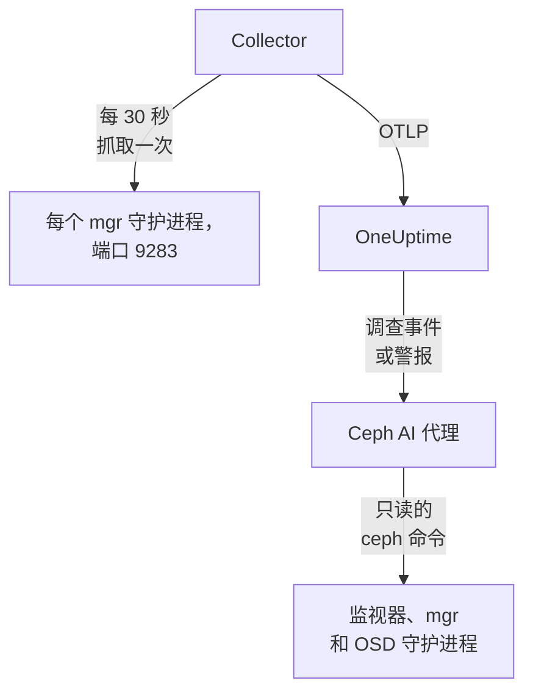

# Ceph 代理

OneUptime Ceph 代理监控 Ceph 集群：它的健康状况、监视器仲裁、OSD、存储池和归置组。它在每个 mgr 守护进程上抓取 Ceph mgr 的 `prometheus` 模块，为每个指标打上你的集群名称，并发送到 OneUptime，集群会在那里连同其 OSD、存储池和守护进程一起显示。[Ceph 监控](/docs/monitor/ceph-monitor) 会根据收到的数据发出警报。

:::cards
- [安装代理](#安装代理): 启用 mgr 模块，然后使用安装脚本或 Docker Compose。
- [代理收集的内容](#代理采集的内容): Ceph 页面、指标和警报模板背后的序列。
- [AI 代理](#ai-代理): 让 OneUptime AI 在调查时读取集群。
- [故障排查](#故障排查): 一个诊断脚本，以及常见问题。
:::

## 工作原理

代理是你在一台机器上用 Docker Compose 运行的两个容器。OpenTelemetry Collector 每 30 秒在每个 mgr 守护进程上抓取 mgr 的 `prometheus` 模块。只有活动的 mgr 会返回指标，因此当它故障转移到备用 mgr 时，指标会继续到达，无需任何更改。旁边的 Ceph AI 代理让 OneUptime AI 在调查事件或警报时运行只读的 `ceph` 命令。



集群会随其第一批数据，以代理作为 `ceph.cluster.name` 打到每个指标上的名称自行注册。

## 开始之前

- Docker Engine 20.10 或更高版本，带 Docker Compose v2 插件，所在机器能通过端口 9283 访问你的 Ceph mgr 守护进程。
- Ceph 管理节点上的一个 shell，`ceph` CLI 在其中能以管理员权限运行。
- 一个摄取密钥。在 **项目设置 → 遥测与 APM → 摄取密钥** 下创建一个并复制其值。
- 从该机器到你的 OneUptime URL 的出站 HTTPS。

## 安装代理

:::steps
### 启用 mgr 的 prometheus 模块

在 Ceph 管理节点上：

```bash
ceph mgr module enable prometheus
```

之后每个 mgr 守护进程都会在端口 `9283` 的 `/metrics` 上提供 Prometheus 指标。只有活动的 mgr 返回指标：备用 mgr 会返回空响应；如果 `mgr/prometheus/standby_behaviour` 设为 `error`，则返回 HTTP 错误。这就是代理要抓取每个 mgr 的原因。列出它们：

```bash
ceph mgr stat                    # active mgr
ceph orch ps --daemon-type mgr   # all mgrs (cephadm clusters)
```

### 安装并启动代理

:::tabs
@tab install.sh
下载安装脚本，并在将要托管代理的机器上运行它：

```bash
curl -sSL https://raw.githubusercontent.com/OneUptime/oneuptime/master/agents/CephAgent/install.sh -o install.sh
bash install.sh
```

脚本会询问你的 OneUptime URL、摄取密钥、集群名称和 mgr 端点，以及 [AI 代理](#ai-代理) 是否可以应用修复。在 `ceph` 能以管理员权限运行的地方，它还会提议为 AI 代理创建专用的 Ceph 客户端。它安装到 `/opt/oneuptime-ceph-agent`，写入一个 `0600` 权限的 `.env` 文件，并用 Docker Compose 启动代理。再次运行脚本会复用该 `.env` 中的所有内容，不会再次询问，这就是 [升级代理](#升级代理) 的方式。
@tab Docker Compose
从 [CephAgent 目录](https://github.com/OneUptime/oneuptime/tree/master/agents/CephAgent) 下载 `docker-compose.yml` 和 `otel-collector-config.yaml` 到一个新文件夹中：

```bash
mkdir oneuptime-ceph-agent && cd oneuptime-ceph-agent
curl -fsSLO https://raw.githubusercontent.com/OneUptime/oneuptime/master/agents/CephAgent/docker-compose.yml
curl -fsSLO https://raw.githubusercontent.com/OneUptime/oneuptime/master/agents/CephAgent/otel-collector-config.yaml
```

在它们旁边创建一个 `.env` 文件：

```bash title=".env"
ONEUPTIME_URL=YOUR_ONEUPTIME_URL
ONEUPTIME_TELEMETRY_INGESTION_KEY=YOUR_TELEMETRY_INGESTION_TOKEN
CEPH_CLUSTER_NAME=my-ceph-cluster
CEPH_MGR_ENDPOINTS=[ceph-mon-1:9283,ceph-mon-2:9283,ceph-mon-3:9283]
```

列出每个 mgr 守护进程，包括活动的和备用的，用逗号分隔并放在方括号中：方括号让 Collector 把该值读作抓取目标列表。启动代理：

```bash
docker compose up -d
```

AI 代理的容器也会启动，并等待它自己的 Ceph 客户端：参见 [AI 代理](#ai-代理)。
:::

### 检查代理是否在运行

```bash
docker compose ps
docker logs -f oneuptime-ceph-agent
```

`docker compose ps` 会列出 Collector（`oneuptime-ceph-agent`）和 AI 代理（`oneuptime-ceph-ai-agent`）。Collector 启动后，其日志中应出现这一行：

```text
Everything is ready. Begin running and processing data.
```

### 在 OneUptime 中找到集群

打开 **产品 → 基础设施 → Ceph → 所有集群**。大约一分钟内，集群会以其 `CEPH_CLUSTER_NAME` 出现，并带有其 OSD、存储池和守护进程。
:::

## 环境变量

安装脚本会把这些写入 `/opt/oneuptime-ceph-agent/.env`；Docker Compose 安装则从 `docker-compose.yml` 旁边的 `.env` 中读取它们。更改其中任何一个之后，请在该文件夹中运行 `docker compose up -d`。

| 变量 | 必需 | 说明 |
| --- | --- | --- |
| `ONEUPTIME_URL` | 是 | 你的 OneUptime URL，例如 `https://oneuptime.com` 或你的自托管实例。如果实例只支持 HTTP，请使用 `http://` 及其端口。 |
| `ONEUPTIME_TELEMETRY_INGESTION_KEY` | 是 | 来自 **项目设置 → 遥测与 APM → 摄取密钥** 的摄取密钥。 |
| `CEPH_CLUSTER_NAME` | 是 | 集群在 OneUptime 中的名称，作为 `ceph.cluster.name` 资源属性打到每个指标上。请保持不变：之后更改它会注册另一个集群。默认为 `ceph`。 |
| `CEPH_MGR_ENDPOINTS` | 是 | 每个 mgr 守护进程，写成放在方括号中、以逗号分隔的 `host:port` 列表，例如 `[ceph-mon-1:9283,ceph-mon-2:9283,ceph-mon-3:9283]`。安装脚本会为你加上方括号。 |

AI 代理自己的设置见 [AI 代理](#ai-代理)。

## 代理如何抓取

- **每个 mgr，每 30 秒一次。** mgr 的 `prometheus` 模块会把每次抓取结果缓存 `mgr/prometheus/scrape_interval`（默认 15 秒）。抓取频率切勿高于此值：否则只会再次读取缓存。
- **`honor_labels: true`。** Ceph 导出的标签（`ceph_daemon`、`pool_id`、每个守护进程的实例标签）保持原样。没有它，`instance` 标签会针对每个抓取目标被重写，并在每次活动 mgr 变化时改变，从而打断每个序列。

## 代理采集的内容

代理会发送 mgr 的 `prometheus` 模块导出的所有内容。OneUptime 的 Ceph 页面、指标目录和警报模板建立在以下序列之上：

| 类别 | 指标 |
| --- | --- |
| 集群健康 | `ceph_health_status`（0 = OK，1 = WARN，2 = ERR）、`ceph_health_detail`（每个活动的健康检查一个序列，带 `name` 和 `severity` 标签，从 Quincy 开始；健康检查警报模板和概览中 **Active Health Checks** 的数据来源）、`ceph_healthcheck_slow_ops`、`ceph_daemon_health_metrics`（按守护进程，以 `type` 为键）、`ceph_mon_quorum_status`、`ceph_mon_metadata`、`ceph_cluster_total_bytes`、`ceph_cluster_total_used_bytes` |
| OSD | `ceph_osd_up`、`ceph_osd_in`、`ceph_osd_apply_latency_ms`、`ceph_osd_commit_latency_ms`、`ceph_osd_stat_bytes`、`ceph_osd_stat_bytes_used`、`ceph_osd_numpg`、`ceph_osd_metadata`，按 OSD 以 `ceph_daemon` 标签区分（例如 `osd.3`） |
| 存储池 | `ceph_pool_stored`、`ceph_pool_max_avail`、`ceph_pool_objects`、`ceph_pool_rd`、`ceph_pool_wr`、`ceph_pool_rd_bytes`、`ceph_pool_wr_bytes`、`ceph_pool_metadata`。数据序列只带有 `pool_id` 标签；存储池的名称在 `ceph_pool_metadata` 上。 |
| 归置组 | `ceph_pg_total`、`ceph_pg_active`、`ceph_pg_clean`、`ceph_pg_degraded`、`ceph_pg_undersized`（均按存储池，以 `pool_id` 区分）、`ceph_num_objects_degraded`、`ceph_num_objects_misplaced` |
| 守护进程 | `ceph_mgr_metadata`、`ceph_mds_metadata` 和 `ceph_rgw_metadata`，加上上面的监视器和 OSD 元数据。每个都指明一个守护进程，并在 `ceph_version` 标签中带有其版本：**Daemons** 页面会列出它们。 |

### 更多抓取目标

mgr 模块涵盖集群的健康状况和容量。若要深入查看，请在 `otel-collector-config.yaml` 的 `scrape_configs` 下添加更多作业：

- **`ceph-exporter`（Reef 18.2 及更高版本）。** cephadm 在每台集群主机上运行一个 `ceph-exporter` 守护进程，在端口 `9926` 上提供每个守护进程的性能计数器。每台主机添加一个目标。
- **`node_exporter`。** 每台 Ceph 主机的 CPU、内存、磁盘和网络指标的常用搭档，默认端口为 `9100`。

两者都会从随附的 `resource` 处理器获得 `ceph.cluster.name` 资源属性，因此会落到 OneUptime 中的同一个集群上。

## 可选 — 发送 Ceph 集群日志

代理可以跟踪 `/var/log/ceph/ceph.log` 并将其发送到 OneUptime，从而填充集群的 **Cluster Log** 页面。它默认关闭，因为这时代理必须运行在拥有集群日志的主机上：默认是监视器主机。

:::steps
### 开启接收器

在 `otel-collector-config.yaml` 中，取消注释 `filelog` 接收器和 `logs` 管道。

### 挂载日志目录

在 `docker-compose.yml` 中，取消注释把该目录挂载到 Collector 中的卷：

```yaml
- /var/log/ceph:/var/log/ceph:ro
```

### 重启代理

```bash
docker compose up -d
```
:::

日志行在写入时即被发送。OneUptime 在显示时读取 `ceph.log` 的格式（时间、守护进程、`INF`/`WRN`/`ERR` 级别、消息），而 `resource` 处理器会打上 `ceph.cluster.name`，因此日志会落到这个集群上。

## 用项目标签标记集群

以 `oneuptime.label.` 开头的资源属性会成为集群上的项目标签：`oneuptime.label.<dimension>=<value>` 就是标签 `<dimension>:<value>`。在 `otel-collector-config.yaml` 的 `resource` 处理器中，紧挨着 `ceph.cluster.name` 添加这些属性：

```yaml
processors:
  resource:
    attributes:
      # ...existing attributes...
      - key: oneuptime.label.team
        value: storage
        action: upsert
      - key: oneuptime.label.env
        value: production
        action: upsert
```

Collector 只在启动时读取其配置：请运行 `docker compose restart oneuptime-ceph-agent`。之后集群会显示标签 `team:storage` 和 `env:production`。标签匹配不区分大小写，因此现有的 `Production` 标签会被复用而不是重复创建，并且代理绝不会删除别人在 OneUptime 中添加的标签。

## 作为 systemd 服务运行

要让代理随机器启动，并在失败时重新启动，请安装它的 systemd 单元。它假定代理位于 `/opt/oneuptime-ceph-agent`，即安装脚本放置它的位置：

```bash
sudo curl -fsSL https://raw.githubusercontent.com/OneUptime/oneuptime/master/agents/CephAgent/systemd/oneuptime-ceph-agent.service -o /etc/systemd/system/oneuptime-ceph-agent.service
sudo systemctl daemon-reload
sudo systemctl enable --now oneuptime-ceph-agent
```

## 升级代理

代理会把其文件所固定的 Collector 版本报告为它的 **代理版本**。当它比此 OneUptime 发布所固定的版本旧时，集群 **概览** 上它的旁边会出现警告标志。选择该标志即可看到这些命令。在其文件开始报告版本之前安装的代理，在以这种方式升级之前不会显示版本。

Collector 镜像固定在 `docker-compose.yml` 中，其配置是旁边的一个文件，因此仅拉取镜像并不能让代理升级。请再次运行 `install.sh`：它会复用你现有 `.env` 中的每个值（不会再询问任何内容），刷新 `docker-compose.yml` 和 `otel-collector-config.yaml`（你编辑过的文件会保留为 `<file>.bak.<timestamp>`），拉取镜像并重新创建代理，使 Collector 读取新的配置。AI 代理的 `ceph/` 文件夹保持原样。

```bash
curl -sSL https://raw.githubusercontent.com/OneUptime/oneuptime/master/agents/CephAgent/install.sh -o install.sh
bash install.sh
```

改用 Docker Compose 安装的？在代理的文件夹中重新下载这两个文件（并重新做一遍你对它们所做的任何修改），然后拉取镜像并重新创建代理：

```bash
curl -fsSLO https://raw.githubusercontent.com/OneUptime/oneuptime/master/agents/CephAgent/docker-compose.yml
curl -fsSLO https://raw.githubusercontent.com/OneUptime/oneuptime/master/agents/CephAgent/otel-collector-config.yaml
docker compose pull
docker compose up -d --force-recreate
```

## 卸载代理

```bash
cd /opt/oneuptime-ceph-agent
docker compose down
```

如果你创建了 AI 代理的 Ceph 客户端，请在管理节点上用 `ceph auth del client.oneuptime-ai` 删除它。

## AI 代理

代理的 `docker-compose.yml` 还会运行 **Ceph AI 代理**，即 `oneuptime-ceph-ai-agent`（镜像 `oneuptime/resource-ai-agent:release`）。当 OneUptime AI 调查此集群上的事件或警报时，它通过该代理运行只读的 `ceph` 命令——`ceph health detail`、`ceph osd tree`、`ceph pg dump_stuck`、`ceph crash ls`——并且仅在你允许时应用修复，例如把 OSD 重新标记为 in 或清除 `noout`。它和 Collector 一样，注册为名为 `CEPH_CLUSTER_NAME` 的集群，并显示在 OneUptime 中该集群的 **人工智能 → AI 代理** 页面上。

- **AI 调查默认开启。** 代理连接后，OneUptime AI 会用它来调查该集群上的事件和警报，集群的 **概览** 会显示代理的状态。要停止，请在代理运行的位置设置 `ONEUPTIME_AI_INVESTIGATION=false`（AI 代理页面上 **AI 可以执行的操作** 下的 **更改** 会显示方法），或者不安装代理。
- **它自己的 Ceph 客户端就是硬性边界。** 它以 `client.oneuptime-ai` 身份连接，使用集群的最小 `ceph.conf` 和该客户端的密钥环，二者放在 `docker-compose.yml` 旁边的 `ceph/` 文件夹中（以只读方式挂载到 `/etc/ceph`）。只有读取 caps 时，它运行的任何命令都无法更改集群。全新安装时，`install.sh` 会提议创建该客户端；再次运行时绝不会创建。切勿把 admin 密钥环放进该文件夹。
- 除非你设置 `ONEUPTIME_AI_ALLOW_WRITES=true` 并为客户端授予修复所需的 caps（代理的 README 列出了这些 caps），否则它是 **只读** 的；`ONEUPTIME_AI_WRITE_TARGETS`（例如 `osd.*,cluster`）限制修复可以触及的范围。同一个 `.env` 中的 `ONEUPTIME_AI_FIXES` 决定修复如何运行——`ask-for-approval`（由人逐一批准）、`automatic` 或 `bypass-approval`——AI 代理页面会以只读方式显示它（[AI 可以执行的操作，由代理设定](/docs/ai/infrastructure-ai-agents#what-ai-may-do-set-by-the-agent)）。
- 它向外连接到监视器（TCP 3300 和 6789）以及 mgr 和 OSD 守护进程（TCP 6800–7300），以 UID 1000 运行且不带任何 capabilities，绝不运行 `auth`、`config-key`、`tell` 或任何删除数据的命令。如果你不使用 OneUptime AI，请从 `docker-compose.yml` 中删除 `oneuptime-ceph-ai-agent` 服务。

要手动创建该客户端，请在 Ceph 管理节点上、代理的文件夹中运行以下命令（如果代理在另一台机器上，请把这两个文件复制到那台机器的 `ceph/` 文件夹中）：

```bash
mkdir -p ceph
ceph config generate-minimal-conf > ceph/ceph.conf
ceph auth get-or-create client.oneuptime-ai mon 'allow r' mgr 'allow r' osd 'allow r' -o ceph/ceph.client.oneuptime-ai.keyring
sudo chown 1000:1000 ceph/ceph.client.oneuptime-ai.keyring
sudo chmod 600 ceph/ceph.client.oneuptime-ai.keyring
docker compose up -d
```

它可以运行什么、修复如何工作以及如何排查它的问题：[Infrastructure AI Agents](/docs/ai/infrastructure-ai-agents#ceph-clusters)。

## 故障排查

:::details 先运行诊断脚本
代理附带一个脚本 [`troubleshoot.sh`](https://github.com/OneUptime/oneuptime/blob/master/agents/CephAgent/troubleshoot.sh)，它会检查整条链路：容器运行时、你配置的每个 mgr 端点、打到每个指标上的集群名称、令牌的格式、Collector 自身的指标，以及 OneUptime 是否接受摄取密钥。当没有任何端点返回 `ceph_health_status`，或只配置了一个端点时，它会发出警告，因为只有活动的 mgr 提供指标。密钥检查最重要。OneUptime 会以 `401` 拒绝错误的密钥（已禁用的密钥或浏览器密钥为 `422`），而 Collector 会把两者都视为永久性错误：它丢弃该批次并记录一条 `Exporting failed` 错误，而容器仍保持健康，这很容易被忽略。该脚本从代理的网络内部请求 `GET <url>/otlp/v1/validate`，直接得到 `200`（有效）或 `401`（无效），并在较旧的服务器上回退到 `POST /fluentd/v1/logs`。

```bash
curl -sSL https://raw.githubusercontent.com/OneUptime/oneuptime/master/agents/CephAgent/troubleshoot.sh -o troubleshoot.sh
bash troubleshoot.sh    # add -d <dir> if you installed outside /opt/oneuptime-ceph-agent
```

它最后会输出一个指明最可能原因的结论。
:::

:::details OneUptime 中没有出现集群
1. 查看 Collector 的日志：`docker logs oneuptime-ceph-agent`。导出时出现 `401` 表示摄取密钥错误；连接被拒绝表示 `ONEUPTIME_URL` 错误。
2. 检查是否有 mgr 在提供指标：`curl http://ACTIVE_MGR_HOST:9283/metrics | head` 应输出 `ceph_*` 行。如果没有，请用 `ceph mgr module enable prometheus` 启用该模块。
3. 检查 `CEPH_MGR_ENDPOINTS` 是否放在方括号中。没有方括号时，Collector 会把整个逗号分隔的列表读作一个目标，而这个目标并不存在。
:::

:::details 集群显示为已断开
当 OneUptime 在 15 分钟内没有从集群收到任何数据时，集群会变为已断开；OneUptime 每 5 分钟检查一次，并且它自身未在接收数据的时间不计入在内。请检查 Collector 是否在运行（`docker compose ps`）、其日志是否没有导出错误，以及机器是否仍能访问你的 OneUptime URL。收到下一批数据后，集群会重新变为已连接。
:::

:::details mgr 故障转移后指标停止
你可能只在抓取以前处于活动状态的 mgr。请在 `CEPH_MGR_ENDPOINTS` 中列出每个 mgr 守护进程：抓取备用 mgr 几乎没有开销，它们只会返回空响应。
:::

:::details Collector 日志中出现备用 mgr 的抓取错误
当你的集群把 `mgr/prometheus/standby_behaviour` 设为 `error` 时，这是预期行为：此时备用 mgr 会以 HTTP 500 响应。活动 mgr 的抓取仍然成功，因此这些错误只是噪音；把该行为改回 `default` 即可消除它们。
:::

:::details 指标落在错误的集群下
OneUptime 按集群的 `ceph.cluster.name` 注册 Ceph 集群，代理从 `CEPH_CLUSTER_NAME` 获取该值。在第一批数据之后更改它，会创建第二个集群，而不是重命名第一个。
:::

## 后续步骤

:::cards
- [Ceph 监控](/docs/monitor/ceph-monitor): 针对健康状况、OSD、归置组、容量、崩溃和慢操作发出警报。
- [Proxmox 代理](/docs/telemetry/proxmox): 在 Proxmox VE 下运行 Ceph？也监控该集群。
- [Infrastructure AI Agents](/docs/ai/infrastructure-ai-agents): Ceph AI 代理可以运行什么，以及修复如何工作。
- [主机 OpenTelemetry Collector](/docs/telemetry/host-otel-collector): 从操作系统层面查看每台 Ceph 主机。
:::
