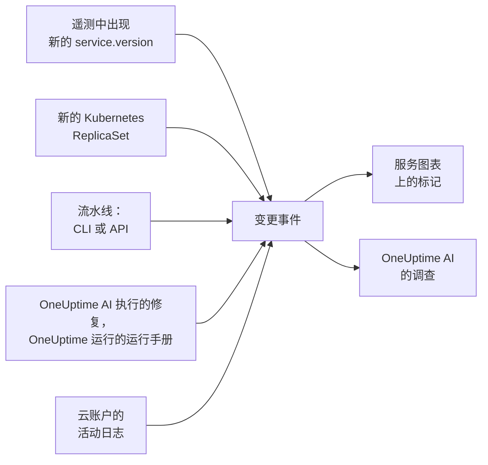

# 部署与变更

OneUptime 会记录你项目中发生的变更：部署、Kubernetes 滚动更新、配置变更、你已连接的云账户中的变更，以及它自己执行的修复。每个变更都会作为一个标记绘制在其所属服务或云资源的图表上，OneUptime AI 调查事件时也会读取这些变更，因此“问题恰好在 10:02 那次部署之后开始”会是你最先得知的事情，而不是最后才知道。

:::cards
- [OneUptime 自行记录的内容](#oneuptime-自行记录的内容): 来自遥测数据的部署和滚动更新、云账户中的变更，以及它自己的修复。
- [从流水线记录部署](#从流水线记录部署): CLI、GitHub Actions 和 API。
- [OneUptime AI 如何使用变更](#oneuptime-ai-如何使用变更): 每次调查中的可疑变更。
- [参考](#参考): 字段、属性和限制。
:::

## 工作原理



## OneUptime 自行记录的内容

这些变更无需你发送任何内容。OneUptime 会根据它已经接收的遥测数据，以及它自己执行的操作来记录它们。

| 变更 | 何时记录 | 来源 |
| --- | --- | --- |
| 部署 | 某个服务开始上报一个它此前在其环境中从未上报过的 `service.version` | `service-version` |
| 滚动更新 | Kubernetes Deployment 的 Pod 开始运行一个它们此前从未运行过的 ReplicaSet：新的镜像、更改过的环境变量或配置引用，或者一次重启 | `kubernetes` |
| OneUptime AI 执行的修复 | AI 代理报告了一条会更改某些内容的命令的结果，例如 `kubectl rollout restart` | `oneuptime-ai` |
| 运行手册 | OneUptime 运行的运行手册在开始后完成、失败或被取消 | `runbook` |
| 云变更 | 已连接云账户的活动日志记录了一项变更：AWS CloudTrail、Azure 活动日志或 Google Cloud 的 Admin Activity 审核日志 | `cloud` |
| 提供商事件 | 云提供商发布了关于该账户的健康事件：AWS Health、Azure Service Health 或 Resource Health，或 Google Cloud Service Health | `cloud-health` |

- **服务上报的第一个版本是它的基线，而不是一次部署。** 一个已经运行了数月的服务，并不是在 OneUptime 开始接收其遥测数据的那一刻才部署的。
- **回滚到过去 30 天内出现过的版本不会被记录，** 因为那个版本并不新。OneUptime AI 执行的回滚会作为修复被记录。
- **一小时内超过 6 个新版本或 ReplicaSet 时，在这一小时结束之前不再记录。** 否则，像构建时间戳这样随每个 Pod 变化的“版本”，会为每个 Pod 都记录一次部署。

只有上报 `service.version` 的服务才会记录部署。请在你的 OpenTelemetry SDK 或 Collector 的资源属性中设置它，同时设置环境和提交：

```bash
OTEL_RESOURCE_ATTRIBUTES="service.version=2.3.1,deployment.environment.name=production,vcs.ref.head.revision=$GIT_SHA"
```

滚动更新需要 [Kubernetes 代理](/docs/telemetry/kubernetes-agent)，它会给每个 Pod 的遥测数据标上其所属的 Deployment 和 ReplicaSet。

云变更和提供商事件需要一个[已连接的云账户](/docs/telemetry/cloud-accounts)。当 OneUptime 列出了相应资源时，每一项都会关联到它所指的云资源，并绘制在该资源的图表上。其类型取决于操作：操作名称表明时为 `deployment`、`scaling` 或 `rollback`，否则为 `config-change`，健康事件则为 `provider-event`。未筛选到任何资源的图表不会显示云账户的活动日志，这样繁忙的账户就不会挤掉你的部署；提供商的健康事件仍会保留在这些图表上。

## 从流水线记录部署

流水线可以在部署或任何其他变更发生时记录它：配置变更、迁移、功能开关。它使用你项目的遥测摄取密钥写入，也就是你的应用发送遥测数据所用的那种密钥。请在 **项目设置 → 遥测与 APM → 摄取密钥** 下创建一个。

固定到某个服务的密钥，会把每个变更都记录在该服务下。

:::tabs
@tab CLI
```bash
oneuptime deploy \
  --service checkout \
  --service-version 2.3.1 \
  --commit "$GIT_SHA" \
  --environment production \
  --url https://oneuptime.com \
  --ingestion-key "$ONEUPTIME_TELEMETRY_INGESTION_KEY"
```
@tab GitHub Actions
```yaml title=".github/workflows/deploy.yml"
- name: Record the deploy in OneUptime
  env:
    ONEUPTIME_URL: https://oneuptime.com
    ONEUPTIME_TELEMETRY_INGESTION_KEY: ${{ secrets.ONEUPTIME_TELEMETRY_INGESTION_KEY }}
  run: |
    npx -y @oneuptime/cli deploy \
      --service checkout \
      --service-version "${{ github.ref_name }}" \
      --commit "${{ github.sha }}" \
      --repository "${{ github.server_url }}/${{ github.repository }}" \
      --environment production
```
@tab API
```bash
curl -X POST https://oneuptime.com/telemetry/change-events/v1/ingest \
  -H "Content-Type: application/json" \
  -H "x-oneuptime-token: $ONEUPTIME_TELEMETRY_INGESTION_KEY" \
  -d '{"events": [{"serviceName": "checkout", "version": "2.3.1", "commit": "1a2b3c4", "environment": "production"}]}'
```
:::

在自托管的 OneUptime 上，请使用你自己的地址代替 `https://oneuptime.com`。API 会在响应中说明它存储了多少个事件、跳过了多少个：

```json
{ "ingested": 1, "skipped": 0 }
```

CLI 的每个选项参见 [`oneuptime deploy`](/docs/cli/command-reference#oneuptime-deploy)。

## OneUptime AI 如何使用变更

事件或警报的每次 [AI 调查](/docs/ai/ai-sre) 都从它之前 2 小时内以及之后 10 分钟内记录的变更开始，之后的 10 分钟是为那些在滚动更新完成后才记录部署的流水线准备的。与该事件关联的服务、集群、主机和云资源上的变更排在最前面。

对于其中最多 4 个指明了服务的变更，OneUptime 会读取该服务在变更前后各 30 分钟内的遥测数据，如果服务在变更之后立即明显变差，就将该变更标记为 **可疑变更**：

| 信号 | 何时成为可疑变更 |
| --- | --- |
| 失败的 span | 错误率至少翻倍，且至少上升 1 个百分点，失败的 span 至少有 10 个 |
| 延迟 | p99 至少增长到原来的 1.5 倍，且至少增加 100 ms |
| 异常 | 每分钟的数量至少是原来的 3 倍，且至少有 10 个 |
| 新异常 | 在该变更发布的版本中，于变更前 10 分钟至变更后 30 分钟之间首次出现的某种异常类型至少发生了 3 次 |

OneUptime 根据这些数字判断哪个变更是可疑变更，而不是根据变更标题的内容。调查会先检查可疑变更，说明它是否导致了该事件，并说明回滚它是否是最快的安全修复。

当可疑变更是某个已开启 [AI 修复](/docs/ai/ai-sre#修复如何运作) 的集群上的 Kubernetes 滚动更新时，OneUptime AI 会先回滚它，所用的 `kubectl rollout undo` 由 OneUptime 根据记录的变更构建。发布代码的部署则通过其提交来回滚：调查会指出造成问题的提交或拉取请求，这样 [修复拉取请求](/docs/ai/ai-sre#自动代码修复) 就可以恰好撤销那一处更改。

无论是否有人被呼叫，OneUptime 还会自行检查每一次部署。部署之后的 30 分钟过去后，它会按相同的阈值把这 30 分钟与部署之前的 30 分钟进行比较；如果服务变差了，一条 [AI 洞察](/docs/ai/ai-sre#洞察主动检测) 会指出该服务上的这次部署。

OneUptime AI 打开的修复拉取请求也会以同样的方式检查：一旦某次已记录的部署包含了它的提交，OneUptime 就会在那里观察修复的目标——异常、它加快的操作、事件或告警背后的监控器、它新增的遥测——并说明修复是否奏效（参见 [自动代码修复](/docs/ai/ai-sre#自动代码修复)）。只有当服务自身的遥测报告了部署版本时，才会按该版本读取已部署的修复，否则从部署后 10 分钟、旧实例停止之后开始读取。

在调查中以及在 [询问 AI](/docs/ai/ask-ai) 中，`recent_changes` 会列出任意时间窗口内的变更，`get_change_details` 会显示一次部署发布了什么：自该服务上一次部署以来的提交、它们的作者、拉取请求，以及它们改动的文件。这需要变更上带有提交，并且其仓库已在代码中连接：通过 [GitHub App](/docs/ai/github-app)，或通过 GitLab、Forgejo 或 Gitea 连接（请参阅 [连接存储库](/docs/ai/ai-agent#连接存储库)）。

## 参考

### 字段

| 字段 | 说明 |
| --- | --- |
| `title` | 变更了什么，例如 `Deploy 2.3.1`。发送了 `version` 的部署可以省略它 |
| `eventType` | 变更的类型：`deployment`（默认值）、`config-change`、`scaling`、`rollback`、`feature-flag` 或你自己的类型 |
| `serviceName` | 变更所属的服务。没有服务时，该变更作用于整个项目 |
| `time` | 变更发生的时间，可以是 ISO 8601，也可以是以秒或毫秒为单位的 epoch 时间。默认为它到达的时间 |
| `description` | 变更的详细信息 |
| `version` | 部署的版本 |
| `previousVersion` | 它所替换的版本 |
| `commit` | 部署的提交（也可以用 `commitSha` 或 `sha`） |
| `repository` | 该提交所在的仓库（也可以用 `repositoryUrl`） |
| `branch` | 部署的分支 |
| `pullRequest` | 部署的拉取请求 |
| `environment` | 部署到的环境 |
| `attributes` | 最多 50 个其他属性，值可以是文本、数字或布尔值 |

顶层字段会以 OpenTelemetry 名称存储为属性：`version` 存为 `service.version`，`commit` 存为 `vcs.ref.head.revision`，`repository` 存为 `vcs.repository.url.full`，`branch` 存为 `vcs.ref.head.name`，`pullRequest` 存为 `vcs.change.id`，`environment` 存为 `deployment.environment.name`。以这些名称之一发送的属性优先于对应的字段。

名称以 `oneuptime.` 开头的属性是 OneUptime 自己的属性，会从流水线发送的内容中丢弃。流水线记录的每个变更都会在 `oneuptime.change.source` 中注明这一点，其值为 `api`。

从云账户读取的变更会用 OpenTelemetry 的名称 `cloud.provider`、`cloud.account.id`、`cloud.region` 和 `cloud.resource_id` 标明账户和资源，并把操作记在 `oneuptime.cloud.operation`，执行者记在 `oneuptime.cloud.actor`，是否失败记在 `oneuptime.change.status`，所属云账户记在 `oneuptime.cloud_account.id`。

### 限制

| 限制 | 值 |
| --- | --- |
| 单个请求中的事件数 | 100 |
| 标题 | 500 个字符 |
| 描述 | 5,000 个字符 |
| 属性 | 50 |
| 时间 | 超过 366 天以前，或超过 60 分钟以后的时间，会被替换为事件到达的时间 |

## 后续步骤

:::cards
- [AI SRE](/docs/ai/ai-sre): 调查会读取什么，以及它如何修复发现的问题。
- [命令参考](/docs/cli/command-reference): CLI 的每条命令。
- [OpenTelemetry](/docs/telemetry/open-telemetry): 发送你的服务的遥测数据，并附上它们的版本。
- [连接云账户](/docs/telemetry/cloud-accounts): 你的 AWS、Azure 和 Google Cloud 账户的变更和健康事件。
:::
