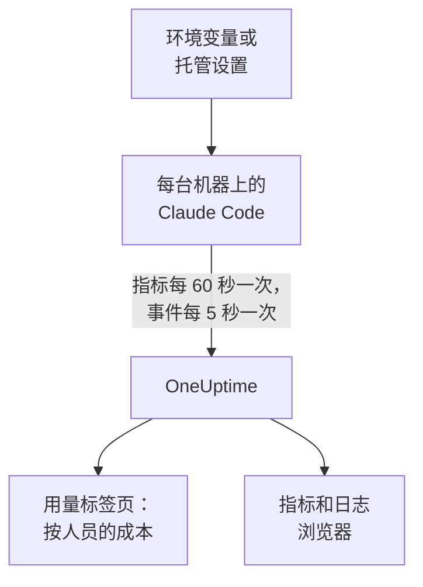

# Claude Code

Claude Code 会自行导出 OpenTelemetry 指标和事件，直接发送到 OneUptime：中间不需要 Collector，也不需要网关。用几个环境变量开启它，或者用一个托管设置文件为整个团队的机器开启，就能按开发者查看成本、token、会话、提交和被接受的编辑。

:::cards
- [设置一台机器](#设置一台机器): 六个环境变量和一次重启。
- [推广到整个团队](#推广到整个团队): 每台机器上一个托管设置文件。
- [把支出归属到人](#把用量归属到人员和团队): 谁已登录，以及何时必须自行设置身份。
- [故障排除](#故障排除): 什么都没有到达时要检查什么。
:::

## 工作原理



Claude Code 发送：

- **成本和 token** ：`claude_code.cost.usage`（USD）和 `claude_code.token.usage`，按模型、按主代理或子代理，以及按发起调用的代理、技能、插件或 MCP 服务器划分。
- **活动** ：会话、提交、拉取请求、新增和删除的代码行，以及活跃时间。
- **编辑决定** ：`claude_code.code_edit_tool.decision` 统计被接受和被拒绝的编辑，因此接受率为 `accept / (accept + reject)`，可按语言和工具划分。
- **事件** ：提示词、工具结果、API 请求和错误、权限模式变化以及 MCP 服务器连接，以 OTLP 日志记录的形式发送。

当开发者使用 Claude 账号登录时，每个指标数据点和每个事件都带有 `user.email`，OneUptime 会在指标上将其读作员工，成本和 token 就在指标上。

## 开始之前

1. 在 **项目设置 → 遥测与 APM → 摄取密钥** 下创建一个遥测摄取密钥。
2. 你的 OTLP 端点是 `https://oneuptime.com/otlp`；如果你自托管 OneUptime，则是 `https://YOUR-ONEUPTIME-HOST/otlp`。
3. 整个团队的机器使用同一个密钥。它会出现在每台开发者机器上，因此请把它当作只能发送数据的共享凭据，并像其他凭据一样定期轮换。

## 设置一台机器

:::steps
### 导出变量

把它们添加到你的 shell 配置文件（`.zshrc` 或 `.bashrc`）中，或在启动 Claude Code 的终端中导出：

```bash
export CLAUDE_CODE_ENABLE_TELEMETRY=1
export OTEL_METRICS_EXPORTER=otlp
export OTEL_LOGS_EXPORTER=otlp
export OTEL_EXPORTER_OTLP_PROTOCOL=http/protobuf
export OTEL_EXPORTER_OTLP_ENDPOINT="https://oneuptime.com/otlp"
export OTEL_EXPORTER_OTLP_HEADERS="x-oneuptime-token=YOUR_INGESTION_TOKEN"
```

| 变量 | 作用 |
| --- | --- |
| `CLAUDE_CODE_ENABLE_TELEMETRY` | 总开关：没有它，什么都不会导出。 |
| `OTEL_METRICS_EXPORTER`、`OTEL_LOGS_EXPORTER` | `otlp` 发送到 OneUptime。`otlp,console` 还会打印发送的内容，便于设置时查看。 |
| `OTEL_EXPORTER_OTLP_PROTOCOL` | `http/protobuf`；`http/json` 和 `grpc` 也可以。 |
| `OTEL_EXPORTER_OTLP_ENDPOINT` | 基础 URL。Claude Code 会自行追加 `/v1/metrics` 和 `/v1/logs`。 |
| `OTEL_EXPORTER_OTLP_HEADERS` | 以逗号分隔的 `key=value` 对；这里是你的摄取密钥。 |

### 重启 Claude Code

变量在 Claude Code 启动时读取。指标每 60 秒发送一次，事件每 5 秒发送一次，因此查看之前请先使用 Claude Code 一分钟。

### 检查数据是否到达

打开 **指标** 并查找 `claude_code.token.usage`，然后打开 **产品 → AI / LLM** 并进入 **用量** ：你的成本会显示在你的邮箱下，并标注 **来自 GenAI 指标** 。
:::

若要把指标和事件发送到不同的地方，请改为设置 `OTEL_EXPORTER_OTLP_METRICS_ENDPOINT` 和 `OTEL_EXPORTER_OTLP_LOGS_ENDPOINT`，并使用完整路径（`https://oneuptime.com/otlp/v1/metrics`、`https://oneuptime.com/otlp/v1/logs`）。

## 推广到整个团队

对于组织，请用托管设置文件分发相同的变量。它的格式与 `settings.json` 相同，变量放在 `env` 块中：

```json title="managed-settings.json"
{
  "env": {
    "CLAUDE_CODE_ENABLE_TELEMETRY": "1",
    "OTEL_METRICS_EXPORTER": "otlp",
    "OTEL_LOGS_EXPORTER": "otlp",
    "OTEL_EXPORTER_OTLP_PROTOCOL": "http/protobuf",
    "OTEL_EXPORTER_OTLP_ENDPOINT": "https://oneuptime.com/otlp",
    "OTEL_EXPORTER_OTLP_HEADERS": "x-oneuptime-token=YOUR_INGESTION_TOKEN",
    "OTEL_RESOURCE_ATTRIBUTES": "team.id=platform,cost_center=eng-123"
  }
}
```

:::steps
### 把文件放在 Claude Code 读取的位置

| 平台 | 路径 |
| --- | --- |
| macOS | `/Library/Application Support/ClaudeCode/managed-settings.json` |
| Linux 和 WSL | `/etc/claude-code/managed-settings.json` |
| Windows | `C:\Program Files\ClaudeCode\managed-settings.json` |

Claude Code 不再读取旧的 Windows 路径 `C:\ProgramData\ClaudeCode\managed-settings.json`。如果你已经在分发托管设置文件，请改为在它旁边添加一个附加文件，例如 `managed-settings.d/10-telemetry.json`：Claude Code 会先合并 `managed-settings.json`，然后按字母顺序合并 `managed-settings.d/` 中的每个 `*.json` 文件。

### 检查一台机器

在 Claude Code 中运行 `/status`。`Setting sources` 这一行应显示 `Enterprise managed settings (file)`，附加文件则显示 `(drop-ins)` 或 `(file + drop-ins)`。括号中如果是其他来源，说明优先级更高的来源胜出，你的文件没有被使用。

### 观察整个团队陆续到达

在 **用量** 标签页上，每位开发者用新设置使用过 Claude Code 后，就会显示为一行。
:::

同样的 JSON 也可以来自 claude.ai 管理控制台中的服务器托管设置（在启动时以及每小时获取）、`com.anthropic.claudecode` 域中的 macOS 配置描述文件，或 Windows 上 `HKLM\SOFTWARE\Policies\ClaudeCode` 下的 `Settings` 值。

:::details 哪个托管来源胜出，以及遥测变量如何组合
默认情况下，Claude Code 使用设置了任一策略键的最高优先级来源，并忽略其他来源：依次是服务器托管设置、MDM 或操作系统策略、托管设置文件，以及按用户的 `HKCU` 注册表值。`env` 块是例外：从 2.1.223 版本起，它会在各管理来源之间逐个变量合并。

遥测变量则不会：`OTEL_EXPORTER_OTLP_*` 变量、`OTEL_LOG_*` 内容开关、`OTEL_LOGS_EXPORTER` 以及测试版跟踪变量，会一起取自设置了其中任一变量的最高优先级来源，因此一个来源的端点绝不会与另一个来源的凭据搭配。如果更高优先级的来源设置了其中任何一个，遥测附加文件就不会起任何作用。

服务器托管设置还需要多一步：非空的 `OTEL_EXPORTER_OTLP_ENDPOINT` 只有在每位开发者在交互式会话中接受安全审批对话框后才会生效，并且导出器设置的更改要到下次启动时才生效。文件和 MDM 策略没有对话框。
:::

:::details 在不编辑每台机器的情况下轮换摄取密钥
不使用固定的请求头，而是在设置中指定 `"otelHeadersHelper": "/path/to/generate-otel-headers.sh"`。该脚本输出一个扁平的请求头 JSON 对象，例如 `{"x-oneuptime-token":"..."}`。Claude Code 在启动时运行它，之后每隔 `CLAUDE_CODE_OTEL_HEADERS_HELPER_DEBOUNCE_MS` 毫秒再次运行（默认 `1740000`，即 29 分钟）。失败信息显示在 `/status` 中。
:::

## 把用量归属到人员和团队

**员工就是 `user.email`。** 开发者使用 Claude 账号登录时，Claude Code 会发送它，并且没有变量可以关闭它。OneUptime 无需任何设置即可从每个成本和 token 数据点读取它。

**其他登录方式不发送邮箱。** 使用 API 密钥，或使用 Amazon Bedrock、Google Cloud 或 Microsoft Foundry 上的 Claude 时，会话中没有 Claude 账号，Claude Code 只发送 `user.id` 和 `session.id`。请在托管设置或启动包装脚本中，为每台机器自行设置身份：

```bash
export OTEL_RESOURCE_ATTRIBUTES="user.email=jdoe@example.com,team.id=platform"
```

**`user.id` 不是一个人。** 它是 Claude Code 首次运行时写入 `~/.claude.json` 的随机 ID：每次安装一个，删除该文件后会生成新的。没有邮箱时，每次安装都显示为单独的一行。有一个例外：登录到 Claude 应用网关的会话会发送登录的身份（`user.id` 是身份提供商的主体，`user.email` 是邮箱），并忽略你自己设置的 `user.*` 键。

**团队和成本中心** 来自 `OTEL_RESOURCE_ATTRIBUTES`：OneUptime 读取 `team.id`、`team`、`cost_center` 和 `department`。值中不能包含空格，加引号也无法转义：请写成 `team=Platform_Engineering`，或使用百分号编码，例如 `team=Platform%20Engineering`。Claude Code 会把这些键复制到每个数据点上（`OTEL_METRICS_INCLUDE_RESOURCE_ATTRIBUTES`，默认开启），无论哪种方式 OneUptime 都能读取。你设置的键绝不会覆盖 Claude Code 自己设置的键。

## OneUptime 显示什么

在 **产品 → AI / LLM → 用量** 中，`claude_code.cost.usage` 为 **员工** 、 **团队** 和 **模型** 表提供数据，`claude_code.token.usage` 为 token 总数提供数据。你看到的内容由两条规则决定：

- **指标只补充 span，从不与之相加。** 如果同一个项目从你自己的应用接收带成本的 GenAI span，Claude Code 的支出就不会显示。请把 Claude Code 发送到单独的项目。请参阅 [span 优先，指标补充](/docs/telemetry/ai-llm-observability#span-优先指标补充)。
- **来自指标的行只携带成本。** 其调用和 token 单元格显示 `—`， **提供商** 和 **应用 / 服务** 表保持为空：这些指标不指明提供商，也不属于任何 OneUptime 服务。

其他所有内容，例如按开发者划分的接受率、代码行数、提交和拉取请求，或按 `query_source` 划分的支出，都可以根据下面的指标在 [仪表盘](/docs/dashboards/index) 上绘制，并用 [指标监控](/docs/monitor/metrics-monitor) 设置警报。

## 指标

每个指标都是计数器，除自己的属性外还携带标准属性。

| 指标 | 单位 | 自己的属性 |
| --- | --- | --- |
| `claude_code.session.count` | 无 | `start_type`：`fresh`、`resume`、`continue`、`agents_view` |
| `claude_code.lines_of_code.count` | 无 | `type`：`added`、`removed`；`model` |
| `claude_code.commit.count` | 无 | 无 |
| `claude_code.pull_request.count` | 无 | 无 |
| `claude_code.cost.usage` | USD | `model`；`query_source`：`main`、`subagent`、`auxiliary`；`speed`：`fast`、`normal`；`effort`；`agent.name`、`skill.name`、`plugin.name`、`marketplace.name`、`mcp_server.name`、`mcp_tool.name` |
| `claude_code.token.usage` | token | `type`：`input`、`output`、`cacheRead`、`cacheCreation`；以及与 `claude_code.cost.usage` 相同的属性 |
| `claude_code.code_edit_tool.decision` | 无 | `tool_name`：`Edit`、`Write`、`NotebookEdit`；`decision`：`accept`、`reject`；`source`；`language` |
| `claude_code.active_time.total` | 秒 | `type`：`user`（在键盘前）、`cli`（工具和模型响应） |

标准属性包括 `session.id`、`app.version`、`app.entrypoint`、`organization.id`、`user.account_uuid`、`user.account_id`、`user.id`、`user.email` 和 `terminal.type`，以及你的 `OTEL_RESOURCE_ATTRIBUTES`。其中一些可以关闭：请参阅 [降低指标量](#降低指标量)。

- 缓存 token 类型使用驼峰命名：`cacheRead` 和 `cacheCreation`。OneUptime 的 token 总数只计算 `input` 和 `output`。
- 在成本和 token 指标上，除非设置了 `OTEL_LOG_TOOL_DETAILS=1`（Claude Code 2.1.273 或更高版本），否则你自己的代理和 MCP 服务器，以及第三方插件和技能的名称会显示为 `custom` 或 `third-party`。

## 事件

事件以 OTLP 日志记录的形式到达，每条都带有 `event.name`、`event.timestamp` 和 `event.sequence`。你最常用的几种：

| 事件 | 记录的内容 |
| --- | --- |
| `claude_code.user_prompt` | 一条提示词：其长度和命令；只有开启后才包含文本 |
| `claude_code.api_request` | 一次模型请求：`model`、`cost_usd`、`cost_usd_micros`、`duration_ms`、`input_tokens`、`output_tokens`、缓存 token |
| `claude_code.api_error` | 重试后仍失败的请求：`model`、`error`、`status_code`、`attempt` |
| `claude_code.tool_result` | 一次工具运行：`tool_name`、`success`、`duration_ms`，以及允许它运行的决定 |
| `claude_code.tool_decision` | 工具是否被允许，以及由什么决定 |
| `claude_code.mcp_server_connection` | MCP 服务器连接成功或失败 |

Claude Code 还会发送许多其他事件，例如拒绝、权限模式变化，以及插件、钩子和技能事件：Anthropic 的 [监控参考](https://code.claude.com/docs/en/monitoring-usage) 列出了全部事件。在 `cost_usd_micros` 中，成本是以百万分之一美元为单位的整数，累加时不会产生舍入误差。

## 降低指标量

默认情况下，Claude Code 会在每个数据点上加上 `session.id`，每个会话都是一个新的序列。在整个团队的机器上，单是这一个属性就会推高指标量，而成本报告并不需要它：

```bash
export OTEL_METRICS_INCLUDE_SESSION_ID=false
```

| 变量 | 默认值 | 添加的内容 |
| --- | --- | --- |
| `OTEL_METRICS_INCLUDE_SESSION_ID` | `true` | `session.id`，每个会话一个新值 |
| `OTEL_METRICS_INCLUDE_VERSION` | `false` | `app.version` |
| `OTEL_METRICS_INCLUDE_ACCOUNT_UUID` | `true` | `user.account_uuid` 和 `user.account_id` |
| `OTEL_METRICS_INCLUDE_ENTRYPOINT` | `false` | `app.entrypoint` |
| `OTEL_METRICS_INCLUDE_RESOURCE_ATTRIBUTES` | `true` | 你的 `OTEL_RESOURCE_ATTRIBUTES` 键 |
| `OTEL_METRICS_INCLUDE_REPOSITORY` | `false` | 仓库的 `vcs.*` 属性 |

`user.email`、`user.id`、`organization.id` 和 `terminal.type` 没有开关。事件是更繁忙的信号：每位活跃的开发者每 5 秒发送一次（`OTEL_LOGS_EXPORT_INTERVAL`，单位为毫秒）。调大该值可以更少次数地发送更大的批次；如果你只需要成本和用量，它们都在指标中，可以设置 `OTEL_LOGS_EXPORTER=none`。

## 提示词和工具内容默认关闭

除非你逐项开启，否则 Claude Code 不会导出提示词、回答、工具参数或工具输出：

| 变量 | 默认值 | `1` 开启的内容 |
| --- | --- | --- |
| `OTEL_LOG_USER_PROMPTS` | 关闭 | 提示词文本 |
| `OTEL_LOG_ASSISTANT_RESPONSES` | 关闭 | 回答文本；未设置时跟随 `OTEL_LOG_USER_PROMPTS` |
| `OTEL_LOG_TOOL_DETAILS` | 关闭 | 工具参数、Bash 命令，以及代理、插件、技能和 MCP 服务器的真实名称 |
| `OTEL_LOG_TOOL_CONTENT` | 关闭 | 工具的输入和输出，仅限跟踪 span |
| `OTEL_LOG_RAW_API_BODIES` | 关闭 | 完整的 API 请求和响应正文（`file:<dir>` 会改为写入磁盘） |

我们建议保持关闭：指标和脱敏后的事件已经能回答谁在哪个模型上花了多少钱、接受率是多少。采集内容会把提示词、源代码和工具输出转移到一个访问控制与你的代码仓库不同的遥测存储中。如果为了调查而开启，`CLAUDE_CODE_OTEL_CONTENT_MAX_LENGTH`（默认 `61440`）会限制每条记录传输的内容量，而 **跟踪 → 设置** 下跟踪的 **清理规则** 和 **丢弃过滤器** 会在存储前将其屏蔽或丢弃。

## 指标以增量形式到达

Claude Code 默认发送增量指标：每个数据点是自上次导出以来的增量，而不是累计总数。绘图或设置警报时，请在窗口内把数据点相加，不要像对待累积计数器那样使用速率或计数器重置函数：数字会出错，却看不出异常。

```bash
export OTEL_EXPORTER_OTLP_METRICS_TEMPORALITY_PREFERENCE=cumulative
```

只有当组织中的每个导出器都使用 `cumulative` 时才固定它，并且不要在同一批机器中混用两种方式。

## 跟踪（测试版）

Claude Code 还有一个测试版跟踪导出器，它把每次交互绘制成一棵 span 树：`claude_code.interaction` 下面是 `claude_code.llm_request` 和 `claude_code.tool`。

```bash
export CLAUDE_CODE_ENHANCED_TELEMETRY_BETA=1
export OTEL_TRACES_EXPORTER=otlp
```

> [!WARNING]
> 不要把测试版跟踪发送到你用于统计支出的项目。它的模型 span 带有 `gen_ai.system` 和 `gen_ai.request.model`，因此 OneUptime 会在 **调用** 中列出它们，但它们的 token 位于 `input_tokens` 和 `output_tokens`，而不是 `gen_ai.usage.*` 键中，所以到达时既没有 token 也没有成本。一旦它们存在， **员工** 、 **团队** 和 **模型** 表显示的就是这些成本为 $0 的行，而不是指标中的支出。

在 Agent SDK 会话和非交互式 `-p` 会话中，Claude Code 会接收传入的 `TRACEPARENT`，因此它的 span 会加入调用方的跟踪；交互式会话会忽略它。只有当 `ANTHROPIC_BASE_URL` 未设置或指向 Anthropic API 时，它才会向模型发送 `traceparent` 请求头；在你自己的代理后面，请设置 `CLAUDE_CODE_PROPAGATE_TRACEPARENT=1`。

## 故障排除

:::details 完全没有数据到达
先检查 `CLAUDE_CODE_ENABLE_TELEMETRY=1`：没有它，其他变量都不起作用。然后在导出器中添加 `console`（`OTEL_METRICS_EXPORTER=otlp,console`）并观察终端：如果打印出了数据点，说明 Claude Code 正常，问题出在端点、密钥或网络上。
:::

:::details 托管设置文件似乎被忽略了
运行 `/status` 并查看 `Setting sources` 这一行。如果没有列出托管来源，说明文件路径错误、不是有效的 JSON，或开发者的账户无法读取它。如果列出了其他来源，说明那个来源胜出，你的文件没有被使用。服务器托管设置还要等开发者在交互式会话中接受审批对话框。
:::

:::details 支出显示为未归属，或每次安装显示为一行
这些开发者没有使用 Claude 账号登录：他们使用的是 API 密钥、Amazon Bedrock、Google Cloud 或 Microsoft Foundry。请按 [把用量归属到人员和团队](#把用量归属到人员和团队) 中的说明，在 `OTEL_RESOURCE_ATTRIBUTES` 中为他们设置 `user.email`。
:::

:::details 缺少团队或成本中心
检查 `OTEL_RESOURCE_ATTRIBUTES` 是否已在该机器上设置、不包含空格，并且没有重复使用 Claude Code 自己设置的键：Claude Code 的值会胜出。
:::

:::details 数字看起来太小或太大
Claude Code 发送的是增量：请在窗口内把数据点相加，参见 [指标以增量形式到达](#指标以增量形式到达)。另外请等满一分钟：指标每 60 秒发送一次。
:::

:::details 密钥被拒绝
OneUptime 会拒绝错误的 `x-oneuptime-token`。请从 **项目设置 → 遥测与 APM → 摄取密钥** 重新复制密钥，并检查请求头是否为 `x-oneuptime-token=YOUR_INGESTION_TOKEN`，且 `=` 两侧没有空格。
:::

## 后续步骤

:::cards
- [AI 编程助手](/docs/telemetry/ai-coding-assistants): 支出如何在所有编程助手之间归属。
- [AI / LLM 可观测性](/docs/telemetry/ai-llm-observability): 你自己的 AI 调用的对话、警报、成本和预算。
- [指标监控](/docs/monitor/metrics-monitor): 针对按开发者划分的支出或 token 设置警报。
:::
