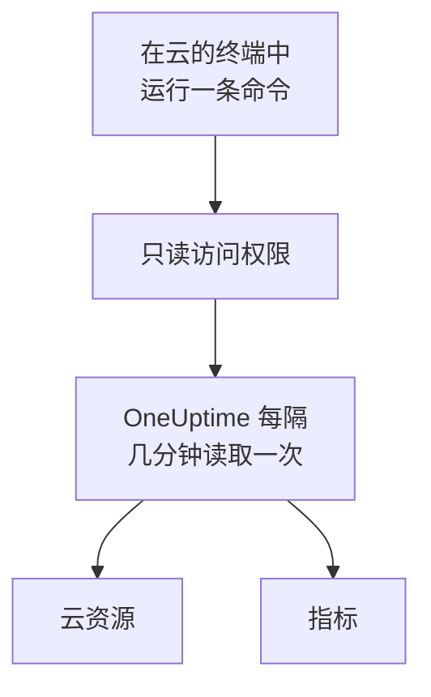

# 连接云账户

在仪表板中连接 AWS 账户、Azure 订阅或 Google Cloud 项目，OneUptime 会列出其中的资源，并按计划读取它们的关键指标。你只需在云自带的浏览器终端中运行一条命令，再粘贴它的输出：无需运行采集器，也无需安装任何东西。

:::cards
- [Amazon Web Services](#amazon-web-services): OneUptime 登录所用的 IAM 角色，或一个访问密钥。
- [Microsoft Azure](#microsoft-azure): 具有 Monitoring Reader 角色的应用。
- [Google Cloud](#google-cloud): 具有 Monitoring Viewer 角色的服务账号。
- [OneUptime 读取什么](#oneuptime-读取什么): 读取哪些资源和指标、多久读取一次，以及费用是多少。
:::

## 工作原理



- **访问权限只能读取。** 命令创建的访问权限只读取指标，不做其他任何事：在 AWS 上是三个读取操作，在 Azure 上是 **Monitoring Reader** 角色，在 Google Cloud 上是 **Monitoring Viewer** 角色。删除它即可切断 OneUptime 的访问。
- **OneUptime 按计划读取。** 除非你在连接时选择其他间隔，Azure 和 Google Cloud 每 5 分钟读取一次，AWS 每 10 分钟读取一次。
- **每个资源都有自己的页面。** 资源会显示在 **云 → 所有资源** 中，带有其关键指标、负责人和标签，和采集器上报的资源一样。

## 开始之前

- **项目所有者或管理员。** 只有他们可以连接、测试和编辑云账户。
- **你的云的终端**（AWS CloudShell、Azure Cloud Shell 或 Google Cloud Shell），并以可以创建 IAM 角色或用户、应用注册或服务账号的身份登录。

## Amazon Web Services

:::steps
### 打开 AWS 表单

前往 **云 → 连接**，然后选择 **Amazon Web Services**。

### 在 AWS CloudShell 中运行命令

选择 OneUptime 的登录方式。推荐使用 **IAM 角色**：不存储任何机密，你可以随时删除该角色。表单会显示为你的项目编写的命令：它会创建一个以你项目的外部 ID 信任 OneUptime 的 AWS 账户的角色，并输出该角色的 ARN。无法使用角色时，请使用 **访问密钥**。以下命令会创建一个具有相同权限的用户，并输出其密钥：

```bash
aws iam create-user --user-name OneUptimeReadOnly > /dev/null 2>&1 || true
aws iam put-user-policy --user-name OneUptimeReadOnly --policy-name OneUptimeReadOnly --policy-document '{"Version":"2012-10-17","Statement":[{"Effect":"Allow","Action":["cloudwatch:GetMetricData","cloudwatch:ListMetrics","tag:GetResources"],"Resource":"*"}]}'
aws iam create-access-key --user-name OneUptimeReadOnly
```

### 粘贴 AWS 命令的输出

将命令输出的全部内容粘贴到 **命令的输出** 中。OneUptime 会从中提取角色的 ARN，或访问密钥 ID 及其机密。

### 测试并连接 AWS

选择 **测试连接**。OneUptime 会登录、统计找到的资源，并说明读取它们的费用。选择 **连接** 即可保存。
:::

该角色和用户只能做以下三件事：

| 操作 | OneUptime 的用途 |
| --- | --- |
| `cloudwatch:ListMetrics` | 在每个区域中找到上报指标的资源 |
| `cloudwatch:GetMetricData` | 读取它们的关键指标 |
| `tag:GetResources` | 用 `Name` 标签为每个资源命名 |

> [!NOTE]
> 在自托管的 OneUptime 上，**IAM 角色** 方式需要 OneUptime 自己的 AWS 身份：将 `CLOUD_CONNECT_AWS_ACCESS_KEY_ID` 和 `CLOUD_CONNECT_AWS_SECRET_ACCESS_KEY` 设置为一个可以调用 `sts:AssumeRole` 的 IAM 用户的密钥。未设置时，表单会提供 **访问密钥**。

## Microsoft Azure

:::steps
### 打开 Azure 表单

前往 **云 → 连接**，然后选择 **Microsoft Azure**。

### 在 Azure Cloud Shell 中运行命令

该命令会在你当前的订阅上创建一个具有 **Monitoring Reader** 角色的应用，并输出其详细信息：

```bash
az ad sp create-for-rbac --name OneUptimeReadOnly --role "Monitoring Reader" --scopes "/subscriptions/$(az account show --query id --output tsv)"
```

### 粘贴 Azure 命令的输出

将命令输出的全部内容粘贴到 **命令的输出** 中。OneUptime 会从中提取 `tenant`、`appId` 和 `password`。

### 测试并连接 Azure

选择 **测试连接**，然后选择 **连接**。
:::

要用同一个应用读取更多订阅，请在每个订阅上为它分配该角色：

```bash
az role assignment create --assignee <APP_ID> --role "Monitoring Reader" --scope /subscriptions/<SUBSCRIPTION_ID>
```

除非你在 **订阅** 中列出部分订阅，OneUptime 会读取该应用可以读取的所有订阅。

## Google Cloud

:::steps
### 打开 Google Cloud 表单

前往 **云 → 连接**，然后选择 **Google Cloud**。

### 在 Google Cloud Shell 中运行命令

在要监控的项目中运行它。它会启用 Cloud Monitoring API，创建一个具有 **Monitoring Viewer** 角色的服务账号，并输出其密钥：

```bash
PROJECT_ID=$(gcloud config get-value project)
gcloud services enable monitoring.googleapis.com
gcloud iam service-accounts create oneuptime-read-only --display-name "OneUptime (read only)"
gcloud projects add-iam-policy-binding "$PROJECT_ID" --member "serviceAccount:oneuptime-read-only@$PROJECT_ID.iam.gserviceaccount.com" --role roles/monitoring.viewer --condition=None > /dev/null
gcloud iam service-accounts keys create oneuptime-key.json --iam-account "oneuptime-read-only@$PROJECT_ID.iam.gserviceaccount.com"
cat oneuptime-key.json && rm oneuptime-key.json
```

### 粘贴密钥

粘贴命令输出的全部内容。OneUptime 会读取密钥所属的项目，并加密存储该密钥。

### 测试并连接 Google Cloud

选择 **测试连接**，然后选择 **连接**。
:::

要用同一个服务账号读取更多项目，请在每个项目中为它分配该角色，并在 **项目** 中列出这些项目：

```bash
gcloud projects add-iam-policy-binding <PROJECT_ID> --member "serviceAccount:oneuptime-read-only@<KEY_PROJECT_ID>.iam.gserviceaccount.com" --role roles/monitoring.viewer
```

## OneUptime 读取什么

| | AWS | Azure | Google Cloud |
| --- | --- | --- | --- |
| 资源 | 在你使用的每个区域中向 CloudWatch 上报指标的资源 | 订阅中的所有资源 | 向 Cloud Monitoring 上报指标的资源 |
| 指标 | 每项服务的关键指标，例如实例的 CPU、网络和状态检查 | 每个资源最多 8 个关键指标 | 每种资源类型的关键指标 |
| 读取间隔 | 10 分钟 | 5 分钟 | 5 分钟 |
| 已删除的资源 | 7 天没有指标后归档 | 在下一次读取时归档 | 7 天没有指标后归档 |

每次读取都会从上一次停止的地方继续，因此每个数据点只写入一次。新连接的首次读取会很快开始，并回溯最近一小时；暂停之后，一次读取最多回溯 6 小时。

OneUptime 发出的调用会按你的云的价格计入你的云账户。**测试连接** 会估算它找到的内容的费用，降低读取频率可以减少费用：在 **更多字段** 中修改 **指标读取间隔**。

| 云 | 价格 |
| --- | --- |
| AWS | CloudWatch `GetMetricData`：每 1,000 个指标 $0.01，每个资源的每个关键指标每次读取计为一个指标 |
| Azure | 每个订阅每月的前 1,000,000 次指标读取免费，之后每 1,000 次 $0.01 |
| Google Cloud | 每月读取的前 1,000,000 个时间序列免费，之后每百万个 $0.50 |

## 故障排除

:::details 测试显示密钥或机密未被接受
复制命令输出的全部内容并重新粘贴。刚创建的密钥可能需要一点时间才能生效。
:::

:::details 测试可以登录，但无法读取
再次运行该命令：它会授予 OneUptime 所需的角色。在 AWS 上，请运行表单为此项目显示的命令：为其他项目创建的角色信任的是那个项目的外部 ID，而不是此项目的外部 ID。
:::

:::details Google Cloud 不允许该命令创建密钥
组织政策 `iam.disableServiceAccountKeyCreation` 可能禁止服务账号密钥。请向组织的管理员申请为该项目设置例外，或[使用你自己的采集器发送指标](/docs/telemetry/cloud-resources)。
:::

:::details 没有显示任何资源
在 AWS 和 Google Cloud 上，资源会在上报指标后显示。如果某个连接无法正常工作，**云 → 连接** 中的 **View error** 会说明其上次读取失败的原因。
:::

## 后续步骤

:::cards
- [云资源](/docs/telemetry/cloud-resources): 改为运行你自己的 OpenTelemetry Collector，或以流方式发送 CloudWatch 指标。
- [指标监控器](/docs/monitor/metrics-monitor): 根据资源的指标发出告警。
:::
