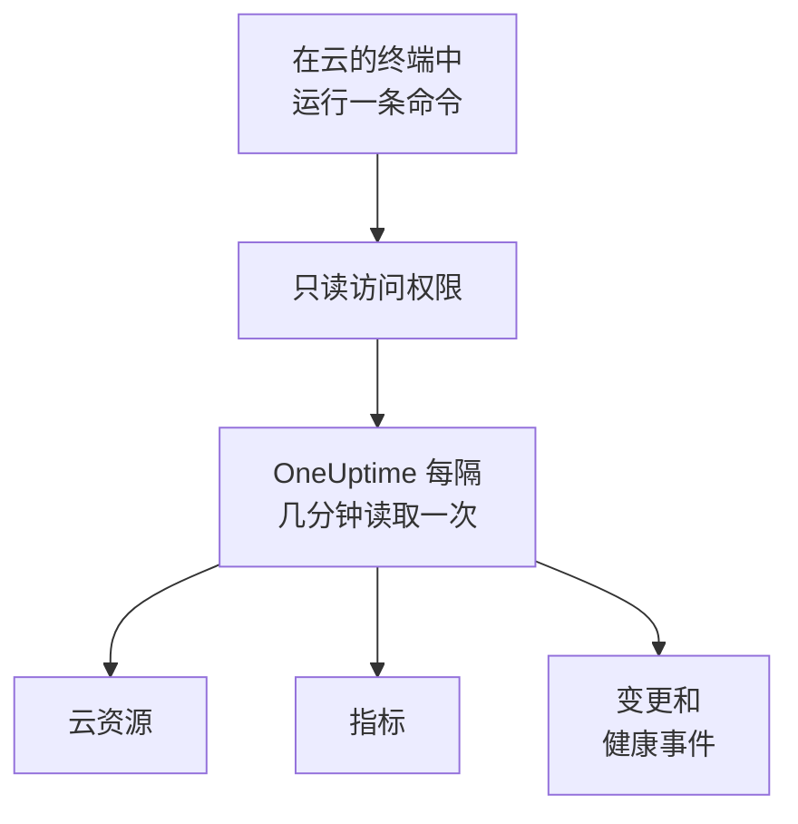

# 连接云账户

在仪表板中连接 AWS 账户、Azure 订阅或 Google Cloud 项目，OneUptime 会列出其中的每个资源，读取它们的关键指标，并记录它们发生了哪些变更，以及你的云提供商对它们健康状况的说明。你只需在云自带的浏览器终端中运行一条命令，再粘贴它的输出：无需运行采集器，也无需安装任何东西。

:::cards
- [Amazon Web Services](#amazon-web-services): OneUptime 登录所用的 IAM 角色，或一个访问密钥。
- [Microsoft Azure](#microsoft-azure): 具有 Monitoring Reader 角色的应用。
- [Google Cloud](#google-cloud): 具有四个只读角色的服务账号。
- [OneUptime 读取什么](#oneuptime-读取什么): 资源、指标、变更和健康事件，多久读取一次，以及费用是多少。
- [数据安全](#数据安全): 该连接让数据安全可以读取什么，以及每个级别会给命令添加什么。
- [让 AI 修复问题](#让-ai-修复问题): 再运行一条命令，OneUptime AI 就能修复它发现的问题。
:::

## 工作原理



- **访问权限只能读取。** 命令创建的访问权限只读取你的资源及其配置、它们的指标、发生的变更和提供商的健康事件，不做其他任何事：在 AWS 上是下面列出的操作，在 Azure 上是 **Monitoring Reader** 角色，在 Google Cloud 上是四个查看者角色。OneUptime 从不通过它读取数据或机密：只有当你允许 AI 读取账户的日志时，才会读取日志行；只有当你为 [数据安全](#数据安全) 开启了内容样本时，才会读取这些样本。删除它即可切断 OneUptime 的访问。
- **OneUptime 按计划读取。** 除非你在连接时选择其他间隔，Azure 和 Google Cloud 每 5 分钟读取一次，AWS 每 10 分钟读取一次。每次读取还会记录自上次以来的变更，并且每 30 分钟会有一次读取重新列出所有资源。
- **每个资源都有自己的页面。** 资源会显示在 **云 → 所有资源** 中，带有其关键指标、负责人和标签。已列出资源的页面还会显示它的 **相连的资源**（它运行在什么里面，什么向它发送流量）、它的端点、标签和设置，以及它的 **事件**、**警报** 和 **更改**。
- **每个账户都有自己的页面。** 账户会显示在 **云 → 账户** 中，带有按类型和区域划分的资源、它们的 **更改**，以及显示其资源如何相互关联的 **拓扑**。
- **OneUptime AI 会读取发生的变更。** 对关联到云资源的事件或警报的调查，会先读取该资源的变更，并在开始时重新读取账户的活动日志。

## 开始之前

- **项目所有者或管理员。** 只有他们可以连接、测试和编辑云账户。
- **你的云的终端**（AWS CloudShell、Azure Cloud Shell 或 Google Cloud Shell），并以可以创建 IAM 角色或用户、应用注册或服务账号的身份登录。

## Amazon Web Services

:::steps
### 打开 AWS 表单

前往 **云 → 连接**，然后选择 **Amazon Web Services**。

### 在 AWS CloudShell 中运行命令

选择 OneUptime 的登录方式。推荐使用 **IAM 角色**：不存储任何机密，你可以随时删除该角色。表单会显示为你的项目编写的命令：它会创建一个以你项目的外部 ID 信任 OneUptime 的 AWS 账户的角色，并输出该角色的 ARN。

在 **读取范围** 中，选择此账户或你的 AWS Organization 中的每个账户。在组织的管理账户中运行组织的命令：它会添加一个 StackSet，把同一个角色放进每个账户（现有的账户和之后加入的账户），并让管理账户的角色列出这些账户。一个连接最多读取 50 个账户。

无法使用角色时，请使用 **访问密钥**：它只读取自己的账户。以下命令会创建一个具有相同权限的用户，并输出其密钥：

```bash
aws iam create-user --user-name OneUptimeReadOnly > /dev/null 2>&1 || true
aws iam put-user-policy --user-name OneUptimeReadOnly --policy-name OneUptimeReadOnly --policy-document '{"Version":"2012-10-17","Statement":[{"Effect":"Allow","Action":["cloudwatch:GetMetricData","cloudwatch:ListMetrics","tag:GetResources","iam:ListAccountAliases","cloudformation:ListResources","ec2:DescribeInstances","ec2:DescribeVolumes","ec2:DescribeVpcs","ec2:DescribeNatGateways","autoscaling:DescribeAutoScalingGroups","elasticloadbalancing:DescribeLoadBalancers","elasticloadbalancing:DescribeLoadBalancerAttributes","elasticloadbalancing:DescribeTargetGroups","elasticloadbalancing:DescribeTargetGroupAttributes","elasticloadbalancing:DescribeTargetHealth","elasticloadbalancing:DescribeTags","ecs:ListClusters","ecs:DescribeClusters","ecs:ListServices","ecs:DescribeServices","lambda:ListFunctions","rds:DescribeDBInstances","rds:DescribeDBClusters","elasticache:DescribeReplicationGroups","sqs:ListQueues","sqs:GetQueueAttributes","sns:ListTopics","sns:GetTopicAttributes","sns:ListSubscriptionsByTopic","dynamodb:ListTables","dynamodb:DescribeTable","kinesis:ListStreams","kinesis:DescribeStreamSummary","states:ListStateMachines","states:DescribeStateMachine","cloudfront:ListDistributions","elasticfilesystem:DescribeFileSystems","es:ListDomainNames","es:DescribeDomains","apprunner:ListServices","apprunner:DescribeService","cloudtrail:LookupEvents","health:DescribeEvents","health:DescribeEventDetails","rds:DescribeEvents","autoscaling:DescribeScalingActivities","ec2:DescribeInstanceStatus","ecs:DescribeTaskDefinition","lambda:GetFunctionConfiguration","lambda:GetFunctionConcurrency","lambda:GetAlias","servicequotas:ListServiceQuotas","logs:DescribeLogGroups","logs:FilterLogEvents"],"Resource":"*"},{"Effect":"Allow","Action":["apigateway:GET"],"Resource":["arn:aws:apigateway:*::/restapis","arn:aws:apigateway:*::/restapis/*","arn:aws:apigateway:*::/apis","arn:aws:apigateway:*::/apis/*"]}]}'
aws iam create-access-key --user-name OneUptimeReadOnly
```

### 粘贴 AWS 命令的输出

将命令输出的全部内容粘贴到 **命令的输出** 中。OneUptime 会从中找出角色的 ARN，或访问密钥 ID 及其机密。

### 测试并连接 AWS

此步骤打开时，OneUptime 会测试连接：它会登录，统计找到的资源，并说明读取它们的费用。选择 **连接** 即可保存。
:::

该角色和用户只能做以下这些事：

| OneUptime 的用途 | 操作 |
| --- | --- |
| 找到上报指标的资源，并读取它们的指标 | `cloudwatch:GetMetricData`, `cloudwatch:ListMetrics` |
| 为每个资源命名并读取其标签 | `tag:GetResources`, `iam:ListAccountAliases` |
| 通过 Cloud Control 列出每个资源及其配置 | `cloudformation:ListResources`, `ec2:DescribeInstances`, `ec2:DescribeVolumes`, `ec2:DescribeVpcs`, `ec2:DescribeNatGateways`, `autoscaling:DescribeAutoScalingGroups`, `elasticloadbalancing:DescribeLoadBalancers`, `elasticloadbalancing:DescribeLoadBalancerAttributes`, `elasticloadbalancing:DescribeTargetGroups`, `elasticloadbalancing:DescribeTargetGroupAttributes`, `elasticloadbalancing:DescribeTargetHealth`, `elasticloadbalancing:DescribeTags`, `ecs:ListClusters`, `ecs:DescribeClusters`, `ecs:ListServices`, `ecs:DescribeServices`, `lambda:ListFunctions`, `rds:DescribeDBInstances`, `rds:DescribeDBClusters`, `elasticache:DescribeReplicationGroups`, `sqs:ListQueues`, `sqs:GetQueueAttributes`, `sns:ListTopics`, `sns:GetTopicAttributes`, `sns:ListSubscriptionsByTopic`, `dynamodb:ListTables`, `dynamodb:DescribeTable`, `kinesis:ListStreams`, `kinesis:DescribeStreamSummary`, `states:ListStateMachines`, `states:DescribeStateMachine`, `cloudfront:ListDistributions`, `elasticfilesystem:DescribeFileSystems`, `es:ListDomainNames`, `es:DescribeDomains`, `apprunner:ListServices`, `apprunner:DescribeService`, `apigateway:GET` |
| 读取发生的变更：账户的管理事件 | `cloudtrail:LookupEvents` |
| 读取 AWS 自己针对该账户的健康事件 | `health:DescribeEvents`, `health:DescribeEventDetails` |
| 在调查期间读取资源的当前状态和最近的事件 | `rds:DescribeEvents`, `autoscaling:DescribeScalingActivities`, `ec2:DescribeInstanceStatus`, `ecs:DescribeTaskDefinition`, `lambda:GetFunctionConfiguration`, `lambda:GetFunctionConcurrency`, `lambda:GetAlias` |
| 在调查期间读取账户的配额 | `servicequotas:ListServiceQuotas` |
| 读取日志行，仅当你允许 AI 读取账户的日志时 | `logs:DescribeLogGroups`, `logs:FilterLogEvents` |
| 从组织的管理账户列出组织的账户 | `organizations:ListAccounts` |

`apigateway:GET` 只允许用于 API 自身的定义，从不用于它们的密钥，并且只有管理账户的角色可以列出组织的账户。AWS Health 只响应使用 Business、Enterprise On-Ramp 或 Enterprise 支持计划的账户：没有这类计划时，OneUptime 会在一天后再次询问。

> [!NOTE]
> 在自托管的 OneUptime 上，**IAM 角色** 方式需要 OneUptime 自己的 AWS 身份：将 `CLOUD_CONNECT_AWS_ACCESS_KEY_ID` 和 `CLOUD_CONNECT_AWS_SECRET_ACCESS_KEY` 设置为一个可以调用 `sts:AssumeRole` 的 IAM 用户的密钥。未设置时，表单会提供 **访问密钥**。

## Microsoft Azure

:::steps
### 打开 Azure 表单

前往 **云 → 连接**，然后选择 **Microsoft Azure**。

### 在 Azure Cloud Shell 中运行命令

该命令会在你当前的订阅上创建一个具有 **Monitoring Reader** 角色的应用，并输出其详细信息以及其机密的到期日期：

```bash
SCOPE="/subscriptions/$(az account show --query id --output tsv)"
OUT=$(az ad sp create-for-rbac --name OneUptimeReadOnly --role "Monitoring Reader" --scopes "$SCOPE")
APP=$(echo "$OUT" | jq -r .appId)
END=$(az ad app credential list --id "$APP" --query "max([].endDateTime)" --output tsv)
echo "$OUT" | jq --arg end "$END" '. + {endDateTime: $end}'
```

在 **读取范围** 中改为选择租户中的每个订阅，角色就会授予租户的根管理组：

```bash
SCOPE="/providers/Microsoft.Management/managementGroups/$(az account show --query tenantId --output tsv)"
OUT=$(az ad sp create-for-rbac --name OneUptimeReadOnly --role "Monitoring Reader" --scopes "$SCOPE")
APP=$(echo "$OUT" | jq -r .appId)
END=$(az ad app credential list --id "$APP" --query "max([].endDateTime)" --output tsv)
echo "$OUT" | jq --arg end "$END" '. + {endDateTime: $end}'
```

### 粘贴 Azure 命令的输出

将命令输出的全部内容粘贴到 **命令的输出** 中。OneUptime 会从中找出 `tenant`、`appId`、`password` 和到期日期。

### 测试并连接 Azure

此步骤打开时，OneUptime 会测试连接。选择 **连接** 即可保存。
:::

要用同一个应用读取更多订阅，请在每个订阅上为它授予该角色：

```bash
az role assignment create --assignee <APP_ID> --role "Monitoring Reader" --scope /subscriptions/<SUBSCRIPTION_ID>
```

除非你在 **订阅** 中列出一些订阅，否则 OneUptime 会读取该应用可以读取的每个订阅，最多 50 个。应用的机密会在到期日停止工作：从到期前 30 天起，每次读取都会对此发出提醒。再次运行该命令并粘贴它的输出，即可为它换一个新的机密。

## Google Cloud

:::steps
### 打开 Google Cloud 表单

前往 **云 → 连接**，然后选择 **Google Cloud**。

### 在 Google Cloud Shell 中运行命令

在要监控的项目中运行它。它会启用 OneUptime 读取的 API，创建一个具有 **Monitoring Viewer**、**Cloud Asset Viewer**、**Logs Viewer** 和 **Service Health Viewer** 角色的服务账号，并输出其密钥：

```bash
PROJECT_ID=$(gcloud config get-value project)
gcloud services enable monitoring.googleapis.com cloudasset.googleapis.com logging.googleapis.com cloudresourcemanager.googleapis.com servicehealth.googleapis.com
gcloud iam service-accounts create oneuptime-read-only --display-name "OneUptime (read only)" > /dev/null 2>&1 || true
gcloud projects add-iam-policy-binding "$PROJECT_ID" --member "serviceAccount:oneuptime-read-only@$PROJECT_ID.iam.gserviceaccount.com" --role roles/monitoring.viewer --condition=None > /dev/null
gcloud projects add-iam-policy-binding "$PROJECT_ID" --member "serviceAccount:oneuptime-read-only@$PROJECT_ID.iam.gserviceaccount.com" --role roles/cloudasset.viewer --condition=None > /dev/null
gcloud projects add-iam-policy-binding "$PROJECT_ID" --member "serviceAccount:oneuptime-read-only@$PROJECT_ID.iam.gserviceaccount.com" --role roles/logging.viewer --condition=None > /dev/null
gcloud projects add-iam-policy-binding "$PROJECT_ID" --member "serviceAccount:oneuptime-read-only@$PROJECT_ID.iam.gserviceaccount.com" --role roles/servicehealth.viewer --condition=None > /dev/null
gcloud iam service-accounts keys create oneuptime-key.json --iam-account "oneuptime-read-only@$PROJECT_ID.iam.gserviceaccount.com"
cat oneuptime-key.json && rm oneuptime-key.json
```

在 **读取范围** 中改为选择组织中的每个项目，角色就会授予该项目所在的组织：

```bash
PROJECT_ID=$(gcloud config get-value project)
ORG_ID=$(gcloud projects get-ancestors "$PROJECT_ID" --format="value(id)" | tail -1)
gcloud services enable monitoring.googleapis.com cloudasset.googleapis.com logging.googleapis.com cloudresourcemanager.googleapis.com servicehealth.googleapis.com
gcloud iam service-accounts create oneuptime-read-only --display-name "OneUptime (read only)" > /dev/null 2>&1 || true
gcloud organizations add-iam-policy-binding "$ORG_ID" --member "serviceAccount:oneuptime-read-only@$PROJECT_ID.iam.gserviceaccount.com" --role roles/monitoring.viewer --condition=None > /dev/null
gcloud organizations add-iam-policy-binding "$ORG_ID" --member "serviceAccount:oneuptime-read-only@$PROJECT_ID.iam.gserviceaccount.com" --role roles/cloudasset.viewer --condition=None > /dev/null
gcloud organizations add-iam-policy-binding "$ORG_ID" --member "serviceAccount:oneuptime-read-only@$PROJECT_ID.iam.gserviceaccount.com" --role roles/logging.viewer --condition=None > /dev/null
gcloud organizations add-iam-policy-binding "$ORG_ID" --member "serviceAccount:oneuptime-read-only@$PROJECT_ID.iam.gserviceaccount.com" --role roles/servicehealth.viewer --condition=None > /dev/null
gcloud iam service-accounts keys create oneuptime-key.json --iam-account "oneuptime-read-only@$PROJECT_ID.iam.gserviceaccount.com"
cat oneuptime-key.json && rm oneuptime-key.json
```

### 粘贴密钥

粘贴命令输出的全部内容。OneUptime 会读取密钥自身所属的项目，并加密存储密钥。

### 测试并连接 Google Cloud

此步骤打开时，OneUptime 会测试连接。选择 **连接** 即可保存。
:::

要用同一个服务账号读取更多项目，请在每个项目中为它授予这四个角色，并在 **项目** 中列出它们：

```bash
for ROLE in roles/monitoring.viewer roles/cloudasset.viewer roles/logging.viewer roles/servicehealth.viewer; do gcloud projects add-iam-policy-binding <PROJECT_ID> --member "serviceAccount:oneuptime-read-only@<KEY_PROJECT_ID>.iam.gserviceaccount.com" --role "$ROLE"; done
```

除非你在 **项目** 中列出一些项目，否则组织的连接最多读取其 50 个项目。

## 数据安全

同一个连接还可以让 [数据安全](/docs/data-security/index) 读取账户的数据存储：它的存储桶、数据库和数据仓库。在 **更多字段** 下，**数据安全** 默认为 **关闭**，直到你另行选择；表单显示的命令会随之变化：

| 数据安全 | 数据安全可以读取什么 | 命令添加了什么 |
| --- | --- | --- |
| **关闭** | 不读取账户中的任何数据存储 | 无 |
| **仅配置** | 谁可以访问每个数据存储，以及它如何加密、备份和记录日志。从不读取数据。 | 在 AWS 上，添加第二个由读取操作组成的内联策略 `OneUptimeDataSecurity`。在 Azure 和 Google Cloud 上不添加任何内容：**Monitoring Reader** 和 **Cloud Asset Viewer** 已经能读取这些信息。 |
| **配置和内容样本** | 上述内容，以及对象和行的样本，用于在其中查找敏感数据 | 在 AWS 上，同一策略再加上 `s3:ListBucket`、`s3:GetObject` 和仅限通过 S3 使用的 `kms:Decrypt`。在 Azure 上，添加 **Storage Blob Data Reader**。在 Google Cloud 上，添加 `roles/storage.objectViewer`、`roles/bigquery.dataViewer` 和 BigQuery API。 |

在 AWS 上，角色的命令会多用一行来添加该策略。在内容级别下，这一行是：

```bash
aws iam put-role-policy --role-name "$ROLE" --policy-name OneUptimeDataSecurity --policy-document '{"Version":"2012-10-17","Statement":[{"Effect":"Allow","Action":["s3:ListAllMyBuckets","s3:GetBucketLocation","s3:GetBucketPolicyStatus","s3:GetBucketPublicAccessBlock","s3:GetAccountPublicAccessBlock","s3:GetBucketAcl","s3:GetBucketPolicy","s3:GetEncryptionConfiguration","s3:GetBucketVersioning","s3:GetBucketLogging","s3:GetBucketOwnershipControls","s3:GetReplicationConfiguration","s3:GetBucketTagging","rds:DescribeDBInstances","rds:DescribeDBClusters","rds:DescribeDBSnapshots","rds:DescribeDBSnapshotAttributes","rds:DescribeDBClusterSnapshots","rds:DescribeDBClusterSnapshotAttributes","dynamodb:ListTables","dynamodb:DescribeTable","dynamodb:DescribeContinuousBackups","redshift:DescribeClusters","redshift:DescribeLoggingStatus","es:ListDomainNames","es:DescribeDomains","elasticache:DescribeReplicationGroups","elasticfilesystem:DescribeFileSystems","kms:ListAliases"],"Resource":"*"},{"Effect":"Allow","Action":["s3:ListBucket"],"Resource":"arn:aws:s3:::*"},{"Effect":"Allow","Action":["s3:GetObject"],"Resource":"arn:aws:s3:::*/*"},{"Effect":"Allow","Action":["kms:Decrypt"],"Resource":"*","Condition":{"StringLike":{"kms:ViaService":"s3.*.amazonaws.com"}}}]}'
```

IAM 把一个用户自身的内联策略总长度限制在 2,048 个字符以内，因此使用 **访问密钥** 时，该策略会放在用户所加入的组 `OneUptimeDataSecurity` 上：

```bash
aws iam create-user --user-name OneUptimeReadOnly > /dev/null 2>&1 || true
aws iam put-user-policy --user-name OneUptimeReadOnly --policy-name OneUptimeReadOnly --policy-document '{"Version":"2012-10-17","Statement":[{"Effect":"Allow","Action":["cloudwatch:GetMetricData","cloudwatch:ListMetrics","tag:GetResources","iam:ListAccountAliases","cloudformation:ListResources","ec2:DescribeInstances","ec2:DescribeVolumes","ec2:DescribeVpcs","ec2:DescribeNatGateways","autoscaling:DescribeAutoScalingGroups","elasticloadbalancing:DescribeLoadBalancers","elasticloadbalancing:DescribeLoadBalancerAttributes","elasticloadbalancing:DescribeTargetGroups","elasticloadbalancing:DescribeTargetGroupAttributes","elasticloadbalancing:DescribeTargetHealth","elasticloadbalancing:DescribeTags","ecs:ListClusters","ecs:DescribeClusters","ecs:ListServices","ecs:DescribeServices","lambda:ListFunctions","rds:DescribeDBInstances","rds:DescribeDBClusters","elasticache:DescribeReplicationGroups","sqs:ListQueues","sqs:GetQueueAttributes","sns:ListTopics","sns:GetTopicAttributes","sns:ListSubscriptionsByTopic","dynamodb:ListTables","dynamodb:DescribeTable","kinesis:ListStreams","kinesis:DescribeStreamSummary","states:ListStateMachines","states:DescribeStateMachine","cloudfront:ListDistributions","elasticfilesystem:DescribeFileSystems","es:ListDomainNames","es:DescribeDomains","apprunner:ListServices","apprunner:DescribeService","cloudtrail:LookupEvents","health:DescribeEvents","health:DescribeEventDetails","rds:DescribeEvents","autoscaling:DescribeScalingActivities","ec2:DescribeInstanceStatus","ecs:DescribeTaskDefinition","lambda:GetFunctionConfiguration","lambda:GetFunctionConcurrency","lambda:GetAlias","servicequotas:ListServiceQuotas","logs:DescribeLogGroups","logs:FilterLogEvents"],"Resource":"*"},{"Effect":"Allow","Action":["apigateway:GET"],"Resource":["arn:aws:apigateway:*::/restapis","arn:aws:apigateway:*::/restapis/*","arn:aws:apigateway:*::/apis","arn:aws:apigateway:*::/apis/*"]}]}'
aws iam create-group --group-name OneUptimeDataSecurity > /dev/null 2>&1 || true
aws iam put-group-policy --group-name OneUptimeDataSecurity --policy-name OneUptimeDataSecurity --policy-document '{"Version":"2012-10-17","Statement":[{"Effect":"Allow","Action":["s3:ListAllMyBuckets","s3:GetBucketLocation","s3:GetBucketPolicyStatus","s3:GetBucketPublicAccessBlock","s3:GetAccountPublicAccessBlock","s3:GetBucketAcl","s3:GetBucketPolicy","s3:GetEncryptionConfiguration","s3:GetBucketVersioning","s3:GetBucketLogging","s3:GetBucketOwnershipControls","s3:GetReplicationConfiguration","s3:GetBucketTagging","rds:DescribeDBInstances","rds:DescribeDBClusters","rds:DescribeDBSnapshots","rds:DescribeDBSnapshotAttributes","rds:DescribeDBClusterSnapshots","rds:DescribeDBClusterSnapshotAttributes","dynamodb:ListTables","dynamodb:DescribeTable","dynamodb:DescribeContinuousBackups","redshift:DescribeClusters","redshift:DescribeLoggingStatus","es:ListDomainNames","es:DescribeDomains","elasticache:DescribeReplicationGroups","elasticfilesystem:DescribeFileSystems","kms:ListAliases"],"Resource":"*"},{"Effect":"Allow","Action":["s3:ListBucket"],"Resource":"arn:aws:s3:::*"},{"Effect":"Allow","Action":["s3:GetObject"],"Resource":"arn:aws:s3:::*/*"},{"Effect":"Allow","Action":["kms:Decrypt"],"Resource":"*","Condition":{"StringLike":{"kms:ViaService":"s3.*.amazonaws.com"}}}]}'
aws iam add-user-to-group --user-name OneUptimeReadOnly --group-name OneUptimeDataSecurity
aws iam create-access-key --user-name OneUptimeReadOnly
```

在 Azure 上，内容级别会在与 **Monitoring Reader** 相同的范围上添加 **Storage Blob Data Reader**：

```bash
SCOPE="/subscriptions/$(az account show --query id --output tsv)"
OUT=$(az ad sp create-for-rbac --name OneUptimeReadOnly --role "Monitoring Reader" --scopes "$SCOPE")
APP=$(echo "$OUT" | jq -r .appId)
az role assignment create --assignee "$APP" --role "Storage Blob Data Reader" --scope "$SCOPE" > /dev/null
END=$(az ad app credential list --id "$APP" --query "max([].endDateTime)" --output tsv)
echo "$OUT" | jq --arg end "$END" '. + {endDateTime: $end}'
```

在 Google Cloud 上，它会添加这两个角色，并启用 `bigquery.googleapis.com`：

```bash
PROJECT_ID=$(gcloud config get-value project)
gcloud services enable monitoring.googleapis.com cloudasset.googleapis.com logging.googleapis.com cloudresourcemanager.googleapis.com servicehealth.googleapis.com bigquery.googleapis.com
gcloud iam service-accounts create oneuptime-read-only --display-name "OneUptime (read only)" > /dev/null 2>&1 || true
gcloud projects add-iam-policy-binding "$PROJECT_ID" --member "serviceAccount:oneuptime-read-only@$PROJECT_ID.iam.gserviceaccount.com" --role roles/monitoring.viewer --condition=None > /dev/null
gcloud projects add-iam-policy-binding "$PROJECT_ID" --member "serviceAccount:oneuptime-read-only@$PROJECT_ID.iam.gserviceaccount.com" --role roles/cloudasset.viewer --condition=None > /dev/null
gcloud projects add-iam-policy-binding "$PROJECT_ID" --member "serviceAccount:oneuptime-read-only@$PROJECT_ID.iam.gserviceaccount.com" --role roles/logging.viewer --condition=None > /dev/null
gcloud projects add-iam-policy-binding "$PROJECT_ID" --member "serviceAccount:oneuptime-read-only@$PROJECT_ID.iam.gserviceaccount.com" --role roles/servicehealth.viewer --condition=None > /dev/null
gcloud projects add-iam-policy-binding "$PROJECT_ID" --member "serviceAccount:oneuptime-read-only@$PROJECT_ID.iam.gserviceaccount.com" --role roles/storage.objectViewer --condition=None > /dev/null
gcloud projects add-iam-policy-binding "$PROJECT_ID" --member "serviceAccount:oneuptime-read-only@$PROJECT_ID.iam.gserviceaccount.com" --role roles/bigquery.dataViewer --condition=None > /dev/null
gcloud iam service-accounts keys create oneuptime-key.json --iam-account "oneuptime-read-only@$PROJECT_ID.iam.gserviceaccount.com"
cat oneuptime-key.json && rm oneuptime-key.json
```

较低级别的命令会用较低级别的策略替换 AWS 策略。**关闭** 不添加任何内容，因此之前的命令所授予的权限会保留，直到你删除它们：AWS 上的 `OneUptimeDataSecurity` 策略（使用 `aws iam delete-role-policy --role-name <your role> --policy-name OneUptimeDataSecurity` 删除），以及 Azure 和 Google Cloud 上内容级别的角色。无论哪种情况，数据安全都会立即停止读取：它只读取连接的级别所允许的内容。[设置数据安全](/docs/data-security/setup) 列出了该策略的每个操作，以及数据安全会保留所读取内容中的哪些部分。

## OneUptime 读取什么

| | AWS | Azure | Google Cloud |
| --- | --- | --- | --- |
| 资源 | 你使用的每个区域中 OneUptime 所知类型的每个资源，来自 Cloud Control | 订阅中的每个资源，来自 Resource Graph | 项目中的每个资源，来自 Cloud Asset Inventory |
| 指标 | 每项服务的关键指标，例如实例的 CPU、网络和状态检查 | 每个资源最多 8 个关键指标 | 每种资源类型的关键指标 |
| 变更 | CloudTrail 管理事件 | 活动日志的管理事件 | Admin Activity 审核日志 |
| 健康事件 | AWS Health | Service Health 和 Resource Health | Service Health |
| 读取间隔 | 10 分钟 | 5 分钟 | 5 分钟 |
| 已删除的资源 | 完整列表中不再有它时归档 | 完整列表中不再有它时归档 | 完整列表中不再有它时归档 |

每次读取都会从上一次停止的地方继续，因此每个数据点和每项变更只写入一次。新连接的首次读取会在一分钟内开始，指标回溯一小时，变更回溯 2 小时；暂停之后，一次读取最多回溯 6 小时。只上报指标、且不在任何列表中的资源，会在 7 天没有指标后归档。

OneUptime 发出的调用会按你的云的价格计入你的云账户。在这三种云上，列出资源以及读取变更和健康事件都不收费；读取指标则收费。测试会估算它找到的内容的费用，降低读取频率可以减少费用：在 **更多字段** 中修改 **指标读取间隔**。

| 云 | 价格 |
| --- | --- |
| AWS | CloudWatch `GetMetricData`：每 1,000 个指标 $0.01，每个资源的每个关键指标每次读取计为一个指标 |
| Azure | 每个订阅每月的前 1,000,000 次指标读取免费，之后每 1,000 次 $0.01 |
| Google Cloud | 每月读取的前 1,000,000 个时间序列免费，之后每百万个 $0.50 |

## 你在 OneUptime 中看到的内容

- **账户的页面。** 在 **云 → 账户** 下，账户的概览会按类型和区域统计其资源，并说明某个连接上次读取它的时间。它的 **资源** 会列出这些资源，它的 **更改** 会按从新到旧列出其中发生的变更，它的 **拓扑** 会绘制它的区域、其中的网络以及每个网络中运行的内容，并在关联的资源上显示未关闭的事件和警报。它的 **动态** 会记录该账户如何来到 OneUptime、它的云 AI 代理何时连接或被重置，以及谁更改了 OneUptime AI 在其中可以做什么。
- **资源的变更。** 一项变更会保存为一个变更事件，关联到它所变更的资源和该资源的账户，并与资源的事件和警报一起，以标记的形式绘制在资源的指标图表上。未筛选到任何资源的图表不会显示云账户的活动日志，这样繁忙的账户就不会挤掉你的部署；提供商的健康事件仍会保留在这些图表上。
- **事件和警报。** 在监控器、事件或警报的关联资源中关联一个云资源，它的事件和警报就会列在该资源的页面上。如果网站、API、SSL、ping 或端口监控器的主机直接或通过 DNS 指向某个资源的端点，该监控器的 **已关联资源** 卡片会在 **建议的云资源** 下列出该资源：选择 **关联资源** 即可关联它。

## 让 AI 修复问题

OneUptime AI 在调查时会借助上面的只读访问读取每个已连接的账户。若要让它也能修复问题，例如重启服务、对其扩容或将其回滚，请在 **云 → 账户** 下打开该账户，然后在其 **概览** 的 **AI 代理** 卡片中选择 **让 AI 修复问题**。

对话框只问一个问题——**AI 可以做到哪一步？** 选择默认的 **先询问我** 时，OneUptime AI 会提出每项修复，由人一键批准；选择 **自行修复低风险问题** 时，安全的更改会自行运行，风险较高的更改仍需等待批准。其他所有设置都在 **更多字段** 下，并有安全的默认值。随后它会显示一条为此账户编写的命令：请以可以在该账户中创建角色的身份登录，在 AWS CloudShell、Azure Cloud Shell 或 Google Cloud Shell 中运行它。该命令会创建一个只能进行已开启更改的角色，并用它在你的账户中启动云 AI 代理。代理会在几分钟内自行连接，对话框也会显示这一点：无需粘贴任何内容。

代理是一个整月都在你的账户中运行的小型容器，由你的云按其标价计费：

| 云 | 运行的内容 | 大约 |
| --- | --- | --- |
| AWS | 一个 0.25 vCPU、0.5 GB 的 ECS Fargate 任务及其公共 IPv4 地址，按 `us-east-1` 的价格计算 | 每月 $13 |
| Azure | 一个 0.25 vCPU、0.5 GiB 的 Container Apps 副本，扣除订阅每月 180,000 vCPU 秒和 360,000 GiB 秒的免费额度之后 | 每月 $14 |
| Google Cloud | 一个 1 vCPU、0.5 GiB 且始终分配 CPU 的 Cloud Run 实例，它会占用一整个 vCPU，扣除每月 240,000 vCPU 秒和 450,000 GiB 秒的免费层级之后 | 每月 $45 |

代理可以更改什么、每项更改如何分级和撤销，以及如何读取其日志：[基础设施 AI 代理](/docs/ai/infrastructure-ai-agents#在云账户中)。

## 故障排除

:::details 测试显示密钥或机密未被接受
复制命令输出的全部内容并重新粘贴。刚创建的密钥可能需要一点时间才能生效。已过期的 Azure 机密也会被拒绝：请再次运行该命令。
:::

:::details 测试可以登录，但无法读取
再次运行该命令：它会授予 OneUptime 所需的角色。在 AWS 上，请运行表单为此项目显示的命令：为其他项目创建的角色信任的是那个项目的外部 ID，而不是此项目的外部 ID。
:::

:::details Google Cloud 不允许该命令创建密钥
组织政策 `iam.disableServiceAccountKeyCreation` 可能禁止服务账号密钥。请向组织的管理员申请为该项目设置例外，或[使用你自己的采集器发送指标](/docs/telemetry/cloud-resources)。
:::

:::details 没有显示任何资源
首次读取会列出账户的每个资源，无论它是否上报指标。如果某个连接无法正常工作，**云 → 连接** 中的 **View error** 会说明其上次读取失败的原因。
:::

:::details 组织的部分账户缺失
一个连接最多读取 50 个账户、订阅或项目，超出时每次读取都会说明。请用单独的连接连接其余的账户。
:::

## 后续步骤

:::cards
- [云资源](/docs/telemetry/cloud-resources): 改为运行你自己的 OpenTelemetry Collector，或以流方式发送 CloudWatch 指标。
- [部署与变更](/docs/telemetry/change-events): OneUptime 记录的每项变更，以及 OneUptime AI 如何读取它们。
- [指标监控器](/docs/monitor/metrics-monitor): 根据资源的指标发出告警。
:::
