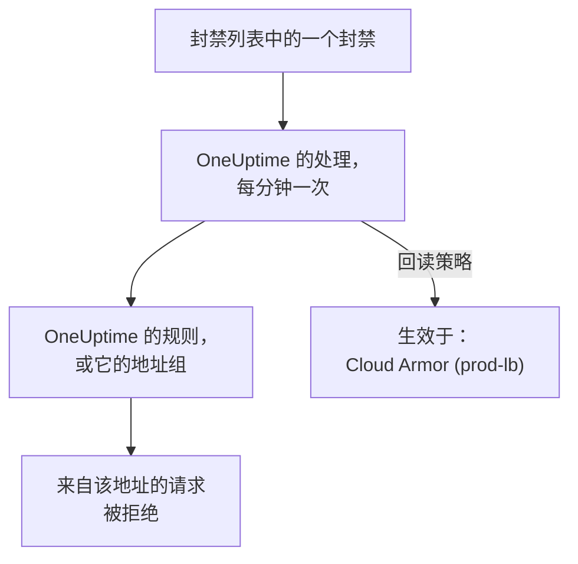

# 在 Cloud Armor 中封禁地址

你的项目的封禁列表可以在你的负载均衡器的 Google Cloud Armor 安全策略中执行。为你已有的 Google Cloud 连接开启它并选择安全策略后，封禁列表封禁的每个地址都会在那里被封禁，无论封禁它的是人、剧本还是 OneUptime AI。

:::cards
- [开启](#开启): Google Cloud 连接上的一项设置，以及它所需的角色。
- [OneUptime 创建的内容](#oneuptime-创建的内容): 在每个策略中创建自己的规则，或在使用 Cloud Armor Enterprise 时创建地址组。
- [匹配哪个地址](#匹配哪个地址): 建立连接的地址，或代理后面的用户 IP。
:::

## 工作原理

OneUptime 会在你选择的每个安全策略中保留自己的规则，并把封禁列表封禁的地址放入其中。它每分钟只更改有变化的部分，每次一条规则，然后回读该策略。在 **封禁列表** 页面上，只有当策略持有该封禁时，该封禁的 **生效于** 才会显示 Cloud Armor (prod-lb)；在此之前，它并未生效。

## 开始之前

- 一个已连接到 OneUptime 的 Google Cloud 项目（请参阅[连接云账户](/docs/telemetry/cloud-accounts#google-cloud)）。
- 可以更改封禁列表生效位置的角色：**项目所有者**、**项目管理员** 或 **安全管理员**。
- 能够在该 Google Cloud 项目中创建并授予角色的人，以便在 Cloud Shell 中运行一条命令。

## 开启

:::steps
### 打开连接
打开 **云 → 连接**，编辑 Google Cloud 连接。

### 开启设置
在 **更多字段** 下，将 **在 Cloud Armor 中封禁地址** 设置为 **开启**，然后保存。表单显示的设置命令现在会在授予其他角色的位置授予下文所述的角色。已有的连接无需再次运行它：**添加 WAF** 对话框会给出在该策略所在项目中授予该角色的命令。

### 添加安全策略
打开 **安全事件 → 剧本 → 封禁列表**。在 **云 WAF** 下，点击 **添加 WAF** 并选择一个安全策略。OneUptime 会询问 Google Cloud 该连接能否写入它，而不会写入任何内容。

### 授予缺失的角色
当缺少某项权限时，对话框会显示在该策略所在项目中授予它的命令。在 Cloud Shell 中运行这些命令，点击 **重新检查**，然后添加该策略。OneUptime 完成设置后，它的 **状态** 会显示 **生效中**。
:::

安全策略来自连接的资源清单：OneUptime 尚未读取的策略会在下一次读取后列出。当某个策略正在执行封禁列表时，其连接的设置不能关闭，连接也不能删除：请先移除该策略，让 OneUptime 撤下其规则。

## OneUptime 创建的内容

OneUptime 会在你添加策略时决定该策略以何种方式容纳封禁列表。

| 内容 | 名称 | 位置 |
| --- | --- | --- |
| 以 403 拒绝请求的规则，每条最多包含 10 个地址或范围 | 其描述以 `OneUptime blocklist <project> #1`、`#2` 等开头 | 在你选择的每个策略中，最多 20 条。 |
| 两个地址组，IPv4 和 IPv6 | `oneuptime-<project>-block-ipv4`, `oneuptime-<project>-block-ipv6` | 全局，位于该策略所在的项目中。仅限 Cloud Armor Enterprise。 |
| 一条以 403 拒绝任一地址组所含地址的规则 | 其描述以 `OneUptime blocklist <project>, address groups` 开头 | 在你选择的每个全局后端策略中，需要 Cloud Armor Enterprise。 |

`<project>` 是你的项目外部 ID 的前八个字符，因此选择同一策略的两个 OneUptime 项目永远不会写入彼此的规则。Cloud Armor 只用优先级来标识规则，因此 OneUptime 通过描述来识别自己的规则。

- **规则。** Cloud Armor 的一条规则可容纳 10 个地址或范围，因此一个策略在 OneUptime 的 20 条规则中最多可容纳 200 个封禁；放不下的封禁会在其所在行上说明。
- **地址组。** 在启用了 Cloud Armor Enterprise 的项目中，全局后端策略改为在两个地址组中容纳封禁列表：10,000 个 IPv4 范围和 2,000 个 IPv6 范围。该项目的所有此类策略共享这些地址组，每个策略中有一条规则拒绝其中所含的地址。这些地址组会占用该项目地址组配额中的 16,000 个单位。

OneUptime 使用 Cloud Armor 的规则方法逐条添加、更改和删除自己的规则：它从不整体写入策略，也从不写入你的规则。单个地址写作 `/32` 或 `/128`。

## 规则在策略中的位置

OneUptime 会把它的规则放在你的第一条放行请求的规则之前的空闲优先级上，从最小的开始，因此你的任何规则都不会放行被封禁的地址：即允许、限流、按速率封禁或公平共享的规则。你的拒绝规则可以排在它们前面。OneUptime 从不重新编号、更改或删除你的规则：当你的第一条此类规则之前没有空闲优先级时，策略会显示 **无可用优先级**，在你腾出一个之后，OneUptime 就会添加其规则。

## 匹配哪个地址

| 安全策略 | 客户端地址 | 何时选择 |
| --- | --- | --- |
| 后端 | **连接到负载均衡器的地址（origin.ip）** | 默认值。 |
| 后端 | 来自该策略请求标头的用户 IP（origin.user_ip） | 适用于位于其他代理或 CDN 之后的负载均衡器。 |
| 边缘 | 连接到负载均衡器的地址（origin.ip） | 唯一的选项：边缘策略不读取其他地址。 |

`origin.user_ip` 是该策略的用户 IP 请求标头（`userIpRequestHeaders`）中的地址，这些标头由负载均衡器前面的代理或 CDN 写入。如果没有设置任何此类标头，或其中没有有效地址，它就是 `origin.ip`。仅当这样的代理会写入这些标头时才选择它，因为直接访问负载均衡器的客户端可以自己写入它们。该选项位于 **添加 WAF** 对话框的 **更多字段** 下，之后你可以在策略所在行使用 **客户端地址** 更改它。

适用于直通网络负载均衡器的网络边缘安全策略无法选择，**添加 WAF** 对话框会说明原因：它的规则匹配的是数据包，而不是请求。

OneUptime 在 Cloud Armor 中的规则只会拒绝。要求质询某个地址的封禁不会在 Cloud Armor 中应用，并会说明这一点。自动响应策略的质询在那里会以相同时长的封禁来执行。

## 规则被手动更改时

当有人将 OneUptime 的某条规则设为预览模式、更改或删除它，或删除它的某个地址组时，OneUptime 会保持其被修改后的样子。策略会显示 **已手动更改**，其中所含的封禁不会生效，并会说明原因，直到有人在策略所在行点击 **恢复**。恢复会按照 OneUptime 的写法重新写入该规则，只要其原有优先级仍空闲，就写在该优先级上，并会重新创建被删除的地址组。

OneUptime 不检查策略是否已附加到后端服务。未附加到任何后端服务的策略不会封禁任何内容。

## 在 Terraform 中管理策略

带有 `rule` 块的 `google_compute_security_policy` 拥有该策略的每条规则，因此它的下一次 plan 会移除 OneUptime 的规则。请将你的规则写成 `google_compute_security_policy_rule` 资源，它们不会影响其他规则；或者在该策略的 `lifecycle` 块中添加 `ignore_changes = [rule]`。

## 权限

设置命令会在授予连接其他角色的位置添加一个自定义角色 `oneuptimeCloudArmorBlocklist`，并将其授予连接的服务账号。**添加 WAF** 对话框显示的命令会在该策略所在项目中添加同一角色。以规则（而非地址组）容纳封禁列表的策略只需要它自身的权限。

| 权限 | 原因 |
| --- | --- |
| `compute.securityPolicies.get`, `compute.securityPolicies.update` | 读取全局策略，并更改其中 OneUptime 的规则。 |
| `compute.regionSecurityPolicies.get`, `compute.regionSecurityPolicies.update` | 读取区域策略，并更改其中 OneUptime 的规则。 |
| `compute.globalOperations.get`, `compute.regionOperations.get` | 等待更改完成。 |
| `compute.projects.get` | 读取该项目是否启用了 Cloud Armor Enterprise。 |
| `networksecurity.addressGroups.get`, `networksecurity.addressGroups.list`, `networksecurity.addressGroups.create`, `networksecurity.addressGroups.update`, `networksecurity.addressGroups.delete`, `networksecurity.addressGroups.use` | 维护 OneUptime 的地址组，并在其规则中引用它们。仅限 Cloud Armor Enterprise。 |
| `networksecurity.operations.get` | 等待地址组的更改完成。 |

该角色无法删除策略，OneUptime 也从不写入其他任何内容。设置命令还会启用 Compute Engine 和 Network Security API。

## 移除

:::steps
### 移除安全策略
在 **安全事件 → 剧本 → 封禁列表** 中，点击策略所在行的 **移除**。OneUptime 会从策略中撤下其规则，并在该项目中没有其他策略使用其地址组时删除这些地址组。

### 关闭设置
编辑连接，将 **在 Cloud Armor 中封禁地址** 设置为 **关闭**，然后保存。只有当该连接的所有策略都不再执行封禁列表时，才能关闭此设置。
:::

当 OneUptime 可能无法再写入该策略时，请在 **移除 WAF** 对话框中勾选 **仅从 OneUptime 移除**。OneUptime 会将该策略从封禁列表中移除，并列出它留下的规则和地址组：在你于 Google Cloud 中删除它们之前，它们会继续封禁其中包含的地址。

## 故障排除

:::details 未生效
策略的状态会说明 Google Cloud 的答复以及该怎么做。如果被拒绝，它会指出缺少的权限：运行 **添加 WAF** 为该策略显示的命令，然后点击 **重新检查**。如果因配额被拒绝，它会指出该配额：请向 Google Cloud 申请更多配额，或删除不再使用的规则。
:::

:::details 无可用优先级
你的第一条放行请求的规则之前的每个优先级都已被占用。请把这条规则移到更大的编号上，然后点击 **重新检查**。
:::

:::details 某个策略不在列表中
OneUptime 会在读取已开启该设置的连接的安全策略之后列出它们。之后添加的策略会在连接的下一次读取后出现。
:::

## 后续步骤

:::cards
- [安全案例与剧本](/docs/telemetry/security-cases): 从案例中封禁地址，并查看其步骤的检查结果。
- [连接云账户](/docs/telemetry/cloud-accounts): 此设置所属的连接。
:::
