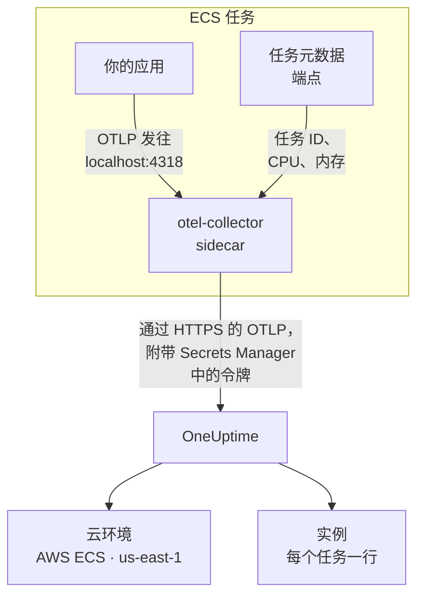

# AWS ECS / Fargate

将 Amazon ECS 任务的追踪、日志和指标发送到 OneUptime，Fargate 和 EC2 启动类型均适用。每个上报 `cloud.platform=aws_ecs` 的任务都会进入按 AWS 账户和区域划分的一个 **Cloud Environment**（例如 _AWS ECS · us-east-1 · 123456789012_），无论其中运行一个服务还是五十个服务。

:::cards
- [工作原理](#工作原理): ECS 检测器和 sidecar Collector 各自做什么。
- [设置](#设置): 保存令牌，把设置添加到任务定义，部署并检查。
- [完整的任务定义](#完整的任务定义): 可直接注册的完整 Fargate 任务定义。
- [故障排除](#故障排除): 卡在 PENDING 的任务、被拒绝的导出、空的实例或磁贴。
:::

## 工作原理



- **ECS 检测器为环境命名。** SDK 或 Collector 中的 OpenTelemetry ECS 资源检测器会读取 ECS 提供给每个容器的任务元数据端点，并把账户、区域和任务标记到任务发送的所有数据上。无需硬编码任何内容。
- **任务为每个实例命名。** 环境的 **实例** 选项卡按任务 ID 列出运行中的任务，并附带它们的 CPU 和内存。
- **sidecar Collector 提供 CPU 和内存。** 它的 `awsecscontainermetrics` 接收器从同一个端点读取每个任务的 CPU 和内存，并且令牌由它保存，应用永远看不到令牌。

ECS 检测器会设置以下资源属性：

| 属性 | ECS 检测器设置的值 | 用途 |
| ------------------------------------------------------------------ | ----------------------- | --------------------------------------------------------------------------------------------------------- |
| `cloud.platform` | `aws_ecs` | 把遥测数据归档到 **云环境** 下。值必须完全一致 |
| `cloud.account.id` | `123456789012` | 环境密钥的一部分 |
| `cloud.region` | `us-east-1` | 环境密钥的一部分 |
| `aws.ecs.task.arn` | 任务 ARN | 按末尾的任务 ID 在 **实例** 下为一个运行中的任务命名 |
| `aws.ecs.task.id` | 任务 ID | 同上；较新的检测器版本会同时设置两者 |
| `aws.ecs.cluster.arn`, `aws.ecs.task.family`, `aws.ecs.launchtype` | 集群和任务 | 保留在每个 span、日志和指标上供你搜索；不属于环境的一部分 |

环境密钥是 `aws_ecs|123456789012|us-east-1`。即使 SDK 还设置了 `service.instance.id`，实例的名称也取自任务 ID：sidecar 的容器指标只带有任务 ID，因此用它作键可以让一个任务的 span 及其 CPU 和内存都留在同一行。完整规则见 [云环境](/docs/telemetry/cloud-environments)。

## 开始之前

- **摄取密钥。** 在 **项目设置 → 遥测与 APM → 摄取密钥** 中创建一个 **服务器** 密钥并复制其令牌。
- **一个 ECS 集群和一个你可以修订的任务定义**，以及为该账户配置好的 AWS CLI。
- **使用 OpenTelemetry SDK 插桩的应用**，能够导出 OTLP，语言不限。

## 选择遥测数据离开任务的方式

| | Sidecar collector | SDK direct |
| ----------------------- | ---------------------------------------------- | ----------------------------------------------- |
| 额外的容器 | 每个任务中的 `otel-collector` | 无 |
| 每个任务的 CPU 和内存 | 有，来自 `awsecscontainermetrics` 接收器 | 无 |
| 保存令牌的一方 | Collector | 应用 |
| 机密中保存的内容 | 只有令牌 | 完整的标头 `x-oneuptime-token=...` |

大多数团队使用 sidecar Collector：它甚至会给那些对 ECS 一无所知的库发出的遥测数据加上 `cloud.*` 属性。对于单个服务，SDK direct 是最简单的选择。下面每一步都为两者各提供一个选项卡；选择其一，所有步骤都会随之切换。

## 设置

:::steps
### 将令牌保存到 Secrets Manager

> [!IMPORTANT]
> 令牌属于机密。请把它保存在 AWS Secrets Manager 中，并在任务定义中通过 `secrets` 和 `valueFrom` 引用。写在普通 `environment` 条目里的令牌，任何能读取任务定义的人都能看到，而且会出现在每一次 `describe-task-definition` 输出和 CloudFormation diff 中。

:::tabs
@tab Sidecar collector
```bash
aws secretsmanager create-secret \
  --name oneuptime/ingestion-token \
  --region us-east-1 \
  --secret-string "YOUR_TELEMETRY_INGESTION_TOKEN"
```

Collector 的配置会添加标头名称，因此这个机密只保存令牌。
@tab SDK direct
```bash
aws secretsmanager create-secret \
  --name oneuptime/ingestion-token \
  --region us-east-1 \
  --secret-string "x-oneuptime-token=YOUR_TELEMETRY_INGESTION_TOKEN"
```

ECS 会把机密的值原样放入变量，而 `OTEL_EXPORTER_OTLP_HEADERS` 需要完整的 `name=value` 对，因此这个机密保存完整的标头。
:::

记下命令打印出的 ARN。它以一个随机后缀结尾，例如 `oneuptime/ingestion-token-AbCdEf`，你需要把它粘贴到任务定义中。

### 允许任务读取机密

任务执行角色（ECS 启动任务时使用的角色，而不是你的代码运行时使用的角色）需要能够读取该机密。请将以下策略附加到 `ecsTaskExecutionRole`：

```json title="secret-access-policy.json"
{
  "Version": "2012-10-17",
  "Statement": [
    {
      "Effect": "Allow",
      "Action": ["secretsmanager:GetSecretValue"],
      "Resource": "arn:aws:secretsmanager:us-east-1:123456789012:secret:oneuptime/ingestion-token-*"
    }
  ]
}
```

如果该机密由客户托管的 KMS 密钥加密，该角色还需要对该密钥的 `kms:Decrypt` 权限。缺少其中任何一项，任务都无法启动，会以 `ResourceInitializationError: unable to pull secrets` 停止。

### 将设置添加到任务定义

:::tabs
@tab Sidecar collector
1. **AWS Console → Amazon Elastic Container Service → Task definitions** → 选择任务定义系列 → **Create new revision**。
2. 在 **Container - 1**（你的应用）下展开 **Environment variables**，添加下面的应用变量。
3. **+ Add container**：名称 `otel-collector`，镜像 `otel/opentelemetry-collector-contrib:latest`（确认可用后固定版本），**Essential container: No**。在 **Docker configuration → Command** 中输入 `--config=env:OTEL_COLLECTOR_CONFIG`。
4. 在 Collector 容器上添加环境变量 `ONEUPTIME_TOKEN`，选择 **Value type: ValueFrom** 并填入机密 ARN；再添加 `OTEL_COLLECTOR_CONFIG`，选择 **Value type: Value** 并填入下面的 Collector 配置。
5. 在应用容器的 **Startup dependency ordering** 下添加 `otel-collector`，条件为 **Start**，这样应用就不会在端口 4318 上有程序监听之前启动。
6. 在 **Task execution role** 下，确认它就是你附加了策略的那个角色。

应用变量。在 `awsvpc` 网络模式（在 Fargate 上总是如此）下，一个任务中的容器共享同一个网络，因此 `localhost` 就是 sidecar：

```bash
OTEL_SERVICE_NAME=checkout-api
OTEL_EXPORTER_OTLP_ENDPOINT=http://localhost:4318
OTEL_EXPORTER_OTLP_PROTOCOL=http/protobuf
```

Collector 配置。Collector 从 `OTEL_COLLECTOR_CONFIG` 变量读取全部配置，因此无需把文件打包进镜像；它还会从 ECS 放入其环境中的机密展开 `${env:ONEUPTIME_TOKEN}`：

```yaml title="OTEL_COLLECTOR_CONFIG"
receivers:
  otlp:
    protocols:
      http:
        endpoint: 0.0.0.0:4318
      grpc:
        endpoint: 0.0.0.0:4317
  # Per-task and per-container CPU / memory from the ECS task metadata
  # endpoint. This is what fills the CPU and memory tiles in OneUptime.
  awsecscontainermetrics:
    collection_interval: 20s
processors:
  # Stamps cloud.provider, cloud.platform=aws_ecs, cloud.account.id,
  # cloud.region and aws.ecs.task.arn on every span, log and metric.
  resourcedetection:
    detectors: [env, ecs]
    timeout: 5s
  batch: {}
exporters:
  otlphttp/oneuptime:
    endpoint: https://oneuptime.com/otlp
    headers:
      x-oneuptime-token: ${env:ONEUPTIME_TOKEN}
service:
  pipelines:
    traces:
      receivers: [otlp]
      processors: [resourcedetection, batch]
      exporters: [otlphttp/oneuptime]
    metrics:
      receivers: [otlp, awsecscontainermetrics]
      processors: [resourcedetection, batch]
      exporters: [otlphttp/oneuptime]
    logs:
      receivers: [otlp]
      processors: [resourcedetection, batch]
      exporters: [otlphttp/oneuptime]
```

`ecs` 检测器和 `awsecscontainermetrics` 接收器都不需要 IAM 权限：两者读取的都是 ECS 通过 `ECS_CONTAINER_METADATA_URI_V4` 提供给每个容器的元数据端点。
@tab SDK direct
1. **AWS Console → Amazon Elastic Container Service → Task definitions** → 选择任务定义系列 → **Create new revision**。
2. 在 **Container - 1**（你的应用）下展开 **Environment variables**，添加下面的变量。添加 `OTEL_EXPORTER_OTLP_HEADERS` 时选择 **Value type: ValueFrom**，并把机密 ARN 作为值。
3. 从下表中添加开启所用语言的 ECS 资源检测器的开关。
4. 在 **Task execution role** 下，确认它就是你附加了策略的那个角色。

```bash
OTEL_SERVICE_NAME=checkout-api
OTEL_EXPORTER_OTLP_ENDPOINT=https://oneuptime.com/otlp
OTEL_EXPORTER_OTLP_PROTOCOL=http/protobuf
# Injected from Secrets Manager (secrets / valueFrom), not typed here.
OTEL_EXPORTER_OTLP_HEADERS=x-oneuptime-token=YOUR_TELEMETRY_INGESTION_TOKEN
```

| 语言 | 开启 ECS 检测器 |
| -------- | --------------------------------------------------------------------------------------------------------------- |
| Node.js | `OTEL_NODE_RESOURCE_DETECTORS=env,host,os,aws` (auto-instrumentations-node) |
| Python | `pip install opentelemetry-sdk-extension-aws`，然后设置 `OTEL_EXPERIMENTAL_RESOURCE_DETECTORS=aws_ecs` |
| Java | `-Dotel.resource.providers.aws.enabled=true`（agent 默认关闭该提供程序） |
| Go | `import "go.opentelemetry.io/contrib/detectors/aws/ecs"`，并将 `ecs.NewResourceDetector()` 传给 `resource.New` |
| .NET | `OpenTelemetry.Resources.AWS` 包：`.ConfigureResource(r => r.AddAWSECSDetector())` |

在任务定义文件中，机密写作 `"secrets": [{ "name": "OTEL_EXPORTER_OTLP_HEADERS", "valueFrom": "<secret ARN>" }]`。
:::

如果你自托管 OneUptime，请使用 `https://YOUR-ONEUPTIME-HOST/otlp` 作为端点。

### 部署新的修订版本

点击 **Create**，然后依次执行 **Clusters → your cluster → Services → select the service → Update → Task definition revision: latest → Deploy**。也可以使用 CLI：

```bash
aws ecs update-service \
  --cluster production \
  --service checkout-api \
  --task-definition checkout-api
```

### 检查连接

先检查令牌：这是最省事的检查，它不通过，后面的一切都无法工作。

```bash
curl -i https://oneuptime.com/otlp/v1/validate \
  -H "x-oneuptime-token: YOUR_TELEMETRY_INGESTION_TOKEN"
```

返回 `200` 且 `"valid": true` 表示令牌已被接受。`401` 表示令牌未知、已吊销、已停用或已过期。用 ECS Exec 在任务内部运行同一条命令，以证明任务本身能够访问 OneUptime：

```bash
aws ecs execute-command --cluster production --task <task id> \
  --container app --interactive --command "sh"
```

Collector 的 CloudWatch 日志流（`otel/otel-collector/...`）中应出现 `Everything is ready`，并且没有包含 `401` 或 `connection refused` 的行。在第一个 span、日志或指标到达后的 1 分钟内，环境就会以 _AWS ECS · us-east-1 · 123456789012_ 的名称出现在 **云 → All Environments** 中。
:::

## 完整的任务定义

下面是 sidecar 方案的文件形式，用 `aws ecs register-task-definition --cli-input-json file://task-definition.json` 注册。请替换账户 ID、区域、镜像和机密 ARN：

```json title="task-definition.json"
{
  "family": "checkout-api",
  "requiresCompatibilities": ["FARGATE"],
  "networkMode": "awsvpc",
  "cpu": "512",
  "memory": "1024",
  "executionRoleArn": "arn:aws:iam::123456789012:role/ecsTaskExecutionRole",
  "taskRoleArn": "arn:aws:iam::123456789012:role/checkout-api-task-role",
  "containerDefinitions": [
    {
      "name": "app",
      "image": "123456789012.dkr.ecr.us-east-1.amazonaws.com/checkout-api:1.4.2",
      "essential": true,
      "portMappings": [{ "containerPort": 8080, "protocol": "tcp" }],
      "environment": [
        { "name": "OTEL_SERVICE_NAME", "value": "checkout-api" },
        {
          "name": "OTEL_EXPORTER_OTLP_ENDPOINT",
          "value": "http://localhost:4318"
        },
        { "name": "OTEL_EXPORTER_OTLP_PROTOCOL", "value": "http/protobuf" }
      ],
      "dependsOn": [
        { "containerName": "otel-collector", "condition": "START" }
      ],
      "logConfiguration": {
        "logDriver": "awslogs",
        "options": {
          "awslogs-group": "/ecs/checkout-api",
          "awslogs-region": "us-east-1",
          "awslogs-stream-prefix": "app"
        }
      }
    },
    {
      "name": "otel-collector",
      "image": "otel/opentelemetry-collector-contrib:latest",
      "essential": false,
      "command": ["--config=env:OTEL_COLLECTOR_CONFIG"],
      "secrets": [
        {
          "name": "ONEUPTIME_TOKEN",
          "valueFrom": "arn:aws:secretsmanager:us-east-1:123456789012:secret:oneuptime/ingestion-token-AbCdEf"
        }
      ],
      "environment": [
        {
          "name": "OTEL_COLLECTOR_CONFIG",
          "value": "receivers:\n  otlp:\n    protocols:\n      http:\n        endpoint: 0.0.0.0:4318\n      grpc:\n        endpoint: 0.0.0.0:4317\n  awsecscontainermetrics:\n    collection_interval: 20s\nprocessors:\n  resourcedetection:\n    detectors: [env, ecs]\n    timeout: 5s\n  batch: {}\nexporters:\n  otlphttp/oneuptime:\n    endpoint: https://oneuptime.com/otlp\n    headers:\n      x-oneuptime-token: ${env:ONEUPTIME_TOKEN}\nservice:\n  pipelines:\n    traces:\n      receivers: [otlp]\n      processors: [resourcedetection, batch]\n      exporters: [otlphttp/oneuptime]\n    metrics:\n      receivers: [otlp, awsecscontainermetrics]\n      processors: [resourcedetection, batch]\n      exporters: [otlphttp/oneuptime]\n    logs:\n      receivers: [otlp]\n      processors: [resourcedetection, batch]\n      exporters: [otlphttp/oneuptime]\n"
        }
      ],
      "logConfiguration": {
        "logDriver": "awslogs",
        "options": {
          "awslogs-group": "/ecs/checkout-api",
          "awslogs-region": "us-east-1",
          "awslogs-stream-prefix": "otel"
        }
      }
    }
  ]
}
```

`OTEL_COLLECTOR_CONFIG` 的值是作为单个 JSON 字符串的 Collector 配置。与其手动转义，不如把 YAML 保存在 `collector.yaml` 中，让 `jq` 来完成：

```bash
jq --rawfile cfg collector.yaml \
  '.containerDefinitions[1].environment[0].value = $cfg' \
  task-definition.json > task-definition.rendered.json
aws ecs register-task-definition --cli-input-json file://task-definition.rendered.json
```

## 网络

任务必须能访问 VPC 外的两个目标：启动时需要 Secrets Manager，导出时需要 OneUptime。

- **私有子网中的 Fargate 任务** 需要一条通往互联网的路由：子网路由表中的 NAT 网关，或带 `assignPublicIp=ENABLED` 的公有子网。两者都没有的任务会在获取机密时卡在 `PENDING`，Collector 还没来得及发送任何数据。
- **安全组的出站规则** 必须允许通过 TCP 443 访问 OneUptime 主机：`oneuptime.com`，或者你自己的主机及其监听端口。默认安全组允许所有出站流量；收紧过的安全组往往不允许。遥测数据不需要入站规则。
- **VPC 接口端点** 用于 `com.amazonaws.us-east-1.secretsmanager`（以及拉取镜像所需的 `ecr.api`、`ecr.dkr` 和 S3），可以让 AWS 调用不经过 NAT。OneUptime 本身仍然需要通往互联网的路由。

```bash
aws ecs update-service \
  --cluster production \
  --service checkout-api \
  --task-definition checkout-api \
  --network-configuration "awsvpcConfiguration={subnets=[subnet-0abc1234],securityGroups=[sg-0def5678],assignPublicIp=ENABLED}"
```

## 你能看到什么

- **概览**：根据追踪计算的请求、错误率和 p95 延迟，**CPU** 和 **内存** 磁贴，以及 **按 CPU 排名的实例**。磁贴的数据来自 `awsecscontainermetrics` 接收器的 `ecs.task.cpu.utilized` 和 `ecs.task.memory.utilized`，或者来自任何带有任务标识的 `container.cpu.utilization` 和 `container.memory.usage` 指标。SDK direct 两者都不发送。
- **实例**：每个运行中的任务一行，以任务 ID（`aws.ecs.task.arn` 的末尾部分）命名，显示最新的 CPU、内存和最后一次出现的时间。停止上报的任务会变为 **Stale**。
- **日志**、**追踪** 和 **指标**：该账户和区域中所有带有 `cloud.platform=aws_ecs` 的数据。
- **服务**：同样的任务，按 `service.name` 拆分。

## 故障排除

按发生顺序列出的 ECS 故障：

:::details 任务卡在 PENDING，提示 "unable to pull secrets"
完整的错误是 `ResourceInitializationError: unable to pull secrets`。要么任务执行角色缺少对该机密的 `secretsmanager:GetSecretValue`（或对其密钥的 `kms:Decrypt`），要么任务没有通往 Secrets Manager 的路由：既没有 NAT 网关，也没有 VPC 端点。参见 [网络](#网络)。
:::

:::details Collector 日志中出现 401
机密中的值不对。对于 sidecar Collector，它必须只是令牌；对于 SDK direct，则必须是完整的标头 `x-oneuptime-token=...`。用 [检查连接](#检查连接) 中的命令检查令牌本身。
:::

:::details 环境出现了，但实例为空
遥测数据中没有任务标识。确认 `ecs` 检测器在运行：资源上必须带有 `aws.ecs.task.arn`、`aws.ecs.task.id` 或 `service.instance.id`。
:::

:::details 实例有数据，但 CPU 和内存磁贴一直为空
`metrics` 管道中缺少 `awsecscontainermetrics` 接收器，或者该管道跳过了 `resourcedetection` 处理器，因此容器指标到达时没有 `cloud.platform`。SDK direct 永远不会填充这些磁贴。
:::

环境始终不出现、落在 **主机** 或 **无服务器函数** 下、显示 **已断开** 或被拆成两个，这些情况见 [云故障排除](/docs/telemetry/cloud-troubleshooting)。

## 后续步骤

:::cards
- [云环境](/docs/telemetry/cloud-environments): 环境和实例是如何识别的。
- [云故障排除](/docs/telemetry/cloud-troubleshooting): 所有平台共有的故障。
- [云资源(IaaS 与 PaaS)](/docs/telemetry/cloud-resources): 来自 CloudWatch 的负载均衡器、RDS 数据库和存储桶。
- [OpenTelemetry](/docs/telemetry/open-telemetry): 为应用插桩，以及端点和限制。
:::
