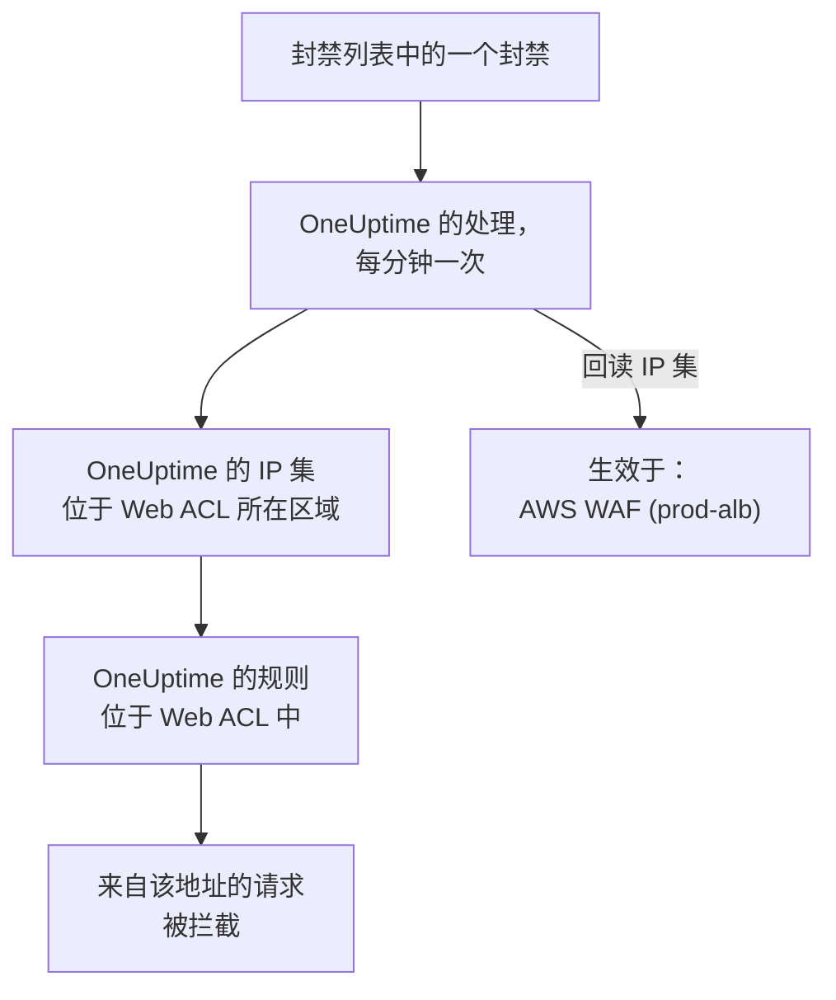

# 在 AWS WAF 中封禁地址

你的项目的封禁列表可以在位于 CloudFront 分配、负载均衡器和 API Gateway 前面的 AWS WAF Web ACL 中执行。为你已有的 AWS 云连接开启它并选择 Web ACL 后，封禁列表封禁的每个地址都会在那里被封禁，无论封禁它的是人、剧本还是 OneUptime AI。

:::cards
- [开启](#开启): 更改 AWS 连接上的一项设置，然后再次运行其设置命令。
- [OneUptime 创建的内容](#oneuptime-创建的内容): 每个区域四个 IP 集，每个 Web ACL 两条规则。
- [在代码中管理 Web ACL](#在代码中管理-web-acl): 自行在 Terraform 或 CloudFormation 中添加规则。
:::

## 工作原理

OneUptime 会在所选 Web ACL 所在的每个区域中保留自己的 IP 集，并在每个 Web ACL 中保留一条规则，封禁这些 IP 集所含的地址。它每分钟用封禁列表中的内容把每个 IP 集写入一次，然后回读这些 IP 集。在 **封禁列表** 页面上，只有当 AWS WAF 持有该封禁、且 Web ACL 的规则封禁了它所在的 IP 集时，该封禁的 **生效于** 才会显示 AWS WAF (prod-alb)；在此之前，它并未生效。

## 开始之前

- 一个已连接到 OneUptime 的 AWS 账户（请参阅[连接云账户](/docs/telemetry/cloud-accounts#amazon-web-services)）。
- 可以更改封禁列表生效位置的角色：**项目所有者**、**项目管理员** 或 **安全管理员**。
- 能够在该 AWS 账户中再次运行连接设置命令的人。

## 开启

:::steps
### 打开连接
打开 **云 → 连接**，编辑 AWS 连接。

### 选择由谁添加规则
在 **更多字段** 下，将 **在 AWS WAF 中封禁地址** 设置为 **开启，由 OneUptime 添加其规则**；如果你的 Web ACL 由 Terraform 或 CloudFormation 管理，则设置为 **开启，由我在代码中添加规则**。

### 再次运行设置命令
表单显示的命令现在会授予 IP 集的权限，并在由 OneUptime 添加规则时授予规则的权限。在 AWS CloudShell 中运行它，然后保存连接。

### 添加 Web ACL
打开 **安全事件 → 剧本 → 封禁列表**。在 **云 WAF** 下，点击 **添加 WAF**，选择一个 Web ACL，并在 **更多字段** 下选择它读取客户端地址的位置，然后添加。OneUptime 会立即完成设置，当其规则封禁这些 IP 集时，它的 **状态** 会显示 **生效中**。
:::

Web ACL 来自连接的资源清单：OneUptime 尚未读取的 Web ACL 会在下一次读取后列出。当某个 Web ACL 正在执行封禁列表时，其连接的设置既不能关闭，也不能从由 OneUptime 添加规则改为在代码中添加，连接也不能删除：请先移除该 Web ACL，让 OneUptime 撤下其规则。

## OneUptime 创建的内容

| 内容 | 名称 | 位置 |
| --- | --- | --- |
| 四个 IP 集：封禁和质询，各有 IPv4 和 IPv6 | `oneuptime-<project>-block-ipv4`, `oneuptime-<project>-block-ipv6`, `oneuptime-<project>-challenge-ipv4`, `oneuptime-<project>-challenge-ipv6` | 所选 Web ACL 所在的每个区域。CloudFront 的 Web ACL 是全局的，其 IP 集位于 `us-east-1`。 |
| 两条规则：一条封禁，一条质询 | `OneUptime-Blocklist-<project>`, `OneUptime-Challenge-<project>` | 由 OneUptime 添加规则时，位于每个所选 Web ACL 中。 |

`<project>` 是你的项目外部 ID 的前八个字符，因此同一账户中的两个 OneUptime 项目永远不会写入彼此的 IP 集。同一区域的 Web ACL 共享这些 IP 集。单个地址写作 `/32` 或 `/128`。AWS WAF 的一个 IP 集最多容纳 10,000 个地址，一个区域最多容纳 100 个 IP 集，除非 AWS 为你提高了上限；放不下的封禁会在其所在行上说明。

## 规则在 Web ACL 中的位置

OneUptime 会把它的两条规则放在编号小于你的第一条规则的空闲优先级上，因此它们会在你编写的规则之前运行。如果 Web ACL 中没有任何规则，它们使用优先级 0 和 1。OneUptime 从不重新编号、更改或删除你的规则：当编号小于你的第一条规则的优先级中没有两个空闲时，Web ACL 会显示 **无可用优先级**，在你腾出两个之后，OneUptime 就会添加其规则。

当客户端地址位于其 IPv4 或 IPv6 的 IP 集之一时，每条规则都会匹配。AWS WAF 会整体更新 Web ACL，因此 OneUptime 会读取 Web ACL、添加其规则，并使用 Web ACL 的锁定令牌写回；如果在此期间有其他人写入了它，就会重新读取。

## 转发的地址

位于其他代理或 CDN 之后的 Web ACL 看到的是代理的地址，而不是客户端的地址。在 **客户端地址** 中选择它从何处读取客户端地址：

| 客户端地址 | 规则读取的内容 |
| --- | --- |
| **请求的来源地址** | 请求发出的地址。默认值。 |
| `X-Forwarded-For` 标头中的最后一个地址 | 最后一个代理追加的地址。它之前的地址是请求自己声称的。 |
| `CF-Connecting-IP` 标头 | Cloudflare 写入的唯一地址。 |
| `True-Client-IP` 标头 | Akamai 或 Cloudflare Enterprise 写入的唯一地址。 |

没有该标头的请求不会匹配：AWS WAF 会放行它，而不是封禁代理的地址。

## 在代码中管理 Web ACL

选择 **开启，由我在代码中添加规则** 时，OneUptime 只创建 IP 集，从不写入你的 Web ACL。在 Web ACL 所在行点击 **显示规则**：它会以 Terraform（`aws_wafv2_web_acl` 的 `rule` 块）和 CloudFormation 两种形式给出这两条规则，并附上每个 IP 集的 ARN 以及 Web ACL 读取的标头。把它们添加到你的代码中、放在你的其他规则之前，然后应用。

在规则加入之前，Web ACL 会显示 **等待你添加规则**，其封禁不会生效。OneUptime 每次处理都会读取该 Web ACL；从第一次发现有规则封禁每个 IP 集的那次处理起，无论你给规则起什么名字，其封禁都会生效。

## 权限

设置命令会向角色添加一个内联策略 `OneUptimeWafBlocklist`。使用访问密钥时，由于 IAM 限制用户自身策略的数量，该策略会附加到一个组 `OneUptimeWafBlocklist-<project>` 上，并让该用户加入这个组。

| 操作 | 资源 | 原因 |
| --- | --- | --- |
| `wafv2:ListIPSets` | 任意 | 在区域中查找 OneUptime 的 IP 集。 |
| `wafv2:GetIPSet`, `wafv2:CreateIPSet`, `wafv2:UpdateIPSet`, `wafv2:DeleteIPSet` | 仅 OneUptime 的 IP 集（`oneuptime-<project>-*`） | 维护这些 IP 集，并在你移除某个区域的最后一个 Web ACL 时删除它们。 |
| `wafv2:GetSampledRequests` | Web ACL | 读取规则拒绝的请求：这是检查案例封禁步骤的依据。 |
| `wafv2:UpdateWebACL` | Web ACL，以及它们引用的 IP 集、正则表达式模式集和规则组 | 添加 OneUptime 的规则。仅在选择 **开启，由 OneUptime 添加其规则** 时需要。 |

读取 Web ACL 所需的 `wafv2:GetWebACL` 已包含在连接的只读策略中。

## 移除

:::steps
### 移除 Web ACL
在 **安全事件 → 剧本 → 封禁列表** 中，点击 Web ACL 所在行的 **移除**。OneUptime 会从该 Web ACL 中撤下其规则，并在该区域没有其他 Web ACL 使用其 IP 集时，清空并删除这些 IP 集。

### 关闭设置
编辑连接，将 **在 AWS WAF 中封禁地址** 设置为 **关闭**，然后保存。只有当该连接的所有 Web ACL 都不再执行封禁列表时，才能关闭此设置。
:::

当 OneUptime 可能无法再写入该 Web ACL 时，请在 **移除 WAF** 对话框中勾选 **仅从 OneUptime 移除**。OneUptime 会将该 Web ACL 从封禁列表中移除，并列出它留在 AWS WAF 中的规则和 IP 集：在你于 AWS WAF 中删除它们之前，它们会继续封禁其中包含的地址。仍被你的规则引用的 IP 集也会保留：OneUptime 会清空它，并列出它的名称。

## 故障排除

:::details 未生效
Web ACL 的状态会说明 AWS 的答复以及该怎么做。如果被拒绝，它会指出被拒绝的操作以及授予该操作的设置：开启该设置，或选择 **开启，由 OneUptime 添加其规则**，然后再次运行连接的设置命令，并点击 **重新检查**。
:::

:::details 无可用优先级
你的第一条规则位于优先级 0 或 1，因此编号小于它的优先级中没有两个空闲。把你所有规则的优先级都往后挪两位，然后点击 **重新检查**。
:::

:::details 某个 Web ACL 不在列表中
OneUptime 会在读取已开启该设置的连接的 Web ACL 之后列出它们。仅通过指标看到的 Web ACL 需要再次运行连接的设置命令，OneUptime 才能读取它们。
:::

## 后续步骤

:::cards
- [安全案例与剧本](/docs/telemetry/security-cases): 从案例中封禁地址，并查看其步骤的检查结果。
- [连接云账户](/docs/telemetry/cloud-accounts): 此设置所属的连接。
:::
