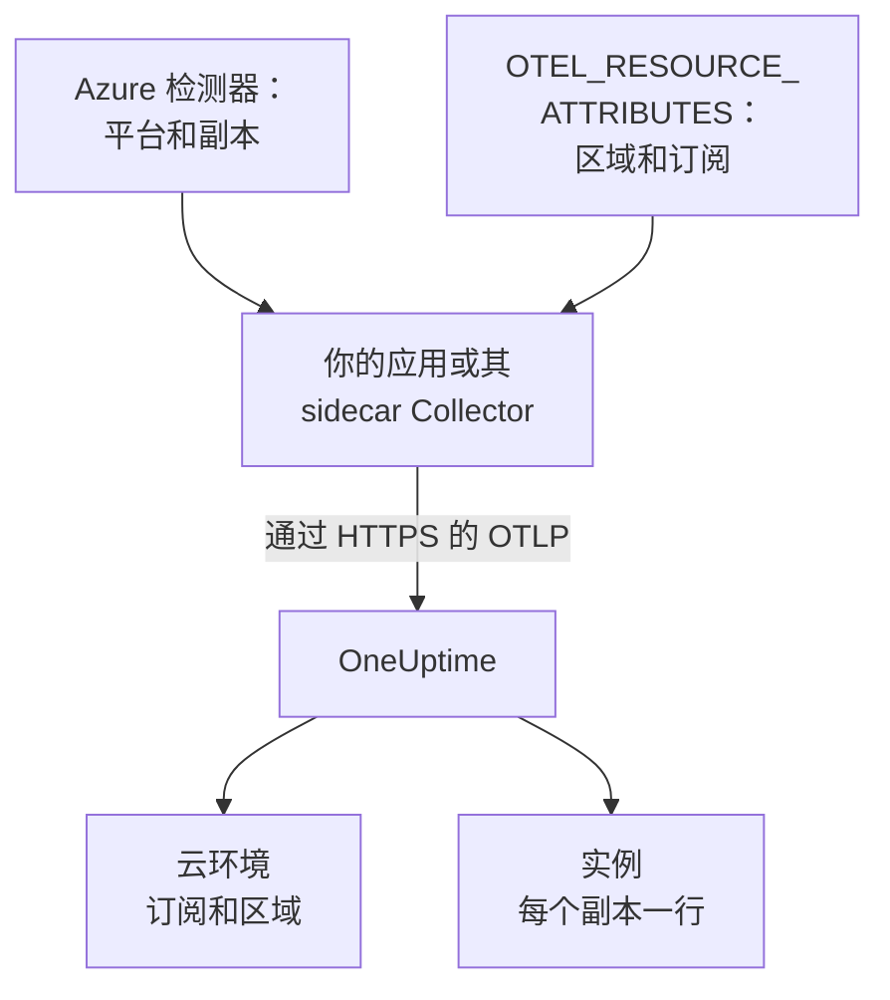

# Azure Container Apps

将 Azure Container Apps 的追踪、日志和指标发送到 OneUptime。每个上报 `cloud.platform=azure_container_apps` 的副本都会进入按 Azure 订阅和区域划分的一个 **Cloud Environment**（例如 _Azure Container Apps · eastus · 00000000-0000-0000-0000-000000000000_），运行中的副本列在 **实例** 下。

:::cards
- [工作原理](#工作原理): 检测器设置了什么，以及需要你自己设置的两个属性。
- [设置](#设置): 保存令牌，用 Azure CLI 或门户配置应用，然后检查。
- [使用环境的托管 OpenTelemetry 代理](#使用环境的托管-opentelemetry-代理): 无需 sidecar 即可转发环境中所有应用的数据。
- [故障排除](#故障排除): 被拒绝的导出、缺失的环境和空的实例。
:::

## 工作原理



Container Apps 有资源检测器：Collector 的 `azurecontainerapps` 检测器，以及 Node.js（`@opentelemetry/resource-detector-azure`）和 .NET（`OpenTelemetry.Resources.Azure`）的检测器。它们读取 `CONTAINER_APP_NAME` 和 `CONTAINER_APP_REPLICA_NAME`，并设置 `cloud.provider`、`cloud.platform`、`service.name` 和副本 ID。它们都不知道区域和订阅，所以你需要在 `OTEL_RESOURCE_ATTRIBUTES` 中自己设置 `cloud.region` 和 `cloud.account.id`。

| 属性 | 值 | 用途 |
| --------------------------------- | ------------------------------------------------------------------------- | ------------------------------------------------------------ |
| `cloud.provider` | `azure` | 显示在概览中 |
| `cloud.platform` | `azure_container_apps` | 把遥测数据归档到 **云环境** 下 |
| `cloud.region` | 环境所在区域，例如 `eastus`：由你设置 | 环境密钥的一部分 |
| `cloud.account.id` | 订阅 ID：由你设置 | 环境密钥的一部分 |
| `azure.container_app.instance.id` | 副本名称，由检测器根据 `CONTAINER_APP_REPLICA_NAME` 设置 | 为一个运行中的副本命名：在 **实例** 下每个副本一行 |
| `service.instance.id` | 副本名称（如果你自己设置） | 在没有检测器设置副本 ID 时使用 |

- **带点号的写法也能用。** Node.js 和 .NET 检测器把平台写作带点号的 `azure.container_apps`。OneUptime 收到时会把它改写为 `azure_container_apps`，因此两种写法会进入同一个环境。
- **主机名就是副本名称。** 只运行 `host` 检测器的 SDK 会把副本名称上报为 `host.name`，在没有更具体的值时，OneUptime 就用它为实例命名。

环境密钥是 `azure_container_apps|<subscription id>|eastus`。

## 开始之前

- **摄取密钥。** 在 **项目设置 → 遥测与 APM → 摄取密钥** 中创建一个 **服务器** 密钥并复制其令牌。
- **安装了 `containerapp` 扩展的 Azure CLI**（`az extension add --name containerapp --upgrade`），并已登录到该订阅，或者使用 Azure 门户。
- **使用 OpenTelemetry SDK 插桩的应用**，能够导出 OTLP。

## 选择遥测数据离开应用的方式

| | SDK direct | Sidecar collector |
| ------------------ | ------------------------------------------- | ------------------------------------------------------------ |
| 额外的容器 | 无 | 应用中的 `otel-collector`，与副本共享 CPU 和内存 |
| 设置属性的一方 | SDK 以及应用上的 `OTEL_RESOURCE_ATTRIBUTES` | Collector，作用于经过它的所有数据 |
| 机密 | `oneuptime-otlp-headers`，完整的标头 | `oneuptime-token`，只有令牌 |

第三种方式是使用环境的托管 OpenTelemetry 代理，它无需 sidecar 即可转发环境中所有应用的数据：参见 [使用环境的托管 OpenTelemetry 代理](#使用环境的托管-opentelemetry-代理)。下面每一步都分别为 SDK direct 和 sidecar Collector 提供选项卡；选择其一，所有步骤都会随之切换。

## 设置

:::steps
### 将令牌保存为 Container Apps 机密

> [!IMPORTANT]
> 令牌属于机密。请把它保存为 Container Apps 机密，并在环境变量中通过 `secretref:` 引用。机密一经设置，就不会显示在 `az containerapp show` 或门户中；普通环境变量则会显示。

:::tabs
@tab SDK direct
```bash
az containerapp secret set \
  --name checkout-api \
  --resource-group my-rg \
  --secrets oneuptime-otlp-headers="x-oneuptime-token=YOUR_TELEMETRY_INGESTION_TOKEN"
```

SDK 的 `OTEL_EXPORTER_OTLP_HEADERS` 需要完整的 `name=value` 标头，因此机密保存的就是它。
@tab Sidecar collector
```bash
az containerapp secret set \
  --name checkout-api \
  --resource-group my-rg \
  --secrets oneuptime-token=YOUR_TELEMETRY_INGESTION_TOKEN
```

Collector 会自己添加标头名称，因此机密只保存令牌。
:::

在门户中：**Azure portal → Container Apps → your app → Settings → Secrets → + Add**。输入键，选择类型 **Container Apps secret**，粘贴值，然后点击 **Add**。

如果你把机密保存在 Key Vault 中，请引用该机密而不是复制它的值。应用的托管标识需要对该保管库拥有 **Key Vault Secrets User** 角色：

```bash
az containerapp secret set \
  --name checkout-api --resource-group my-rg \
  --secrets "oneuptime-token=keyvaultref:https://my-vault.vault.azure.net/secrets/oneuptime-token,identityref:system"
```

### 配置容器应用

:::tabs
@tab SDK direct
在应用容器上设置导出器，以及检测器不知道的属性。把区域和订阅 ID 换成你自己的：

```bash
az containerapp update \
  --name checkout-api \
  --resource-group my-rg \
  --set-env-vars \
    OTEL_SERVICE_NAME=checkout-api \
    OTEL_EXPORTER_OTLP_ENDPOINT=https://oneuptime.com/otlp \
    OTEL_EXPORTER_OTLP_PROTOCOL=http/protobuf \
    OTEL_EXPORTER_OTLP_HEADERS=secretref:oneuptime-otlp-headers \
    "OTEL_RESOURCE_ATTRIBUTES=cloud.provider=azure,cloud.platform=azure_container_apps,cloud.region=eastus,cloud.account.id=00000000-0000-0000-0000-000000000000"
```

要获得副本标识，请开启 SDK 的 Azure 检测器：Node.js 中使用 `OTEL_NODE_RESOURCE_DETECTORS=env,host,os,azure`，.NET 中使用 `OpenTelemetry.Resources.Azure` 和 `.ConfigureResource(r => r.AddAzureContainerAppsDetector())`。它会根据 `CONTAINER_APP_REPLICA_NAME` 设置 `azure.container_app.instance.id`。

Container Apps 无法把一个环境变量嵌入另一个环境变量，因此在其他语言中无法把 `service.instance.id` 放进 `OTEL_RESOURCE_ATTRIBUTES`。请开启主机检测器（它的 `host.name` 就是副本名称），或在代码中设置：

```js title="tracing.js"
// Node.js: the file you load with --require before the app starts
const { NodeSDK } = require("@opentelemetry/sdk-node");
const { resourceFromAttributes } = require("@opentelemetry/resources");

const sdk = new NodeSDK({
  resource: resourceFromAttributes({
    "service.instance.id": process.env.CONTAINER_APP_REPLICA_NAME,
  }),
});
sdk.start();
```

```python title="tracing.py"
# Python: before the tracer provider is created
import os
from opentelemetry.sdk.resources import Resource

resource = Resource.create({"service.instance.id": os.environ.get("CONTAINER_APP_REPLICA_NAME", "")})
```

无论使用哪个检测器，都要在 `OTEL_RESOURCE_ATTRIBUTES` 中保留 `cloud.region` 和 `cloud.account.id`：没有任何 Container Apps 检测器会设置它们，而环境密钥需要它们。

或者在门户中：

1. 打开 **Application → Containers → Edit and deploy**，在 **Container** 选项卡中选择你的容器，然后点击 **Edit**。
2. 在 **Environment variables** 下，以 **Manual entry** 为来源添加上面的每个变量，并以 **Reference a secret** 为来源添加 `OTEL_EXPORTER_OTLP_HEADERS`，指向 `oneuptime-otlp-headers`。
3. 点击 **Save**。
@tab Sidecar collector
sidecar 运行在同一个副本中，因此能看到相同的 `CONTAINER_APP_NAME` 和 `CONTAINER_APP_REPLICA_NAME`。它的 `azurecontainerapps` 检测器会把它们转换为 `cloud.provider`、`cloud.platform`、`service.name` 和 `azure.container_app.instance.id`，而它的 `env` 检测器会从 Collector 自身环境中的 `OTEL_RESOURCE_ATTRIBUTES` 读取 `cloud.region` 和 `cloud.account.id`。应用只需导出到 `http://localhost:4318`。

导出应用的定义，把 Collector 添加到 `template.containers`，然后应用它：

```bash
az containerapp show --name checkout-api --resource-group my-rg -o yaml > checkout-api.yaml
# edit checkout-api.yaml as below
az containerapp update --name checkout-api --resource-group my-rg --yaml checkout-api.yaml
```

```yaml title="checkout-api.yaml"
properties:
  configuration:
    secrets:
      - name: oneuptime-token
        value: YOUR_TELEMETRY_INGESTION_TOKEN
  template:
    containers:
      - name: app
        image: myregistry.azurecr.io/checkout-api:1.4.2
        env:
          - name: OTEL_SERVICE_NAME
            value: checkout-api
          - name: OTEL_EXPORTER_OTLP_ENDPOINT
            value: http://localhost:4318
          - name: OTEL_EXPORTER_OTLP_PROTOCOL
            value: http/protobuf
        resources:
          cpu: 0.5
          memory: 1Gi
      - name: otel-collector
        image: otel/opentelemetry-collector-contrib:latest
        args:
          - --config=env:OTEL_COLLECTOR_CONFIG
        env:
          - name: ONEUPTIME_TOKEN
            secretRef: oneuptime-token
          # Read by the resourcedetection processor's env detector.
          - name: OTEL_RESOURCE_ATTRIBUTES
            value: cloud.provider=azure,cloud.platform=azure_container_apps,cloud.region=eastus,cloud.account.id=00000000-0000-0000-0000-000000000000
          - name: OTEL_COLLECTOR_CONFIG
            value: |
              receivers:
                otlp:
                  protocols:
                    http:
                      endpoint: 0.0.0.0:4318
                    grpc:
                      endpoint: 0.0.0.0:4317
              processors:
                # env: cloud.region + cloud.account.id from OTEL_RESOURCE_ATTRIBUTES.
                # azurecontainerapps: cloud.provider, cloud.platform, service.name
                # and azure.container_app.instance.id from the CONTAINER_APP_*
                # variables. override: false keeps the service.name the
                # application set instead of the Container App's name.
                resourcedetection:
                  detectors: [env, azurecontainerapps]
                  timeout: 2s
                  override: false
                batch: {}
              exporters:
                otlphttp/oneuptime:
                  endpoint: https://oneuptime.com/otlp
                  headers:
                    x-oneuptime-token: ${env:ONEUPTIME_TOKEN}
              service:
                pipelines:
                  traces:
                    receivers: [otlp]
                    processors: [resourcedetection, batch]
                    exporters: [otlphttp/oneuptime]
                  metrics:
                    receivers: [otlp]
                    processors: [resourcedetection, batch]
                    exporters: [otlphttp/oneuptime]
                  logs:
                    receivers: [otlp]
                    processors: [resourcedetection, batch]
                    exporters: [otlphttp/oneuptime]
        resources:
          cpu: 0.25
          memory: 0.5Gi
```

`az containerapp show` 不会导出机密的值，所以请手动把 `secrets` 条目加回去；如果你在第一步已经设置了机密，也可以省略它：更新会保留已有的机密。Container Apps 会把副本中所有容器的 CPU 和内存加在一起，因此 sidecar 的 `resources` 会计入应用的配额。

或者在门户中：

1. 打开 **Application → Containers → Edit and deploy**。在 **Container** 选项卡中，通过 **+ Add** 添加一个名为 `otel-collector` 的容器，镜像为 `otel/opentelemetry-collector-contrib:latest`，**Arguments override** 为 `--config=env:OTEL_COLLECTOR_CONFIG`。
2. 添加它的环境变量：`ONEUPTIME_TOKEN`（**Reference a secret**：`oneuptime-token`）、`OTEL_RESOURCE_ATTRIBUTES` 和 `OTEL_COLLECTOR_CONFIG`（**Manual entry**，值如上）。
3. 点击 **Save**。
:::

如果你自托管 OneUptime，请使用 `https://YOUR-ONEUPTIME-HOST/otlp` 作为端点。

### 部署新的修订版本

`az containerapp update` 本身就会部署新的修订版本。在门户中点击 **Create**。如果有多个修订版本处于活动状态，请在 **Revisions and replicas** 下把流量切到新版本。

### 检查连接

```bash
curl -i https://oneuptime.com/otlp/v1/validate \
  -H "x-oneuptime-token: YOUR_TELEMETRY_INGESTION_TOKEN"
```

返回 `200` 且 `"valid": true` 表示令牌已被接受。`401` 表示令牌未知、已吊销、已停用或已过期。然后查看 Collector 的输出：

```bash
az containerapp logs show --name checkout-api --resource-group my-rg \
  --container otel-collector --follow
```

查找 `Everything is ready`，并确认没有 `401` 或 `connection refused`。在第一个 span、日志或指标到达后的 1 分钟内，环境就会以 _Azure Container Apps · eastus · 00000000-0000-0000-0000-000000000000_ 的名称出现在 **云 → All Environments** 中。
:::

## 使用环境的托管 OpenTelemetry 代理

Container Apps 环境可以运行 Azure 的托管 OpenTelemetry 代理。它从环境中的每个应用接收 OTLP，并转发到你配置的端点，无需在每个应用中放置 sidecar。该代理 **只通过 OTLP/gRPC** 导出，因此不能使用 HTTP 路径 `/otlp`。请改为让它指向 OneUptime 主机的 443 端口，OneUptime 在那里通过 TLS 提供 OTLP/gRPC：

```bash
az containerapp env telemetry otlp add \
  --name my-aca-env \
  --resource-group my-rg \
  --otlp-name oneuptime \
  --endpoint oneuptime.com:443 \
  --insecure false \
  --headers "x-oneuptime-token=YOUR_TELEMETRY_INGESTION_TOKEN" \
  --enable-open-telemetry-traces true \
  --enable-open-telemetry-logs true \
  --enable-open-telemetry-metrics true
```

- **自托管：** 使用 `YOUR-ONEUPTIME-HOST:443`。自托管的 OneUptime 只接受通过 TLS 的 OTLP/gRPC：参见 [基于 gRPC 的 OTLP](/docs/telemetry/open-telemetry#基于-grpc-的-otlp)。
- **属性仍由应用设置。** 代理会向每个应用注入它自己的 `OTEL_EXPORTER_OTLP_ENDPOINT` 和 `OTEL_EXPORTER_OTLP_PROTOCOL=grpc`，因此请在应用中去掉这两项，保留 `OTEL_SERVICE_NAME` 和 `OTEL_RESOURCE_ATTRIBUTES`。代理会转发应用发送的内容，因此 `cloud.*` 和副本 ID 仍然来自每个应用。
- **你的 `OTEL_RESOURCE_ATTRIBUTES` 优先。** 代理也会设置 `OTEL_RESOURCE_ATTRIBUTES`，而应用上设置的值会替换它：请在你的值中包含容器应用名称和副本 ID，或在代码中设置它们。

## 网络

- **出站流量默认是开放的。** 无论环境的入口是外部还是内部，副本无需任何配置即可访问 `oneuptime.com:443`。
- **自定义 VNet 是例外。** 如果 VNet 中有把 `0.0.0.0/0` 发往防火墙或 NAT 网关的用户定义路由，或者子网上有网络安全组，请在防火墙或 NSG 上允许通过 TCP 443 访问 OneUptime 主机（或你自己主机的端口）。
- **VNet 内的自托管 OneUptime** 必须能从环境的子网解析并路由到。
- **遥测数据不需要任何 Azure 角色。** 只有 Key Vault 引用要求应用的托管标识对该保管库拥有 **Key Vault Secrets User**。

## 你能看到什么

- **概览**：根据追踪计算的请求、错误率和 p95 延迟。Container Apps 不会向 sidecar 公开副本的资源使用情况，因此只有当你发送带有副本标识的 `container.cpu.utilization` 和 `container.memory.usage` 指标时，**CPU** 和 **内存** 磁贴才会有数据。大多数团队把这些交给 Azure Monitor。
- **实例**：每个副本一行，名称取自检测器设置的 `azure.container_app.instance.id`、你自己设置的 `service.instance.id`，或在只运行主机检测器时取自 `host.name`。
- 按环境过滤的 **日志**、**追踪** 和 **指标**，以及 **服务** 下的按服务视图。

## 故障排除

:::details 什么都没出现，Collector 日志中有 401
机密中的值不对。`oneuptime-token` 必须只是令牌；`oneuptime-otlp-headers` 必须是完整的标头 `x-oneuptime-token=...`。
:::

:::details 应用出现在服务下，但没有环境
缺少 `OTEL_RESOURCE_ATTRIBUTES`，或者 `cloud.platform` 不完全等于 `azure_container_apps`。用 `az containerapp show ... --query properties.template.containers[].env` 查看应用的设置。
:::

:::details 环境存在，但实例为空
资源上 `service.instance.id`、`azure.container_app.instance.id` 和 `host.name` 一个都没有。请在 Collector 中添加 `azurecontainerapps` 检测器，开启 SDK 的 Azure 检测器或主机检测器，或在代码中设置 `service.instance.id`。
:::

:::details 一个订阅出现了两个环境
一个应用设置了 `cloud.region`（或 `cloud.account.id`）而另一个没有，或者区域写法不同（`eastus` 和 `East US`）。这些值必须逐字符一致。
:::

其他问题见 [云故障排除](/docs/telemetry/cloud-troubleshooting)。

## 后续步骤

:::cards
- [云环境](/docs/telemetry/cloud-environments): 环境和实例是如何识别的。
- [其他云平台](/docs/telemetry/cloud-other-platforms): Azure App Service 和 Azure Container Instances。
- [云故障排除](/docs/telemetry/cloud-troubleshooting): 所有平台共有的故障。
- [云资源(IaaS 与 PaaS)](/docs/telemetry/cloud-resources): 来自 Azure Monitor 的订阅中的每个资源。
:::
