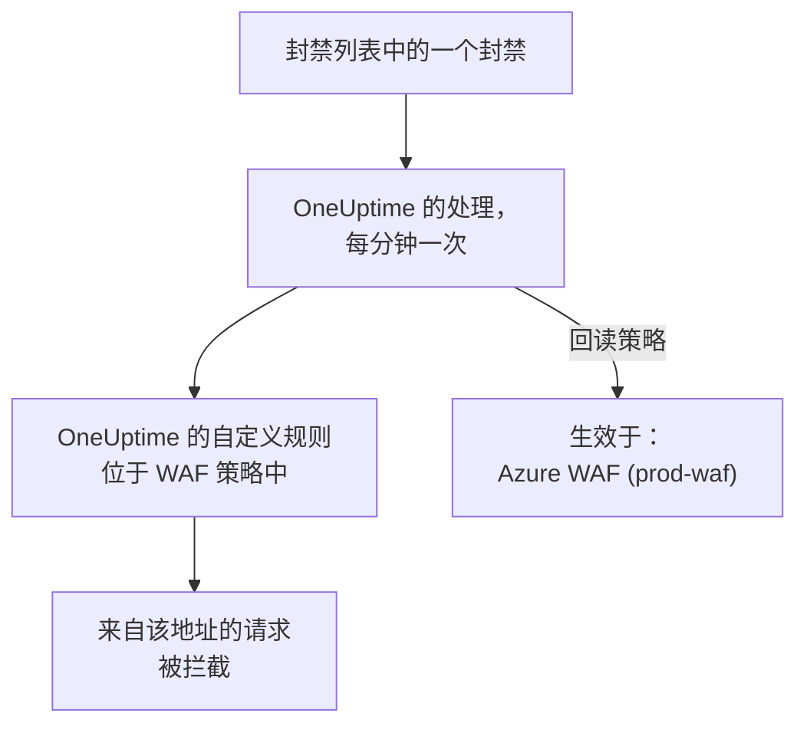

# 在 Azure WAF 中封禁地址

你的项目的封禁列表可以在你的 Application Gateway 和 Front Door 的 Azure WAF 策略中执行。为你已有的 Azure 云连接开启它并选择 WAF 策略后，封禁列表封禁的每个地址都会在那里被封禁，无论封禁它的是人、剧本还是 OneUptime AI。

:::cards
- [开启](#开启): Azure 连接上的一项设置，以及它所需的角色。
- [OneUptime 创建的内容](#oneuptime-创建的内容): 在你选择的每个策略中创建自己的自定义规则。
- [匹配哪个地址](#匹配哪个地址): 建立连接的地址，或代理后面的原始客户端。
:::

## 工作原理

OneUptime 会在你选择的每个 WAF 策略中保留自己的自定义规则，并把封禁列表封禁的地址放入其中。它每分钟用封禁列表中的内容把策略写入一次，然后回读该策略。在 **封禁列表** 页面上，只有当策略持有该封禁、且 Azure 已应用这次更改时，该封禁的 **生效于** 才会显示 Azure WAF (prod-waf)；在此之前，它并未生效。

## 开始之前

- 一个已连接到 OneUptime 的 Azure 订阅（请参阅[连接云账户](/docs/telemetry/cloud-accounts#microsoft-azure)）。
- 可以更改封禁列表生效位置的角色：**项目所有者**、**项目管理员** 或 **安全管理员**。
- 能够在该 Azure 订阅中分配角色的人，以便在 Azure Cloud Shell 中运行一条命令。

## 开启

:::steps
### 打开连接
打开 **云 → 连接**，编辑 Azure 连接。

### 开启设置
在 **更多字段** 下，将 **在 Azure WAF 中封禁地址** 设置为 **开启**，然后保存。表单显示的设置命令现在会在整个订阅上授予下文所述的角色。已有的连接无需再次运行它：**添加 WAF** 对话框会给出仅在一个策略上授予该角色的命令。

### 添加 WAF 策略
打开 **安全事件 → 剧本 → 封禁列表**。在 **云 WAF** 下，点击 **添加 WAF** 并选择一个 WAF 策略。OneUptime 会询问 Azure 该连接能否写入它，而不会写入任何内容。

### 授予缺失的角色
当缺少某项权限时，对话框会显示仅在该策略上授予它的命令。在 Azure Cloud Shell 中运行这些命令，点击 **重新检查**，然后添加该策略。OneUptime 读取该策略后，它的 **状态** 会显示 **生效中**。
:::

WAF 策略来自连接的资源清单：OneUptime 尚未读取的策略会在下一次读取后列出。当某个策略正在执行封禁列表时，其连接的设置不能关闭，连接也不能删除：请先移除该策略，让 OneUptime 撤下其规则。

## OneUptime 创建的内容

| 内容 | 名称 | 位置 |
| --- | --- | --- |
| 自定义规则，每条包含一个 IP 匹配条件，操作为 Block | `OneUptime<project>Block1`, `OneUptime<project>Block2`, ... | 在你选择的每个 WAF 策略中，最多 10 条。 |

`<project>` 是你的项目外部 ID 的前八个字符，因此选择同一策略的两个 OneUptime 项目永远不会写入彼此的规则。在 Application Gateway 上，一条规则可容纳 540 个地址或范围，使用 CRS 3.2 或 Default Rule Set 时为 600 个；在 Front Door 上为 600 个。有十条规则时，一个策略可容纳 5,400 或 6,000 个封禁；放不下的封禁会在其所在行上说明。

OneUptime 只更改策略中自己的规则，不更改其他任何内容。Azure 只能整体写入 WAF 策略，因此 OneUptime 会连同 ETag 一起读取策略，更改自己的规则，然后在 `If-Match` 中带上 ETag 将其写回：其他所有规则、设置和托管规则集都按读取时的原样写入。如果在此期间有其他人写入了该策略，Azure 会拒绝这次写入，OneUptime 会重新读取它，并在对方写入的内容之上进行更改。

## 规则在策略中的位置

OneUptime 会把它的规则放在你的第一条允许流量的规则之前的空闲优先级上，从最小的开始，因此你的任何规则都不会放行被封禁的地址。你的封禁或记录规则可以排在它们前面。OneUptime 从不重新编号、更改或删除你的规则：当你的第一条 Allow 规则之前没有空闲优先级时，策略会显示 **无可用优先级**，在你腾出一个之后，OneUptime 就会添加其规则。

## 匹配哪个地址

| WAF 策略 | 客户端地址 | 何时选择 |
| --- | --- | --- |
| Front Door | **连接到 Front Door 的地址（SocketAddr）** | 默认值。 |
| Front Door | 原始客户端，来自 X-Forwarded-For（RemoteAddr） | 适用于位于其他代理或 CDN 之后的 Front Door。 |
| Application Gateway | 连接到网关的地址（RemoteAddr） | 唯一的选项：它的 IP 匹配不读取其他地址。 |

Front Door 的 `RemoteAddr` 取自 `X-Forwarded-For` 标头，而直接连接到 Front Door 的客户端可以自己写入该标头。仅当 Front Door 前面的其他代理或 CDN 会写入该标头时才选择它。该选项位于 **添加 WAF** 对话框的 **更多字段** 下，之后你可以在策略所在行使用 **客户端地址** 更改它。

Application Gateway 的 IP 匹配只读取 IPv4 地址，因此 IPv6 封禁不会在那里应用，其所在行会说明原因。

OneUptime 在 Azure WAF 中的规则只会封禁。要求质询某个地址的封禁不会在 Azure WAF 中应用，并会说明这一点。自动响应策略的质询在那里会以相同时长的封禁来执行。

## 更改需要多长时间

Application Gateway 会在 Azure 写入更改时应用它。Front Door 接受更改后，会在接下来的几分钟内将其分发到各个边缘节点：策略会显示 **应用中**，新封禁的 **生效于** 会等待该策略，直到 Azure 报告其已完成预配。此后该封禁即会生效。

## 规则被手动更改时

当有人在 Azure 中关闭、更改或删除 OneUptime 的某条规则时，OneUptime 会保持其被修改后的样子。策略会显示 **已手动更改**，该规则所含的封禁不会生效，并会说明原因，直到有人在策略所在行点击 **恢复**。恢复会按照 OneUptime 的写法重新写入该规则，只要其原有优先级仍空闲，就写在该优先级上。

不封禁任何内容的策略也会说明这一点，其封禁不会生效：

- 已关闭的策略。
- 处于 **Detection** 模式的策略，它只记录与 OneUptime 规则匹配的内容。
- 未关联到应用程序网关、侦听器、路径规则或 Front Door 域的策略。

## 在 Terraform 中管理策略

Terraform 也会整体写入 WAF 策略，因此它的下一次 plan 会移除 OneUptime 的规则。要让 OneUptime 保留这些规则，请将 `ignore_changes = [custom_rules]` 添加到 `lifecycle` 块中（用于 `azurerm_web_application_firewall_policy`），或将 `ignore_changes = [custom_rule]` 添加到 `azurerm_cdn_frontdoor_firewall_policy` 的同一块中，并且不要在该策略的代码中编写你自己的自定义规则。

## 权限

设置命令会添加一个自定义角色 `OneUptime WAF Blocklist`，并在订阅上将其分配给连接的应用。**添加 WAF** 对话框显示的命令只会在一个策略上分配同一角色。

| 操作 | 原因 |
| --- | --- |
| `Microsoft.Network/ApplicationGatewayWebApplicationFirewallPolicies/read`, `Microsoft.Network/ApplicationGatewayWebApplicationFirewallPolicies/write` | 读取 Application Gateway WAF 策略，并在其中写入 OneUptime 的规则。 |
| `Microsoft.Network/FrontDoorWebApplicationFirewallPolicies/read`, `Microsoft.Network/FrontDoorWebApplicationFirewallPolicies/write` | 读取 Front Door WAF 策略，并在其中写入 OneUptime 的规则。 |

该角色无法删除策略，OneUptime 也从不写入其他任何内容。

## 移除

:::steps
### 移除 WAF 策略
在 **安全事件 → 剧本 → 封禁列表** 中，点击策略所在行的 **移除**。OneUptime 会从策略中撤下其规则，且不会更改其中的任何其他内容。

### 关闭设置
编辑连接，将 **在 Azure WAF 中封禁地址** 设置为 **关闭**，然后保存。只有当该连接的所有策略都不再执行封禁列表时，才能关闭此设置。
:::

当 OneUptime 可能无法再写入该策略时，请在 **移除 WAF** 对话框中勾选 **仅从 OneUptime 移除**。OneUptime 会将该策略从封禁列表中移除，并列出它留在策略中的规则：在你于 Azure 中删除它们之前，它们会继续封禁其中包含的地址。

## 故障排除

:::details 未生效
策略的状态会说明 Azure 的答复以及该怎么做。如果被拒绝，它会指出缺少的权限：运行 **添加 WAF** 为该策略显示的命令，然后点击 **重新检查**。
:::

:::details 无可用优先级
你的第一条允许流量的规则位于优先级 1，或者它之前的每个优先级都已被占用。请给它一个更大的优先级编号，然后点击 **重新检查**。
:::

:::details 某个策略不在列表中
OneUptime 会在读取已开启该设置的连接的 WAF 策略之后列出它们。之后添加的策略会在连接的下一次读取后出现。
:::

## 后续步骤

:::cards
- [安全案例与剧本](/docs/telemetry/security-cases): 从案例中封禁地址，并查看其步骤的检查结果。
- [连接云账户](/docs/telemetry/cloud-accounts): 此设置所属的连接。
:::
