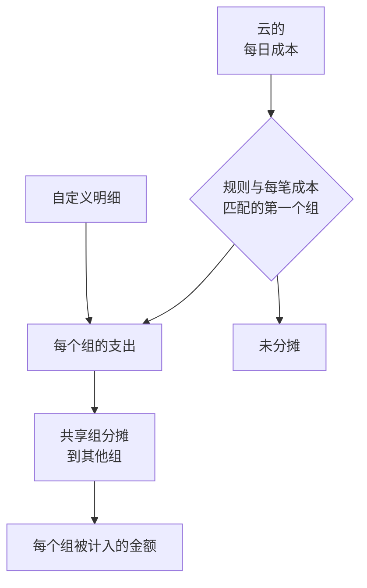

# 云成本分摊

成本组回答每月云账单的第一个问题：钱是谁花的。像“按团队”或“按成本中心”这样的**成本视图**，按规则把已连接账户的支出分配到**成本组**中，不会重复计算。没有规则匹配的部分会作为未分摊支出清楚地显示出来，共享成本则分摊到各组。它们位于 **云 → 支出 → 成本组**。

:::cards
- [创建视图](#创建视图): 依据你已设置的所有者按团队、按标记，或使用自定义组。
- [编写组的规则](#编写组的规则): 账户、服务、标记、所有者团队、标签等。
- [未分摊支出](#未分摊支出): 没有规则匹配的部分，一键即可分配。
- [共享成本](#共享成本): 支持计划或共享集群，分摊到各组。
:::

## 工作原理



- **第一个匹配的组拿走这笔成本。** 视图中的组有先后顺序，每笔成本归入规则与之匹配的第一个组，因此不会重复计算。各组与未分摊支出之和始终等于该时段的总额。
- **规则会读取成本携带的一切信息。** 账户、云、服务、区域、资源及其标记，以及 OneUptime 对该资源的了解：它的所有者团队、标签、App Platforms 环境和应用。
- **一切都在查看时计算。** 不会为每笔成本写入任何内容。修改规则后，OneUptime 保留的每个月都会重新分配，最多回溯 400 天，无需等待。每个数字都跟随其上方的切换器，按计费成本、摊销成本或净成本显示，与[云成本](/docs/telemetry/cloud-costs#计费成本摊销成本和净成本)中一样；自定义明细在每种基准下都相同。
- **多个视图可以分配同一笔支出。** “按团队”和“按成本中心”各自以自己的方式分配全部支出。

## 开始之前

- **已读取的成本。** [连接云账户](/docs/telemetry/cloud-accounts)，并让它[读取成本](/docs/telemetry/cloud-costs)。
- **按需使用标记或所有者。** 标记规则需要成本带有这些标记；在 AWS 上，请开启[按资源的成本](/docs/telemetry/cloud-costs#按资源的成本)。所有者团队来自每个资源的所有者，可以手动设置，也可以通过[所有者规则](/docs/configuration/label-and-owner-rules)设置。

## 创建视图

打开 **云 → 支出 → 成本组**。还没有视图的项目会看到三种开始方式：

| 开始方式 | 创建的内容 |
| --- | --- |
| **按团队（依据所有者）** | 为每个拥有云资源的团队建一个组，并关联到该团队。 |
| **按标记** | 为成本所带标记的每个值建一个组，例如 `team` 或 `cost-center`。 |
| **自定义组** | 一个空视图。你自己编写每个组的规则。 |

按标记或按所有者团队的视图，其组会在保存时由 OneUptime 创建，之后每小时随着新的标记值和所有者出现继续创建。你可以重命名这些组、将其关联到团队或设为共享。它们的规则由 OneUptime 维护。要立即创建缺少的组，请打开视图并点击 **立即创建组**。

## 编写组的规则

打开一个视图，然后在 **组** 下选择 **创建成本组**。只要组的**任意**一条规则与某笔成本匹配，该成本就属于此组；而一条规则要匹配，其条件必须**全部**匹配。条件会把成本携带的一项信息与你选择或输入的值进行比较：

| 字段 | 读取的内容 |
| --- | --- |
| **标记** | 按标记的键读取标记的值。**已设置** 和 **未设置** 判断成本是否带有该标记。 |
| **账户** | 计费该成本的已连接账户。 |
| **所有者团队** | 在 OneUptime 中拥有该资源的团队。 |
| **服务** | 云账单中所用的服务名称。 |
| **标签** | 资源或其账户在 OneUptime 中的标签。 |
| **区域** | 区域。对全局服务请将值留空。 |
| **云** | AWS、Azure 或 Google Cloud。 |
| **资源** | 云中对该资源的命名。 |
| **App Platforms 环境** 和 **应用** | 按 **云 → 支出 → 成本** 的计算方式，环境或应用被计费的金额。 |
| **Kubernetes 命名空间** 和 **Kubernetes 集群** | 当共享组按集群的命名空间分摊时所用的命名空间。请参阅 [Kubernetes 集群](#kubernetes-集群)。 |

文本比较不区分大小写：`Payments` 和 `payments` 是同一个团队。标记的键按书写原样比较，与云中保存的一致。

例如，一个有三条规则的**支付**组会拿走带有 `team: payments` 标记的成本，**或**计费到 payments 账户的成本，**或**归支付团队所有的成本。

### 组的顺序

在 **组** 下拖动各组即可更改顺序。如果某个组的规则已被前面的组完全覆盖，它就永远拿不到成本，其所在行会显示拿走全部成本的组。如果某个组的规则也匹配前面的组拿走的成本，则会显示它从中得到多少。

### 有多个所有者团队的资源

由两个团队拥有的资源会在它们之间平均分摊：每个团队的一半分别经过规则。不涉及所有者的规则（例如标记或账户）仍然拿走整笔成本。所属团队没有组的那一半保持未分摊。

## 未分摊支出

视图页面会列出尚无规则匹配的部分：它由哪些服务、账户、标记值和所有者团队构成，按成本从高到低排列。点击其中一项旁边的 **添加到组**，即可把针对它的规则添加到某个组或新组。其成本会立即移入该组，包括过去月份的成本。

## 共享成本

支持计划、共享集群或网络中心属于所有人。把它建成一个单独的组，然后在 **更多字段** 中开启 **共享**，并选择如何将其成本分摊到视图中的其他组：

| 分摊方式 | 方法 |
| --- | --- |
| **按支出占比分摊** | 每个组按其他组当月云支出中的占比分得一份。当月它们没有支出时，平均分摊。 |
| **平均分摊** | 每个组分得相同的金额。 |
| **按固定百分比分摊** | 你为每个组设置的百分比，合计 100。 |
| **按 Kubernetes 命名空间分摊** | 集群中每个命名空间当月的成本。见下文。 |

共享组的成本按每个月的份额逐日分摊，因此一个月无论按天读取还是按月读取，数字都相同。未分摊支出永远不会分得份额。

### Kubernetes 集群

集群的节点由云计费，而集群自身的成本引擎会给出每个命名空间的用量。要把共享集群中的工作负载计入各个团队：

1. 创建一个规则与集群节点匹配的组，例如 **标记** `eks:cluster-name` **是以下任一项** `prod`。
2. 开启 **共享**，选择 **按 Kubernetes 命名空间分摊**，然后选择 **Kubernetes集群**。
3. 为各团队的组设置读取命名空间标签的规则，这些标签会被视为标记。例如 **标记** `team` **是以下任一项** `payments`，或 **Kubernetes 命名空间** **开头是** `payments-`。

每个月，节点成本会按每个命名空间在集群[成本引擎](/docs/telemetry/kubernetes-cost)中的成本分摊，每个命名空间的部分归入规则与之匹配的第一个组。闲置容量，以及没有任何组拿走的命名空间，都留在集群的组中。集群自身计价的成本永远不会加到你的账单上，因此不会重复计算。

## 自定义明细

在 **云 → 支出 → 成本组** 的 **自定义明细** 中，添加云账单中没有的费用或抵扣：支持合同的分摊额、企业折扣、内部加价或平台费。

- **一次性或每月。** 按月明细会分摊到每个月的各天，因此不满一个月时只计相应部分。
- **添加到账户或组。** 添加到账户的明细会像该账户的成本一样经过每个视图的规则。添加到组的明细直接归入该组。
- **始终分开。** 每个数字都把明细与云计费的金额分开，因此云自身的数字仍与其控制台一致。

## 查看每个组的支出

- **云 → 支出 → 成本**：在 **钱花在哪里** 下选择 **成本组** 和一个视图。显示每个组的支出，并与上一时段对比。
- **视图页面**：每个组被计入的金额（含共享成本）、没有规则匹配的部分，以及用于当月成本回收的 **下载 CSV**。
- **组页面**：逐日支出、计费最多的服务、资源和账户，以及它的规则。页面只显示该组的支出，因此请把组关联到它的 **团队**，并把页面发给团队：任何有权读取云支出的人都能打开它。

## API、CLI 和 MCP

视图、组和明细都是 API 资源（`cloud-cost-view`、`cloud-cost-group`、`cloud-cost-line-item`），和其他资源一样有 CLI 命令和 MCP 工具。组的规则是 JSON：

```json
[
  { "conditions": [{ "field": "tag", "key": "team", "operator": "is", "values": ["payments"] }] },
  { "conditions": [{ "field": "ownerTeam", "operator": "is", "values": ["<team ID>"] }] }
]
```

要按完整的 UTC 日（从 `startDate` 到 `endDate`）读取视图的分配结果：

```bash
curl -X POST "https://oneuptime.com/api/cloud-cost-view/<view ID>/allocation" \
  -H "apikey: <API key>" -H "tenantid: <project ID>" -H "Content-Type: application/json" \
  -d '{"startDate": "2026-11-01", "endDate": "2026-11-30", "currency": "USD"}'
```

响应包含每个组的 `total` 及其构成（`cloud`、`lineItems`、`sharedIn`、`sharedOut`）、按天或按月的数字、上一时段，以及未分摊支出的构成。`POST /cloud-cost-group/<group ID>/spend` 返回单个组的结果。将 `basis` 设为 `billed`、`amortized` 或 `net` 即可获得该基准的数字；不设置时使用项目的基准，响应中的 `basis` 会说明是哪一种。

## 限制

- 一个视图最多包含 500 个组。按标记的视图会为成本最高的 500 个值建组。
- 一个组最多有 25 条规则，一条规则最多 20 个条件，一个条件最多 200 个值。
- 成本保留 400 天，因此视图最多读取 400 天。

## 故障排除

:::details 某个组什么都没有
它的规则可能还没有匹配任何成本，或者前面的组拿走了它们匹配的所有成本。此时它在 **组** 下的行会显示那个组：把这个组拖到它上方，或缩小前面那个组的规则范围。
:::

:::details 某笔成本进了错误的组
每笔成本归入规则与之匹配的第一个组。把它应属的组拖到拿走它的组上方，或缩小那个组的规则范围。
:::

:::details 标记规则什么都不匹配
成本会保留读取时带有的标记：Google Cloud 账单导出的标签，否则是其计费资源的标记，在 AWS 上这需要[按资源的成本](/docs/telemetry/cloud-costs#按资源的成本)。标记的键按书写原样比较。
:::

:::details 按标记或按所有者团队的视图缺少某个组
OneUptime 每小时创建缺少的组：最近 400 天成本中的每个标记值，或每个拥有云资源的团队，各建一个组，最多 500 个。要立即创建，请在视图页面点击 **立即创建组**。
:::

:::details 数字中少了某个账户
视图的数字以大多数账户的计费币种显示。以其他币种计费的账户不计入其中，其他币种的明细也一样。
:::

## 后续步骤

:::cards
- [云成本与节省](/docs/telemetry/cloud-costs): 已连接账户的成本，以及如何少花钱。
- [标签与所有者规则](/docs/configuration/label-and-owner-rules): 为资源设置供规则读取的所有者团队和标签。
- [Kubernetes 成本可观测性](/docs/telemetry/kubernetes-cost): 每个 Kubernetes 工作负载的成本。
:::
