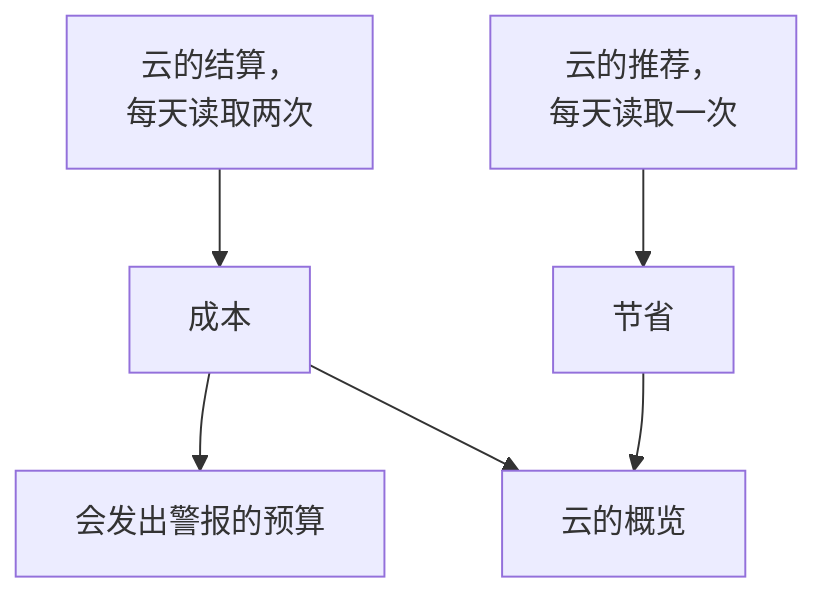

# 云成本与节省

已连接的云账户还会告诉你它的成本，以及如何降低成本。OneUptime 从云自身的结算中读取每天的成本，从云自身的推荐服务中读取推荐，在 **云 → 支出 → 成本** 和 **云 → 支出 → 节省** 中显示它们，并在某个月的成本超出预算之前通过 **云 → 支出 → 预算** 发出警报。

:::cards
- [Amazon Web Services](#amazon-web-services): Cost Explorer 和 Cost Optimization Hub，各开启一次。
- [Microsoft Azure](#microsoft-azure): Cost Management 和 Azure Advisor，多一个角色。
- [Google Cloud](#google-cloud): 你导出到 BigQuery 的结算数据，以及 Recommender。
- [预算](#预算): 当某个月的支出超过预算的某个比例时发出的警报。
:::

## 工作原理



- **成本来自云自身的结算。** AWS Cost Explorer、Azure Cost Management 以及 Google Cloud 导出到 BigQuery 的结算数据，在抵扣额度和退款之前，以账户的计费币种计算。每个金额都是一天的金额，按 UTC 日期，与云的计费方式一致。
- **云会延迟报告最后一两天。** 每次读取都会重新读取最近一周，并在每月的头几天重新读取整个上个月，因此某一天的成本会随着云结束这一天而确定下来。连接的首次读取会回溯到上上个月的月初。
- **当月预测沿用最近一周的速度。** 它等于本月到目前为止的成本，再加上剩余每一天按最近七个完整日的平均值计算的成本。
- **节省来自云自身的推荐服务。** AWS Cost Optimization Hub、Azure Advisor 和 Google Cloud 的 Recommender：更小的规格、闲置的资源、值得做的承诺，每一项都附有每月可节省的金额。你在云控制台中执行或忽略的推荐，会在下一次读取时消失。

## 开始之前

- **一个已连接的账户。** 使用当前的设置命令 [连接云账户](/docs/telemetry/cloud-accounts)：它让连接可以读取成本和推荐。之前创建的连接在你重新运行其命令之前，两者都不会读取。

## Amazon Web Services

连接用 `ce:GetCostAndUsage` 读取成本，用 `cost-optimization-hub:ListRecommendations` 读取推荐。两者都需要先在账户中开启某项功能：

:::steps
### 开启 Cost Explorer

在 AWS Billing and Cost Management 控制台中打开一次 Cost Explorer：AWS 会在一天内准备好账户的成本。连接组织的管理账户，即可读取每个成员账户的成本。

### 加入 Cost Optimization Hub

在同一个控制台中打开 Cost Optimization Hub 并加入：组织从其管理账户加入，或者仅为该账户加入。它的推荐会在一天内到达。
:::

Cost Explorer 每个请求收费 $0.01，每次读取成本会发出几个请求。Cost Optimization Hub 免费。

## Microsoft Azure

应用使用 **Cost Management Reader** 角色读取成本，作用域与 **Monitoring Reader** 相同：设置命令会同时授予这两个角色。Azure Advisor 的推荐通过 **Monitoring Reader** 读取，因此无需开启任何功能。要为之前创建的应用授予该角色，请运行：

```bash
az role assignment create --assignee <APP_ID> --role "Cost Management Reader" --scope /subscriptions/<SUBSCRIPTION_ID>
```

Cost Management 会按每个订阅作答，并附上每项成本所属的资源，读取它不收费。当它无法为某个订阅作答时，账户的 **成本** 会说明原因。

## Google Cloud

Google Cloud 没有提供项目成本的 API：OneUptime 从你的结算账户导出到 BigQuery 的数据中读取成本。

:::steps
### 将结算导出到 BigQuery

在 Google Cloud 控制台中打开 Billing，再打开 Billing export，开启将详细使用费用导出到 BigQuery 数据集。Google 从你开启的那天起写入，会延迟几个小时。

### 允许服务账号读取它

在导出的数据集上为连接的服务账号授予 **BigQuery Data Viewer**。设置命令已经为它授予了 **BigQuery Job User**，以便在它自己的项目中运行查询。

### 填写导出的表

在 **云 → 连接** 中编辑连接，并在 **更多字段** 中将 **账单导出表** 设为表的完整名称：`<PROJECT_ID>.<DATASET>.gcp_billing_export_resource_v1_<BILLING_ACCOUNT_ID>`。
:::

详细导出会写明每项成本所属的资源；标准导出只写明服务和区域。BigQuery 对查询收费：每月前 1 TiB 免费，之后每 TiB $6.25，一个月的导出数据从几兆字节到几千兆字节不等。Recommender 关于机器类型和闲置资源的推荐通过设置命令授予的 **Compute Recommender Viewer** 读取，不收费。

## 减少支出的方法

**云 → 支出 → 节省** 列出每一条推荐，节省最多的排在最前：要做什么、针对哪个资源、会改变什么，以及每月能节省多少。上方的条带会汇总它们，包括总计和按类型的合计：更小的规格、闲置的资源、承诺。当 OneUptime 中有该资源时，推荐会链接到其资源的页面。

### 基于 OneUptime 自身读数的规格调整

如果推荐服务未开启、不覆盖资源的类型或认为资源太新，以致没有推荐服务给出建议，OneUptime 会根据连接在最近 14 天读取的 CPU 和内存读数来判断资源的规格。它判断 AWS 上的 EC2 实例、RDS 数据库和 ElastiCache 集群，Azure 上的虚拟机、PostgreSQL 和 MySQL 灵活服务器以及 App Service 计划，还有 Google Cloud 上的 Compute Engine 虚拟机和 Cloud SQL 实例：

- **过度配置** 指规格减半、甚至只剩四分之一时仍有余量：在较小的规格上，CPU 的第 95 百分位数最多为 60%，最高 CPU 读数最多为 100%，并且在读取内存时，内存峰值最多为 70%。
- **配置不足** 指 CPU 的第 95 百分位数达到 85% 或以上，或内存峰值达到 90% 或以上：建议使用大一倍的规格。

资源有了 6 天的读数后就会被判断规格。资源的页面会在其成本旁显示 **规格调整**，过度配置的资源会以 OneUptime 为来源列在 **云 → 支出 → 节省** 中。一项更改能节省的金额，是它在资源最近 30 天成本中所占的部分，因此只要云按名称为资源计费，就能知道：Azure 和 Google Cloud 的详细导出会这样做，AWS Cost Explorer 不会。EC2 实例只有安装 CloudWatch 代理、Compute Engine 虚拟机只有安装 Ops Agent 才会报告内存，没有代理时只按 CPU 判断规格。t3、B 系列和 e2-micro 等可突增规格从不判断。

## 预算

:::steps
### 创建预算

在 **云 → 支出 → 预算** 中创建预算：填写它的 **每月金额** 以及适用的 **账户**，留空则适用于所有账户。

### 选择何时发出警报

**警报阈值** 填写要发出警报的预算比例，以百分比表示：初始为 80 和 100。**预计超出时发出警报** 还会在按最近一周的速度本月将超出预算时，每月发出一次警报。**异常日发出警报** 还会在某天的成本远高于平常时，于次日发出警报：参见 [异常日](#异常日)。**警报严重性** 和 **值班策略** 决定警报的严重程度以及呼叫谁。
:::

每次读取成本之后以及每小时都会检查预算。当本月支出越过一个阈值时，会为它发出一条警报；如果一次读取同时越过多个阈值，则为最高的阈值发出警报。新的月份开始时，上个月的警报会被解决。预算只计算以其币种计费的账户。

AI 智能体可以通过 [MCP 服务器](/docs/ai/mcp-server) 创建和更改预算，脚本则可以使用 CLI 的 `oneuptime cloud-budget` 命令：参见 [资源操作](/docs/cli/resource-operations)。

### 异常日

每次读取之后，账户最近 14 个完整日子中的每一天，都会与其之前的 14 天比较。当某项服务的成本达到其平常一天的两倍或以上，或整个账户达到其平常一天的一倍半或以上时，这一天就是异常日。两种情况的增加额都必须至少比平常多 10（以账户的货币计），并且至少为账户平常一天的 5%，所以几分钱绝不会被当作激增。某一天的平常值是其之前 14 天的中位数，因此一次激增几乎不会改变它；账户也要在有了一周的成本之后才会被判断。

**云 → 支出 → 成本** 在每日支出下方列出异常日。计入该账户的预算会在次日为每个账户和每一天发出一条警报，并列出每项成本上升的服务。持续数天的激增会在其开始的那天告知，超过一周的日子则不再告知。在这类警报出现之前创建的预算，要等您编辑预算并将其打开后才会发出这类警报。

## 你在 OneUptime 中看到的内容

- **云的概览。** **云 → 概览** 在需要关注的内容旁边，显示本月支出与上月同一天之前支出的对比、成本最高的服务，以及效果最大的减少支出的方法。
- **每天的支出。** **云 → 支出 → 成本** 绘制最近 30 天中的每一天，列出成本远高于平常的日子，并按服务、区域、账户或资源拆分某个时间段。未读取成本的账户会列在下方，并附上原因。
- **账户的成本。** 账户的 **成本** 仅针对该账户显示同样的内容，并附上它减少支出的方法。
- **资源的成本。** 当云按名称为资源计费时，资源的页面会显示它本月和最近 30 天的成本，并附上它减少支出的方法和规格调整。

## 故障排除

:::details 账户显示 需要权限
连接还不能读取账户的成本。从 **云 → 连接** 重新运行它的设置命令：命令会添加读取成本所需的权限。在 Google Cloud 上，还要在导出的数据集上为服务账号授予 **BigQuery Data Viewer**。
:::

:::details 账户显示 未设置
它的云还没有可提供的成本。在 AWS 上开启 Cost Explorer；在 Google Cloud 上，在 **账单导出表** 中填写导出的表。第一批金额会随下一次读取到达，在 12 小时之内。
:::

:::details 金额漏掉了某个账户
金额以大多数账户的计费币种显示。以其他币种计费的账户会连同其币种列在下方，预算只计算以预算自身币种计费的账户。
:::

:::details 本月金额低于云控制台中的金额
云会延迟报告最后一两天，而且金额是抵扣额度和退款之前的金额。之后的读取会追上来。
:::

## 后续步骤

:::cards
- [连接云账户](/docs/telemetry/cloud-accounts): 连接另一个账户，或重新运行它的命令。
- [云资源](/docs/telemetry/cloud-resources): 每个资源的指标，来自你自己的采集器。
- [Kubernetes 成本可观测性](/docs/telemetry/kubernetes-cost): 每个 Kubernetes 工作负载的成本。
:::
