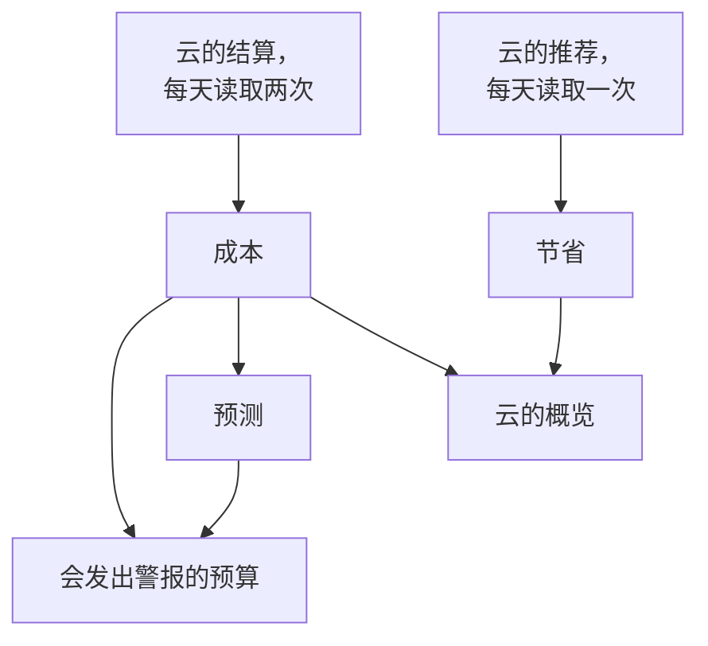

# 云成本与节省

已连接的云账户还会告诉你它的成本，以及如何降低成本。OneUptime 从云自身的结算中读取每天的成本，从云自身的推荐服务中读取推荐，在 **云 → 支出 → 成本** 和 **云 → 支出 → 节省** 中显示它们，在 **云 → 支出 → 承诺** 中列出你的 Savings Plans、预留和承诺使用折扣，在某个月、季度或年度的成本超出预算之前通过 **云 → 支出 → 预算** 告知你，并在 **云 → 支出 → 预测** 中预测未来几个月。如果你允许，它还会执行所有者批准的节省，在非工作时间停止非生产资源，并用账单核对每项更改。

:::cards
- [Amazon Web Services](#amazon-web-services): Cost Explorer 和 Cost Optimization Hub，各开启一次。
- [Microsoft Azure](#microsoft-azure): Cost Management 和 Azure Advisor，多一个角色。
- [Google Cloud](#google-cloud): 你导出到 BigQuery 的结算数据，以及 Recommender。
- [计费成本、摊销成本和净成本](#计费成本摊销成本和净成本): 每项成本都有三种基准，让承诺和抵扣额度落在钱真正花出去的地方。
- [承诺与续订](#承诺与续订): 每一项承诺、在承诺结束前或使用不足时发出的警报，以及该续订或购买什么。
- [执行节省](#执行节省): 经所有者批准后应用一项节省，也可以撤销。
- [非工作时间计划](#非工作时间计划): 在夜间和周末停止非生产资源。
- [节省 AI 规则](#节省-ai-规则): 提议给所有者，或在上限内直接更改。
- [预算](#预算): 适用于任何账户、成本组或服务的月度、季度或年度预算。
- [预测](#预测): 未来 12 个月预计花费多少，以及可信度如何。
:::

## 工作原理



- **成本来自云自身的结算。** AWS Cost Explorer、Azure Cost Management 以及 Google Cloud 导出到 BigQuery 的结算数据，以账户的计费币种计算，每项都按计费成本、摊销成本和净成本保存：参见 [计费成本、摊销成本和净成本](#计费成本摊销成本和净成本)。每个金额都是一天的金额，按 UTC 日期，与云的计费方式一致。
- **云会延迟报告最后一两天。** 每次读取都会重新读取最近一周，并在每月的头几天重新读取整个上个月，因此某一天的成本会随着云结束这一天而确定下来。连接的首次读取会回溯到上上个月的月初。
- **当月预测沿用最近一周的速度。** 它等于本月到目前为止的成本，再加上剩余每一天按最近七个完整日的平均值计算的成本。
- **节省来自云自身的推荐服务。** AWS Cost Optimization Hub、Azure Advisor 和 Google Cloud 的 Recommender：更小的规格、闲置的资源、值得做的承诺，每一项都附有每月可节省的金额。你在云控制台中执行或忽略的推荐，会在下一次读取时消失。

## 开始之前

- **一个已连接的账户。** 使用当前的设置命令 [连接云账户](/docs/telemetry/cloud-accounts)：它让连接可以读取成本和推荐。之前创建的连接在你重新运行其命令之前，两者都不会读取。

## Amazon Web Services

连接用 `ce:GetCostAndUsage` 读取成本，用 `ce:GetSavingsPlansCoverage`、`ce:GetSavingsPlansUtilization`、`ce:GetSavingsPlansUtilizationDetails`、`ce:GetReservationCoverage` 和 `ce:GetReservationUtilization` 读取承诺，用 `savingsplans:DescribeSavingsPlans` 读取已购买的 Savings Plans，用 `cost-optimization-hub:ListRecommendations` 和 `cost-optimization-hub:GetRecommendation` 读取推荐。设置命令把 Cost Explorer 的读取作为三个系列授予：`ce:GetCostAndUsage*`、`ce:GetSavingsPlans*` 和 `ce:GetReservation*`，它们全都只是读取，这样访问密钥的用户仍能控制在 IAM 允许其策略使用的 2,048 个字符以内。Cost Explorer 和 Cost Optimization Hub 都需要先在账户中开启：

:::steps
### 开启 Cost Explorer

在 AWS Billing and Cost Management 控制台中打开一次 Cost Explorer：AWS 会在一天内准备好账户的成本。连接组织的管理账户，即可读取每个成员账户的成本。

### 加入 Cost Optimization Hub

在同一个控制台中打开 Cost Optimization Hub 并加入：组织从其管理账户加入，或者仅为该账户加入。它的推荐会在一天内到达。
:::

Cost Explorer 每个请求收费 $0.01：每次读取成本会发出两个或稍多几个请求，一个用于计费成本和摊销成本，一个用于净成本；承诺每天用四个请求读取其覆盖率和使用率，另外每天再用六到十二个请求读取每项承诺自身的数据。Savings Plans API 和 Cost Optimization Hub 免费。

### 按资源的成本

开启资源级数据后，Cost Explorer 还会给出最近 14 天每个资源的成本。在 AWS Billing and Cost Management 控制台中打开 Cost Management 偏好设置，按天粒度开启资源级数据；组织则从其管理账户开启。AWS 会在 48 小时内准备好数据。

然后在 **云 → 连接** 下编辑连接，并在 **更多字段** 中开启 **按资源的成本**。连接每天用 `ce:GetCostAndUsageWithResources` 读取一次：第一次读取 14 天，之后再次读取最近三天，每次发出几个请求。读到的内容在 Cost Explorer 不再保留后仍随账户的成本保存。之前创建的连接需要重新运行设置命令，以添加此操作。

## Microsoft Azure

应用使用 **Cost Management Reader** 角色读取成本，作用域与 **Monitoring Reader** 相同：设置命令会同时授予这两个角色。Azure Advisor 的推荐通过 **Monitoring Reader** 读取，因此无需开启任何功能。要为之前创建的应用授予该角色，请运行：

```bash
az role assignment create --assignee <APP_ID> --role "Cost Management Reader" --scope /subscriptions/<SUBSCRIPTION_ID>
```

Cost Management 会按每个订阅作答，并附上每项成本所属的资源，读取它不收费。当它无法为某个订阅作答时，账户的 **成本** 会说明原因。

Cost Management 会限制读取一个租户成本的速度，对所有读取者都一样：每个查询读取的每个月数据消耗一个查询处理单元 (QPU)，一个租户每 10 秒有 12 QPU，每分钟 60，每小时 600。OneUptime 在每项配额的三分之二以内逐个读取租户的订阅，在 Cost Management 拒绝查询时按其要求等待，并在下一次读取时从停下的地方继续。尚未读取的订阅显示 **排队中** 以及读取时间；已有金额的订阅在此期间保留其金额。订阅的摊销成本每次读取时都会读取，实际成本每天读取一次，因此订阅的第一次读取会查询 Cost Management 两次，消耗两倍的查询单元：大型租户的第一批金额要多等几次读取。

租户的预留和节省计划通过 **Reservations Reader** 和 **Savings plan Reader** 读取，Azure 在租户本身的范围上授予这两个角色，只有拥有提升访问权限的全局管理员才能在那里授予。设置命令会尝试授予，无法授予时会说明。之后要授予它们，请以拥有提升访问权限的全局管理员身份运行：

```bash
az role assignment create --assignee <APP_ID> --role "Reservations Reader" --scope /providers/Microsoft.Capacity
az role assignment create --assignee <APP_ID> --role "Savings plan Reader" --scope /providers/Microsoft.BillingBenefits
```

没有它们时，成本和推荐仍像以前一样读取，**云 → 支出 → 承诺** 会说明要授予哪个角色。

## Google Cloud

Google Cloud 没有提供项目成本的 API：OneUptime 从你的结算账户导出到 BigQuery 的数据中读取成本。

:::steps
### 将结算导出到 BigQuery

在 Google Cloud 控制台中打开 Billing，再打开 Billing export，开启将详细使用费用导出到 BigQuery 数据集。Google 从你开启的那天起写入，会延迟几个小时。

### 允许服务账号读取它

在导出的数据集上为连接的服务账号授予 **BigQuery Data Viewer**。设置命令已经为它授予了 **BigQuery Job User**，以便在它自己的项目中运行查询。

### 填写导出的表

在 **云 → 连接** 中编辑连接，并在 **更多字段** 中将 **账单导出表** 设为表的完整名称：`<PROJECT_ID>.<DATASET>.gcp_billing_export_resource_v1_<BILLING_ACCOUNT_ID>`。
:::

详细导出会写明每项成本所属的资源；标准导出只写明服务和区域。BigQuery 对查询收费：每月前 1 TiB 免费，之后每 TiB $6.25，一个月的导出数据从几兆字节到几千兆字节不等。Recommender 关于机器类型和闲置资源的推荐通过设置命令授予的 **Compute Recommender Viewer** 读取，不收费。Compute Engine 的承诺通过 **Cloud Asset Viewer** 从 Cloud Asset Inventory 列出，设置命令已经授予了该角色：无需再授予其他权限。

## 计费成本、摊销成本和净成本

每项成本都以三种基准保存，**云 → 支出 → 成本**、账户的 **成本**、云概览和预算会显示你选择的那一种：

- **计费成本** 是云在出账当天记下的每笔费用，在抵扣额度和退款之前。预付的 Savings Plan 或预留是购买当天的一笔大额费用，而它覆盖的用量在其余期限内看起来是免费的。
- **摊销成本** 把每项承诺的费用分摊到它覆盖的日子和资源上，让钱落在花出去的地方。它仍然在抵扣额度和退款之前。除非你选择其他基准，页面显示的就是它。
- **净成本** 是摊销成本减去抵扣额度、退款和折扣：即账单的合计。

| | 计费成本 | 摊销成本 | 净成本 |
|---|---|---|---|
| AWS | Cost Explorer 的非混合成本 (unblended) | Cost Explorer 的摊销成本 | Cost Explorer 的净摊销成本，含抵扣额度和退款 |
| Azure | Cost Management 的实际成本 | Cost Management 的摊销成本 | 摊销成本：Azure 在计费账户上扣除抵扣额度，而订阅的连接不会读取计费账户 |
| Google Cloud | 导出数据中的成本 | 成本减去承诺使用折扣和订阅的抵扣额度 | 成本减去所有抵扣额度 |

金额上方的切换器会更改页面上的基准，OneUptime 会在你的浏览器中记住你在此项目中的选择。项目自己的基准，即页面打开时使用、预算所关注的基准，位于 **云 → 设置 → 成本设置**。预算可以关注自己的基准：编辑预算并设置 **成本基准**。

在三种成本开始保存之前读取的成本，在每种基准下都显示其计费金额。每个连接会再读取一次自己的成本，回溯范围与第一次读取相同，以便填满每种基准。

## 减少支出的方法

**云 → 支出 → 节省** 列出每一条推荐，节省最多的排在最前：要做什么、针对哪个资源、会改变什么，以及每月能节省多少。上方的条带会汇总它们，包括总计和按类型的合计：更小的规格、闲置的资源、承诺。当 OneUptime 中有该资源时，推荐会链接到其资源的页面；OneUptime 能执行的推荐带有 **应用**：请参阅 [执行节省](#执行节省)。

### 基于 OneUptime 自身读数的规格调整

如果推荐服务未开启、不覆盖资源的类型或认为资源太新，以致没有推荐服务给出建议，OneUptime 会根据连接在最近 14 天读取的 CPU 和内存读数来判断资源的规格。它判断 AWS 上的 EC2 实例、RDS 数据库和 ElastiCache 集群，Azure 上的虚拟机、PostgreSQL 和 MySQL 灵活服务器以及 App Service 计划，还有 Google Cloud 上的 Compute Engine 虚拟机和 Cloud SQL 实例：

- **过度配置** 指规格减半、甚至只剩四分之一时仍有余量：在较小的规格上，CPU 的第 95 百分位数最多为 60%，最高 CPU 读数最多为 100%，并且在读取内存时，内存峰值最多为 70%。
- **配置不足** 指 CPU 的第 95 百分位数达到 85% 或以上，或内存峰值达到 90% 或以上：建议使用大一倍的规格。

资源有了 6 天的读数后就会被判断规格。资源的页面会在其成本旁显示 **规格调整**，过度配置的资源会以 OneUptime 为来源列在 **云 → 支出 → 节省** 中。一项更改能节省的金额，是它在资源最近 30 天成本中所占的部分，因此只要云按名称为资源计费，就能知道：Azure 和 Google Cloud 的详细导出会这样做，AWS 在开启“按资源的成本”后也会。EC2 实例只有安装 CloudWatch 代理、Compute Engine 虚拟机只有安装 Ops Agent 才会报告内存，没有代理时只按 CPU 判断规格。t3、B 系列和 e2-micro 等可突增规格从不判断。

### 承诺

**云 → 支出 → 节省** 和账户的 **成本** 会显示最近 30 天的支出中有多少由各账户的承诺支付，以及其中有多少被使用，每种类型一行：

- AWS：Savings Plans 和预留实例，来自 Cost Explorer。组织的管理账户会为组织中的每个账户读取。
- Azure：节省计划和预留，来自 Cost Management，按摊销成本计算。
- Google Cloud：承诺使用折扣，来自你的账单导出。导出不会说明承诺中有多少未被使用，因此不显示使用了多少。

没有承诺的账户会显示按需费率运行、而承诺能以更低价格支付的部分。每种类型的数字都是其云自己的，各类型从不相加：预留和 Savings Plan 可能都会把同一台机器的支出算作自己要覆盖的部分。每项承诺都单独列在 **云 → 支出 → 承诺** 中：参见 [承诺与续订](#承诺与续订)。

## 承诺与续订

**云 → 支出 → 承诺** 列出你的连接能读取的每个 Savings Plan、预留和承诺使用折扣，这样不会有承诺在你不知情时结束：

- 顶部的 **活动承诺** 统计活动中的承诺和 90 天内结束的承诺，**使用率** 显示最近 30 天使用了多少、有多少未被使用，**覆盖率** 显示它们覆盖了多少支出。
- **即将结束** 列出 90 天内结束且不会自动续订的承诺，每项都附有续订计划：要保住折扣需要购买什么（其每小时承诺或实例，按已使用的部分），每月成本和节省多少，何时回本，以及现在和结束后有多少支出被覆盖。**在控制台中续订** 会打开云中续订它的页面。
- **所有承诺** 是完整列表：每项是什么、覆盖什么，它的账户、何时结束、期限和付款选项、最近 30 天使用了多少，以及它支付了哪些用量、节省了多少。
- **购买计划** 是云的推荐服务建议购买的内容，每项都显示每月的成本和节省、何时回本以及覆盖率会如何变化。**在控制台中购买** 会打开购买它的页面。
- 在它们下方，是每个账户按类型列出的承诺，与其 **成本** 中显示的一样，以及承诺何时发出警报，可通过 **更改警报** 调整。

OneUptime 只做规划：它从不购买、续订或退还承诺。购买在你的云控制台中进行。

| | 承诺来自哪里 | 每项承诺的已知信息 |
|---|---|---|
| AWS | Cost Explorer 的 Savings Plans 和预留实例，各自带有自己的使用率，以及用于已购买计划（包括排队等待开始的计划）的 Savings Plans API | 结束时间、期限、付款选项、每小时承诺或实例、费用，以及最近 30 天和 7 天的使用率 |
| Azure | 租户的预留和节省计划 | 结束时间、期限、计费计划、是否自动续订，以及最近 30 天和 7 天的使用率 |
| Google Cloud | Compute Engine 的承诺，来自 Cloud Asset Inventory | 结束时间、计划、资源以及是否自动续订。Google Cloud 不会说明承诺被使用了多少 |

在 AWS 上，组织的管理账户会列出每个账户的承诺。Google Cloud 保存在结算账号而不是项目中的基于支出的承诺使用折扣，目前尚未列出。

### 承诺警报

承诺会发出警报，并像任何警报一样通过值班策略呼叫。在 **云 → 设置 → 成本设置** 中，**承诺警报** 决定何时发出：

- **承诺结束前发出警报**：初始为结束前 90、30 和 7 天。在承诺已到达的这些日子中最近的一天发出一条警报，每个更近的日子都会取代前一个。会自动续订的承诺，或其续订已排队在结束时开始的承诺，不会发出警报。
- **使用率低于此值时发出警报**：初始为 80%，针对承诺最近 7 天的使用率，在它运行满一周之后。使用率恢复后警报会被解决。
- **覆盖率低于此值时发出警报**：初始为 60%，针对账户中某一类型的承诺可以覆盖的支出，在曾经覆盖更多之后。覆盖率恢复后会被解决。留空时，覆盖率不会发出警报。

**对承诺发出警报** 可以关闭所有这些警报，**警报严重性**、**值班策略** 和 **所有者** 决定它们有多严重、呼叫谁以及归谁所有。每条警报都会说明承诺覆盖什么、支付了什么，并指向它的续订计划。当承诺结束、续订或不再被列出时，警报会自动解决。

## 执行节省

只要账户的云连接的 **节省操作** 设置允许，OneUptime 就会通过该连接执行节省：[节省操作](/docs/telemetry/cloud-accounts#节省操作) 说明了每个选项授予什么。它只执行一步就能完成的更改：停止闲置的实例或数据库，把 gp2 卷改为 gp3，删除未挂载的磁盘、旧快照或未使用的映像，释放未使用的地址，以及在你允许时把实例或数据库调整为推荐的规格。它从不购买承诺：**在控制台中购买** 会为此打开你的云的页面。

:::steps
### 选择应用

在 **云 → 支出 → 节省** 中，对一项节省选择 **应用**。对话框会说明会改变什么、每月节省多少、如何撤销或无法撤销，以及由谁批准。

### 所有者批准

被指定为资源所有者的人，或拥有该资源的团队中同时可以编辑它的成员，批准此更改。没有所有者的资源由项目所有者或项目管理员批准。如果你自己可以批准，**应用** 会立即以你的身份执行它。否则，它会在 **等待审批** 中等待，直到所有者选择 **批准**，或选择 **隐藏** 并说明原因。

### OneUptime 执行更改

更改通过连接执行，并连同批准者一起记录在资源和账户的时间线上。删除磁盘前会先创建最终快照，除非你关闭 **先创建最终快照**。
:::

每项更改都会说明如何撤销：**已执行的更改** 中的 **撤销** 会重新启动已停止的实例，把卷或规格改回原样，或从最终快照重新创建已删除的磁盘。永久删除的内容，例如快照、映像或已释放的地址，无法撤销，对话框会在你应用前说明这一点。如果项目通过 **风险较高的修复需要两次批准** 要求两次批准，无法撤销的更改需要两个人批准。

如果资源的标记表明它以代码管理，例如由 Terraform 或 CloudFormation 管理，则改为在代码中更改：对话框会提供 **打开拉取请求**，发到声明它的代码仓库，这样下一次 apply 就不会撤销这项节省。

### 由账单证明

**本月已节省** 只统计你的云账单显示的金额。更改后的 3 天在账单中稳定下来后，会把资源的每日成本与更改前一周比较：成本至少下降了所承诺金额的四分之一时为 **账单中已体现**，否则为 **账单中未体现**；如果你的云不按名称为该资源计费，则为 **无法测量**。**正在核对账单** 统计仍在等待这些天数的更改。

## 非工作时间计划

在 **云 → 支出 → 计划** 中，计划会在非工作时间停止非生产的实例和数据库，并重新启动它们：

:::steps
### 选择资源

指定选择它们的云标记，例如 `Schedule` = `office-hours`，可以在一个账户中，也可以在所有账户中。

### 指定运行时间

选择工作日、启动时间和停止时间（24 小时制）以及时区。
:::

工作时间结束时，计划会通过其账户的连接，停止其标记选中且已知不是生产的每个运行中的资源；工作时间开始时，它只重新启动自己停止的资源：有人手动停止的资源会保持停止。**查看资源** 会列出计划当前选中的资源，以及让某些资源保持运行的原因。它会停止 AWS 上的 EC2 实例和 RDS 数据库、Azure 上的虚拟机，以及 Google Cloud 上的 Compute Engine 实例。AWS 会自行重新启动已停止七天的数据库。

计划从不停止生产资源，也不停止没有任何信息说明其环境的资源。在以下情况下，资源已知不是生产资源：

- 它的某个标记这样说明，键如 `environment`、`env`、`stage`、`tier` 或 `deployment.environment`，值如 `dev`、`test`、`qa`、`staging` 或 `sandbox`；
- 它的账户在账户的 **设置** 中的 **环境** 被标为 **非生产**；
- 或它的某个标签这样说明，例如 `Staging` 或 `env: dev`。

以生产为准：值为 `prod`、`production` 或 `live` 的标记，或被标为 **生产** 的账户，会让资源保持运行，无论其他信息怎么说。判断时从不读取资源的名称。关闭计划后，它不再停止任何资源，并会在工作时间开始时启动它停止的资源；删除计划后，它停止的资源会立即启动。

## 节省 AI 规则

开启 **启用 AI** 后，OneUptime AI 每次读取账户的节省后，都会把它能执行的每项节省提议给资源的所有者，由他们在 **等待审批** 中批准或驳回。在 **云 → 设置 → 节省 AI 规则** 中，规则按更改类型、资源的环境和所在的云，说明 OneUptime AI 如何处理与之匹配的节省：**关闭**、**提议给所有者**，或在每月上限内 **无需询问直接执行**。没有规则时，每项节省都会被提议，但不会执行；有规则时只处理与规则匹配的节省，匹配的规则之间以最谨慎的为准。

规则只会在已知不是生产的资源上、只对可以撤销的更改、只在匹配规则中最小的上限之内无需询问直接执行，并且每个项目每小时最多 10 次：其余的都会被提议。无需询问执行的更改会连同执行它的规则一起记录在时间线上，其所有者可以撤销它。被驳回或撤销的节省在 30 天内不会再次被提议。

## 预算

:::steps
### 创建预算

在 **云 → 支出 → 预算** 中创建预算，并选择它的 **适用于**：所有账户、一个 **账户**、按规则划分支出的 **成本组**，或 **过滤器** 指定的服务、区域和标记（写法与成本组的规则相同）。将它的 **成本基准** 留空，即按项目的基准计算。

### 设定可以花费多少

它的 **时间段** 是一个月、一个季度或一年，它的 **金额** 是一个时间段可以花费的金额。季度和年度从 **年度第一个月** 开始：从四月开始时，一年是从四月到次年三月。一年的 **预算计划** 可以把金额平均分到各个月，或在 **月度计划** 中为每个月设定自己的金额。这样每个月都与自己的份额比较，清淡月份绝不会因繁忙月份的支出而收到警报。

### 选择何时发出警报

**警报阈值** 填写要采取行动的预算比例，以百分比表示：初始为 80 和 100。**预计超出时发出警报** 还会在时间段预计花费超过预算时，每个时间段发出一次警报。**异常日发出警报** 还会在某天的成本远高于平常时，于次日发出警报：参见 [异常日](#异常日)。**警报严重性** 决定其警报的严重程度。

### 选择告知谁

当支出越过低于 100% 的比例时，**通知** 中的人员和团队会通过电子邮件和聊天得到告知，不发警报，因此不会因预算内的支出呼叫任何人。**通知成本组的团队** 还会告知成本组所属的团队。从 100% 起会创建警报，他们成为警报的所有者，并呼叫 **值班策略**。无人可告知的预算会在每个比例都创建警报。
:::

每次读取成本之后以及每小时都会检查预算。当时间段的支出越过一个比例时，会告知要通知的人员，或从 100% 起创建警报；如果一次读取同时越过多个比例，则只为最高的创建一次。新的时间段开始时，上一个时间段的警报会被解决。按月拆分的一年会逐月检查，与当月的份额比较。预算只计算以其货币计费的账户，并按它的基准计算：摊销成本的预算不会因预付购买的承诺而触发，而计费成本的预算会在购买当天计入它。

当一个时间段截至目前的成本、本月剩余天数按最近一个完整周的速度计算的花费，以及季度或年度之后的月份按 [预测](#预测) 计算的花费，合计超过预算时，该时间段就预计会超出预算。

每个预算的行会显示它计入的内容、它的时间段以及截至目前的时间段：对于按月拆分的一年，显示本月与其份额的对比，旁边是全年。它的页面会逐月显示时间段与每个月份额的对比、本月的每日支出、成本最高的项目以及告知对象。年度预算的页面可以把它的预测保存为计划。

AI 智能体可以通过 [MCP 服务器](/docs/ai/mcp-server) 创建和更改预算，脚本则可以使用 CLI 的 `oneuptime cloud-budget` 命令：参见 [资源操作](/docs/cli/resource-operations)。

### 异常日

每次读取之后，账户最近 14 个完整日子中的每一天，都会与其之前的 14 天比较。当某项服务的成本达到其平常一天的两倍或以上，或整个账户达到其平常一天的一倍半或以上时，这一天就是异常日。两种情况的增加额都必须至少比平常多 10（以账户的货币计），并且至少为账户平常一天的 5%，所以几分钱绝不会被当作激增。某一天的平常值是其之前 14 天的中位数，因此一次激增几乎不会改变它；账户也要在有了一周的成本之后才会被判断。

**云 → 支出 → 成本** 会在每日支出的柱形上方标出异常日，并在下方列出。在所有账户视图中，每个标记都会打开其账户的 **成本**。适用于所有账户或一个账户的月度预算，会在次日为每个账户和每一天创建一条警报，并列出每个偏高的服务。其他预算会以同样的方式，把它计入的内容与它自己的平常一天比较。持续多日的激增会在开始的那天报告，超过一周的日子不会报告。在这些警报出现之前创建的预算，要等你编辑并开启后才会创建它们。

## 预测

**云 → 支出 → 预测** 会按你选择的成本基准，说明所有内容、一个账户、一个成本组或一个服务在未来 12 个月中每个月预计花费多少。它还会说明每个预测是如何得出的，依据是 OneUptime 保存的完整月份成本，一年或稍多一些：

- **本月** 是截至目前的成本，加上剩余每天按最近七个完整日的平均值计算的花费，与预算的估算方式相同。
- **不足 3 个完整月份** 时，之后每个月都沿用这个速度，不给出可能范围：读取的数据太少，无法区分趋势和偶然波动。
- **从 3 个完整月份起**，趋势会穿过每个月的平均一天：取每两个月之间斜率的中位数，因此单个异常月份几乎不会改变它。
- **从 12 个完整月份起**，每个日历月还会记住去年高于或低于趋势的程度，因此十二月的高峰也会在下一个十二月被预测出来。

之后每个月都有一个可能范围，它应当 10 次中有 8 次落在其中，依据是过去各月偏离趋势的程度，单侧从不窄于 5%。月份越远、预测所依据的月份越少，范围越宽。从 12 个完整月份起，每个范围还会更宽，因为一年中每个日历月只出现一次。预测不是承诺：新的服务、迁移或价格变化，会以过去任何月份都没有出现过的方式改变未来几个月。

**模拟** 会从你选择的月份起，按你输入的比例让之后每个月增长或减少，例如从一月起 20%。**另存为预算计划** 会把未来十二个月设为年度预算的计划，可以是新预算，也可以是已有预算，每个月按其预测份额控制。

## API 中的预算和预测

预算是一种 API 资源（`cloud-budget`），与其他资源一样有 CLI 命令和 MCP 工具。预算的 `scope` 是 `allAccounts`、`account`（带 `cloudAccountId`）、`costGroup`（带 `cloudCostGroupId`）或 `filter`（带 `filterRules`，写法与成本组的规则相同）。它的 `period` 是 `month`、`quarter` 或 `year`，从 `fiscalYearStartMonth`（1 到 12）开始。一年的 `planSplit` 是 `none`、`equal` 或 `byMonth`，十二个月按财年顺序放在 `monthlyPlan` 中。

要像预算页面那样，逐月读取预算的时间段、本月的每日支出以及成本最高的项目：

```bash
curl -X POST "https://oneuptime.com/api/cloud-budget/<budget ID>/spend" \
  -H "apikey: <API key>" -H "tenantid: <project ID>"
```

要预测某个范围未来 1 到 24 个月的花费，可附带可选的模拟：

```bash
curl -X POST "https://oneuptime.com/api/cloud-budget/forecast" \
  -H "apikey: <API key>" -H "tenantid: <project ID>" -H "Content-Type: application/json" \
  -d '{"scope": "costGroup", "cloudCostGroupId": "<group ID>", "monthsAhead": 12, "growth": {"percent": 20, "fromMonth": "2027-01"}}'
```

响应的 `forecast` 包含它的 `method`（`pace`、`trend` 或 `trendAndSeason`）、它所依据的月份，以及每个月的 `amount`，之后的月份还有 `low` 和 `high`。将 `basis` 设为 `billed`、`amortized` 或 `net`，即可按该基准预测；不设置时按项目的基准预测，响应中的 `basis` 会说明是哪一个。预算的支出按它自己的基准计算。

## 钱花在哪里

**云 → 支出 → 成本** 可按服务、区域、账户或资源拆分某个时间段的支出，还有另外三种方式：

- 按应用平台环境：每个环境在其账户和区域中的平台服务（例如 Amazon ECS 或 Cloud Run），以及 Elastic Beanstalk 环境中按 AWS 赋予的标记找到的资源。
- 按应用：平台按名称向应用计费的部分，例如 Cloud Run 服务或 Container App。Amazon ECS 按任务计费，App Service 按计划计费，因此其应用的成本仍归其环境。
- 按标记：你所选标记的每个值。成本会保留读取时的标记：Google Cloud 账单导出的标签，否则为其计费资源的标记；在 AWS 上这需要“按资源的成本”。

列表下方，卡片会说明其余部分的金额：不属于任何环境的部分、按整个环境计费的部分，或不带该标记的部分。在开始保留标记之前读取的成本会再读取一次，回溯到首次读取的范围，以补上它们的标记。

## 你在 OneUptime 中看到的内容

- **云的概览。** **云 → 概览** 在需要关注的内容旁边，显示本月支出与上月同一天之前支出的对比、成本最高的服务，以及效果最大的减少支出的方法。
- **每天的支出。** **云 → 支出 → 成本** 绘制最近 30 天中的每一天并标出成本远高于平常的日子，列出这些日子，并按服务、区域、账户、资源、应用平台环境、应用或标记拆分某个时间段，可按计费成本、摊销成本或净成本查看。未读取成本的账户会列在下方，并附上原因。
- **每项承诺。** **云 → 支出 → 承诺** 列出每项承诺何时结束、使用了多少，即将结束的承诺该续订什么，以及该购买什么。
- **账户的成本。** 账户的 **成本** 仅针对该账户显示同样的内容，并附上它的承诺和减少支出的方法。
- **资源的成本。** 当云按名称为资源计费时，资源的页面会显示它本月和最近 30 天的成本，并附上它减少支出的方法和规格调整。
- **每个预算。** **云 → 支出 → 预算** 列出每个预算及其计入的内容、时间段和截至目前的时间段，每一项都会打开它的页面。
- **未来几个月。** **云 → 支出 → 预测** 绘制预测所依据的月份、本月的预计值和未来 12 个月，并说明它是如何得出的。
- **节省了多少。** **云 → 支出 → 节省** 首先显示已执行的更改本月按账单节省了多少、等待批准的更改和已执行的更改，以及计划停止资源的小时数。

## 故障排除

:::details 账户显示 需要权限
连接还不能读取账户的成本。从 **云 → 连接** 重新运行它的设置命令：命令会添加读取成本所需的权限。在 Google Cloud 上，还要在导出的数据集上为服务账号授予 **BigQuery Data Viewer**。
:::

:::details 账户显示 未设置
它的云还没有可提供的成本。在 AWS 上开启 Cost Explorer；在 Google Cloud 上，在 **账单导出表** 中填写导出的表。第一批金额会随下一次读取到达，在 12 小时之内。
:::

:::details 账户显示 排队中
它的成本在排队等候：Azure Cost Management 限制读取一个租户成本的速度。账户会显示读取时间，即从那时起连接的第一次读取，无需任何操作。已有金额的账户在此期间保留其金额。
:::

:::details 按资源的成本显示 未设置
该账户未开启资源级数据。请在 AWS Billing and Cost Management 控制台的 Cost Management 偏好设置中按天粒度开启；组织成员需从组织的管理账户开启。AWS 会在 48 小时内准备好数据，第二天的读取会获取它。
:::

:::details 承诺显示 需要权限
连接还不能读取该账户的 Savings Plans 和预留。请从 **云 → 连接** 重新运行其设置命令：它会添加读取它们所用的操作。在 Azure 上，由拥有提升访问权限的全局管理员授予 **Reservations Reader** 和 **Savings plan Reader**：参见 [Microsoft Azure](#microsoft-azure)。
:::

:::details 摊销成本和净成本显示的与计费成本相同
在三种成本开始保存之前读取的成本，在连接下一次读取成本之前，在每种基准下都显示其计费金额，下一次读取会回溯到与第一次读取相同的范围重新读取。在 Azure 上，净成本始终等于摊销成本。
:::

:::details 承诺结束了，却没有收到警报
会自动续订的承诺，或其续订已排队在结束时开始的承诺，不会发出警报；在 **云 → 设置 → 成本设置** 中关闭了承诺警报的项目，其承诺也不会。警报还需要项目设置了警报严重性。
:::

:::details 金额漏掉了某个账户
金额以大多数账户的计费币种显示。以其他币种计费的账户会连同其币种列在下方，预算只计算以预算自身币种计费的账户。
:::

:::details 某项节省没有应用
OneUptime 只执行一步就能完成的更改：承诺，或会改变多处的推荐，需要在你的云控制台中完成。当账户的连接不允许时，应用会打开一个对话框，说明为什么无法在这里执行：打开它的 **节省操作**，并再次运行它的设置命令。
:::

:::details 某个计划让资源保持运行
**查看资源** 会说明原因：它是生产资源、没有信息表明它不是生产资源，或其账户的连接不允许节省操作。为它添加标记，例如 `environment` = `dev`，或将其账户标为 **非生产**。
:::

:::details 预测没有可能范围
它所依据的成本不足 3 个完整月份，因此之后每个月都沿用最近一个完整周的速度，不给出范围。读取到第三个完整月份后就会给出范围。连接的首次读取会追溯到上上个月的月初。
:::

:::details 有人收到了预算告知，但没有警报
低于 100% 时，指定了要通知的人员或团队的预算会告知他们，不创建警报，因此不会呼叫任何人。从 100% 起它会创建警报，并呼叫它的值班策略。无人可告知的预算会在每个比例都创建警报。
:::

:::details 本月金额低于云控制台中的金额
云会延迟报告最后一两天，而且计费金额和摊销金额是抵扣额度和退款之前的金额。之后的读取会追上来。请与云控制台显示的基准进行比较：AWS 默认打开的是非混合成本，也就是计费成本。
:::

## 后续步骤

:::cards
- [云成本分摊](/docs/telemetry/cloud-cost-allocation): 将支出分摊到团队、产品和成本中心。
- [连接云账户](/docs/telemetry/cloud-accounts): 连接另一个账户，或重新运行它的命令。
- [云资源](/docs/telemetry/cloud-resources): 每个资源的指标，来自你自己的采集器。
- [Kubernetes 成本可观测性](/docs/telemetry/kubernetes-cost): 每个 Kubernetes 工作负载的成本。
:::
