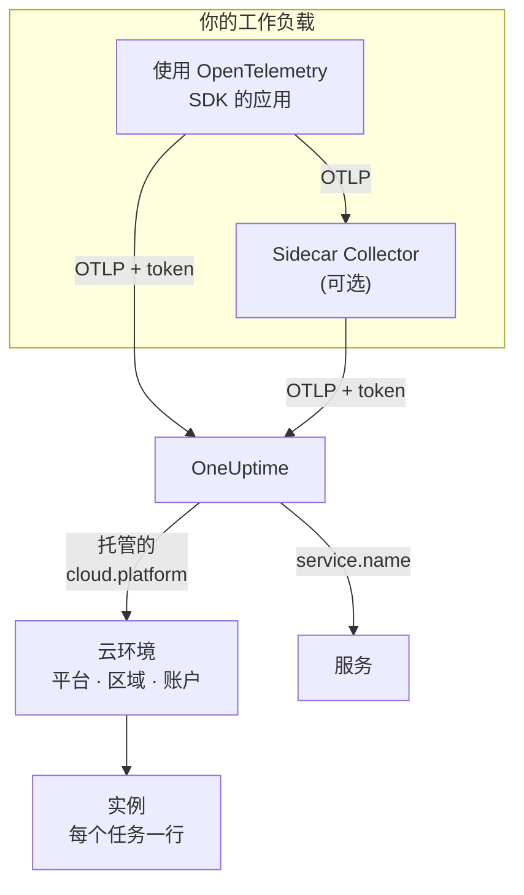

# 云环境

**Cloud Environment** 是你的容器在托管云平台上运行的地方：ECS 集群所在的账户和区域、Cloud Run 的项目和区域、Container Apps 的订阅和区域。当你的遥测数据第一次带着正确的资源属性到达时，OneUptime 就会创建一个环境，并汇总在其中运行的每个工作负载。无需手动注册任何内容。

:::cards
- [AWS ECS / Fargate](/docs/telemetry/cloud-aws-ecs): Fargate 或 EC2 上的任务，以及每个任务的 CPU 和内存。
- [Google Cloud Run](/docs/telemetry/cloud-gcp-cloud-run): 服务和作业，它们也会作为无服务器函数列出。
- [Azure Container Apps](/docs/telemetry/cloud-azure-container-apps): 副本，其区域和订阅需要手动设置。
- [其他云平台](/docs/telemetry/cloud-other-platforms): Elastic Beanstalk、App Runner、App Engine、App Service 和 Container Instances。
:::

## 工作原理



- **资源检测器说明工作负载在哪里运行。** SDK 或 Collector 中的 OpenTelemetry 资源检测器会读取平台的元数据，并在工作负载发送的所有数据上设置 `cloud.platform`、`cloud.account.id` 和 `cloud.region`。没有检测器的地方，需要你自己设置。
- **环境负责汇总。** 平台、账户和区域都相同的工作负载会进入同一个环境。各个服务仍在 **服务** 中保留各自的行。
- **每个运行中的任务都是一个实例。** 环境的 **实例** 选项卡会列出运行中的任务、实例或副本，并在平台能提供时显示实时的 CPU 和内存。

## 开始之前

- **摄取密钥。** 在 **项目设置 → 遥测与 APM → 摄取密钥** 中创建一个 **服务器** 密钥并复制其令牌，参见[创建摄取密钥](/docs/telemetry/open-telemetry#创建摄取密钥)。令牌属于机密：每个平台页面都会说明应把它存放在该云的机密存储中的什么位置。
- **应用中的 OpenTelemetry。** 导出 OTLP 的 OpenTelemetry SDK，或在应用旁边运行的 OpenTelemetry Collector。

## 支持的平台

| 平台 | `cloud.platform` | `cloud.*` 由谁填写 | 实例标识 | 指南 |
| ------------------------- | --------------------------- | ---------------------- | --------------------------------- | ------------------------------------------------------------------ |
| AWS ECS / Fargate | `aws_ecs` | 资源检测器 | `aws.ecs.task.arn` | [AWS ECS / Fargate](/docs/telemetry/cloud-aws-ecs) |
| AWS Elastic Beanstalk | `aws_elastic_beanstalk` | 资源检测器 | `host.id` | [其他云平台](/docs/telemetry/cloud-other-platforms) |
| AWS App Runner | `aws_app_runner` | 手动设置 | `host.name` | [其他云平台](/docs/telemetry/cloud-other-platforms) |
| Google Cloud Run | `gcp_cloud_run` | 资源检测器 | `faas.instance` | [Google Cloud Run](/docs/telemetry/cloud-gcp-cloud-run) |
| Google App Engine | `gcp_app_engine` | 资源检测器 | `faas.instance` | [其他云平台](/docs/telemetry/cloud-other-platforms) |
| Azure Container Apps | `azure_container_apps` | 资源检测器 | `azure.container_app.instance.id` | [Azure Container Apps](/docs/telemetry/cloud-azure-container-apps) |
| Azure Container Instances | `azure_container_instances` | 手动设置 | `host.name` | [其他云平台](/docs/telemetry/cloud-other-platforms) |
| Azure App Service | `azure_app_service` | 资源检测器 | `host.id` | [其他云平台](/docs/telemetry/cloud-other-platforms) |

- **资源检测器：** SDK 或 Collector 的 `resourcedetection` 处理器中的 OpenTelemetry 资源检测器会替你设置 `cloud.*` 属性。
- **手动设置：** 没有检测器，所以你要把属性写进 `OTEL_RESOURCE_ATTRIBUTES`。平台页面会给出确切的那一行。
- **Azure 检测器知道得更少。** Container Apps 检测器既不知道区域也不知道订阅，App Service 检测器不知道订阅：缺少的部分需要你自己设置。
- **带点号的 Azure 写法也能用。** Node.js 和 .NET 的 Azure 检测器写入的是 `azure.container_apps` 和 `azure.app_service`。OneUptime 收到后会把它们改写为上面带下划线的值。

## OneUptime 如何识别环境

三个资源属性的每种组合各对应一个环境：

| 属性 | 必填 | 含义 |
| ------------------ | -------- | ------------------------------------------------------------------------------------------- |
| `cloud.platform` | 是 | [支持的平台](#支持的平台) 中的某个值 |
| `cloud.account.id` | 否 | AWS 账户 ID、Google Cloud 项目 ID 或 Azure 订阅 ID |
| `cloud.region` | 否 | 区域，例如 `us-east-1`、`us-central1` 或 `eastus` |

OneUptime 用 `|` 把这三个值连接成 **环境密钥**，并用同样的值为环境命名，例如 _AWS ECS · us-east-1 · 123456789012_ ：

```text title="Environment keys"
aws_ecs|123456789012|us-east-1
gcp_cloud_run|my-project|us-central1
azure_container_apps|00000000-0000-0000-0000-000000000000|eastus
```

> [!IMPORTANT]
> 缺少的部分会以空段的形式留在密钥中：`aws_ecs||us-east-1`。因此，省略了 `cloud.account.id` 的工作负载会进入与设置了它的工作负载不同的环境。本以为只有一个环境却看到两个，通常就是这个原因。

### 实例标识

在一个环境中，每个运行中的任务、实例或副本在 **实例** 下各占一行。它的名称取自遥测数据中按以下顺序找到的第一个资源属性：

1. `aws.ecs.task.id`
2. `aws.ecs.task.arn`（缩短为任务 ID）
3. `faas.instance`
4. `azure.container_app.instance.id`
5. `service.instance.id`
6. `container.id`
7. `host.id`
8. `host.name`

平台自身的标识有意排在最前面。sidecar Collector 和应用的 SDK 都能看到它，而且它在重启后保持不变。SDK 通常会为每个进程生成一个新的 `service.instance.id`（Node.js SDK 默认如此），因此如果先用它作为键，一个 ECS 任务就会被拆成两行。只有当平台没有设置自己的标识时，才会使用 `service.instance.id`。[支持的平台](#支持的平台) 中的 **实例标识** 列给出了每个平台上典型配置所使用的属性。

### 手动创建的环境

很少需要这样做：摄取过程会为你创建环境。要在遥测数据到达之前创建环境，请打开 **云 → All Environments** 并点击 **创建云资源**。选择 **云平台**，然后按照遥测数据上报的值准确填写 **云账户 ID** 和 **云区域**。OneUptime 用这三个值构建密钥 `platform|account|region`，而摄取过程只按密钥匹配环境。环境的名称与摄取过程会起的名称相同；要显示其他名称，请打开 **更多字段** 并填写 **显示名称**。

## 哪些不是云环境

| 运行在 | 出现的位置 | 原因 |
| ------------------------------------------------------------------------------------------------- | ------------------------ | ---------------------------------------------------------------------------------------------------- |
| EC2, Compute Engine, Azure VM (`aws_ec2`, `gcp_compute_engine`, `azure_vm`) | **主机** | 虚拟机就是主机。参见 [主机 OpenTelemetry Collector](/docs/telemetry/host-otel-collector) |
| EKS、GKE、AKS、自管理的 Kubernetes | **Kubernetes** | 按 `k8s.*` 属性路由。参见 [Kubernetes 代理](/docs/telemetry/kubernetes-agent) |
| Lambda, Cloud Functions, Azure Functions (`aws_lambda`, `gcp_cloud_functions`, `azure_functions`) | **无服务器函数** | 按 `faas.name` 路由，若 `cloud.platform` 为 FaaS 平台，则按 `service.name` 路由。参见 [无服务器函数](/docs/telemetry/serverless-functions) |
| 负载均衡器、存储桶、托管数据库以及其他 IaaS 或 PaaS 资源 | **Cloud Resources** | 根据 Azure Monitor、CloudWatch 和 Cloud Monitoring 发布的指标发现。参见 [云资源](/docs/telemetry/cloud-resources) |

> [!NOTE]
> Cloud Run 和 App Engine 会有意出现在两个地方。它们的检测器同时设置了托管的 `cloud.platform` 和 `faas.name`，因此每个服务本身也是一个 **无服务器函数**，而 **Cloud Environment** 则汇总了该项目和区域中的所有服务。同一份遥测数据会同时归档到两处。

## 连接工作负载

每个平台页面都会用该云自己的命令和控制台界面介绍这些步骤。概要如下：

:::steps
### 为遥测数据加上云属性

:::tabs
@tab Sidecar collector
任务、实例或副本中的第二个容器。应用导出到 `localhost:4318`，Collector 的 `resourcedetection` 处理器会在经过的所有数据上加上 `cloud.*`。令牌由 Collector 保存，在 ECS 上它还会发送每个任务的 CPU 和内存：

```yaml title="collector.yaml"
processors:
  resourcedetection:
    detectors: [env, ecs] # [env, gcp] on Cloud Run and App Engine; [env, azurecontainerapps] on Container Apps
    timeout: 5s
```
@tab SDK direct
应用的 SDK 直接导出到 OneUptime。在 SDK 中开启平台的资源检测器，例如 Node.js 中的 `OTEL_NODE_RESOURCE_DETECTORS=env,host,os,aws`：每个平台页面都列出了各语言对应的开关。没有额外的容器，也就没有容器的 CPU 和内存。
:::

### 将 OTLP 导出到 OneUptime

:::tabs
@tab Sidecar collector
```yaml title="collector.yaml"
exporters:
  otlphttp/oneuptime:
    endpoint: https://oneuptime.com/otlp
    headers:
      x-oneuptime-token: ${env:ONEUPTIME_TOKEN}

service:
  pipelines:
    traces:
      receivers: [otlp]
      processors: [resourcedetection, batch]
      exporters: [otlphttp/oneuptime]
    metrics:
      receivers: [otlp]
      processors: [resourcedetection, batch]
      exporters: [otlphttp/oneuptime]
    logs:
      receivers: [otlp]
      processors: [resourcedetection, batch]
      exporters: [otlphttp/oneuptime]
```

Collector 从环境变量中展开 `${env:ONEUPTIME_TOKEN}`，该变量由平台从其机密存储中填入：Secrets Manager、Secret Manager 或 Container Apps 机密。
@tab SDK direct
```bash
OTEL_EXPORTER_OTLP_ENDPOINT="https://oneuptime.com/otlp"
OTEL_EXPORTER_OTLP_HEADERS="x-oneuptime-token=YOUR_TELEMETRY_INGESTION_TOKEN"
```
:::

如果你自托管 OneUptime，请使用 `https://YOUR-ONEUPTIME-HOST/otlp`。

### 检查连接

```bash
curl -i https://oneuptime.com/otlp/v1/validate \
  -H "x-oneuptime-token: YOUR_TELEMETRY_INGESTION_TOKEN"
```

返回 `200` 且 `"valid": true` 表示令牌已被接受。`401` 表示令牌未知、已吊销、已停用或已过期，响应中的 `message` 会说明是哪一种。在第一个 span、日志或指标到达后的 1 分钟内，环境就会出现在 **云 → All Environments** 中。
:::

> [!TIP]
> 同样的步骤也在仪表板中，并已填好你的令牌：在第一个环境到达之前位于 **云 → All Environments**，之后位于每个环境的 **文档** 选项卡。

## 你能看到什么

环境的 **概览** 显示：

- 根据追踪计算的 **请求**、**错误率** 和 **p95 latency**，以及你所选时间范围内的请求、错误和内存图表。
- 所有在线实例的 **CPU** 和 **内存**，以及 **按 CPU 排名的实例** 列表。它们来自带有实例标识的 `container.cpu.utilization` 和 `container.memory.usage` 指标；在 ECS 上则来自 `awsecscontainermetrics` 接收器的 `ecs.task.cpu.utilized` 和 `ecs.task.memory.utilized`。
- **实例**：最近 15 分钟内上报过的实例数量。**实例** 选项卡中每个实例一行。
- 按环境过滤的 **日志**、**追踪** 和 **指标** 选项卡。

遥测数据中断 15 分钟的环境会显示 **已断开**，下一个 span、日志或指标到达后会恢复为 **已连接**。OneUptime 自身停机或追赶积压数据的时间不计入这 15 分钟。

### 标签和所有者

- **来自遥测数据：** 像 `oneuptime.label.team=payments` 这样的资源属性会给环境添加标签 `team:payments`。
- **来自规则：** **云 → 设置 → 标签规则** 和 **所有者规则** 会为匹配的环境添加标签和所有者。参见 [标签与所有者规则](/docs/configuration/label-and-owner-rules)。

## 故障排除

[云故障排除](/docs/telemetry/cloud-troubleshooting) 按发生顺序逐一介绍各种故障：环境始终不出现、落在 **主机** 下或只出现在 **无服务器函数** 下、没有实例或没有 CPU 和内存、显示 **已断开**、被拆成两个，或者是手动创建后始终无法匹配。

## 后续步骤

:::cards
- [AWS ECS / Fargate](/docs/telemetry/cloud-aws-ecs): 最常见的配置，附带完整的任务定义。
- [云故障排除](/docs/telemetry/cloud-troubleshooting): 环境缺失或不正确时该检查什么。
- [云资源(IaaS 与 PaaS)](/docs/telemetry/cloud-resources): 来自云自身监控的负载均衡器、存储桶和托管数据库。
- [无服务器函数](/docs/telemetry/serverless-functions): Lambda、Cloud Functions 和 Azure Functions。
:::
