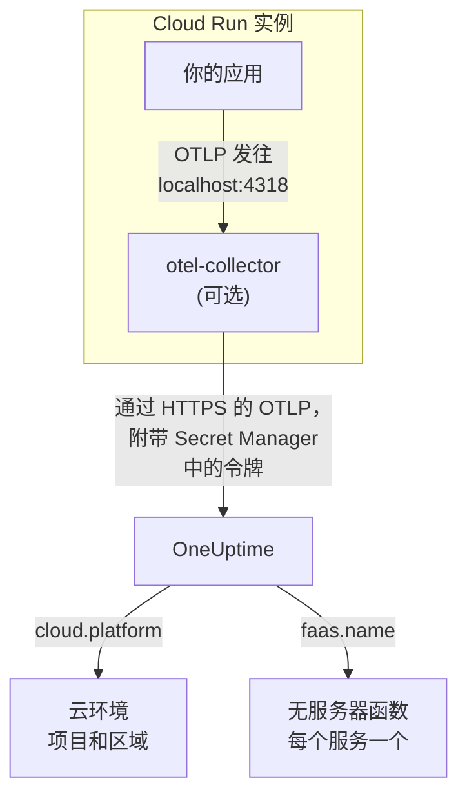

# Google Cloud Run

将 Cloud Run 服务和作业的追踪、日志和指标发送到 OneUptime。所有上报 `cloud.platform=gcp_cloud_run` 的数据都会进入按 Google Cloud 项目和区域划分的一个 **Cloud Environment**（例如 _GCP Cloud Run · us-central1 · my-project_），每个服务也会出现在 **无服务器函数** 下。

:::cards
- [工作原理](#工作原理): GCP 检测器设置了什么，以及为什么一个服务会出现在两个地方。
- [设置](#设置): 保存令牌，配置服务，部署并检查。
- [带 sidecar 的服务 YAML](#带-sidecar-的服务-yaml): 一个带 Collector 的完整 Cloud Run 服务。
- [故障排除](#故障排除): 机密错误、sidecar 启动顺序和缺失的环境。
:::

## 工作原理



OpenTelemetry GCP 资源检测器会读取元数据服务器以及环境变量 `K_SERVICE` 和 `K_REVISION`，并设置：

| 属性 | 在 Cloud Run 上的值 | 用途 |
| ------------------ | ------------------------------ | ----------------------------------------------------------------------------------------- |
| `cloud.platform` | `gcp_cloud_run` | 把遥测数据归档到 **云环境** 下 |
| `cloud.account.id` | 项目 ID | 环境密钥的一部分 |
| `cloud.region` | `us-central1` | 环境密钥的一部分 |
| `faas.name` | 服务名称（`K_SERVICE`） | 同时在 **无服务器函数** 下列出该服务 |
| `faas.version` | 修订版本（`K_REVISION`） | 显示在该服务的无服务器函数概览中；环境不使用它 |
| `faas.instance` | 实例 ID | 为一个运行中的实例命名：在 **实例** 下每个实例一行 |

> [!NOTE]
> Cloud Run 有意出现在两个地方。因为检测器设置了 `faas.name`，每个服务也是一个 **无服务器函数**，有自己的调用次数、错误率和持续时间。**Cloud Environment** 汇总了该项目和区域中的所有服务。数据不会存储两次：同一份遥测数据会同时归档到两处。

环境密钥是 `gcp_cloud_run|my-project|us-central1`。

## 开始之前

- **摄取密钥。** 在 **项目设置 → 遥测与 APM → 摄取密钥** 中创建一个 **服务器** 密钥并复制其令牌。
- **`gcloud`**：已登录到该项目，并已启用 Secret Manager API：`gcloud services enable secretmanager.googleapis.com`。
- **使用 OpenTelemetry SDK 插桩的应用**，能够导出 OTLP。

## 选择遥测数据离开服务的方式

| | SDK direct | Sidecar collector |
| --------------- | ---------------------------------------------------- | ---------------------------------------------------------------------- |
| 额外的容器 | 无 | 服务中的 `otel-collector` |
| 适用场景 | 单个服务，以及 Cloud Run 作业 | 一个项目中的多个服务，或无法运行检测器的 SDK |
| 保存令牌的一方 | 应用 | Collector |
| 机密 | `oneuptime-otlp-headers`，完整的标头 | `oneuptime-ingestion-token`，只有令牌 |

作业会一直运行到结束，没有什么需要让 sidecar 保持运行：请使用 SDK direct。下面每一步都为两者各提供一个选项卡；选择其一，所有步骤都会随之切换。

## 设置

:::steps
### 将令牌保存到 Secret Manager

> [!IMPORTANT]
> 令牌属于机密。请把它放进 Secret Manager，并在服务中以基于机密的环境变量引用它。普通环境变量对项目的每个查看者都可见，在控制台和 `gcloud run services describe` 中都能看到。

:::tabs
@tab SDK direct
```bash
printf '%s' "x-oneuptime-token=YOUR_TELEMETRY_INGESTION_TOKEN" | gcloud secrets create oneuptime-otlp-headers \
  --data-file=- \
  --replication-policy=automatic

gcloud secrets add-iam-policy-binding oneuptime-otlp-headers \
  --member="serviceAccount:checkout-api@my-project.iam.gserviceaccount.com" \
  --role="roles/secretmanager.secretAccessor"
```

Cloud Run 会把机密的值原样放入变量，而 `OTEL_EXPORTER_OTLP_HEADERS` 需要完整的 `name=value` 对，因此这个机密保存完整的标头。
@tab Sidecar collector
```bash
printf '%s' "YOUR_TELEMETRY_INGESTION_TOKEN" | gcloud secrets create oneuptime-ingestion-token \
  --data-file=- \
  --replication-policy=automatic

gcloud secrets add-iam-policy-binding oneuptime-ingestion-token \
  --member="serviceAccount:checkout-api@my-project.iam.gserviceaccount.com" \
  --role="roles/secretmanager.secretAccessor"
```

Collector 的配置会添加标头名称，因此这个机密只保存令牌。
:::

在 `--member` 中填写服务的运行时服务账号，而不是你自己的用户。如果没有 `roles/secretmanager.secretAccessor`，修订版本会部署失败并报 `Permission denied on secret`。如果服务仍以默认的 Compute 服务账号运行，请把该角色授予这个账号，并考虑为服务分配专用账号：默认账号由项目中的所有内容共享。

### 配置服务

:::tabs
@tab SDK direct
1. **Google Cloud console → Cloud Run → click the service → Edit & deploy new revision**。
2. 在 **Containers** 选项卡中打开你的容器，进入 **Variables & Secrets**。添加下面的变量。
3. 点击 **Reference a secret**，选择 `oneuptime-otlp-headers`、版本 `latest`，并将其作为环境变量 `OTEL_EXPORTER_OTLP_HEADERS` 公开。
4. 在 **Security** 选项卡中，确认 **Service account** 就是你授予了 `roles/secretmanager.secretAccessor` 的那个账号。

```bash
OTEL_SERVICE_NAME=checkout-api
OTEL_EXPORTER_OTLP_ENDPOINT=https://oneuptime.com/otlp
OTEL_EXPORTER_OTLP_PROTOCOL=http/protobuf
# Secret-backed (Variables & Secrets → Reference a secret), not typed here.
OTEL_EXPORTER_OTLP_HEADERS=x-oneuptime-token=YOUR_TELEMETRY_INGESTION_TOKEN
```

然后开启所用语言的 GCP 资源检测器：

| 语言 | 开启 GCP 检测器 |
| -------- | ------------------------------------------------------------------------------------------------------------------- |
| Node.js | `OTEL_NODE_RESOURCE_DETECTORS=env,host,os,gcp` (auto-instrumentations-node) |
| Python | `pip install opentelemetry-resourcedetector-gcp`，然后设置 `OTEL_EXPERIMENTAL_RESOURCE_DETECTORS=gcp_resource_detector` |
| Java | `-Dotel.resource.providers.gcp.enabled=true` |
| Go | `import "go.opentelemetry.io/contrib/detectors/gcp"`，并将 `gcp.NewDetector()` 传给 `resource.New` |
| .NET | `OpenTelemetry.Resources.Gcp` 包：`.ConfigureResource(r => r.AddGcpDetector())` |

或者全部通过 CLI 设置：

```bash
gcloud run services update checkout-api --region us-central1 \
  --set-env-vars "^@^OTEL_SERVICE_NAME=checkout-api@OTEL_EXPORTER_OTLP_ENDPOINT=https://oneuptime.com/otlp@OTEL_EXPORTER_OTLP_PROTOCOL=http/protobuf@OTEL_NODE_RESOURCE_DETECTORS=env,host,os,gcp" \
  --set-secrets "OTEL_EXPORTER_OTLP_HEADERS=oneuptime-otlp-headers:latest"
```

前缀 `^@^` 让 `gcloud` 用 `@` 而不是 `,` 拆分该标志的列表。没有它，`gcloud` 会在每个逗号处拆分 `OTEL_NODE_RESOURCE_DETECTORS=env,host,os,gcp`，并报 `Bad syntax for dict arg [host]` 失败。
@tab Sidecar collector
1. **Google Cloud console → Cloud Run → click the service → Edit & deploy new revision**。
2. 在 **Containers** 选项卡中打开你的容器，进入 **Variables & Secrets**。添加下面的应用变量。
3. 点击 **+ Add container**。将容器镜像 URL 设为 `otel/opentelemetry-collector-contrib:latest`，并在 **Container command and arguments** 下添加参数 `--config=env:OTEL_COLLECTOR_CONFIG`。
4. 在新容器的 **Variables & Secrets** 选项卡中，使用 **Reference a secret**，把 `oneuptime-ingestion-token` 作为环境变量 `ONEUPTIME_TOKEN` 公开。再添加变量 `OTEL_COLLECTOR_CONFIG`，其值为 [带 sidecar 的服务 YAML](#带-sidecar-的服务-yaml) 中的 Collector 配置。
5. 在 Collector 的 **Settings** 选项卡中添加一个 **Startup probe**（HTTP，路径 `/`，端口 `13133`），并在 **Container start-up order** 下让你的容器依赖 `otel-collector`。
6. 在 **Security** 选项卡中，确认 **Service account** 就是你授予了 `roles/secretmanager.secretAccessor` 的那个账号。

同一个 Cloud Run 实例中的容器共享 `localhost`，因此应用就在那里导出到 sidecar：

```bash
OTEL_SERVICE_NAME=checkout-api
OTEL_EXPORTER_OTLP_ENDPOINT=http://localhost:4318
OTEL_EXPORTER_OTLP_PROTOCOL=http/protobuf
```

通过 CLI 时，sidecar 就是下面的服务 YAML，用 `gcloud run services replace service.yaml --region us-central1` 部署。
:::

如果你自托管 OneUptime，请使用 `https://YOUR-ONEUPTIME-HOST/otlp` 作为端点。

### 部署新的修订版本

在控制台中点击 **Deploy**。Cloud Run 会用这些设置启动一个新的修订版本，并在其就绪后把流量切过去。`gcloud` 命令本身就会部署新的修订版本。

### 检查连接

```bash
curl -i https://oneuptime.com/otlp/v1/validate \
  -H "x-oneuptime-token: YOUR_TELEMETRY_INGESTION_TOKEN"
```

返回 `200` 且 `"valid": true` 表示令牌已被接受。`401` 表示令牌未知、已吊销、已停用或已过期。然后向服务发送一个请求，在 Cloud Logging 中查看 Collector 的日志（按 `otel-collector` 容器过滤），检查是否有 `401`、`connection refused` 或 `context deadline exceeded`。1 分钟内，环境就会以 _GCP Cloud Run · us-central1 · my-project_ 的名称出现在 **云 → All Environments** 中，服务则出现在 **无服务器函数** 下。
:::

## 带 sidecar 的服务 YAML

Collector 从 `OTEL_COLLECTOR_CONFIG`（`--config=env:OTEL_COLLECTOR_CONFIG`）读取全部配置，并通过 `${env:ONEUPTIME_TOKEN}` 从机密中读取令牌。`run.googleapis.com/container-dependencies` 注解让 Cloud Run 先启动 Collector，并等待它的启动探针通过后再启动应用：

```yaml title="service.yaml"
apiVersion: serving.knative.dev/v1
kind: Service
metadata:
  name: checkout-api
spec:
  template:
    metadata:
      annotations:
        # "app" depends on "otel-collector": the collector starts first and
        # must pass its startup probe before the app container is started.
        run.googleapis.com/container-dependencies: '{"app":["otel-collector"]}'
    spec:
      serviceAccountName: checkout-api@my-project.iam.gserviceaccount.com
      containers:
        - name: app
          image: us-central1-docker.pkg.dev/my-project/apps/checkout-api:1.4.2
          ports:
            - containerPort: 8080
          env:
            - name: OTEL_SERVICE_NAME
              value: checkout-api
            - name: OTEL_EXPORTER_OTLP_ENDPOINT
              value: http://localhost:4318
            - name: OTEL_EXPORTER_OTLP_PROTOCOL
              value: http/protobuf
        - name: otel-collector
          image: otel/opentelemetry-collector-contrib:latest
          args:
            - --config=env:OTEL_COLLECTOR_CONFIG
          env:
            - name: ONEUPTIME_TOKEN
              valueFrom:
                secretKeyRef:
                  name: oneuptime-ingestion-token
                  key: latest
            - name: OTEL_COLLECTOR_CONFIG
              value: |
                receivers:
                  otlp:
                    protocols:
                      http:
                        endpoint: 0.0.0.0:4318
                      grpc:
                        endpoint: 0.0.0.0:4317
                processors:
                  # Stamps cloud.provider, cloud.platform=gcp_cloud_run,
                  # cloud.account.id, cloud.region and faas.* on everything.
                  resourcedetection:
                    detectors: [env, gcp]
                    timeout: 5s
                  batch: {}
                exporters:
                  otlphttp/oneuptime:
                    endpoint: https://oneuptime.com/otlp
                    headers:
                      x-oneuptime-token: ${env:ONEUPTIME_TOKEN}
                extensions:
                  health_check:
                    endpoint: 0.0.0.0:13133
                service:
                  extensions: [health_check]
                  pipelines:
                    traces:
                      receivers: [otlp]
                      processors: [resourcedetection, batch]
                      exporters: [otlphttp/oneuptime]
                    metrics:
                      receivers: [otlp]
                      processors: [resourcedetection, batch]
                      exporters: [otlphttp/oneuptime]
                    logs:
                      receivers: [otlp]
                      processors: [resourcedetection, batch]
                      exporters: [otlphttp/oneuptime]
          startupProbe:
            httpGet:
              path: /
              port: 13133
            periodSeconds: 2
            failureThreshold: 15
          resources:
            limits:
              cpu: 500m
              memory: 256Mi
```

部署它：

```bash
gcloud run services replace service.yaml --region us-central1
```

只有接收请求的容器（`app`）才声明 `ports`；sidecar 不能声明。

## 网络

- **默认情况下**，Cloud Run 服务可以直接访问互联网，导出到 `oneuptime.com` 无需其他设置。
- **使用 VPC egress: All traffic 时**（`--vpc-egress all-traffic`，通过 Direct VPC egress 或 Serverless VPC Access 连接器），出站流量会经过你的 VPC，这时 VPC 需要 Cloud NAT（或通往代理的路由）才能访问 OneUptime 主机。使用默认的 `private-ranges-only` 时，只有私有地址经过 VPC，OneUptime 可被直接访问。
- VPC 中的 **出站防火墙规则** 必须允许通过 TCP 443 访问 OneUptime 主机。
- **VPC 内的自托管 OneUptime** 是相反的情况：让流量经过 VPC（`private-ranges-only` 或 `all-traffic`），以便在那里解析 `https://YOUR-ONEUPTIME-HOST/otlp`。

## 你能看到什么

- **概览**：根据追踪计算的请求、错误率和 p95 延迟。
- **实例**：每个 Cloud Run 实例一行，以 `faas.instance` 命名。Cloud Run 不会向 sidecar 公开容器的资源使用情况，因此除非你自己发送带有相同 `faas.instance` 的 `container.cpu.utilization` 和 `container.memory.usage` 指标，否则 **CPU** 和 **内存** 磁贴会保持为空。请在这里查看请求磁贴，实例的 CPU 和内存交给 Cloud Monitoring。
- 按环境过滤的 **日志**、**追踪** 和 **指标**。
- 同一个服务也会出现在 **无服务器函数**（按 `faas.name`）和 **服务**（按 `service.name`）下。

## 故障排除

:::details 修订版本失败，提示 "Permission denied on secret"
运行时服务账号对该机密缺少 `roles/secretmanager.secretAccessor`，或者绑定加在了与服务引用的机密不同的另一个机密上。以运行时服务账号作为 `--member`，重新运行 `gcloud secrets add-iam-policy-binding` 命令。
:::

:::details Cloud Run 拒绝 container-dependencies
注解中指定的容器不存在，或者 Collector 没有启动探针，导致 Cloud Run 无法判断它何时就绪。
:::

:::details 服务出现在无服务器函数下，但没有环境
遥测数据中没有 `cloud.platform`：SDK 中没有开启 GCP 检测器，或者 Collector 的 `detectors` 列表中缺少 `gcp`。
:::

:::details 环境存在，但实例为空
遥测数据中既没有 `faas.instance` 也没有 `service.instance.id`。原因相同：检测器没有运行。
:::

环境始终不出现、显示 **已断开** 或被拆成两个，这些情况见 [云故障排除](/docs/telemetry/cloud-troubleshooting)。

## 后续步骤

:::cards
- [云环境](/docs/telemetry/cloud-environments): 环境和实例是如何识别的。
- [无服务器函数](/docs/telemetry/serverless-functions): 每个 Cloud Run 服务的按服务视图。
- [云故障排除](/docs/telemetry/cloud-troubleshooting): 所有平台共有的故障。
- [云资源(IaaS 与 PaaS)](/docs/telemetry/cloud-resources): 来自 Cloud Monitoring 的 Cloud SQL、负载均衡器和存储桶。
:::
